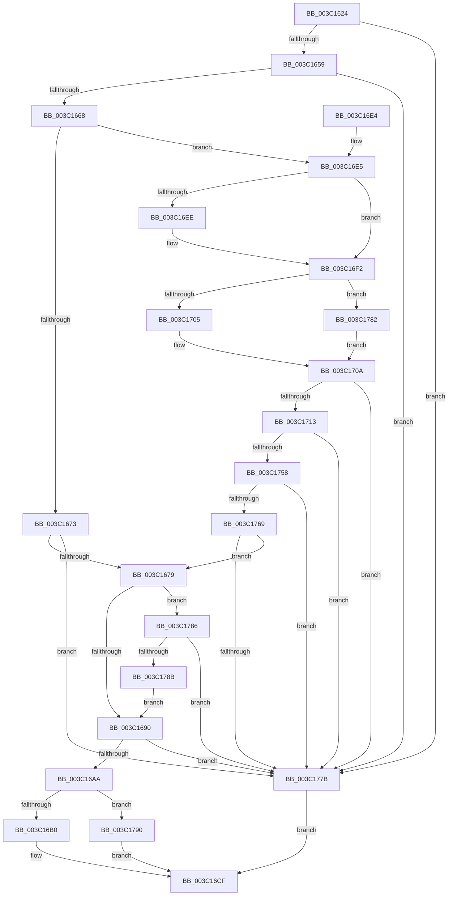

# KiEvaluatePreemptionSwapTarget

- RVA: `0x003C1624`–`0x003C1797` (길이 `371` bytes)
- VA: `0x00000001403C1624`
- 실행 섹션: `.text`
- PDB 이름 있음: `예`; PDB Function 태그: `아니요`
- unwind 정보 RVA: `0x0008E108`
- 디코드: `99`개 명령, `371/371` bytes 표시
- 미해석 바이트: `0` (있으면 어셈블리에 `.byte`로 보존)

> 이 문서는 커널 이미지의 기계어와 PDB 기호를 분석해 생성했습니다. 4번과 5번은 함수 원형과 자료형을 바이너리 사용 방식에서 추정한 C 해석이며 원본 소스 복구 결과는 아닙니다.

## 1. Dependencies

- 직접 호출 지점: **3**; 고유 호출 대상: **3**
- 직접 호출자로 확인된 함수: **1**
- RIP 상대 이미지 참조: **0**

### Outgoing calls
- `0x003C169B` → [KiHeteroComputeThreadImportance](KiHeteroComputeThreadImportance_function_003C17A0.md) (function, `0x003C17A0`)
- `0x003C16C5` → [KiHeteroIsSwapBeneficialForPerformance](KiHeteroIsSwapBeneficialForPerformance_function_003C180C.md) (function, `0x003C180C`)
- `0x003C1745` → [KiGenerateHeteroSets](../39/KiGenerateHeteroSets_function_0039ED50.md) (function, `0x0039ED50`)

### Direct callers
- [KiHeteroAttemptPreemptionSwapOnSubNode](KiHeteroAttemptPreemptionSwapOnSubNode_function_003C1144.md) at `0x003C12F6`

### Static image references
- 디코드된 RIP-relative 메모리 참조가 없습니다.

## 2. Other-region calls and transfers

- 다른 실행 섹션으로 향하는 call: **0**
- 별도 외부 분기/꼬리 이동을 확인하지 못했습니다.

## 3. Assembly (complete function range)

```asm
003C1624  4C 8B DC                        mov r11, rsp
003C1627  49 89 5B 08                     mov qword ptr [r11 + 8], rbx
003C162B  49 89 6B 10                     mov qword ptr [r11 + 0x10], rbp
003C162F  49 89 73 18                     mov qword ptr [r11 + 0x18], rsi
003C1633  57                              push rdi
003C1634  48 83 EC 50                     sub rsp, 0x50
003C1638  33 C0                           xor eax, eax
003C163A  0F 57 C0                        xorps xmm0, xmm0
003C163D  F6 41 23 10                     test byte ptr [rcx + 0x23], 0x10
003C1641  49 8B F8                        mov rdi, r8
003C1644  0F 11 44 24 30                  movups xmmword ptr [rsp + 0x30], xmm0
003C1649  49 89 43 E8                     mov qword ptr [r11 - 0x18], rax
003C164D  48 8B EA                        mov rbp, rdx
003C1650  48 8B D9                        mov rbx, rcx
003C1653  0F 85 22 01 00 00               jne 0x1403c177b
003C1659  48 8B 71 38                     mov rsi, qword ptr [rcx + 0x38]
003C165D  0F B6 06                        movzx eax, byte ptr [rsi]
003C1660  84 C0                           test al, al
003C1662  0F 88 13 01 00 00               js 0x1403c177b
003C1668  41 0F BE 08                     movsx ecx, byte ptr [r8]
003C166C  83 E0 7F                        and eax, 0x7f
003C166F  3B C1                           cmp eax, ecx
003C1671  74 72                           je 0x1403c16e5
003C1673  0F 8F 02 01 00 00               jg 0x1403c177b
003C1679  44 0F B6 56 40                  movzx r10d, byte ptr [rsi + 0x40]
003C167E  41 8B CA                        mov ecx, r10d
003C1681  83 E1 07                        and ecx, 7
003C1684  8D 41 FB                        lea eax, [rcx - 5]
003C1687  83 F8 01                        cmp eax, 1
003C168A  0F 87 F6 00 00 00               ja 0x1403c1786
003C1690  8A 16                           mov dl, byte ptr [rsi]
003C1692  41 8B CA                        mov ecx, r10d
003C1695  80 E2 7F                        and dl, 0x7f
003C1698  83 E1 07                        and ecx, 7
003C169B  E8 00 01 00 00                  call 0x1403c17a0
003C16A0  66 3B 47 12                     cmp ax, word ptr [rdi + 0x12]
003C16A4  0F 87 D1 00 00 00               ja 0x1403c177b
003C16AA  0F 82 E0 00 00 00               jb 0x1403c1790
003C16B0  44 8A 4F 10                     mov r9b, byte ptr [rdi + 0x10]
003C16B4  4C 8B C5                        mov r8, rbp
003C16B7  41 C0 EA 03                     shr r10b, 3
003C16BB  48 8B CB                        mov rcx, rbx
003C16BE  41 80 E2 07                     and r10b, 7
003C16C2  41 8A D2                        mov dl, r10b
003C16C5  E8 42 01 00 00                  call 0x1403c180c
003C16CA  85 C0                           test eax, eax
003C16CC  0F 95 C0                        setne al
003C16CF  48 8B 5C 24 60                  mov rbx, qword ptr [rsp + 0x60]
003C16D4  48 8B 6C 24 68                  mov rbp, qword ptr [rsp + 0x68]
003C16D9  48 8B 74 24 70                  mov rsi, qword ptr [rsp + 0x70]
003C16DE  48 83 C4 50                     add rsp, 0x50
003C16E2  5F                              pop rdi
003C16E3  C3                              ret
003C16E4  CC                              int3
003C16E5  48 8B 43 10                     mov rax, qword ptr [rbx + 0x10]
003C16E9  48 85 C0                        test rax, rax
003C16EC  75 04                           jne 0x1403c16f2
003C16EE  48 8B 43 08                     mov rax, qword ptr [rbx + 8]
003C16F2  0F B6 8A D0 00 00 00            movzx ecx, byte ptr [rdx + 0xd0]
003C16F9  48 8B 90 40 02 00 00            mov rdx, qword ptr [rax + 0x240]
003C1700  66 3B 0A                        cmp cx, word ptr [rdx]
003C1703  73 7D                           jae 0x1403c1782
003C1705  48 8B 54 CA 08                  mov rdx, qword ptr [rdx + rcx*8 + 8]
003C170A  48 85 95 C8 00 00 00            test qword ptr [rbp + 0xc8], rdx
003C1711  74 68                           je 0x1403c177b
003C1713  44 0F B6 46 40                  movzx r8d, byte ptr [rsi + 0x40]
003C1718  48 8D 4C 24 30                  lea rcx, [rsp + 0x30]
003C171D  41 8B C0                        mov eax, r8d
003C1720  48 89 4C 24 28                  mov qword ptr [rsp + 0x28], rcx
003C1725  48 8B 8D C0 00 00 00            mov rcx, qword ptr [rbp + 0xc0]
003C172C  45 8B C8                        mov r9d, r8d
003C172F  C1 E8 06                        shr eax, 6
003C1732  41 83 E1 07                     and r9d, 7
003C1736  41 C0 E8 03                     shr r8b, 3
003C173A  83 E0 01                        and eax, 1
003C173D  41 80 E0 07                     and r8b, 7
003C1741  89 44 24 20                     mov dword ptr [rsp + 0x20], eax
003C1745  E8 06 D6 FD FF                  call 0x14039ed50
003C174A  48 8B 85 C8 00 00 00            mov rax, qword ptr [rbp + 0xc8]
003C1751  48 85 44 24 40                  test qword ptr [rsp + 0x40], rax
003C1756  74 23                           je 0x1403c177b
003C1758  8A 0F                           mov cl, byte ptr [rdi]
003C175A  BA 01 00 00 00                  mov edx, 1
003C175F  D3 E2                           shl edx, cl
003C1761  85 93 D8 83 00 00               test dword ptr [rbx + 0x83d8], edx
003C1767  75 12                           jne 0x1403c177b
003C1769  48 8B 83 48 8E 00 00            mov rax, qword ptr [rbx + 0x8e48]
003C1770  8B 40 08                        mov eax, dword ptr [rax + 8]
003C1773  85 D0                           test eax, edx
003C1775  0F 84 FE FE FF FF               je 0x1403c1679
003C177B  32 C0                           xor al, al
003C177D  E9 4D FF FF FF                  jmp 0x1403c16cf
003C1782  33 D2                           xor edx, edx
003C1784  EB 84                           jmp 0x1403c170a
003C1786  83 F9 02                        cmp ecx, 2
003C1789  77 F0                           ja 0x1403c177b
003C178B  E9 00 FF FF FF                  jmp 0x1403c1690
003C1790  B0 01                           mov al, 1
003C1792  E9 38 FF FF FF                  jmp 0x1403c16cf
```

## 4. C-style interpretation (structured pseudocode)

```c
__int64 __fastcall KiEvaluatePreemptionSwapTarget(__int64 a1, __int64 a2, __int64 a3)
{
    __int64 result;
    __int64 v_r10;
    __int64 v_rsp;
    unsigned __int64 v_stack_m28;
    unsigned __int64 v_stack_p10;
    unsigned __int64 v_stack_p18;
    unsigned int v_stack_p20;
    unsigned __int64 v_stack_p28;
    unsigned __int64 v_stack_p30;
    unsigned __int64 v_stack_p40;
    unsigned __int64 v_stack_p8;

    *(unsigned __int64 *)(v_rsp + 8) = v_rbx;
    *(unsigned __int64 *)(v_rsp + 16) = v_rbp;
    *(unsigned __int64 *)(v_rsp + 24) = v_rsi;
    v_rsp = (v_rsp) - (80);
    result = 0;
    v_stack_m28 = v_xmm0;
    *(unsigned __int64 *)(v_rsp - 24) = 0;
    if (((*(unsigned __int8 *)(a1 + 35)) & (16)) != 0) goto loc_003C177B;
    if (sign_flag) goto loc_003C177B;
    result = (unsigned int)((*(unsigned __int8 *)(*(unsigned __int64 *)(a1 + 56))) & (127));
    if (((unsigned int)(result)) == ((unsigned int)((__int8)(*(unsigned __int8 *)(a3))))) goto loc_003C16E5;
    if (((unsigned int)(result)) > ((unsigned int)((__int8)(*(unsigned __int8 *)(a3))))) goto loc_003C177B;
loc_003C1679:
    a1 = (unsigned int)(((unsigned int)((unsigned int)(*(unsigned __int8 *)(*(unsigned __int64 *)(a1 + 56) + 64)))) & (7));
    if (((unsigned int)(a1 - 5)) > 1) goto loc_003C1786;
loc_003C1690:
    a2 = (unsigned __int8)((*(unsigned __int8 *)(*(unsigned __int64 *)(a1 + 56))) & (127));
    a1 = (unsigned int)(((unsigned int)((unsigned int)(*(unsigned __int8 *)(*(unsigned __int64 *)(a1 + 56) + 64)))) & (7));
    result = KiHeteroComputeThreadImportance(a1, a2, a3, a4);
    if (((unsigned __int16)(result)) > (*(unsigned __int16 *)(a3 + 18))) goto loc_003C177B;
    if (((unsigned __int16)(result)) < (*(unsigned __int16 *)(a3 + 18))) goto loc_003C1790;
    v_r10 = (unsigned __int8)((*(unsigned __int8 *)(*(unsigned __int64 *)(a1 + 56) + 64)) >> (3));
    v_r10 = (unsigned __int8)((v_r10) & (7));
    result = KiHeteroIsSwapBeneficialForPerformance(a1, (unsigned __int8)(v_r10), a2, *(unsigned __int8 *)(a3 + 16));
    result = ((unsigned int)(result) != 0) ? 1 : 0;
loc_003C16CF:
    v_rsp = (v_rsp) + (80);
    return result;
loc_003C16E5:
    result = *(unsigned __int64 *)(v_stack_p8 + 16);
    if (*(unsigned __int64 *)(v_stack_p8 + 16) == 0) {
        result = *(unsigned __int64 *)(v_stack_p8 + 8);
    }
    if (((unsigned __int16)(*(unsigned __int8 *)((unsigned __int8)(v_r10) + 208))) >= (*(unsigned __int16 *)(*(unsigned __int64 *)(result + 576)))) goto loc_003C1782;
loc_003C170A:
    if (((*(unsigned __int64 *)(v_stack_p10 + 200)) & (*(unsigned __int64 *)(*(unsigned __int64 *)(result + 576) + *(unsigned __int8 *)((unsigned __int8)(v_r10) + 208) * 8 + 8))) == 0) goto loc_003C177B;
    v_stack_p28 = v_stack_p30;
    result = (unsigned int)(((unsigned int)((unsigned int)(*(unsigned __int8 *)(v_stack_p18 + 64)))) >> (6));
    a4 = (unsigned int)(((unsigned int)((unsigned int)(*(unsigned __int8 *)(v_stack_p18 + 64)))) & (7));
    a3 = (unsigned __int8)((*(unsigned __int8 *)(v_stack_p18 + 64)) >> (3));
    result = (unsigned int)((result) & (1));
    a3 = (unsigned __int8)((a3) & (7));
    v_stack_p20 = (unsigned int)(result);
    result = KiGenerateHeteroSets(*(unsigned __int64 *)(v_stack_p10 + 192), *(unsigned __int64 *)(*(unsigned __int64 *)(result + 576) + *(unsigned __int8 *)((unsigned __int8)(v_r10) + 208) * 8 + 8), a3, a4);
    if (((v_stack_p40) & (*(unsigned __int64 *)(v_stack_p10 + 200))) == 0) goto loc_003C177B;
    a2 = (unsigned int)((1) << ((unsigned __int8)(*(unsigned __int8 *)(a3))));
    if (((*(unsigned int *)(v_stack_p8 + 33752)) & ((unsigned int)(a2))) != 0) goto loc_003C177B;
    if ((((unsigned int)((unsigned int)(*(unsigned int *)(*(unsigned __int64 *)(v_stack_p8 + 36424) + 8)))) & ((unsigned int)(a2))) == 0) goto loc_003C1679;
loc_003C177B:
    result = 0;
    goto loc_003C16CF;
loc_003C1782:
    a2 = 0;
    goto loc_003C170A;
loc_003C1786:
    if (((unsigned int)(*(unsigned __int8 *)(a3))) > 2) goto loc_003C177B;
    goto loc_003C1690;
loc_003C1790:
    goto loc_003C16CF;
}
```

## 5. (Beta) C Style

```c
int64_t KiEvaluatePreemptionSwapTarget(void *Arg1, void *Arg2, void *Arg3)
{
    uint8_t *arg1 = (uint8_t *)Arg1;
    uint8_t *arg2 = (uint8_t *)Arg2;
    uint8_t *arg3 = (uint8_t *)Arg3;

    int64_t result;
    int64_t local_r10;
    int64_t local_rsp;
    uint64_t v_stack_m28;
    uint64_t v_stack_p10;
    uint64_t v_stack_p18;
    uint32_t v_stack_p20;
    uint64_t v_stack_p28;
    uint64_t v_stack_p30;
    uint64_t v_stack_p40;
    uint64_t v_stack_p8;

    *(uint64_t *)(local_rsp + 0x8) = local_rbx;
    *(uint64_t *)(local_rsp + 0x10) = local_rbp;
    *(uint64_t *)(local_rsp + 0x18) = local_rsi;
    local_rsp = (local_rsp) - (80);
    result = 0;
    v_stack_m28 = v_xmm0;
    *(uint64_t *)(local_rsp - 0x18) = 0;
    if (((*(uint8_t *)(arg1 + 0x23)) & (16)) != 0) goto loc_003C177B;
    if (sign_flag) goto loc_003C177B;
    result = (uint32_t)((*(uint8_t *)(*(uint64_t *)(arg1 + 0x38))) & (127));
    if (((uint32_t)(result)) == ((uint32_t)((int8_t)(*(uint8_t *)(arg3))))) goto loc_003C16E5;
    if (((uint32_t)(result)) > ((uint32_t)((int8_t)(*(uint8_t *)(arg3))))) goto loc_003C177B;
loc_003C1679:
    Arg1 = (uint32_t)(((uint32_t)((uint32_t)(*(uint8_t *)(*(uint64_t *)(arg1 + 0x38) + 0x40)))) & (7));
    if (((uint32_t)(Arg1 - 5)) > 1) goto loc_003C1786;
loc_003C1690:
    Arg2 = (uint8_t)((*(uint8_t *)(*(uint64_t *)(arg1 + 0x38))) & (127));
    Arg1 = (uint32_t)(((uint32_t)((uint32_t)(*(uint8_t *)(*(uint64_t *)(arg1 + 0x38) + 0x40)))) & (7));
    result = KiHeteroComputeThreadImportance(Arg1, Arg2, Arg3, a4);
    if (((uint16_t)(result)) > (*(uint16_t *)(arg3 + 0x12))) goto loc_003C177B;
    if (((uint16_t)(result)) < (*(uint16_t *)(arg3 + 0x12))) goto loc_003C1790;
    local_r10 = (uint8_t)((*(uint8_t *)(*(uint64_t *)(arg1 + 0x38) + 0x40)) >> (3));
    local_r10 = (uint8_t)((local_r10) & (7));
    result = KiHeteroIsSwapBeneficialForPerformance(Arg1, (uint8_t)(local_r10), Arg2, *(uint8_t *)(arg3 + 0x10));
    result = ((uint32_t)(result) != 0) ? 1 : 0;
loc_003C16CF:
    local_rsp = (local_rsp) + (80);
    return result;
loc_003C16E5:
    result = *(uint64_t *)(v_stack_p8 + 0x10);
    if (*(uint64_t *)(v_stack_p8 + 0x10) == 0) {
        result = *(uint64_t *)(v_stack_p8 + 0x8);
    }
    if (((uint16_t)(*(uint8_t *)((uint8_t)(local_r10) + 0xD0))) >= (*(uint16_t *)(*(uint64_t *)(result + 0x240)))) goto loc_003C1782;
loc_003C170A:
    if (((*(uint64_t *)(v_stack_p10 + 0xC8)) & (*(uint64_t *)(*(uint64_t *)(result + 0x240) + *(uint8_t *)((uint8_t)(local_r10) + 0xD0) * 8 + 0x8))) == 0) goto loc_003C177B;
    v_stack_p28 = v_stack_p30;
    result = (uint32_t)(((uint32_t)((uint32_t)(*(uint8_t *)(v_stack_p18 + 0x40)))) >> (6));
    a4 = (uint32_t)(((uint32_t)((uint32_t)(*(uint8_t *)(v_stack_p18 + 0x40)))) & (7));
    Arg3 = (uint8_t)((*(uint8_t *)(v_stack_p18 + 0x40)) >> (3));
    result = (uint32_t)((result) & (1));
    Arg3 = (uint8_t)((Arg3) & (7));
    v_stack_p20 = (uint32_t)(result);
    result = KiGenerateHeteroSets(*(uint64_t *)(v_stack_p10 + 0xC0), *(uint64_t *)(*(uint64_t *)(result + 0x240) + *(uint8_t *)((uint8_t)(local_r10) + 0xD0) * 8 + 0x8), Arg3, a4);
    if (((v_stack_p40) & (*(uint64_t *)(v_stack_p10 + 0xC8))) == 0) goto loc_003C177B;
    Arg2 = (uint32_t)((1) << ((uint8_t)(*(uint8_t *)(arg3))));
    if (((*(uint32_t *)(v_stack_p8 + 0x83D8)) & ((uint32_t)(Arg2))) != 0) goto loc_003C177B;
    if ((((uint32_t)((uint32_t)(*(uint32_t *)(*(uint64_t *)(v_stack_p8 + 0x8E48) + 0x8)))) & ((uint32_t)(Arg2))) == 0) goto loc_003C1679;
loc_003C177B:
    result = 0;
    goto loc_003C16CF;
loc_003C1782:
    Arg2 = 0;
    goto loc_003C170A;
loc_003C1786:
    if (((uint32_t)(*(uint8_t *)(arg3))) > 2) goto loc_003C177B;
    goto loc_003C1690;
loc_003C1790:
    goto loc_003C16CF;
}
```

### 관측된 메모리 오프셋

구조체 형식이 확인되지 않은 접근은 인자 기준의 오프셋으로만 기록했습니다.

| 기준 인자 | 오프셋 표현 | 폭 (bit) | 접근 |
|---|---:|---:|---|
| `Arg1` | `+ 0x8` | `64` | `R` |
| `Arg1` | `+ 0x10` | `64` | `R` |
| `Arg1` | `+ 0x23` | `8` | `R` |
| `Arg1` | `+ 0x38` | `64` | `R` |
| `Arg1` | `+ 0x83D8` | `32` | `R` |
| `Arg1` | `+ 0x8E48` | `64` | `R` |
| `Arg2` | `+ 0xC0` | `64` | `R` |
| `Arg2` | `+ 0xC8` | `64` | `R` |
| `Arg2` | `+ 0xD0` | `8` | `R` |
| `Arg3` | `+ 0x0` | `8` | `R` |
| `Arg3` | `+ 0x10` | `8` | `R` |
| `Arg3` | `+ 0x12` | `16` | `R` |

## 6. Execution-region graph

[열기: 2D/3D 그래프와 함수 탐색 컨트롤 패널](../../../control-panel.html?section=text&rva=0x003C1624&view=graph)

- 2D 그래프는 위에서 아래로 흐르고, 3D 그래프는 빈 공간을 드래그해 회전합니다. Shift+드래그는 이동, 휠은 확대·축소, 함수 노드 선택은 대상 보고서 이동입니다.

### Static fallback


