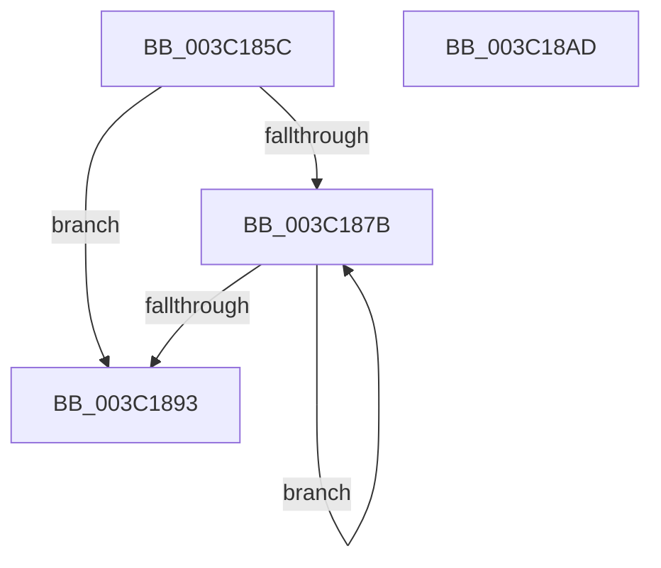

# KiFindBiasedProcessorIndex

- RVA: `0x003C185C`–`0x003C18AE` (길이 `82` bytes)
- VA: `0x00000001403C185C`
- 실행 섹션: `.text`
- PDB 이름 있음: `예`; PDB Function 태그: `아니요`
- unwind 정보 RVA: `0x0008E134`
- 디코드: `26`개 명령, `82/82` bytes 표시
- 미해석 바이트: `0` (있으면 어셈블리에 `.byte`로 보존)

> 이 문서는 커널 이미지의 기계어와 PDB 기호를 분석해 생성했습니다. 4번과 5번은 함수 원형과 자료형을 바이너리 사용 방식에서 추정한 C 해석이며 원본 소스 복구 결과는 아닙니다.

## 1. Dependencies

- 직접 호출 지점: **0**; 고유 호출 대상: **0**
- 직접 호출자로 확인된 함수: **5**
- RIP 상대 이미지 참조: **1**

### Outgoing calls
- 직접 디코드된 call 명령이 없습니다.

### Direct callers
- [KiHeteroSelectIdleProcessorFromSubNode](../25/KiHeteroSelectIdleProcessorFromSubNode_function_00255504.md) at `0x00255698`
- [KiHeteroSelectIdleProcessorFromSubNode](../25/KiHeteroSelectIdleProcessorFromSubNode_function_00255504.md) at `0x002556B4`
- [KiCheckPreferredHeteroProcessor](../39/KiCheckPreferredHeteroProcessor_function_0039D72C.md) at `0x0039DA91`
- [KiSelectIdealProcessorSetForGroup](KiSelectIdealProcessorSetForGroup_function_003C0E68.md) at `0x003C10BE`
- [KiSelectIdealProcessorSetForGroup](KiSelectIdealProcessorSetForGroup_function_003C0E68.md) at `0x003C1126`
- [KiHeteroAttemptPreemptionSwapOnSubNode](KiHeteroAttemptPreemptionSwapOnSubNode_function_003C1144.md) at `0x003C120B`
- [KiHeteroScanQueueForPreemptionSwapTarget](KiHeteroScanQueueForPreemptionSwapTarget_function_003C133C.md) at `0x003C15D1`

### Static image references
- `0x003C1893` → RVA `0x00F231B8` (`.data`; read)

## 2. Other-region calls and transfers

- 다른 실행 섹션으로 향하는 call: **0**
- 별도 외부 분기/꼬리 이동을 확인하지 못했습니다.

## 3. Assembly (complete function range)

```asm
003C185C  48 89 5C 24 10                  mov qword ptr [rsp + 0x10], rbx
003C1861  48 8B C2                        mov rax, rdx
003C1864  33 DB                           xor ebx, ebx
003C1866  F3 4D 0F B8 C8                  popcnt r9, r8
003C186B  33 D2                           xor edx, edx
003C186D  45 8B C9                        mov r9d, r9d
003C1870  49 F7 F1                        div r9
003C1873  44 8B D9                        mov r11d, ecx
003C1876  83 C2 01                        add edx, 1
003C1879  74 18                           je 0x1403c1893
003C187B  83 64 24 08 00                  and dword ptr [rsp + 8], 0
003C1880  FF C3                           inc ebx
003C1882  49 0F BC C0                     bsf rax, r8
003C1886  03 D8                           add ebx, eax
003C1888  8D 48 01                        lea ecx, [rax + 1]
003C188B  49 D3 E8                        shr r8, cl
003C188E  83 C2 FF                        add edx, -1
003C1891  75 E8                           jne 0x1403c187b
003C1893  48 8B 05 1E 19 B6 00            mov rax, qword ptr [rip + 0xb6191e]
003C189A  41 C1 E3 06                     shl r11d, 6
003C189E  41 8D 4B FF                     lea ecx, [r11 - 1]
003C18A2  03 CB                           add ecx, ebx
003C18A4  48 8B 5C 24 10                  mov rbx, qword ptr [rsp + 0x10]
003C18A9  8B 04 88                        mov eax, dword ptr [rax + rcx*4]
003C18AC  C3                              ret
003C18AD  CC                              int3
```

## 4. C-style interpretation (structured pseudocode)

```c
__int64 __fastcall KiFindBiasedProcessorIndex(int a1, __int64 a2, __int64 a3)
{
    __int64 v_r11;
    __int64 v_rbx;
    unsigned __int64 v_stack_p10;
    unsigned int v_stack_p8;

    v_stack_p10 = v_rbx;
    v_rbx = 0;
    a2 = 0;
    a2 = (unsigned int)((a2) + (1));
    if (condition_is_equal) goto loc_003C1893;
loc_003C187B:
    v_rbx = (unsigned int)((v_rbx) + 1);
    v_rbx = (unsigned int)((v_rbx) + ((unsigned int)(a2)));
    a3 = (a3) >> ((unsigned __int8)(a2 + 1));
    a2 = (unsigned int)((a2) + (-1));
    if (condition_is_not_equal) goto loc_003C187B;
loc_003C1893:
    v_r11 = (unsigned int)(((unsigned int)(a1)) << (6));
    a1 = (unsigned int)((v_r11 - 1) + ((unsigned int)(v_rbx)));
    return (unsigned int)(*(unsigned int *)(*(unsigned __int64 *)(v_rip + 11933982) + a1 * 4));
}
```

## 5. (Beta) C Style

```c
int64_t KiFindBiasedProcessorIndex(int32_t Arg1, int64_t Arg2, int64_t Arg3)
{
    int64_t local_r11;
    int64_t local_rbx;
    uint64_t v_stack_p10;
    uint32_t v_stack_p8;

    v_stack_p10 = local_rbx;
    local_rbx = 0;
    Arg2 = 0;
    Arg2 = (uint32_t)((Arg2) + (1));
    if (condition_is_equal) goto loc_003C1893;
loc_003C187B:
    local_rbx = (uint32_t)((local_rbx) + 1);
    local_rbx = (uint32_t)((local_rbx) + ((uint32_t)(Arg2)));
    Arg3 = (Arg3) >> ((uint8_t)(Arg2 + 1));
    Arg2 = (uint32_t)((Arg2) + (-1));
    if (condition_is_not_equal) goto loc_003C187B;
loc_003C1893:
    local_r11 = (uint32_t)(((uint32_t)(Arg1)) << (6));
    Arg1 = (uint32_t)((local_r11 - 1) + ((uint32_t)(local_rbx)));
    return (uint32_t)(*(uint32_t *)(*(uint64_t *)(v_rip + 0xB6191E) + Arg1 * 4));
}
```

## 6. Execution-region graph

[열기: 2D/3D 그래프와 함수 탐색 컨트롤 패널](../../../control-panel.html?section=text&rva=0x003C185C&view=graph)

- 2D 그래프는 위에서 아래로 흐르고, 3D 그래프는 빈 공간을 드래그해 회전합니다. Shift+드래그는 이동, 휠은 확대·축소, 함수 노드 선택은 대상 보고서 이동입니다.

### Static fallback


