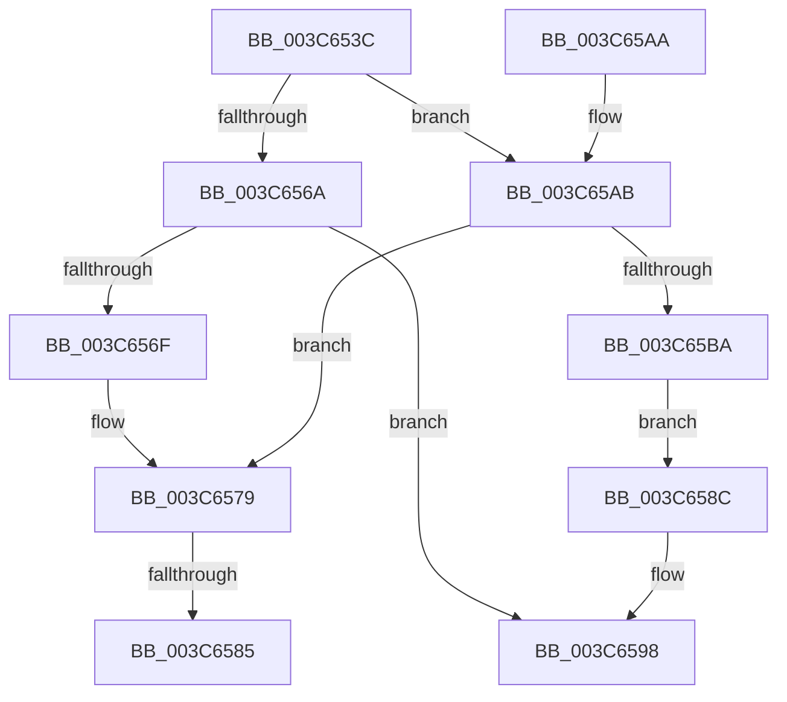

# KiFlushQueueApc

- RVA: `0x003C653C`–`0x003C65BC` (길이 `128` bytes)
- VA: `0x00000001403C653C`
- 실행 섹션: `.text`
- PDB 이름 있음: `예`; PDB Function 태그: `예`
- unwind 정보 RVA: `0x0008E51C`
- 디코드: `36`개 명령, `128/128` bytes 표시
- 미해석 바이트: `0` (있으면 어셈블리에 `.byte`로 보존)

> 이 문서는 커널 이미지의 기계어와 PDB 기호를 분석해 생성했습니다. 4번과 5번은 함수 원형과 자료형을 바이너리 사용 방식에서 추정한 C 해석이며 원본 소스 복구 결과는 아닙니다.

## 1. Dependencies

- 직접 호출 지점: **3**; 고유 호출 대상: **2**
- 직접 호출자로 확인된 함수: **1**
- RIP 상대 이미지 참조: **0**

### Outgoing calls
- `0x003C6574` → [KiAcquireThreadLockRaiseToDpc](../39/KiAcquireThreadLockRaiseToDpc_function_00396280.md) (function, `0x00396280`)
- `0x003C6593` → [KiReleaseThreadLockLowerIrql](KiReleaseThreadLockLowerIrql_function_003C65D0.md) (function, `0x003C65D0`)
- `0x003C65B0` → [KiAcquireThreadLockRaiseToDpc](../39/KiAcquireThreadLockRaiseToDpc_function_00396280.md) (function, `0x00396280`)

### Direct callers
- [KeRundownApcQueues](../../page/90/KeRundownApcQueues_function_00905C44.md) at `0x00905C7D`
- [KeRundownApcQueues](../../page/90/KeRundownApcQueues_function_00905C44.md) at `0x00905C8F`

### Static image references
- 디코드된 RIP-relative 메모리 참조가 없습니다.

## 2. Other-region calls and transfers

- 다른 실행 섹션으로 향하는 call: **0**
- call이 아닌 외부 분기/꼬리 이동: **2**
  - `0x003C657F` → [sub_006E8202](../6E/Unknown_function_006E8202.md) (`tail-transfer`)
  - `0x003C6587` → [sub_006E8202 + 0x2C](../6E/Unknown_function_006E8202.md) (`tail-transfer`)

## 3. Assembly (complete function range)

```asm
003C653C  48 89 5C 24 08                  mov qword ptr [rsp + 8], rbx
003C6541  48 89 74 24 18                  mov qword ptr [rsp + 0x18], rsi
003C6546  57                              push rdi
003C6547  48 83 EC 20                     sub rsp, 0x20
003C654B  48 0F BE C2                     movsx rax, dl
003C654F  48 8D 99 98 00 00 00            lea rbx, [rcx + 0x98]
003C6556  48 C1 E0 04                     shl rax, 4
003C655A  48 8B F1                        mov rsi, rcx
003C655D  48 03 D8                        add rbx, rax
003C6560  C6 44 24 38 00                  mov byte ptr [rsp + 0x38], 0
003C6565  80 FA 01                        cmp dl, 1
003C6568  74 41                           je 0x1403c65ab
003C656A  48 39 1B                        cmp qword ptr [rbx], rbx
003C656D  74 29                           je 0x1403c6598
003C656F  48 8D 54 24 38                  lea rdx, [rsp + 0x38]
003C6574  E8 07 FD FC FF                  call 0x140396280
003C6579  48 8B 3B                        mov rdi, qword ptr [rbx]
003C657C  48 3B FB                        cmp rdi, rbx
003C657F  0F 85 7D 1C 32 00               jne 0x1406e8202
003C6585  33 FF                           xor edi, edi
003C6587  E9 A2 1C 32 00                  jmp 0x1406e822e
003C658C  8A 54 24 38                     mov dl, byte ptr [rsp + 0x38]
003C6590  48 8B CE                        mov rcx, rsi
003C6593  E8 38 00 00 00                  call 0x1403c65d0
003C6598  33 C0                           xor eax, eax
003C659A  48 8B 5C 24 30                  mov rbx, qword ptr [rsp + 0x30]
003C659F  48 8B 74 24 40                  mov rsi, qword ptr [rsp + 0x40]
003C65A4  48 83 C4 20                     add rsp, 0x20
003C65A8  5F                              pop rdi
003C65A9  C3                              ret
003C65AA  CC                              int3
003C65AB  48 8D 54 24 38                  lea rdx, [rsp + 0x38]
003C65B0  E8 CB FC FC FF                  call 0x140396280
003C65B5  48 39 1B                        cmp qword ptr [rbx], rbx
003C65B8  75 BF                           jne 0x1403c6579
003C65BA  EB D0                           jmp 0x1403c658c
```

## 4. C-style interpretation (structured pseudocode)

```c
__int64 __fastcall KiFlushQueueApc(__int64 a1, unsigned __int8 a2)
{
    __int64 result;
    __int64 v_rbx;
    __int64 v_rdi;
    __int64 v_rsp;
    unsigned __int8 v_stack_p10;
    unsigned __int64 v_stack_p18;
    unsigned __int64 v_stack_p38;
    unsigned __int64 v_stack_p8;

    v_stack_p8 = v_rbx;
    v_stack_p18 = v_rsi;
    v_rsp = (v_rsp) - (32);
    result = ((__int8)(a2)) << (4);
    v_rbx = (a1 + 152) + (result);
    v_stack_p10 = 0;
    if (a2 == 1) goto loc_003C65AB;
    if ((*(unsigned __int64 *)(v_rbx)) == v_rbx) goto loc_003C6598;
    result = KiAcquireThreadLockRaiseToDpc(a1, v_stack_p10, a3, a4);
loc_003C6579:
    v_rdi = 0;
loc_003C658C:
    result = KiReleaseThreadLockLowerIrql(a1, v_stack_p10, a3, a4);
loc_003C6598:
    result = 0;
    v_rsp = (v_rsp) + (32);
    return result;
loc_003C65AB:
    result = KiAcquireThreadLockRaiseToDpc(a1, v_stack_p38, a3, a4);
    if ((*(unsigned __int64 *)(v_stack_p8)) != v_stack_p8) goto loc_003C6579;
    goto loc_003C658C;
}
```

## 5. (Beta) C Style

```c
int64_t KiFlushQueueApc(void *Arg1, uint8_t Arg2)
{
    uint8_t *arg1 = (uint8_t *)Arg1;

    int64_t result;
    int64_t local_rbx;
    int64_t local_rdi;
    int64_t local_rsp;
    uint8_t v_stack_p10;
    uint64_t v_stack_p18;
    uint64_t v_stack_p38;
    uint64_t v_stack_p8;

    v_stack_p8 = local_rbx;
    v_stack_p18 = local_rsi;
    local_rsp = (local_rsp) - (32);
    result = ((int8_t)(Arg2)) << (4);
    local_rbx = (Arg1 + 152) + (result);
    v_stack_p10 = 0;
    if (Arg2 == 1) goto loc_003C65AB;
    if ((*(uint64_t *)(local_rbx)) == local_rbx) goto loc_003C6598;
    result = KiAcquireThreadLockRaiseToDpc(Arg1, v_stack_p10, a3, a4);
loc_003C6579:
    local_rdi = 0;
loc_003C658C:
    result = KiReleaseThreadLockLowerIrql(Arg1, v_stack_p10, a3, a4);
loc_003C6598:
    result = 0;
    local_rsp = (local_rsp) + (32);
    return result;
loc_003C65AB:
    result = KiAcquireThreadLockRaiseToDpc(Arg1, v_stack_p38, a3, a4);
    if ((*(uint64_t *)(v_stack_p8)) != v_stack_p8) goto loc_003C6579;
    goto loc_003C658C;
}
```

### 관측된 메모리 오프셋

구조체 형식이 확인되지 않은 접근은 인자 기준의 오프셋으로만 기록했습니다.

| 기준 인자 | 오프셋 표현 | 폭 (bit) | 접근 |
|---|---:|---:|---|
| `Arg1` | `+ 0x0` | `64` | `R` |
| `Arg1` | `+ 0x98` | `64` | `R` |

## 6. Execution-region graph

[열기: 2D/3D 그래프와 함수 탐색 컨트롤 패널](../../../control-panel.html?section=text&rva=0x003C653C&view=graph)

- 2D 그래프는 위에서 아래로 흐르고, 3D 그래프는 빈 공간을 드래그해 회전합니다. Shift+드래그는 이동, 휠은 확대·축소, 함수 노드 선택은 대상 보고서 이동입니다.

### Static fallback


