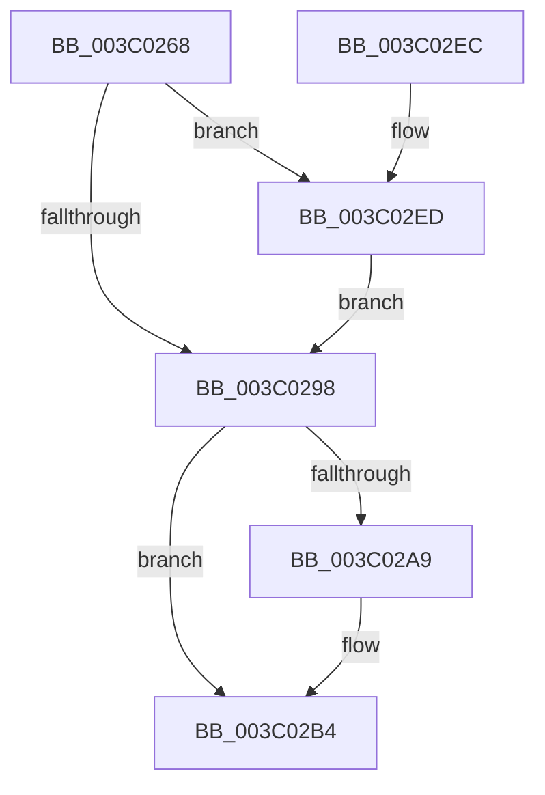

# KiGetDeepIdleProcessors

- RVA: `0x003C0268`–`0x003C02F6` (길이 `142` bytes)
- VA: `0x00000001403C0268`
- 실행 섹션: `.text`
- PDB 이름 있음: `예`; PDB Function 태그: `아니요`
- unwind 정보 RVA: `0x00068908`
- 디코드: `38`개 명령, `142/142` bytes 표시
- 미해석 바이트: `0` (있으면 어셈블리에 `.byte`로 보존)

> 이 문서는 커널 이미지의 기계어와 PDB 기호를 분석해 생성했습니다. 4번과 5번은 함수 원형과 자료형을 바이너리 사용 방식에서 추정한 C 해석이며 원본 소스 복구 결과는 아닙니다.

## 1. Dependencies

- 직접 호출 지점: **5**; 고유 호출 대상: **5**
- 직접 호출자로 확인된 함수: **1**
- RIP 상대 이미지 참조: **2**

### Outgoing calls
- `0x003C029B` → [PoCopyDeepIdleMask](PoCopyDeepIdleMask_function_003C04C8.md) (function, `0x003C04C8`)
- `0x003C02AF` → [KiLowerIrqlProcessIrqlFlags](../4F/KiLowerIrqlProcessIrqlFlags_function_004F5698.md) (function, `0x004F5698`)
- `0x003C02C5` → [KiComplementAffinityEx](KiComplementAffinityEx_function_003C05E0.md) (function, `0x003C05E0`)
- `0x003C02D7` → [KeAndAffinityEx2](KeAndAffinityEx2_function_003C0740.md) (function, `0x003C0740`)
- `0x003C02EF` → [KiRaiseIrqlProcessIrqlFlags](../4F/KiRaiseIrqlProcessIrqlFlags_function_004F56FC.md) (function, `0x004F56FC`)

### Direct callers
- [sub_006F322E](../6F/Unknown_function_006F322E.md) at `0x006F3307`

### Static image references
- `0x003C028F` → RVA `0x00FC6D20` (`ALMOSTRO`; read)
- `0x003C02CD` → RVA `0x00FC7120` (`ALMOSTRO`; read)

## 2. Other-region calls and transfers

- 다른 실행 섹션으로 향하는 call: **0**
- 별도 외부 분기/꼬리 이동을 확인하지 못했습니다.

## 3. Assembly (complete function range)

```asm
003C0268  48 89 5C 24 08                  mov qword ptr [rsp + 8], rbx
003C026D  48 89 74 24 10                  mov qword ptr [rsp + 0x10], rsi
003C0272  57                              push rdi
003C0273  48 83 EC 20                     sub rsp, 0x20
003C0277  48 8B FA                        mov rdi, rdx
003C027A  48 8B F1                        mov rsi, rcx
003C027D  F0 83 0C 24 00                  lock or dword ptr [rsp], 0
003C0282  44 0F 20 C3                     mov rbx, cr8
003C0286  BA 02 00 00 00                  mov edx, 2
003C028B  44 0F 22 C2                     mov cr8, rdx
003C028F  83 3D 8A 6A C0 00 00            cmp dword ptr [rip + 0xc06a8a], 0
003C0296  75 55                           jne 0x1403c02ed
003C0298  48 8B CE                        mov rcx, rsi
003C029B  E8 28 02 00 00                  call 0x1403c04c8
003C02A0  83 3D 79 6A C0 00 00            cmp dword ptr [rip + 0xc06a79], 0
003C02A7  74 0B                           je 0x1403c02b4
003C02A9  44 0F 20 C1                     mov rcx, cr8
003C02AD  8A D3                           mov dl, bl
003C02AF  E8 E4 53 13 00                  call 0x1404f5698
003C02B4  0F B6 C3                        movzx eax, bl
003C02B7  44 0F 22 C0                     mov cr8, rax
003C02BB  0F B7 57 02                     movzx edx, word ptr [rdi + 2]
003C02BF  4C 8B C6                        mov r8, rsi
003C02C2  48 8B CF                        mov rcx, rdi
003C02C5  E8 16 03 00 00                  call 0x1403c05e0
003C02CA  4C 8B C7                        mov r8, rdi
003C02CD  48 8D 15 4C 6E C0 00            lea rdx, [rip + 0xc06e4c]
003C02D4  48 8B CF                        mov rcx, rdi
003C02D7  E8 64 04 00 00                  call 0x1403c0740
003C02DC  48 8B 5C 24 30                  mov rbx, qword ptr [rsp + 0x30]
003C02E1  48 8B 74 24 38                  mov rsi, qword ptr [rsp + 0x38]
003C02E6  48 83 C4 20                     add rsp, 0x20
003C02EA  5F                              pop rdi
003C02EB  C3                              ret
003C02EC  CC                              int3
003C02ED  8A CB                           mov cl, bl
003C02EF  E8 08 54 13 00                  call 0x1404f56fc
003C02F4  EB A2                           jmp 0x1403c0298
```

## 4. C-style interpretation (structured pseudocode)

```c
__int64 __fastcall KiGetDeepIdleProcessors(__int64 a1, __int64 a2)
{
    __int64 result;
    __int64 v_rsp;
    unsigned int v_stack_m28;
    unsigned __int64 v_stack_p10;
    unsigned __int64 v_stack_p8;

    v_stack_p8 = v_rbx;
    v_stack_p10 = v_rsi;
    v_rsp = (v_rsp) - (32);
    if ((*(unsigned int *)(v_rip + 12610186)) != 0) goto loc_003C02ED;
loc_003C0298:
    result = PoCopyDeepIdleMask(a1, 2, a3, a4);
    if ((*(unsigned int *)(v_rip + 12610169)) != 0) {
        a1 = 2;
        a2 = (unsigned __int8)(v_cr8);
        result = KiLowerIrqlProcessIrqlFlags(a1, a2, a3, a4);
    }
    result = KiComplementAffinityEx(a2, *(unsigned __int16 *)(a2 + 2), a1, a4);
    result = KeAndAffinityEx2(a2, v_rip + 12611148, a2, a4);
    v_rsp = (v_rsp) + (32);
    return result;
loc_003C02ED:
    result = KiRaiseIrqlProcessIrqlFlags((unsigned __int8)(v_stack_p8), v_rip + 12611148, a2, a4);
    goto loc_003C0298;
}
```

## 5. (Beta) C Style

```c
int64_t KiGetDeepIdleProcessors(int64_t Arg1, void *Arg2)
{
    uint8_t *arg2 = (uint8_t *)Arg2;

    int64_t result;
    int64_t local_rsp;
    uint32_t v_stack_m28;
    uint64_t v_stack_p10;
    uint64_t v_stack_p8;

    v_stack_p8 = local_rbx;
    v_stack_p10 = local_rsi;
    local_rsp = (local_rsp) - (32);
    if ((*(uint32_t *)(v_rip + 0xC06A8A)) != 0) goto loc_003C02ED;
loc_003C0298:
    result = PoCopyDeepIdleMask(Arg1, 2, a3, a4);
    if ((*(uint32_t *)(v_rip + 0xC06A79)) != 0) {
        Arg1 = 2;
        Arg2 = (uint8_t)(v_cr8);
        result = KiLowerIrqlProcessIrqlFlags(Arg1, Arg2, a3, a4);
    }
    result = KiComplementAffinityEx(Arg2, *(uint16_t *)(arg2 + 0x2), Arg1, a4);
    result = KeAndAffinityEx2(Arg2, v_rip + 12611148, Arg2, a4);
    local_rsp = (local_rsp) + (32);
    return result;
loc_003C02ED:
    result = KiRaiseIrqlProcessIrqlFlags((uint8_t)(v_stack_p8), v_rip + 12611148, Arg2, a4);
    goto loc_003C0298;
}
```

### 관측된 메모리 오프셋

구조체 형식이 확인되지 않은 접근은 인자 기준의 오프셋으로만 기록했습니다.

| 기준 인자 | 오프셋 표현 | 폭 (bit) | 접근 |
|---|---:|---:|---|
| `Arg2` | `+ 0x2` | `16` | `R` |

## 6. Execution-region graph

[열기: 2D/3D 그래프와 함수 탐색 컨트롤 패널](../../../control-panel.html?section=text&rva=0x003C0268&view=graph)

- 2D 그래프는 위에서 아래로 흐르고, 3D 그래프는 빈 공간을 드래그해 회전합니다. Shift+드래그는 이동, 휠은 확대·축소, 함수 노드 선택은 대상 보고서 이동입니다.

### Static fallback


