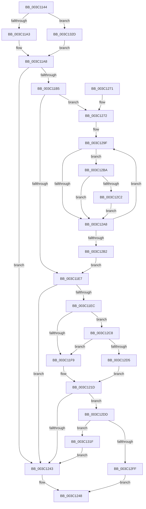

# KiHeteroAttemptPreemptionSwapOnSubNode

- RVA: `0x003C1144`–`0x003C1335` (길이 `497` bytes)
- VA: `0x00000001403C1144`
- 실행 섹션: `.text`
- PDB 이름 있음: `예`; PDB Function 태그: `아니요`
- unwind 정보 RVA: `0x0008E0BC`
- 디코드: `129`개 명령, `497/497` bytes 표시
- 미해석 바이트: `0` (있으면 어셈블리에 `.byte`로 보존)

> 이 문서는 커널 이미지의 기계어와 PDB 기호를 분석해 생성했습니다. 4번과 5번은 함수 원형과 자료형을 바이너리 사용 방식에서 추정한 C 해석이며 원본 소스 복구 결과는 아닙니다.

## 1. Dependencies

- 직접 호출 지점: **9**; 고유 호출 대상: **9**
- 직접 호출자로 확인된 함수: **2**
- RIP 상대 이미지 참조: **2**

### Outgoing calls
- `0x003C11CE` → [KiGenerateHeteroSets](../39/KiGenerateHeteroSets_function_0039ED50.md) (function, `0x0039ED50`)
- `0x003C120B` → [KiFindBiasedProcessorIndex](KiFindBiasedProcessorIndex_function_003C185C.md) (function, `0x003C185C`)
- `0x003C1232` → [KiHeteroScanQueueForPreemptionSwapTarget](KiHeteroScanQueueForPreemptionSwapTarget_function_003C133C.md) (function, `0x003C133C`)
- `0x003C1251` → [_security_check_cookie](../6A/_security_check_cookie_function_006AC640.md) (function, `0x006AC640`)
- `0x003C127C` → [memset](../6C/memset_function_006C6C40.md) (function, `0x006C6C40`)
- `0x003C1292` → [RtlCopyVolatileMemory](../6B/RtlCopyVolatileMemory_function_006BC9D0.md) (function, `0x006BC9D0`)
- `0x003C12E8` → [KiAcquirePrcbLocksForPreemptionAttempt](../30/KiAcquirePrcbLocksForPreemptionAttempt_function_0030EC40.md) (function, `0x0030EC40`)
- `0x003C12F6` → [KiEvaluatePreemptionSwapTarget](KiEvaluatePreemptionSwapTarget_function_003C1624.md) (function, `0x003C1624`)
- `0x003C1323` → [KiReleasePrcbLocksForIsolationUnit](../39/KiReleasePrcbLocksForIsolationUnit_function_00399C50.md) (function, `0x00399C50`)

### Direct callers
- [sub_0025308F](../25/Unknown_function_0025308F.md) at `0x002540A8`
- [sub_002546EC](../25/Unknown_function_002546EC.md) at `0x00254B23`

### Static image references
- `0x003C1160` → RVA `0x00E0A740` (`.data`; read)
- `0x003C1212` → RVA `0x00FC8C40` (`ALMOSTRO`; read)

## 2. Other-region calls and transfers

- 다른 실행 섹션으로 향하는 call: **0**
- 별도 외부 분기/꼬리 이동을 확인하지 못했습니다.

## 3. Assembly (complete function range)

```asm
003C1144  48 89 5C 24 20                  mov qword ptr [rsp + 0x20], rbx
003C1149  55                              push rbp
003C114A  56                              push rsi
003C114B  57                              push rdi
003C114C  41 54                           push r12
003C114E  41 55                           push r13
003C1150  41 56                           push r14
003C1152  41 57                           push r15
003C1154  48 8D 6C 24 F1                  lea rbp, [rsp - 0xf]
003C1159  48 81 EC A0 00 00 00            sub rsp, 0xa0
003C1160  48 8B 05 D9 95 A4 00            mov rax, qword ptr [rip + 0xa495d9]
003C1167  48 33 C4                        xor rax, rsp
003C116A  48 89 45 FF                     mov qword ptr [rbp - 1], rax
003C116E  4C 8B 6D 6F                     mov r13, qword ptr [rbp + 0x6f]
003C1172  33 C0                           xor eax, eax
003C1174  4C 8B 7D 7F                     mov r15, qword ptr [rbp + 0x7f]
003C1178  33 DB                           xor ebx, ebx
003C117A  48 89 45 B7                     mov qword ptr [rbp - 0x49], rax
003C117E  0F 57 C0                        xorps xmm0, xmm0
003C1181  0F B7 81 88 00 00 00            movzx eax, word ptr [rcx + 0x88]
003C1188  4D 8B E0                        mov r12, r8
003C118B  48 8B F2                        mov rsi, rdx
003C118E  4C 8B F1                        mov r14, rcx
003C1191  0F 11 45 A7                     movups xmmword ptr [rbp - 0x59], xmm0
003C1195  48 89 5D 9F                     mov qword ptr [rbp - 0x61], rbx
003C1199  66 41 3B 01                     cmp ax, word ptr [r9]
003C119D  0F 83 8A 01 00 00               jae 0x1403c132d
003C11A3  49 8B 54 C1 08                  mov rdx, qword ptr [r9 + rax*8 + 8]
003C11A8  48 85 91 80 00 00 00            test qword ptr [rcx + 0x80], rdx
003C11AF  0F 84 8E 00 00 00               je 0x1403c1243
003C11B5  45 8B 4D 04                     mov r9d, dword ptr [r13 + 4]
003C11B9  48 8D 45 A7                     lea rax, [rbp - 0x59]
003C11BD  45 8A 45 10                     mov r8b, byte ptr [r13 + 0x10]
003C11C1  48 89 44 24 28                  mov qword ptr [rsp + 0x28], rax
003C11C6  41 8B 45 08                     mov eax, dword ptr [r13 + 8]
003C11CA  89 44 24 20                     mov dword ptr [rsp + 0x20], eax
003C11CE  E8 7D DB FD FF                  call 0x14039ed50
003C11D3  49 8B 7E 10                     mov rdi, qword ptr [r14 + 0x10]
003C11D7  48 F7 D7                        not rdi
003C11DA  48 23 7D AF                     and rdi, qword ptr [rbp - 0x51]
003C11DE  39 5D 77                        cmp dword ptr [rbp + 0x77], ebx
003C11E1  0F 8F 8B 00 00 00               jg 0x1403c1272
003C11E7  48 85 FF                        test rdi, rdi
003C11EA  74 57                           je 0x1403c1243
003C11EC  4C 39 B6 C0 00 00 00            cmp qword ptr [rsi + 0xc0], r14
003C11F3  0F 84 CF 00 00 00               je 0x1403c12c8
003C11F9  0F B6 96 D1 00 00 00            movzx edx, byte ptr [rsi + 0xd1]
003C1200  4C 8B C7                        mov r8, rdi
003C1203  41 0F B7 8E 88 00 00 00         movzx ecx, word ptr [r14 + 0x88]
003C120B  E8 4C 06 00 00                  call 0x1403c185c
003C1210  8B C8                           mov ecx, eax
003C1212  48 8D 05 27 7A C0 00            lea rax, [rip + 0xc07a27]
003C1219  48 8B 0C C8                     mov rcx, qword ptr [rax + rcx*8]
003C121D  48 8B 89 48 8E 00 00            mov rcx, qword ptr [rcx + 0x8e48]
003C1224  4C 8B CF                        mov r9, rdi
003C1227  4D 8B C4                        mov r8, r12
003C122A  4C 89 6C 24 20                  mov qword ptr [rsp + 0x20], r13
003C122F  48 8B D6                        mov rdx, rsi
003C1232  E8 05 01 00 00                  call 0x1403c133c
003C1237  48 8B F8                        mov rdi, rax
003C123A  48 85 C0                        test rax, rax
003C123D  0F 85 9A 00 00 00               jne 0x1403c12dd
003C1243  BB 01 00 00 C0                  mov ebx, 0xc0000001
003C1248  8B C3                           mov eax, ebx
003C124A  48 8B 4D FF                     mov rcx, qword ptr [rbp - 1]
003C124E  48 33 CC                        xor rcx, rsp
003C1251  E8 EA B3 2E 00                  call 0x1406ac640
003C1256  48 8B 9C 24 F8 00 00 00         mov rbx, qword ptr [rsp + 0xf8]
003C125E  48 81 C4 A0 00 00 00            add rsp, 0xa0
003C1265  41 5F                           pop r15
003C1267  41 5E                           pop r14
003C1269  41 5D                           pop r13
003C126B  41 5C                           pop r12
003C126D  5F                              pop rdi
003C126E  5E                              pop rsi
003C126F  5D                              pop rbp
003C1270  C3                              ret
003C1271  CC                              int3
003C1272  33 D2                           xor edx, edx
003C1274  48 8D 4D BF                     lea rcx, [rbp - 0x41]
003C1278  44 8D 42 40                     lea r8d, [rdx + 0x40]
003C127C  E8 BF 59 30 00                  call 0x1406c6c40
003C1281  49 8D 96 00 02 00 00            lea rdx, [r14 + 0x200]
003C1288  41 B8 40 00 00 00               mov r8d, 0x40
003C128E  48 8D 4D BF                     lea rcx, [rbp - 0x41]
003C1292  E8 39 B7 2F 00                  call 0x1406bc9d0
003C1297  48 8B CB                        mov rcx, rbx
003C129A  8A D3                           mov dl, bl
003C129C  4C 8B C3                        mov r8, rbx
003C129F  0F B6 C2                        movzx eax, dl
003C12A2  48 0F A3 C7                     bt rdi, rax
003C12A6  72 12                           jb 0x1403c12ba
003C12A8  FE C2                           inc dl
003C12AA  49 FF C0                        inc r8
003C12AD  80 FA 40                        cmp dl, 0x40
003C12B0  72 ED                           jb 0x1403c129f
003C12B2  48 8B F9                        mov rdi, rcx
003C12B5  E9 2D FF FF FF                  jmp 0x1403c11e7
003C12BA  42 80 7C 05 BF 01               cmp byte ptr [rbp + r8 - 0x41], 1
003C12C0  75 E6                           jne 0x1403c12a8
003C12C2  4C 0F AB C1                     bts rcx, r8
003C12C6  EB E0                           jmp 0x1403c12a8
003C12C8  48 85 BE 40 8E 00 00            test qword ptr [rsi + 0x8e40], rdi
003C12CF  0F 84 24 FF FF FF               je 0x1403c11f9
003C12D5  48 8B CE                        mov rcx, rsi
003C12D8  E9 40 FF FF FF                  jmp 0x1403c121d
003C12DD  41 8B 55 14                     mov edx, dword ptr [r13 + 0x14]
003C12E1  4C 8D 45 9F                     lea r8, [rbp - 0x61]
003C12E5  48 8B CF                        mov rcx, rdi
003C12E8  E8 53 D9 F4 FF                  call 0x14030ec40
003C12ED  4D 8B C5                        mov r8, r13
003C12F0  49 8B D4                        mov rdx, r12
003C12F3  48 8B CF                        mov rcx, rdi
003C12F6  E8 29 03 00 00                  call 0x1403c1624
003C12FB  84 C0                           test al, al
003C12FD  74 20                           je 0x1403c131f
003C12FF  48 8B 4D 9F                     mov rcx, qword ptr [rbp - 0x61]
003C1303  49 89 0F                        mov qword ptr [r15], rcx
003C1306  8A 4F 23                        mov cl, byte ptr [rdi + 0x23]
003C1309  F6 D1                           not cl
003C130B  41 C7 47 0C 01 00 00 00         mov dword ptr [r15 + 0xc], 1
003C1313  83 E1 01                        and ecx, 1
003C1316  41 89 4F 08                     mov dword ptr [r15 + 8], ecx
003C131A  E9 29 FF FF FF                  jmp 0x1403c1248
003C131F  48 8D 4D 9F                     lea rcx, [rbp - 0x61]
003C1323  E8 28 89 FD FF                  call 0x140399c50
003C1328  E9 16 FF FF FF                  jmp 0x1403c1243
003C132D  48 8B D3                        mov rdx, rbx
003C1330  E9 73 FE FF FF                  jmp 0x1403c11a8
```

## 4. C-style interpretation (structured pseudocode)

```c
__int64 __fastcall KiHeteroAttemptPreemptionSwapOnSubNode(__int64 a1, __int64 a2, __int64 a3, __int64 a4, __int64 a5, unsigned int a6, __int64 a7)
{
    __int64 result;
    __int64 v_rbx;
    __int64 v_rdi;
    __int64 v_rsp;
    unsigned __int64 v_stack_m47;
    unsigned __int64 v_stack_m48;
    unsigned __int64 v_stack_m88;
    unsigned __int64 v_stack_m90;
    unsigned __int64 v_stack_m98;
    unsigned __int64 v_stack_mA0;
    unsigned __int64 v_stack_mA8;
    unsigned __int64 v_stack_mB0;
    unsigned int v_stack_mB8;
    unsigned __int64 v_stack_p20;

    v_stack_p20 = v_rbx;
    v_rsp = (v_rsp) - (160);
    result = (*(unsigned __int64 *)(v_rip + 10786265)) ^ (v_rsp);
    v_stack_m48 = result;
    result = 0;
    v_rbx = 0;
    v_stack_m90 = 0;
    v_stack_mA0 = v_xmm0;
    v_stack_mA8 = 0;
    if (((unsigned __int16)(*(unsigned __int16 *)(a1 + 136))) >= (*(unsigned __int16 *)(a4))) goto loc_003C132D;
loc_003C11A8:
    if (((*(unsigned __int64 *)(a1 + 128)) & (*(unsigned __int64 *)(a4 + *(unsigned __int16 *)(a1 + 136) * 8 + 8))) == 0) goto loc_003C1243;
    v_stack_mB0 = v_stack_mA0;
    v_stack_mB8 = (unsigned int)((unsigned int)(*(unsigned int *)(a5 + 8)));
    result = KiGenerateHeteroSets(a1, *(unsigned __int64 *)(a4 + *(unsigned __int16 *)(a1 + 136) * 8 + 8), *(unsigned __int8 *)(a5 + 16), (unsigned int)(*(unsigned int *)(a5 + 4)));
    v_rdi = ~(*(unsigned __int64 *)(a1 + 16));
    v_rdi = (v_rdi) & (v_stack_m98);
    if (a6 > 0) goto loc_003C1272;
loc_003C11E7:
    if (v_rdi == 0) goto loc_003C1243;
    if ((*(unsigned __int64 *)(a2 + 192)) == a1) goto loc_003C12C8;
loc_003C11F9:
    result = KiFindBiasedProcessorIndex(*(unsigned __int16 *)(a1 + 136), *(unsigned __int8 *)(a2 + 209), v_rdi, (unsigned int)(*(unsigned int *)(a5 + 4)));
loc_003C121D:
    v_stack_mB8 = a5;
    result = KiHeteroScanQueueForPreemptionSwapTarget(*(unsigned __int64 *)(*(unsigned __int64 *)(v_rip + 12614183 + (unsigned int)((unsigned int)(result)) * 8) + 36424), a2, a3, v_rdi);
    if (result != 0) goto loc_003C12DD;
loc_003C1243:
loc_003C1248:
    a1 = (v_stack_m48) ^ (v_rsp);
    result = _security_check_cookie(a1, a2, a3, v_rdi);
    v_rsp = (v_rsp) + (160);
    return result;
loc_003C1272:
    a2 = 0;
    result = memset(v_stack_m88, a2, a2 + 64, v_rdi);
    result = RtlCopyVolatileMemory(v_stack_m88, a1 + 512, 64, v_rdi);
loc_003C129F:
    if (condition_is_below) goto loc_003C12BA;
loc_003C12A8:
    a2 = (unsigned __int8)(((unsigned __int8)(v_stack_p20)) + 1);
    a3 = (v_stack_p20) + 1;
    if (((unsigned __int8)(a2)) < 64) goto loc_003C129F;
    goto loc_003C11E7;
loc_003C12BA:
    if ((*(unsigned __int8 *)(v_stack_m47 + a3 * 1 - 65)) != 1) goto loc_003C12A8;
    goto loc_003C12A8;
loc_003C12C8:
    if (((*(unsigned __int64 *)(a2 + 36416)) & (v_stack_p20)) == 0) goto loc_003C11F9;
    goto loc_003C121D;
loc_003C12DD:
    result = KiAcquirePrcbLocksForPreemptionAttempt(v_stack_p20, (unsigned int)(*(unsigned int *)(a5 + 20)), v_stack_mA8, v_rdi);
    result = KiEvaluatePreemptionSwapTarget(v_stack_p20, a3, a5, v_rdi);
    if ((unsigned __int8)(result) == 0) goto loc_003C131F;
    *(unsigned __int64 *)(a7) = v_stack_mA8;
    a1 = (unsigned __int8)(~(*(unsigned __int8 *)(v_stack_p20 + 35)));
    *(unsigned int *)(a7 + 12) = 1;
    a1 = (unsigned int)((a1) & (1));
    *(unsigned int *)(a7 + 8) = (unsigned int)(a1);
    goto loc_003C1248;
loc_003C131F:
    result = KiReleasePrcbLocksForIsolationUnit(v_stack_mA8, a3, a5, v_rdi);
    goto loc_003C1243;
loc_003C132D:
    goto loc_003C11A8;
}
```

## 5. (Beta) C Style

```c
int64_t KiHeteroAttemptPreemptionSwapOnSubNode(void *Arg1, void *Arg2, int64_t Arg3, void *Arg4, void *Arg5, uint32_t Arg6, void *Arg7)
{
    uint8_t *arg1 = (uint8_t *)Arg1;
    uint8_t *arg2 = (uint8_t *)Arg2;
    uint8_t *arg4 = (uint8_t *)Arg4;
    uint8_t *arg5 = (uint8_t *)Arg5;
    uint8_t *arg7 = (uint8_t *)Arg7;

    int64_t result;
    int64_t local_rbx;
    int64_t local_rdi;
    int64_t local_rsp;
    uint64_t v_stack_m47;
    uint64_t v_stack_m48;
    uint64_t v_stack_m88;
    uint64_t v_stack_m90;
    uint64_t v_stack_m98;
    uint64_t v_stack_mA0;
    uint64_t v_stack_mA8;
    uint64_t v_stack_mB0;
    uint32_t v_stack_mB8;
    uint64_t v_stack_p20;

    v_stack_p20 = local_rbx;
    local_rsp = (local_rsp) - (160);
    result = (*(uint64_t *)(v_rip + 0xA495D9)) ^ (local_rsp);
    v_stack_m48 = result;
    result = 0;
    local_rbx = 0;
    v_stack_m90 = 0;
    v_stack_mA0 = v_xmm0;
    v_stack_mA8 = 0;
    if (((uint16_t)(*(uint16_t *)(arg1 + 0x88))) >= (*(uint16_t *)(arg4))) goto loc_003C132D;
loc_003C11A8:
    if (((*(uint64_t *)(arg1 + 0x80)) & (*(uint64_t *)(arg4 + *(uint16_t *)(arg1 + 0x88) * 8 + 0x8))) == 0) goto loc_003C1243;
    v_stack_mB0 = v_stack_mA0;
    v_stack_mB8 = (uint32_t)((uint32_t)(*(uint32_t *)(arg5 + 0x8)));
    result = KiGenerateHeteroSets(Arg1, *(uint64_t *)(arg4 + *(uint16_t *)(arg1 + 0x88) * 8 + 0x8), *(uint8_t *)(arg5 + 0x10), (uint32_t)(*(uint32_t *)(arg5 + 0x4)));
    local_rdi = ~(*(uint64_t *)(arg1 + 0x10));
    local_rdi = (local_rdi) & (v_stack_m98);
    if (Arg6 > 0) goto loc_003C1272;
loc_003C11E7:
    if (local_rdi == 0) goto loc_003C1243;
    if ((*(uint64_t *)(arg2 + 0xC0)) == Arg1) goto loc_003C12C8;
loc_003C11F9:
    result = KiFindBiasedProcessorIndex(*(uint16_t *)(arg1 + 0x88), *(uint8_t *)(arg2 + 0xD1), local_rdi, (uint32_t)(*(uint32_t *)(arg5 + 0x4)));
loc_003C121D:
    v_stack_mB8 = Arg5;
    result = KiHeteroScanQueueForPreemptionSwapTarget(*(uint64_t *)(*(uint64_t *)(v_rip + 0xC07A27 + (uint32_t)((uint32_t)(result)) * 8) + 0x8E48), Arg2, Arg3, local_rdi);
    if (result != 0) goto loc_003C12DD;
loc_003C1243:
loc_003C1248:
    Arg1 = (v_stack_m48) ^ (local_rsp);
    result = _security_check_cookie(Arg1, Arg2, Arg3, local_rdi);
    local_rsp = (local_rsp) + (160);
    return result;
loc_003C1272:
    Arg2 = 0;
    result = memset(v_stack_m88, Arg2, Arg2 + 64, local_rdi);
    result = RtlCopyVolatileMemory(v_stack_m88, Arg1 + 512, 64, local_rdi);
loc_003C129F:
    if (condition_is_below) goto loc_003C12BA;
loc_003C12A8:
    Arg2 = (uint8_t)(((uint8_t)(v_stack_p20)) + 1);
    Arg3 = (v_stack_p20) + 1;
    if (((uint8_t)(Arg2)) < 64) goto loc_003C129F;
    goto loc_003C11E7;
loc_003C12BA:
    if ((*(uint8_t *)(v_stack_m47 + Arg3 * 1 - 0x41)) != 1) goto loc_003C12A8;
    goto loc_003C12A8;
loc_003C12C8:
    if (((*(uint64_t *)(arg2 + 0x8E40)) & (v_stack_p20)) == 0) goto loc_003C11F9;
    goto loc_003C121D;
loc_003C12DD:
    result = KiAcquirePrcbLocksForPreemptionAttempt(v_stack_p20, (uint32_t)(*(uint32_t *)(arg5 + 0x14)), v_stack_mA8, local_rdi);
    result = KiEvaluatePreemptionSwapTarget(v_stack_p20, Arg3, Arg5, local_rdi);
    if ((uint8_t)(result) == 0) goto loc_003C131F;
    *(uint64_t *)(arg7) = v_stack_mA8;
    Arg1 = (uint8_t)(~(*(uint8_t *)(v_stack_p20 + 0x23)));
    *(uint32_t *)(arg7 + 0xC) = 1;
    Arg1 = (uint32_t)((Arg1) & (1));
    *(uint32_t *)(arg7 + 0x8) = (uint32_t)(Arg1);
    goto loc_003C1248;
loc_003C131F:
    result = KiReleasePrcbLocksForIsolationUnit(v_stack_mA8, Arg3, Arg5, local_rdi);
    goto loc_003C1243;
loc_003C132D:
    goto loc_003C11A8;
}
```

### 관측된 메모리 오프셋

구조체 형식이 확인되지 않은 접근은 인자 기준의 오프셋으로만 기록했습니다.

| 기준 인자 | 오프셋 표현 | 폭 (bit) | 접근 |
|---|---:|---:|---|
| `Arg1` | `+ 0x10` | `64` | `R` |
| `Arg1` | `+ 0x80` | `64` | `R` |
| `Arg1` | `+ 0x88` | `16` | `R` |
| `Arg1` | `+ 0x200` | `64` | `R` |
| `Arg2` | `+ 0xC0` | `64` | `R` |
| `Arg2` | `+ 0xD1` | `8` | `R` |
| `Arg2` | `+ 0x8E40` | `64` | `R` |
| `Arg4` | `+ 0x0` | `16` | `R` |
| `Arg4` | `+ 0x8 + rax*8` | `64` | `R` |
| `Arg5` | `+ 0x4` | `32` | `R` |
| `Arg5` | `+ 0x8` | `32` | `R` |
| `Arg5` | `+ 0x10` | `8` | `R` |
| `Arg5` | `+ 0x14` | `32` | `R` |
| `Arg7` | `+ 0x0` | `64` | `W` |
| `Arg7` | `+ 0x8` | `32` | `W` |
| `Arg7` | `+ 0xC` | `32` | `W` |

## 6. Execution-region graph

[열기: 2D/3D 그래프와 함수 탐색 컨트롤 패널](../../../control-panel.html?section=text&rva=0x003C1144&view=graph)

- 2D 그래프는 위에서 아래로 흐르고, 3D 그래프는 빈 공간을 드래그해 회전합니다. Shift+드래그는 이동, 휠은 확대·축소, 함수 노드 선택은 대상 보고서 이동입니다.

### Static fallback


