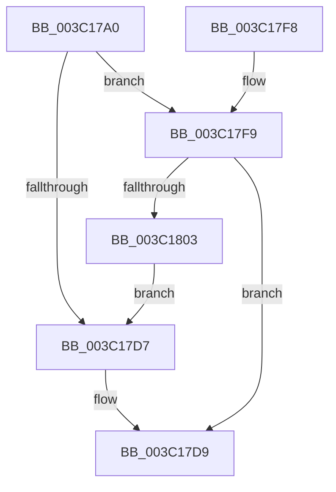

# KiHeteroComputeThreadImportance

- RVA: `0x003C17A0`–`0x003C1805` (길이 `101` bytes)
- VA: `0x00000001403C17A0`
- 실행 섹션: `.text`
- PDB 이름 있음: `예`; PDB Function 태그: `아니요`
- unwind 정보 RVA: `0x0008E120`
- 디코드: `27`개 명령, `101/101` bytes 표시
- 미해석 바이트: `0` (있으면 어셈블리에 `.byte`로 보존)

> 이 문서는 커널 이미지의 기계어와 PDB 기호를 분석해 생성했습니다. 4번과 5번은 함수 원형과 자료형을 바이너리 사용 방식에서 추정한 C 해석이며 원본 소스 복구 결과는 아닙니다.

## 1. Dependencies

- 직접 호출 지점: **1**; 고유 호출 대상: **1**
- 직접 호출자로 확인된 함수: **2**
- RIP 상대 이미지 참조: **3**

### Outgoing calls
- `0x003C17EE` → [_security_check_cookie](../6A/_security_check_cookie_function_006AC640.md) (function, `0x006AC640`)

### Direct callers
- [KiHeteroScanQueueForPreemptionSwapTarget](KiHeteroScanQueueForPreemptionSwapTarget_function_003C133C.md) at `0x003C14D3`
- [KiHeteroScanQueueForPreemptionSwapTarget](KiHeteroScanQueueForPreemptionSwapTarget_function_003C133C.md) at `0x003C157E`
- [KiEvaluatePreemptionSwapTarget](KiEvaluatePreemptionSwapTarget_function_003C1624.md) at `0x003C169B`

### Static image references
- `0x003C17A4` → RVA `0x00E0A740` (`.data`; read)
- `0x003C17CD` → RVA `0x00FC6D14` (`ALMOSTRO`; read)
- `0x003C17F9` → RVA `0x00FC6D10` (`ALMOSTRO`; read)

## 2. Other-region calls and transfers

- 다른 실행 섹션으로 향하는 call: **0**
- 별도 외부 분기/꼬리 이동을 확인하지 못했습니다.

## 3. Assembly (complete function range)

```asm
003C17A0  48 83 EC 18                     sub rsp, 0x18
003C17A4  48 8B 05 95 8F A4 00            mov rax, qword ptr [rip + 0xa48f95]
003C17AB  48 33 C4                        xor rax, rsp
003C17AE  48 89 44 24 08                  mov qword ptr [rsp + 8], rax
003C17B3  48 63 C1                        movsxd rax, ecx
003C17B6  C7 04 24 05 04 03 02            mov dword ptr [rsp], 0x2030405
003C17BD  66 C7 44 24 04 06 00            mov word ptr [rsp + 4], 6
003C17C4  C6 44 24 06 01                  mov byte ptr [rsp + 6], 1
003C17C9  0F B6 0C 04                     movzx ecx, byte ptr [rsp + rax]
003C17CD  8B 05 41 55 C0 00               mov eax, dword ptr [rip + 0xc05541]
003C17D3  A8 08                           test al, 8
003C17D5  75 22                           jne 0x1403c17f9
003C17D7  32 D2                           xor dl, dl
003C17D9  0F B7 C1                        movzx eax, cx
003C17DC  0F B6 CA                        movzx ecx, dl
003C17DF  66 C1 E0 08                     shl ax, 8
003C17E3  66 0B C1                        or ax, cx
003C17E6  48 8B 4C 24 08                  mov rcx, qword ptr [rsp + 8]
003C17EB  48 33 CC                        xor rcx, rsp
003C17EE  E8 4D AE 2E 00                  call 0x1406ac640
003C17F3  48 83 C4 18                     add rsp, 0x18
003C17F7  C3                              ret
003C17F8  CC                              int3
003C17F9  8B 05 11 55 C0 00               mov eax, dword ptr [rip + 0xc05511]
003C17FF  A8 08                           test al, 8
003C1801  75 D6                           jne 0x1403c17d9
003C1803  EB D2                           jmp 0x1403c17d7
```

## 4. C-style interpretation (structured pseudocode)

```c
__int64 __fastcall KiHeteroComputeThreadImportance(int a1, unsigned __int8 a2)
{
    __int64 result;
    __int64 v_rsp;
    unsigned __int64 v_stack_m10;
    unsigned __int8 v_stack_m12;
    unsigned __int16 v_stack_m14;
    unsigned int v_stack_m18;

    v_rsp = (v_rsp) - (24);
    result = (*(unsigned __int64 *)(v_rip + 10784661)) ^ (v_rsp);
    v_stack_m10 = result;
    v_stack_m18 = 0x2030405ULL;
    v_stack_m14 = 6;
    v_stack_m12 = 1;
    if ((((unsigned __int8)((unsigned int)(*(unsigned int *)(v_rip + 12604737)))) & (8)) != 0) goto loc_003C17F9;
loc_003C17D7:
    a2 = 0;
loc_003C17D9:
    result = (unsigned __int16)(((unsigned __int16)(*(unsigned __int8 *)(v_rsp + (int)(a1) * 1))) << (8));
    result = (unsigned __int16)((result) | (0));
    a1 = (v_stack_m10) ^ (v_rsp);
    result = _security_check_cookie(a1, a2, a3, a4);
    v_rsp = (v_rsp) + (24);
    return result;
loc_003C17F9:
    if ((((unsigned __int8)((unsigned int)(*(unsigned int *)(v_rip + 12604689)))) & (8)) != 0) goto loc_003C17D9;
    goto loc_003C17D7;
}
```

## 5. (Beta) C Style

```c
int64_t KiHeteroComputeThreadImportance(int32_t Arg1, uint8_t Arg2)
{
    int64_t result;
    int64_t local_rsp;
    uint64_t v_stack_m10;
    uint8_t v_stack_m12;
    uint16_t v_stack_m14;
    uint32_t v_stack_m18;

    local_rsp = (local_rsp) - (24);
    result = (*(uint64_t *)(v_rip + 0xA48F95)) ^ (local_rsp);
    v_stack_m10 = result;
    v_stack_m18 = 0x2030405ULL;
    v_stack_m14 = 6;
    v_stack_m12 = 1;
    if ((((uint8_t)((uint32_t)(*(uint32_t *)(v_rip + 0xC05541)))) & (8)) != 0) goto loc_003C17F9;
loc_003C17D7:
    Arg2 = 0;
loc_003C17D9:
    result = (uint16_t)(((uint16_t)(*(uint8_t *)(local_rsp + (int32_t)(Arg1) * 1))) << (8));
    result = (uint16_t)((result) | (0));
    Arg1 = (v_stack_m10) ^ (local_rsp);
    result = _security_check_cookie(Arg1, Arg2, a3, a4);
    local_rsp = (local_rsp) + (24);
    return result;
loc_003C17F9:
    if ((((uint8_t)((uint32_t)(*(uint32_t *)(v_rip + 0xC05511)))) & (8)) != 0) goto loc_003C17D9;
    goto loc_003C17D7;
}
```

## 6. Execution-region graph

[열기: 2D/3D 그래프와 함수 탐색 컨트롤 패널](../../../control-panel.html?section=text&rva=0x003C17A0&view=graph)

- 2D 그래프는 위에서 아래로 흐르고, 3D 그래프는 빈 공간을 드래그해 회전합니다. Shift+드래그는 이동, 휠은 확대·축소, 함수 노드 선택은 대상 보고서 이동입니다.

### Static fallback


