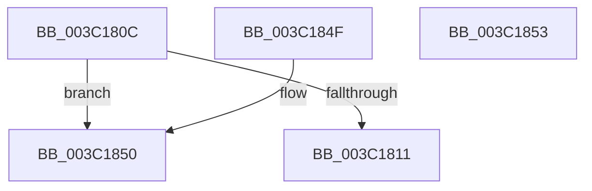

# KiHeteroIsSwapBeneficialForPerformance

- RVA: `0x003C180C`–`0x003C1854` (길이 `72` bytes)
- VA: `0x00000001403C180C`
- 실행 섹션: `.text`
- PDB 이름 있음: `예`; PDB Function 태그: `아니요`
- unwind 정보 RVA: `0x000DB714`
- 디코드: `19`개 명령, `72/72` bytes 표시
- 미해석 바이트: `0` (있으면 어셈블리에 `.byte`로 보존)

> 이 문서는 커널 이미지의 기계어와 PDB 기호를 분석해 생성했습니다. 4번과 5번은 함수 원형과 자료형을 바이너리 사용 방식에서 추정한 C 해석이며 원본 소스 복구 결과는 아닙니다.

## 1. Dependencies

- 직접 호출 지점: **0**; 고유 호출 대상: **0**
- 직접 호출자로 확인된 함수: **2**
- RIP 상대 이미지 참조: **1**

### Outgoing calls
- 직접 디코드된 call 명령이 없습니다.

### Direct callers
- [KiHeteroScanQueueForPreemptionSwapTarget](KiHeteroScanQueueForPreemptionSwapTarget_function_003C133C.md) at `0x003C1524`
- [KiEvaluatePreemptionSwapTarget](KiEvaluatePreemptionSwapTarget_function_003C1624.md) at `0x003C16C5`

### Static image references
- `0x003C1845` → RVA `0x00FC5418` (`ALMOSTRO`; read)

## 2. Other-region calls and transfers

- 다른 실행 섹션으로 향하는 call: **0**
- 별도 외부 분기/꼬리 이동을 확인하지 못했습니다.

## 3. Assembly (complete function range)

```asm
003C180C  41 3A D1                        cmp dl, r9b
003C180F  74 3F                           je 0x1403c1850
003C1811  0F B6 C2                        movzx eax, dl
003C1814  44 0F B7 94 41 BC 86 00 00      movzx r10d, word ptr [rcx + rax*2 + 0x86bc]
003C181D  45 0F B7 9C 40 BC 86 00 00      movzx r11d, word ptr [r8 + rax*2 + 0x86bc]
003C1826  41 0F B6 C1                     movzx eax, r9b
003C182A  41 0F B7 94 40 BC 86 00 00      movzx edx, word ptr [r8 + rax*2 + 0x86bc]
003C1833  0F B7 8C 41 BC 86 00 00         movzx ecx, word ptr [rcx + rax*2 + 0x86bc]
003C183B  33 C0                           xor eax, eax
003C183D  2B CA                           sub ecx, edx
003C183F  41 2B CA                        sub ecx, r10d
003C1842  41 03 CB                        add ecx, r11d
003C1845  3B 0D CD 3B C0 00               cmp ecx, dword ptr [rip + 0xc03bcd]
003C184B  0F 9D C0                        setge al
003C184E  C3                              ret
003C184F  CC                              int3
003C1850  33 C0                           xor eax, eax
003C1852  C3                              ret
003C1853  CC                              int3
```

## 4. C-style interpretation (structured pseudocode)

```c
__int64 __fastcall KiHeteroIsSwapBeneficialForPerformance(__int64 a1, unsigned __int8 a2, __int64 a3, unsigned __int8 a4)
{
    __int64 result;

    if (a2 == a4) goto loc_003C1850;
    result = 0;
    a1 = (unsigned int)((*(unsigned __int16 *)(a1 + a4 * 2 + 34492)) - ((unsigned int)(*(unsigned __int16 *)(a3 + a4 * 2 + 34492))));
    a1 = (unsigned int)((a1) - ((unsigned int)(*(unsigned __int16 *)(a1 + a2 * 2 + 34492))));
    a1 = (unsigned int)((a1) + ((unsigned int)(*(unsigned __int16 *)(a3 + a2 * 2 + 34492))));
    result = (((unsigned int)(a1)) >= (*(unsigned int *)(v_rip + 12598221))) ? 1 : 0;
    return result;
loc_003C1850:
    result = 0;
    return result;
}
```

## 5. (Beta) C Style

```c
int64_t KiHeteroIsSwapBeneficialForPerformance(void *Arg1, uint8_t Arg2, void *Arg3, uint8_t Arg4)
{
    uint8_t *arg1 = (uint8_t *)Arg1;
    uint8_t *arg3 = (uint8_t *)Arg3;

    int64_t result;

    if (Arg2 == Arg4) goto loc_003C1850;
    result = 0;
    Arg1 = (uint32_t)((*(uint16_t *)(arg1 + Arg4 * 2 + 0x86BC)) - ((uint32_t)(*(uint16_t *)(arg3 + Arg4 * 2 + 0x86BC))));
    Arg1 = (uint32_t)((Arg1) - ((uint32_t)(*(uint16_t *)(arg1 + Arg2 * 2 + 0x86BC))));
    Arg1 = (uint32_t)((Arg1) + ((uint32_t)(*(uint16_t *)(arg3 + Arg2 * 2 + 0x86BC))));
    result = (((uint32_t)(Arg1)) >= (*(uint32_t *)(v_rip + 0xC03BCD))) ? 1 : 0;
    return result;
loc_003C1850:
    result = 0;
    return result;
}
```

### 관측된 메모리 오프셋

구조체 형식이 확인되지 않은 접근은 인자 기준의 오프셋으로만 기록했습니다.

| 기준 인자 | 오프셋 표현 | 폭 (bit) | 접근 |
|---|---:|---:|---|
| `Arg1` | `+ 0x86BC + rax*2` | `16` | `R` |
| `Arg3` | `+ 0x86BC + rax*2` | `16` | `R` |

## 6. Execution-region graph

[열기: 2D/3D 그래프와 함수 탐색 컨트롤 패널](../../../control-panel.html?section=text&rva=0x003C180C&view=graph)

- 2D 그래프는 위에서 아래로 흐르고, 3D 그래프는 빈 공간을 드래그해 회전합니다. Shift+드래그는 이동, 휠은 확대·축소, 함수 노드 선택은 대상 보고서 이동입니다.

### Static fallback


