# KiHeteroScanQueueForPreemptionSwapTarget

- RVA: `0x003C133C`–`0x003C161B` (길이 `735` bytes)
- VA: `0x00000001403C133C`
- 실행 섹션: `.text`
- PDB 이름 있음: `예`; PDB Function 태그: `아니요`
- unwind 정보 RVA: `0x0008E0E4`
- 디코드: `191`개 명령, `735/735` bytes 표시
- 미해석 바이트: `0` (있으면 어셈블리에 `.byte`로 보존)

> 이 문서는 커널 이미지의 기계어와 PDB 기호를 분석해 생성했습니다. 4번과 5번은 함수 원형과 자료형을 바이너리 사용 방식에서 추정한 C 해석이며 원본 소스 복구 결과는 아닙니다.

## 1. Dependencies

- 직접 호출 지점: **7**; 고유 호출 대상: **5**
- 직접 호출자로 확인된 함수: **2**
- RIP 상대 이미지 참조: **4**

### Outgoing calls
- `0x003C13AF` → [memcpy](../6C/memcpy_function_006C6840.md) (function, `0x006C6840`)
- `0x003C13C6` → [memcpy](../6C/memcpy_function_006C6840.md) (function, `0x006C6840`)
- `0x003C1483` → [_security_check_cookie](../6A/_security_check_cookie_function_006AC640.md) (function, `0x006AC640`)
- `0x003C14D3` → [KiHeteroComputeThreadImportance](KiHeteroComputeThreadImportance_function_003C17A0.md) (function, `0x003C17A0`)
- `0x003C1524` → [KiHeteroIsSwapBeneficialForPerformance](KiHeteroIsSwapBeneficialForPerformance_function_003C180C.md) (function, `0x003C180C`)
- `0x003C157E` → [KiHeteroComputeThreadImportance](KiHeteroComputeThreadImportance_function_003C17A0.md) (function, `0x003C17A0`)
- `0x003C15D1` → [KiFindBiasedProcessorIndex](KiFindBiasedProcessorIndex_function_003C185C.md) (function, `0x003C185C`)

### Direct callers
- [KiCheckPreferredHeteroProcessor](../39/KiCheckPreferredHeteroProcessor_function_0039D72C.md) at `0x0039DA58`
- [KiHeteroAttemptPreemptionSwapOnSubNode](KiHeteroAttemptPreemptionSwapOnSubNode_function_003C1144.md) at `0x003C1232`

### Static image references
- `0x003C1350` → RVA `0x00E0A740` (`.data`; read)
- `0x003C1415` → RVA `0x00FC8C40` (`ALMOSTRO`; read)
- `0x003C1426` → RVA `0x00FC6ADE` (`ALMOSTRO`; read)
- `0x003C1511` → RVA `0x00F231B8` (`.data`; read)

## 2. Other-region calls and transfers

- 다른 실행 섹션으로 향하는 call: **0**
- 별도 외부 분기/꼬리 이동을 확인하지 못했습니다.

## 3. Assembly (complete function range)

```asm
003C133C  40 53                           push rbx
003C133E  55                              push rbp
003C133F  56                              push rsi
003C1340  57                              push rdi
003C1341  41 54                           push r12
003C1343  41 55                           push r13
003C1345  41 56                           push r14
003C1347  41 57                           push r15
003C1349  48 81 EC D8 00 00 00            sub rsp, 0xd8
003C1350  48 8B 05 E9 93 A4 00            mov rax, qword ptr [rip + 0xa493e9]
003C1357  48 33 C4                        xor rax, rsp
003C135A  48 89 84 24 C0 00 00 00         mov qword ptr [rsp + 0xc0], rax
003C1362  0F B6 B1 C1 02 00 00            movzx esi, byte ptr [rcx + 0x2c1]
003C1369  4C 8B F1                        mov r14, rcx
003C136C  4C 8B B9 C8 02 00 00            mov r15, qword ptr [rcx + 0x2c8]
003C1373  8B EE                           mov ebp, esi
003C1375  0F B6 B9 C0 02 00 00            movzx edi, byte ptr [rcx + 0x2c0]
003C137C  4D 23 F9                        and r15, r9
003C137F  4C 8B AC 24 40 01 00 00         mov r13, qword ptr [rsp + 0x140]
003C1387  48 89 4C 24 28                  mov qword ptr [rsp + 0x28], rcx
003C138C  48 89 54 24 38                  mov qword ptr [rsp + 0x38], rdx
003C1391  48 8D 91 40 02 00 00            lea rdx, [rcx + 0x240]
003C1398  4C 89 44 24 30                  mov qword ptr [rsp + 0x30], r8
003C139D  48 8D 8C 24 80 00 00 00         lea rcx, [rsp + 0x80]
003C13A5  48 03 CE                        add rcx, rsi
003C13A8  89 74 24 24                     mov dword ptr [rsp + 0x24], esi
003C13AC  44 8B C7                        mov r8d, edi
003C13AF  E8 8C 54 30 00                  call 0x1406c6840
003C13B4  48 8D 4C 24 40                  lea rcx, [rsp + 0x40]
003C13B9  44 8B C7                        mov r8d, edi
003C13BC  48 03 CE                        add rcx, rsi
003C13BF  49 8D 96 80 02 00 00            lea rdx, [r14 + 0x280]
003C13C6  E8 75 54 30 00                  call 0x1406c6840
003C13CB  44 8D 34 3E                     lea r14d, [rsi + rdi]
003C13CF  33 DB                           xor ebx, ebx
003C13D1  44 89 74 24 20                  mov dword ptr [rsp + 0x20], r14d
003C13D6  41 B8 FF FF 00 00               mov r8d, 0xffff
003C13DC  44 8B E3                        mov r12d, ebx
003C13DF  44 8B D6                        mov r10d, esi
003C13E2  41 3B F6                        cmp esi, r14d
003C13E5  0F 83 8A 00 00 00               jae 0x1403c1475
003C13EB  41 8B CA                        mov ecx, r10d
003C13EE  41 B9 01 00 00 00               mov r9d, 1
003C13F4  49 D3 E1                        shl r9, cl
003C13F7  4D 85 F9                        test r9, r15
003C13FA  0F 85 9D 00 00 00               jne 0x1403c149d
003C1400  41 FF C2                        inc r10d
003C1403  48 FF C5                        inc rbp
003C1406  45 3B D6                        cmp r10d, r14d
003C1409  72 E0                           jb 0x1403c13eb
003C140B  4D 85 E4                        test r12, r12
003C140E  74 65                           je 0x1403c1475
003C1410  45 0F B7 5D 12                  movzx r11d, word ptr [r13 + 0x12]
003C1415  4C 8D 15 24 78 C0 00            lea r10, [rip + 0xc07824]
003C141C  66 45 3B C3                     cmp r8w, r11w
003C1420  0F 85 1A 01 00 00               jne 0x1403c1540
003C1426  38 1D B2 56 C0 00               cmp byte ptr [rip + 0xc056b2], bl
003C142C  74 47                           je 0x1403c1475
003C142E  4C 8B 44 24 30                  mov r8, qword ptr [rsp + 0x30]
003C1433  4C 8D 7C 24 40                  lea r15, [rsp + 0x40]
003C1438  4C 03 FE                        add r15, rsi
003C143B  8B EE                           mov ebp, esi
003C143D  48 8B 74 24 28                  mov rsi, qword ptr [rsp + 0x28]
003C1442  48 8B FB                        mov rdi, rbx
003C1445  8B CD                           mov ecx, ebp
003C1447  41 BE 01 00 00 00               mov r14d, 1
003C144D  49 D3 E6                        shl r14, cl
003C1450  4D 85 E6                        test r14, r12
003C1453  0F 85 9B 00 00 00               jne 0x1403c14f4
003C1459  44 8B 74 24 20                  mov r14d, dword ptr [rsp + 0x20]
003C145E  FF C5                           inc ebp
003C1460  49 FF C7                        inc r15
003C1463  41 3B EE                        cmp ebp, r14d
003C1466  72 DD                           jb 0x1403c1445
003C1468  8B 74 24 24                     mov esi, dword ptr [rsp + 0x24]
003C146C  48 85 FF                        test rdi, rdi
003C146F  0F 85 19 01 00 00               jne 0x1403c158e
003C1475  48 8B C3                        mov rax, rbx
003C1478  48 8B 8C 24 C0 00 00 00         mov rcx, qword ptr [rsp + 0xc0]
003C1480  48 33 CC                        xor rcx, rsp
003C1483  E8 B8 B1 2E 00                  call 0x1406ac640
003C1488  48 81 C4 D8 00 00 00            add rsp, 0xd8
003C148F  41 5F                           pop r15
003C1491  41 5E                           pop r14
003C1493  41 5D                           pop r13
003C1495  41 5C                           pop r12
003C1497  5F                              pop rdi
003C1498  5E                              pop rsi
003C1499  5D                              pop rbp
003C149A  5B                              pop rbx
003C149B  C3                              ret
003C149C  CC                              int3
003C149D  0F B6 94 2C 80 00 00 00         movzx edx, byte ptr [rsp + rbp + 0x80]
003C14A5  84 D2                           test dl, dl
003C14A7  0F 88 53 FF FF FF               js 0x1403c1400
003C14AD  8B CA                           mov ecx, edx
003C14AF  83 E1 7F                        and ecx, 0x7f
003C14B2  41 3A 4D 00                     cmp cl, byte ptr [r13]
003C14B6  0F 8F 44 FF FF FF               jg 0x1403c1400
003C14BC  0F B6 4C 2C 40                  movzx ecx, byte ptr [rsp + rbp + 0x40]
003C14C1  83 E1 07                        and ecx, 7
003C14C4  8D 41 FB                        lea eax, [rcx - 5]
003C14C7  83 F8 01                        cmp eax, 1
003C14CA  0F 87 3D 01 00 00               ja 0x1403c160d
003C14D0  80 E2 7F                        and dl, 0x7f
003C14D3  E8 C8 02 00 00                  call 0x1403c17a0
003C14D8  66 41 3B 45 12                  cmp ax, word ptr [r13 + 0x12]
003C14DD  0F 87 1D FF FF FF               ja 0x1403c1400
003C14E3  4D 0B E1                        or r12, r9
003C14E6  66 41 3B C0                     cmp ax, r8w
003C14EA  66 44 0F 42 C0                  cmovb r8w, ax
003C14EF  E9 0C FF FF FF                  jmp 0x1403c1400
003C14F4  41 8A 17                        mov dl, byte ptr [r15]
003C14F7  45 8A 4D 10                     mov r9b, byte ptr [r13 + 0x10]
003C14FB  C0 EA 03                        shr dl, 3
003C14FE  80 E2 07                        and dl, 7
003C1501  41 3A D1                        cmp dl, r9b
003C1504  0F 84 4F FF FF FF               je 0x1403c1459
003C150A  0F B7 8E C6 02 00 00            movzx ecx, word ptr [rsi + 0x2c6]
003C1511  48 8B 05 A0 1C B6 00            mov rax, qword ptr [rip + 0xb61ca0]
003C1518  C1 E1 06                        shl ecx, 6
003C151B  03 CD                           add ecx, ebp
003C151D  8B 0C 88                        mov ecx, dword ptr [rax + rcx*4]
003C1520  49 8B 0C CA                     mov rcx, qword ptr [r10 + rcx*8]
003C1524  E8 E3 02 00 00                  call 0x1403c180c
003C1529  4C 8D 15 10 77 C0 00            lea r10, [rip + 0xc07710]
003C1530  85 C0                           test eax, eax
003C1532  0F 84 21 FF FF FF               je 0x1403c1459
003C1538  49 0B FE                        or rdi, r14
003C153B  E9 19 FF FF FF                  jmp 0x1403c1459
003C1540  48 8B FB                        mov rdi, rbx
003C1543  44 8B C6                        mov r8d, esi
003C1546  4C 8B D6                        mov r10, rsi
003C1549  41 8B C8                        mov ecx, r8d
003C154C  41 B9 01 00 00 00               mov r9d, 1
003C1552  49 D3 E1                        shl r9, cl
003C1555  4D 85 E1                        test r9, r12
003C1558  75 10                           jne 0x1403c156a
003C155A  41 FF C0                        inc r8d
003C155D  49 FF C2                        inc r10
003C1560  45 3B C6                        cmp r8d, r14d
003C1563  72 E4                           jb 0x1403c1549
003C1565  E9 02 FF FF FF                  jmp 0x1403c146c
003C156A  42 8A 94 14 80 00 00 00         mov dl, byte ptr [rsp + r10 + 0x80]
003C1572  42 0F B6 4C 14 40               movzx ecx, byte ptr [rsp + r10 + 0x40]
003C1578  80 E2 7F                        and dl, 0x7f
003C157B  83 E1 07                        and ecx, 7
003C157E  E8 1D 02 00 00                  call 0x1403c17a0
003C1583  66 41 3B C3                     cmp ax, r11w
003C1587  74 D1                           je 0x1403c155a
003C1589  49 0B F9                        or rdi, r9
003C158C  EB CC                           jmp 0x1403c155a
003C158E  8B C6                           mov eax, esi
003C1590  4C 8D 84 24 80 00 00 00         lea r8, [rsp + 0x80]
003C1598  4C 03 C0                        add r8, rax
003C159B  B2 3F                           mov dl, 0x3f
003C159D  8B CE                           mov ecx, esi
003C159F  B8 01 00 00 00                  mov eax, 1
003C15A4  48 D3 E0                        shl rax, cl
003C15A7  48 85 F8                        test rax, rdi
003C15AA  75 3C                           jne 0x1403c15e8
003C15AC  FF C6                           inc esi
003C15AE  49 FF C0                        inc r8
003C15B1  41 3B F6                        cmp esi, r14d
003C15B4  72 E7                           jb 0x1403c159d
003C15B6  48 8B 44 24 38                  mov rax, qword ptr [rsp + 0x38]
003C15BB  4C 8B C3                        mov r8, rbx
003C15BE  0F B6 90 D1 00 00 00            movzx edx, byte ptr [rax + 0xd1]
003C15C5  48 8B 44 24 28                  mov rax, qword ptr [rsp + 0x28]
003C15CA  0F B7 88 C6 02 00 00            movzx ecx, word ptr [rax + 0x2c6]
003C15D1  E8 86 02 00 00                  call 0x1403c185c
003C15D6  8B C8                           mov ecx, eax
003C15D8  48 8D 1D 61 76 C0 00            lea rbx, [rip + 0xc07661]
003C15DF  48 8B 1C CB                     mov rbx, qword ptr [rbx + rcx*8]
003C15E3  E9 8D FE FF FF                  jmp 0x1403c1475
003C15E8  45 0F B6 08                     movzx r9d, byte ptr [r8]
003C15EC  41 8B C9                        mov ecx, r9d
003C15EF  44 0F BE D2                     movsx r10d, dl
003C15F3  83 E1 7F                        and ecx, 0x7f
003C15F6  41 3B CA                        cmp ecx, r10d
003C15F9  7D 0B                           jge 0x1403c1606
003C15FB  41 8A D1                        mov dl, r9b
003C15FE  48 8B D8                        mov rbx, rax
003C1601  80 E2 7F                        and dl, 0x7f
003C1604  EB A6                           jmp 0x1403c15ac
003C1606  75 A4                           jne 0x1403c15ac
003C1608  48 0B D8                        or rbx, rax
003C160B  EB 9F                           jmp 0x1403c15ac
003C160D  83 F9 02                        cmp ecx, 2
003C1610  0F 87 EA FD FF FF               ja 0x1403c1400
003C1616  E9 B5 FE FF FF                  jmp 0x1403c14d0
```

## 4. C-style interpretation (structured pseudocode)

```c
__int64 __fastcall KiHeteroScanQueueForPreemptionSwapTarget(__int64 a1, __int64 a2, __int64 a3, __int64 a4, __int64 a5)
{
    __int64 result;
    __int64 v_r10;
    __int64 v_r12;
    __int64 v_r14;
    __int64 v_r15;
    __int64 v_rbp;
    __int64 v_rbx;
    __int64 v_rdi;
    __int64 v_rsi;
    __int64 v_rsp;
    unsigned __int64 v_stack_m58;
    unsigned __int64 v_stack_m98;
    unsigned __int64 v_stack_mD8;
    unsigned __int64 v_stack_mE0;
    unsigned __int64 v_stack_mE8;
    unsigned __int64 v_stack_mF0;
    unsigned int v_stack_mF4;
    unsigned int v_stack_mF8;
    unsigned __int64 v_stack_p28;
    unsigned __int64 v_stack_p38;
    unsigned __int64 v_stack_p80;

    v_rsp = (v_rsp) - (216);
    result = (*(unsigned __int64 *)(v_rip + 10785769)) ^ (v_rsp);
    v_stack_m58 = result;
    v_r15 = (*(unsigned __int64 *)(a1 + 712)) & (a4);
    v_stack_mF0 = a1;
    v_stack_mE0 = a2;
    v_stack_mE8 = a3;
    a1 = (v_stack_m98) + (*(unsigned __int8 *)(a1 + 705));
    v_stack_mF4 = (unsigned int)(*(unsigned __int8 *)(a1 + 705));
    result = memcpy(a1, a1 + 576, (unsigned int)((unsigned int)(*(unsigned __int8 *)(a1 + 704))), a4);
    a1 = (v_stack_mD8) + (*(unsigned __int8 *)(a1 + 705));
    result = memcpy(a1, a1 + 640, (unsigned int)((unsigned int)(*(unsigned __int8 *)(a1 + 704))), a4);
    v_rbx = 0;
    v_stack_mF8 = (unsigned int)(*(unsigned __int8 *)(a1 + 705) + *(unsigned __int8 *)(a1 + 704) * 1);
    if (((unsigned int)(*(unsigned __int8 *)(a1 + 705))) >= ((unsigned int)(*(unsigned __int8 *)(a1 + 705) + *(unsigned __int8 *)(a1 + 704) * 1))) goto loc_003C1475;
loc_003C13EB:
    a4 = (1) << ((unsigned __int8)((unsigned int)((unsigned int)((unsigned int)((unsigned int)(*(unsigned __int8 *)(a1 + 705)))))));
    if (((a4) & (v_r15)) != 0) goto loc_003C149D;
loc_003C1400:
    v_r10 = (unsigned int)(((unsigned int)((unsigned int)(*(unsigned __int8 *)(a1 + 705)))) + 1);
    v_rbp = ((unsigned int)((unsigned int)(*(unsigned __int8 *)(a1 + 705)))) + 1;
    if (((unsigned int)(v_r10)) < ((unsigned int)(*(unsigned __int8 *)(a1 + 705) + *(unsigned __int8 *)(a1 + 704) * 1))) goto loc_003C13EB;
    if (0 == 0) goto loc_003C1475;
    if (((unsigned __int16)((unsigned int)(0xFFFFULL))) != ((unsigned __int16)(*(unsigned __int16 *)(a5 + 18)))) goto loc_003C1540;
    if ((*(unsigned __int8 *)(v_rip + 12605106)) == 0) goto loc_003C1475;
    v_r15 = (v_stack_mD8) + (*(unsigned __int8 *)(a1 + 705));
loc_003C1445:
    v_r14 = (1) << ((unsigned __int8)((unsigned int)((unsigned int)((unsigned int)((unsigned int)(*(unsigned __int8 *)(a1 + 705)))))));
    if (((v_r14) & (0)) != 0) goto loc_003C14F4;
loc_003C1459:
    v_rbp = (unsigned int)(((unsigned int)((unsigned int)(*(unsigned __int8 *)(a1 + 705)))) + 1);
    v_r15 = (v_r15) + 1;
    if (((unsigned int)(v_rbp)) < ((unsigned int)((unsigned int)(v_stack_mF8)))) goto loc_003C1445;
loc_003C146C:
    if (0 != 0) goto loc_003C158E;
loc_003C1475:
    a1 = (v_stack_m58) ^ (v_rsp);
    result = _security_check_cookie(a1, a1 + 640, v_stack_mE8, a4);
    v_rsp = (v_rsp) + (216);
    return result;
loc_003C149D:
    if (sign_flag) goto loc_003C1400;
    a1 = (unsigned int)(((unsigned int)((unsigned int)(*(unsigned __int8 *)(v_rsp + v_rbp * 1 + 128)))) & (127));
    if (((unsigned __int8)(a1)) > (*(unsigned __int8 *)(a5))) goto loc_003C1400;
    a1 = (unsigned int)((*(unsigned __int8 *)(v_rsp + v_rbp * 1 + 64)) & (7));
    if (((unsigned int)(a1 - 5)) > 1) goto loc_003C160D;
loc_003C14D0:
    a2 = (unsigned __int8)((*(unsigned __int8 *)(v_rsp + v_rbp * 1 + 128)) & (127));
    result = KiHeteroComputeThreadImportance(a1, a2, v_stack_mE8, a4);
    if (((unsigned __int16)(result)) > (*(unsigned __int16 *)(a5 + 18))) goto loc_003C1400;
    v_r12 = (0) | (a4);
    a3 = v_stack_mE8;
    if (((unsigned __int16)(result)) < ((unsigned __int16)(v_stack_mE8))) { a3 = (unsigned __int16)(result); }
    goto loc_003C1400;
loc_003C14F4:
    a2 = (unsigned __int8)((*(unsigned __int8 *)(v_r15)) >> (3));
    a2 = (unsigned __int8)((a2) & (7));
    if (((unsigned __int8)(a2)) == ((unsigned __int8)(*(unsigned __int8 *)(a5 + 16)))) goto loc_003C1459;
    a1 = (unsigned int)((*(unsigned __int16 *)((unsigned int)(v_stack_mF4) + 710)) << (6));
    a1 = (unsigned int)((a1) + ((unsigned int)(v_rbp)));
    result = KiHeteroIsSwapBeneficialForPerformance(*(unsigned __int64 *)(v_rip + 12613668 + (unsigned int)(*(unsigned int *)(*(unsigned __int64 *)(v_rip + 11934880) + a1 * 4)) * 8), a2, a3, *(unsigned __int8 *)(a5 + 16));
    if ((unsigned int)(result) == 0) goto loc_003C1459;
    v_rdi = (0) | ((unsigned int)(v_stack_mF8));
    goto loc_003C1459;
loc_003C1540:
loc_003C1549:
    a4 = (1) << ((unsigned __int8)((unsigned int)((unsigned int)((unsigned int)((unsigned int)((unsigned int)(v_stack_mF4)))))));
    if (((a4) & (v_r12)) != 0) goto loc_003C156A;
loc_003C155A:
    a3 = (unsigned int)(((unsigned int)((unsigned int)((unsigned int)(v_stack_mF4)))) + 1);
    v_r10 = ((unsigned int)(v_stack_mF4)) + 1;
    if (((unsigned int)(a3)) < ((unsigned int)((unsigned int)(v_stack_mF8)))) goto loc_003C1549;
    goto loc_003C146C;
loc_003C156A:
    a2 = (unsigned __int8)((*(unsigned __int8 *)(v_rsp + v_r10 * 1 + 128)) & (127));
    a1 = (unsigned int)((*(unsigned __int8 *)(v_rsp + v_r10 * 1 + 64)) & (7));
    result = KiHeteroComputeThreadImportance(a1, a2, a3, a4);
    if (((unsigned __int16)(result)) == ((unsigned __int16)(*(unsigned __int16 *)(a5 + 18)))) goto loc_003C155A;
    v_rdi = (0) | (a4);
    goto loc_003C155A;
loc_003C158E:
    a3 = (v_stack_p80) + ((unsigned int)((unsigned int)((unsigned int)(v_stack_mF4))));
loc_003C159D:
    result = (1) << ((unsigned __int8)((unsigned int)((unsigned int)((unsigned int)(v_stack_mF4)))));
    if (((result) & (v_rdi)) != 0) goto loc_003C15E8;
loc_003C15AC:
    v_rsi = (unsigned int)(((unsigned int)(v_stack_mF4)) + 1);
    a3 = (a3) + 1;
    if (((unsigned int)(v_rsi)) < ((unsigned int)((unsigned int)(v_stack_mF8)))) goto loc_003C159D;
    result = KiFindBiasedProcessorIndex(*(unsigned __int16 *)(v_stack_p28 + 710), *(unsigned __int8 *)(v_stack_p38 + 209), 0, a4);
    goto loc_003C1475;
loc_003C15E8:
    a1 = (unsigned int)(((unsigned int)((unsigned int)(*(unsigned __int8 *)(0)))) & (127));
    if (((unsigned int)(a1)) >= ((unsigned int)((__int8)((unsigned __int8)(*(unsigned __int8 *)(v_stack_p38 + 209)))))) goto loc_003C1606;
    a2 = (unsigned __int8)(((unsigned __int8)(*(unsigned __int8 *)(0))) & (127));
    goto loc_003C15AC;
loc_003C1606:
    if (condition_is_not_equal) goto loc_003C15AC;
    v_rbx = (result) | (result);
    goto loc_003C15AC;
loc_003C160D:
    if (((unsigned int)(a1)) > 2) goto loc_003C1400;
    goto loc_003C14D0;
}
```

## 5. (Beta) C Style

```c
int64_t KiHeteroScanQueueForPreemptionSwapTarget(void *Arg1, int64_t Arg2, int64_t Arg3, int64_t Arg4, void *Arg5)
{
    uint8_t *arg1 = (uint8_t *)Arg1;
    uint8_t *arg5 = (uint8_t *)Arg5;

    int64_t result;
    int64_t local_r10;
    int64_t local_r12;
    int64_t local_r14;
    int64_t local_r15;
    int64_t local_rbp;
    int64_t local_rbx;
    int64_t local_rdi;
    int64_t local_rsi;
    int64_t local_rsp;
    uint64_t v_stack_m58;
    uint64_t v_stack_m98;
    uint64_t v_stack_mD8;
    uint64_t v_stack_mE0;
    uint64_t v_stack_mE8;
    uint64_t v_stack_mF0;
    uint32_t v_stack_mF4;
    uint32_t v_stack_mF8;
    uint64_t v_stack_p28;
    uint64_t v_stack_p38;
    uint64_t v_stack_p80;

    local_rsp = (local_rsp) - (216);
    result = (*(uint64_t *)(v_rip + 0xA493E9)) ^ (local_rsp);
    v_stack_m58 = result;
    local_r15 = (*(uint64_t *)(arg1 + 0x2C8)) & (Arg4);
    v_stack_mF0 = Arg1;
    v_stack_mE0 = Arg2;
    v_stack_mE8 = Arg3;
    Arg1 = (v_stack_m98) + (*(uint8_t *)(arg1 + 0x2C1));
    v_stack_mF4 = (uint32_t)(*(uint8_t *)(arg1 + 0x2C1));
    result = memcpy(Arg1, Arg1 + 576, (uint32_t)((uint32_t)(*(uint8_t *)(arg1 + 0x2C0))), Arg4);
    Arg1 = (v_stack_mD8) + (*(uint8_t *)(arg1 + 0x2C1));
    result = memcpy(Arg1, Arg1 + 640, (uint32_t)((uint32_t)(*(uint8_t *)(arg1 + 0x2C0))), Arg4);
    local_rbx = 0;
    v_stack_mF8 = (uint32_t)(*(uint8_t *)(arg1 + 0x2C1) + *(uint8_t *)(arg1 + 0x2C0) * 1);
    if (((uint32_t)(*(uint8_t *)(arg1 + 0x2C1))) >= ((uint32_t)(*(uint8_t *)(arg1 + 0x2C1) + *(uint8_t *)(arg1 + 0x2C0) * 1))) goto loc_003C1475;
loc_003C13EB:
    Arg4 = (1) << ((uint8_t)((uint32_t)((uint32_t)((uint32_t)((uint32_t)(*(uint8_t *)(arg1 + 0x2C1)))))));
    if (((Arg4) & (local_r15)) != 0) goto loc_003C149D;
loc_003C1400:
    local_r10 = (uint32_t)(((uint32_t)((uint32_t)(*(uint8_t *)(arg1 + 0x2C1)))) + 1);
    local_rbp = ((uint32_t)((uint32_t)(*(uint8_t *)(arg1 + 0x2C1)))) + 1;
    if (((uint32_t)(local_r10)) < ((uint32_t)(*(uint8_t *)(arg1 + 0x2C1) + *(uint8_t *)(arg1 + 0x2C0) * 1))) goto loc_003C13EB;
    if (0 == 0) goto loc_003C1475;
    if (((uint16_t)((uint32_t)(0xFFFFULL))) != ((uint16_t)(*(uint16_t *)(arg5 + 0x12)))) goto loc_003C1540;
    if ((*(uint8_t *)(v_rip + 0xC056B2)) == 0) goto loc_003C1475;
    local_r15 = (v_stack_mD8) + (*(uint8_t *)(arg1 + 0x2C1));
loc_003C1445:
    local_r14 = (1) << ((uint8_t)((uint32_t)((uint32_t)((uint32_t)((uint32_t)(*(uint8_t *)(arg1 + 0x2C1)))))));
    if (((local_r14) & (0)) != 0) goto loc_003C14F4;
loc_003C1459:
    local_rbp = (uint32_t)(((uint32_t)((uint32_t)(*(uint8_t *)(arg1 + 0x2C1)))) + 1);
    local_r15 = (local_r15) + 1;
    if (((uint32_t)(local_rbp)) < ((uint32_t)((uint32_t)(v_stack_mF8)))) goto loc_003C1445;
loc_003C146C:
    if (0 != 0) goto loc_003C158E;
loc_003C1475:
    Arg1 = (v_stack_m58) ^ (local_rsp);
    result = _security_check_cookie(Arg1, Arg1 + 640, v_stack_mE8, Arg4);
    local_rsp = (local_rsp) + (216);
    return result;
loc_003C149D:
    if (sign_flag) goto loc_003C1400;
    Arg1 = (uint32_t)(((uint32_t)((uint32_t)(*(uint8_t *)(local_rsp + local_rbp * 1 + 0x80)))) & (127));
    if (((uint8_t)(Arg1)) > (*(uint8_t *)(arg5))) goto loc_003C1400;
    Arg1 = (uint32_t)((*(uint8_t *)(local_rsp + local_rbp * 1 + 0x40)) & (7));
    if (((uint32_t)(Arg1 - 5)) > 1) goto loc_003C160D;
loc_003C14D0:
    Arg2 = (uint8_t)((*(uint8_t *)(local_rsp + local_rbp * 1 + 0x80)) & (127));
    result = KiHeteroComputeThreadImportance(Arg1, Arg2, v_stack_mE8, Arg4);
    if (((uint16_t)(result)) > (*(uint16_t *)(arg5 + 0x12))) goto loc_003C1400;
    local_r12 = (0) | (Arg4);
    Arg3 = v_stack_mE8;
    if (((uint16_t)(result)) < ((uint16_t)(v_stack_mE8))) { Arg3 = (uint16_t)(result); }
    goto loc_003C1400;
loc_003C14F4:
    Arg2 = (uint8_t)((*(uint8_t *)(local_r15)) >> (3));
    Arg2 = (uint8_t)((Arg2) & (7));
    if (((uint8_t)(Arg2)) == ((uint8_t)(*(uint8_t *)(arg5 + 0x10)))) goto loc_003C1459;
    Arg1 = (uint32_t)((*(uint16_t *)((uint32_t)(v_stack_mF4) + 0x2C6)) << (6));
    Arg1 = (uint32_t)((Arg1) + ((uint32_t)(local_rbp)));
    result = KiHeteroIsSwapBeneficialForPerformance(*(uint64_t *)(v_rip + 0xC07824 + (uint32_t)(*(uint32_t *)(*(uint64_t *)(v_rip + 0xB61CA0) + arg1 * 4)) * 8), Arg2, Arg3, *(uint8_t *)(arg5 + 0x10));
    if ((uint32_t)(result) == 0) goto loc_003C1459;
    local_rdi = (0) | ((uint32_t)(v_stack_mF8));
    goto loc_003C1459;
loc_003C1540:
loc_003C1549:
    Arg4 = (1) << ((uint8_t)((uint32_t)((uint32_t)((uint32_t)((uint32_t)((uint32_t)(v_stack_mF4)))))));
    if (((Arg4) & (local_r12)) != 0) goto loc_003C156A;
loc_003C155A:
    Arg3 = (uint32_t)(((uint32_t)((uint32_t)((uint32_t)(v_stack_mF4)))) + 1);
    local_r10 = ((uint32_t)(v_stack_mF4)) + 1;
    if (((uint32_t)(Arg3)) < ((uint32_t)((uint32_t)(v_stack_mF8)))) goto loc_003C1549;
    goto loc_003C146C;
loc_003C156A:
    Arg2 = (uint8_t)((*(uint8_t *)(local_rsp + local_r10 * 1 + 0x80)) & (127));
    Arg1 = (uint32_t)((*(uint8_t *)(local_rsp + local_r10 * 1 + 0x40)) & (7));
    result = KiHeteroComputeThreadImportance(Arg1, Arg2, Arg3, Arg4);
    if (((uint16_t)(result)) == ((uint16_t)(*(uint16_t *)(arg5 + 0x12)))) goto loc_003C155A;
    local_rdi = (0) | (Arg4);
    goto loc_003C155A;
loc_003C158E:
    Arg3 = (v_stack_p80) + ((uint32_t)((uint32_t)((uint32_t)(v_stack_mF4))));
loc_003C159D:
    result = (1) << ((uint8_t)((uint32_t)((uint32_t)((uint32_t)(v_stack_mF4)))));
    if (((result) & (local_rdi)) != 0) goto loc_003C15E8;
loc_003C15AC:
    local_rsi = (uint32_t)(((uint32_t)(v_stack_mF4)) + 1);
    Arg3 = (Arg3) + 1;
    if (((uint32_t)(local_rsi)) < ((uint32_t)((uint32_t)(v_stack_mF8)))) goto loc_003C159D;
    result = KiFindBiasedProcessorIndex(*(uint16_t *)(v_stack_p28 + 0x2C6), *(uint8_t *)(v_stack_p38 + 0xD1), 0, Arg4);
    goto loc_003C1475;
loc_003C15E8:
    Arg1 = (uint32_t)(((uint32_t)((uint32_t)(*(uint8_t *)(0)))) & (127));
    if (((uint32_t)(Arg1)) >= ((uint32_t)((int8_t)((uint8_t)(*(uint8_t *)(v_stack_p38 + 0xD1)))))) goto loc_003C1606;
    Arg2 = (uint8_t)(((uint8_t)(*(uint8_t *)(0))) & (127));
    goto loc_003C15AC;
loc_003C1606:
    if (condition_is_not_equal) goto loc_003C15AC;
    local_rbx = (result) | (result);
    goto loc_003C15AC;
loc_003C160D:
    if (((uint32_t)(Arg1)) > 2) goto loc_003C1400;
    goto loc_003C14D0;
}
```

### 관측된 메모리 오프셋

구조체 형식이 확인되지 않은 접근은 인자 기준의 오프셋으로만 기록했습니다.

| 기준 인자 | 오프셋 표현 | 폭 (bit) | 접근 |
|---|---:|---:|---|
| `Arg1` | `+ 0x240` | `64` | `R` |
| `Arg1` | `+ 0x280` | `64` | `R` |
| `Arg1` | `+ 0x2C0` | `8` | `R` |
| `Arg1` | `+ 0x2C1` | `8` | `R` |
| `Arg1` | `+ 0x2C8` | `64` | `R` |
| `Arg5` | `+ 0x0` | `8` | `R` |
| `Arg5` | `+ 0x10` | `8` | `R` |
| `Arg5` | `+ 0x12` | `16` | `R` |

## 6. Execution-region graph

[열기: 2D/3D 그래프와 함수 탐색 컨트롤 패널](../../../control-panel.html?section=text&rva=0x003C133C&view=graph)

- 2D 그래프는 위에서 아래로 흐르고, 3D 그래프는 빈 공간을 드래그해 회전합니다. Shift+드래그는 이동, 휠은 확대·축소, 함수 노드 선택은 대상 보고서 이동입니다.

### Static fallback

```mermaid
flowchart TD
  bb_003C133C[BB_003C133C]
  bb_003C13EB[BB_003C13EB]
  bb_003C1400[BB_003C1400]
  bb_003C140B[BB_003C140B]
  bb_003C1410[BB_003C1410]
  bb_003C1426[BB_003C1426]
  bb_003C142E[BB_003C142E]
  bb_003C1445[BB_003C1445]
  bb_003C1459[BB_003C1459]
  bb_003C1468[BB_003C1468]
  bb_003C146C[BB_003C146C]
  bb_003C1475[BB_003C1475]
  bb_003C149C[BB_003C149C]
  bb_003C149D[BB_003C149D]
  bb_003C14AD[BB_003C14AD]
  bb_003C14BC[BB_003C14BC]
  bb_003C14D0[BB_003C14D0]
  bb_003C14E3[BB_003C14E3]
  bb_003C14F4[BB_003C14F4]
  bb_003C150A[BB_003C150A]
  bb_003C1538[BB_003C1538]
  bb_003C1540[BB_003C1540]
  bb_003C1549[BB_003C1549]
  bb_003C155A[BB_003C155A]
  bb_003C1565[BB_003C1565]
  bb_003C156A[BB_003C156A]
  bb_003C1589[BB_003C1589]
  bb_003C158E[BB_003C158E]
  bb_003C159D[BB_003C159D]
  bb_003C15AC[BB_003C15AC]
  bb_003C15B6[BB_003C15B6]
  bb_003C15E8[BB_003C15E8]
  bb_003C15FB[BB_003C15FB]
  bb_003C1606[BB_003C1606]
  bb_003C1608[BB_003C1608]
  bb_003C160D[BB_003C160D]
  bb_003C1616[BB_003C1616]
  bb_003C133C -->|branch| bb_003C1475
  bb_003C133C -->|fallthrough| bb_003C13EB
  bb_003C13EB -->|branch| bb_003C149D
  bb_003C13EB -->|fallthrough| bb_003C1400
  bb_003C1400 -->|branch| bb_003C13EB
  bb_003C1400 -->|fallthrough| bb_003C140B
  bb_003C140B -->|branch| bb_003C1475
  bb_003C140B -->|fallthrough| bb_003C1410
  bb_003C1410 -->|branch| bb_003C1540
  bb_003C1410 -->|fallthrough| bb_003C1426
  bb_003C1426 -->|branch| bb_003C1475
  bb_003C1426 -->|fallthrough| bb_003C142E
  bb_003C142E -->|flow| bb_003C1445
  bb_003C1445 -->|branch| bb_003C14F4
  bb_003C1445 -->|fallthrough| bb_003C1459
  bb_003C1459 -->|branch| bb_003C1445
  bb_003C1459 -->|fallthrough| bb_003C1468
  bb_003C1468 -->|flow| bb_003C146C
  bb_003C146C -->|branch| bb_003C158E
  bb_003C146C -->|fallthrough| bb_003C1475
  bb_003C149C -->|flow| bb_003C149D
  bb_003C149D -->|branch| bb_003C1400
  bb_003C149D -->|fallthrough| bb_003C14AD
  bb_003C14AD -->|branch| bb_003C1400
  bb_003C14AD -->|fallthrough| bb_003C14BC
  bb_003C14BC -->|branch| bb_003C160D
  bb_003C14BC -->|fallthrough| bb_003C14D0
  bb_003C14D0 -->|branch| bb_003C1400
  bb_003C14D0 -->|fallthrough| bb_003C14E3
  bb_003C14E3 -->|branch| bb_003C1400
  bb_003C14F4 -->|branch| bb_003C1459
  bb_003C14F4 -->|fallthrough| bb_003C150A
  bb_003C150A -->|branch| bb_003C1459
  bb_003C150A -->|fallthrough| bb_003C1538
  bb_003C1538 -->|branch| bb_003C1459
  bb_003C1540 -->|flow| bb_003C1549
  bb_003C1549 -->|branch| bb_003C156A
  bb_003C1549 -->|fallthrough| bb_003C155A
  bb_003C155A -->|branch| bb_003C1549
  bb_003C155A -->|fallthrough| bb_003C1565
  bb_003C1565 -->|branch| bb_003C146C
  bb_003C156A -->|branch| bb_003C155A
  bb_003C156A -->|fallthrough| bb_003C1589
  bb_003C1589 -->|branch| bb_003C155A
  bb_003C158E -->|flow| bb_003C159D
  bb_003C159D -->|branch| bb_003C15E8
  bb_003C159D -->|fallthrough| bb_003C15AC
  bb_003C15AC -->|branch| bb_003C159D
  bb_003C15AC -->|fallthrough| bb_003C15B6
  bb_003C15B6 -->|branch| bb_003C1475
  bb_003C15E8 -->|branch| bb_003C1606
  bb_003C15E8 -->|fallthrough| bb_003C15FB
  bb_003C15FB -->|branch| bb_003C15AC
  bb_003C1606 -->|branch| bb_003C15AC
  bb_003C1606 -->|fallthrough| bb_003C1608
  bb_003C1608 -->|branch| bb_003C15AC
  bb_003C160D -->|branch| bb_003C1400
  bb_003C160D -->|fallthrough| bb_003C1616
  bb_003C1616 -->|branch| bb_003C14D0
```


