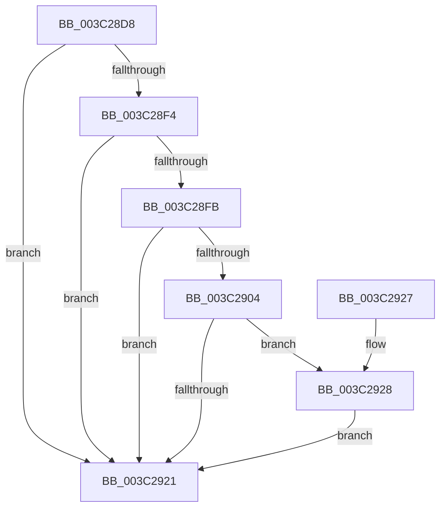

# KiInitializeForegroundBoostThread

- RVA: `0x003C28D8`–`0x003C2946` (길이 `110` bytes)
- VA: `0x00000001403C28D8`
- 실행 섹션: `.text`
- PDB 이름 있음: `예`; PDB Function 태그: `아니요`
- unwind 정보 RVA: `0x0008E244`
- 디코드: `33`개 명령, `110/110` bytes 표시
- 미해석 바이트: `0` (있으면 어셈블리에 `.byte`로 보존)

> 이 문서는 커널 이미지의 기계어와 PDB 기호를 분석해 생성했습니다. 4번과 5번은 함수 원형과 자료형을 바이너리 사용 방식에서 추정한 C 해석이며 원본 소스 복구 결과는 아닙니다.

## 1. Dependencies

- 직접 호출 지점: **4**; 고유 호출 대상: **4**
- 직접 호출자로 확인된 함수: **1**
- RIP 상대 이미지 참조: **0**

### Outgoing calls
- `0x003C2904` → [KiSetForegroundBoost](KiSetForegroundBoost_function_003C343C.md) (function, `0x003C343C`)
- `0x003C2911` → [KiComputeThreadPriority](KiComputeThreadPriority_function_003C45F4.md) (function, `0x003C45F4`)
- `0x003C2935` → [KiUpdateThreadPriority](../25/KiUpdateThreadPriority_function_00257810.md) (function, `0x00257810`)
- `0x003C293F` → [KiUpdateSharedReadyQueueAffinityThread](../2C/KiUpdateSharedReadyQueueAffinityThread_function_002CE470.md) (function, `0x002CE470`)

### Direct callers
- [KeStartThread](KeStartThread_function_003C21B8.md) at `0x003C2513`

### Static image references
- 디코드된 RIP-relative 메모리 참조가 없습니다.

## 2. Other-region calls and transfers

- 다른 실행 섹션으로 향하는 call: **0**
- 별도 외부 분기/꼬리 이동을 확인하지 못했습니다.

## 3. Assembly (complete function range)

```asm
003C28D8  40 53                           push rbx
003C28DA  48 83 EC 30                     sub rsp, 0x30
003C28DE  48 8B 81 20 02 00 00            mov rax, qword ptr [rcx + 0x220]
003C28E5  48 8B D9                        mov rbx, rcx
003C28E8  8B 80 88 00 00 00               mov eax, dword ptr [rax + 0x88]
003C28EE  0F BA E0 0D                     bt eax, 0xd
003C28F2  73 2D                           jae 0x1403c2921
003C28F4  8B 41 78                        mov eax, dword ptr [rcx + 0x78]
003C28F7  A8 08                           test al, 8
003C28F9  75 26                           jne 0x1403c2921
003C28FB  80 B9 C3 00 00 00 00            cmp byte ptr [rcx + 0xc3], 0
003C2902  7E 1D                           jle 0x1403c2921
003C2904  E8 33 0B 00 00                  call 0x1403c343c
003C2909  45 33 C0                        xor r8d, r8d
003C290C  33 D2                           xor edx, edx
003C290E  48 8B CB                        mov rcx, rbx
003C2911  E8 DE 1C 00 00                  call 0x1403c45f4
003C2916  0F BE 8B C3 00 00 00            movsx ecx, byte ptr [rbx + 0xc3]
003C291D  3B C1                           cmp eax, ecx
003C291F  7F 07                           jg 0x1403c2928
003C2921  48 83 C4 30                     add rsp, 0x30
003C2925  5B                              pop rbx
003C2926  C3                              ret
003C2927  CC                              int3
003C2928  44 8B C8                        mov r9d, eax
003C292B  C6 44 24 20 00                  mov byte ptr [rsp + 0x20], 0
003C2930  4C 8B C3                        mov r8, rbx
003C2933  33 C9                           xor ecx, ecx
003C2935  E8 D6 4E E9 FF                  call 0x140257810
003C293A  48 8B D3                        mov rdx, rbx
003C293D  33 C9                           xor ecx, ecx
003C293F  E8 2C BB F0 FF                  call 0x1402ce470
003C2944  EB DB                           jmp 0x1403c2921
```

## 4. C-style interpretation (structured pseudocode)

```c
__int64 __fastcall KiInitializeForegroundBoostThread(__int64 a1, int a2, int a3)
{
    __int64 result;
    __int64 v_rsp;
    unsigned __int8 v_stack_p20;

    v_rsp = (v_rsp) - (48);
    if (condition_is_above_or_equal) goto loc_003C2921;
    if ((((unsigned __int8)((unsigned int)(*(unsigned int *)(a1 + 120)))) & (8)) != 0) goto loc_003C2921;
    if ((*(unsigned __int8 *)(a1 + 195)) <= 0) goto loc_003C2921;
    result = KiSetForegroundBoost(a1, a2, a3, a4);
    a3 = 0;
    a2 = 0;
    result = KiComputeThreadPriority(a1, a2, a3, a4);
    if (((unsigned int)(result)) > ((unsigned int)((__int8)(*(unsigned __int8 *)(a1 + 195))))) goto loc_003C2928;
loc_003C2921:
    v_rsp = (v_rsp) + (48);
    return result;
loc_003C2928:
    v_stack_p20 = 0;
    a1 = 0;
    result = KiUpdateThreadPriority(a1, a2, a1, (unsigned int)((unsigned int)(result)));
    a1 = 0;
    result = KiUpdateSharedReadyQueueAffinityThread(a1, 0, a1, (unsigned int)((unsigned int)(result)));
    goto loc_003C2921;
}
```

## 5. (Beta) C Style

```c
int64_t KiInitializeForegroundBoostThread(void *Arg1, int32_t Arg2, int32_t Arg3)
{
    uint8_t *arg1 = (uint8_t *)Arg1;

    int64_t result;
    int64_t local_rsp;
    uint8_t v_stack_p20;

    local_rsp = (local_rsp) - (48);
    if (condition_is_above_or_equal) goto loc_003C2921;
    if ((((uint8_t)((uint32_t)(*(uint32_t *)(arg1 + 0x78)))) & (8)) != 0) goto loc_003C2921;
    if ((*(uint8_t *)(arg1 + 0xC3)) <= 0) goto loc_003C2921;
    result = KiSetForegroundBoost(Arg1, Arg2, Arg3, a4);
    Arg3 = 0;
    Arg2 = 0;
    result = KiComputeThreadPriority(Arg1, Arg2, Arg3, a4);
    if (((uint32_t)(result)) > ((uint32_t)((int8_t)(*(uint8_t *)(arg1 + 0xC3))))) goto loc_003C2928;
loc_003C2921:
    local_rsp = (local_rsp) + (48);
    return result;
loc_003C2928:
    v_stack_p20 = 0;
    Arg1 = 0;
    result = KiUpdateThreadPriority(Arg1, Arg2, Arg1, (uint32_t)((uint32_t)(result)));
    Arg1 = 0;
    result = KiUpdateSharedReadyQueueAffinityThread(Arg1, 0, Arg1, (uint32_t)((uint32_t)(result)));
    goto loc_003C2921;
}
```

### 관측된 메모리 오프셋

구조체 형식이 확인되지 않은 접근은 인자 기준의 오프셋으로만 기록했습니다.

| 기준 인자 | 오프셋 표현 | 폭 (bit) | 접근 |
|---|---:|---:|---|
| `Arg1` | `+ 0x78` | `32` | `R` |
| `Arg1` | `+ 0xC3` | `8` | `R` |
| `Arg1` | `+ 0x220` | `64` | `R` |

## 6. Execution-region graph

[열기: 2D/3D 그래프와 함수 탐색 컨트롤 패널](../../../control-panel.html?section=text&rva=0x003C28D8&view=graph)

- 2D 그래프는 위에서 아래로 흐르고, 3D 그래프는 빈 공간을 드래그해 회전합니다. Shift+드래그는 이동, 휠은 확대·축소, 함수 노드 선택은 대상 보고서 이동입니다.

### Static fallback


