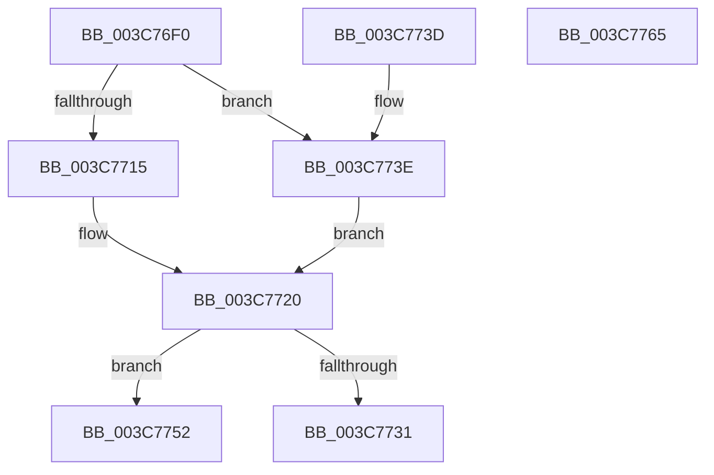

# KiMoveApcState

- RVA: `0x003C76F0`–`0x003C7766` (길이 `118` bytes)
- VA: `0x00000001403C76F0`
- 실행 섹션: `.text`
- PDB 이름 있음: `예`; PDB Function 태그: `아니요`
- unwind 정보 RVA: `0x000DB714`
- 디코드: `37`개 명령, `118/118` bytes 표시
- 미해석 바이트: `0` (있으면 어셈블리에 `.byte`로 보존)

> 이 문서는 커널 이미지의 기계어와 PDB 기호를 분석해 생성했습니다. 4번과 5번은 함수 원형과 자료형을 바이너리 사용 방식에서 추정한 C 해석이며 원본 소스 복구 결과는 아닙니다.

## 1. Dependencies

- 직접 호출 지점: **0**; 고유 호출 대상: **0**
- 직접 호출자로 확인된 함수: **2**
- RIP 상대 이미지 참조: **0**

### Outgoing calls
- 직접 디코드된 call 명령이 없습니다.

### Direct callers
- [sub_0028F34E](../28/Unknown_function_0028F34E.md) at `0x0028F354`
- [sub_003C7676](Unknown_function_003C7676.md) at `0x003C767C`

### Static image references
- 디코드된 RIP-relative 메모리 참조가 없습니다.

## 2. Other-region calls and transfers

- 다른 실행 섹션으로 향하는 call: **0**
- 별도 외부 분기/꼬리 이동을 확인하지 못했습니다.

## 3. Assembly (complete function range)

```asm
003C76F0  48 8B 41 20                     mov rax, qword ptr [rcx + 0x20]
003C76F4  48 89 42 20                     mov qword ptr [rdx + 0x20], rax
003C76F8  0F B6 41 28                     movzx eax, byte ptr [rcx + 0x28]
003C76FC  88 42 28                        mov byte ptr [rdx + 0x28], al
003C76FF  0F B6 41 29                     movzx eax, byte ptr [rcx + 0x29]
003C7703  88 42 29                        mov byte ptr [rdx + 0x29], al
003C7706  0F B6 41 2A                     movzx eax, byte ptr [rcx + 0x2a]
003C770A  88 42 2A                        mov byte ptr [rdx + 0x2a], al
003C770D  4C 8B 01                        mov r8, qword ptr [rcx]
003C7710  4C 3B C1                        cmp r8, rcx
003C7713  75 29                           jne 0x1403c773e
003C7715  48 89 52 08                     mov qword ptr [rdx + 8], rdx
003C7719  48 89 12                        mov qword ptr [rdx], rdx
003C771C  C6 42 29 00                     mov byte ptr [rdx + 0x29], 0
003C7720  4C 8B 49 10                     mov r9, qword ptr [rcx + 0x10]
003C7724  48 8D 41 10                     lea rax, [rcx + 0x10]
003C7728  4C 8D 42 10                     lea r8, [rdx + 0x10]
003C772C  4C 3B C8                        cmp r9, rax
003C772F  75 21                           jne 0x1403c7752
003C7731  4D 89 40 08                     mov qword ptr [r8 + 8], r8
003C7735  4D 89 00                        mov qword ptr [r8], r8
003C7738  C6 42 2A 00                     mov byte ptr [rdx + 0x2a], 0
003C773C  C3                              ret
003C773D  CC                              int3
003C773E  48 8B 41 08                     mov rax, qword ptr [rcx + 8]
003C7742  4C 89 02                        mov qword ptr [rdx], r8
003C7745  48 89 42 08                     mov qword ptr [rdx + 8], rax
003C7749  49 89 50 08                     mov qword ptr [r8 + 8], rdx
003C774D  48 89 10                        mov qword ptr [rax], rdx
003C7750  EB CE                           jmp 0x1403c7720
003C7752  48 8B 41 18                     mov rax, qword ptr [rcx + 0x18]
003C7756  4D 89 08                        mov qword ptr [r8], r9
003C7759  48 89 42 18                     mov qword ptr [rdx + 0x18], rax
003C775D  4D 89 41 08                     mov qword ptr [r9 + 8], r8
003C7761  4C 89 00                        mov qword ptr [rax], r8
003C7764  C3                              ret
003C7765  CC                              int3
```

## 4. C-style interpretation (structured pseudocode)

```c
__int64 __fastcall KiMoveApcState(__int64 a1, __int64 a2)
{
    *(unsigned __int64 *)(a2 + 32) = *(unsigned __int64 *)(a1 + 32);
    *(unsigned __int8 *)(a2 + 40) = (unsigned __int8)(*(unsigned __int8 *)(a1 + 40));
    *(unsigned __int8 *)(a2 + 41) = (unsigned __int8)(*(unsigned __int8 *)(a1 + 41));
    *(unsigned __int8 *)(a2 + 42) = (unsigned __int8)(*(unsigned __int8 *)(a1 + 42));
    if ((*(unsigned __int64 *)(a1)) != a1) goto loc_003C773E;
    *(unsigned __int64 *)(a2 + 8) = a2;
    *(unsigned __int64 *)(a2) = a2;
    *(unsigned __int8 *)(a2 + 41) = 0;
loc_003C7720:
    if ((*(unsigned __int64 *)(a1 + 16)) != (a1 + 16)) goto loc_003C7752;
    *(unsigned __int64 *)(a2 + 16 + 8) = a2 + 16;
    *(unsigned __int64 *)(a2 + 16) = a2 + 16;
    *(unsigned __int8 *)(a2 + 42) = 0;
    return a1 + 16;
loc_003C773E:
    *(unsigned __int64 *)(a2) = a2 + 16;
    *(unsigned __int64 *)(a2 + 8) = *(unsigned __int64 *)(a1 + 8);
    *(unsigned __int64 *)(a2 + 16 + 8) = a2;
    *(unsigned __int64 *)(*(unsigned __int64 *)(a1 + 8)) = a2;
    goto loc_003C7720;
loc_003C7752:
    *(unsigned __int64 *)(a2 + 16) = *(unsigned __int64 *)(a1 + 16);
    *(unsigned __int64 *)(a2 + 24) = *(unsigned __int64 *)(a1 + 24);
    *(unsigned __int64 *)(*(unsigned __int64 *)(a1 + 16) + 8) = a2 + 16;
    *(unsigned __int64 *)(*(unsigned __int64 *)(a1 + 24)) = a2 + 16;
    return *(unsigned __int64 *)(a1 + 24);
}
```

## 5. (Beta) C Style

```c
void *KiMoveApcState(void *Arg1, void *Arg2)
{
    uint8_t *arg1 = (uint8_t *)Arg1;
    uint8_t *arg2 = (uint8_t *)Arg2;

    *(uint64_t *)(arg2 + 0x20) = *(uint64_t *)(arg1 + 0x20);
    *(uint8_t *)(arg2 + 0x28) = (uint8_t)(*(uint8_t *)(arg1 + 0x28));
    *(uint8_t *)(arg2 + 0x29) = (uint8_t)(*(uint8_t *)(arg1 + 0x29));
    *(uint8_t *)(arg2 + 0x2A) = (uint8_t)(*(uint8_t *)(arg1 + 0x2A));
    if ((*(uint64_t *)(arg1)) != Arg1) goto loc_003C773E;
    *(void **)(arg2 + 0x8) = Arg2;
    *(void **)(arg2) = Arg2;
    *(uint8_t *)(arg2 + 0x29) = 0;
loc_003C7720:
    if ((*(uint64_t *)(arg1 + 0x10)) != (Arg1 + 16)) goto loc_003C7752;
    *(void **)(arg2 + 0x10 + 0x8) = Arg2 + 16;
    *(void **)(arg2 + 0x10) = Arg2 + 16;
    *(uint8_t *)(arg2 + 0x2A) = 0;
    return Arg1 + 16;
loc_003C773E:
    *(void **)(arg2) = Arg2 + 16;
    *(uint64_t *)(arg2 + 0x8) = *(uint64_t *)(arg1 + 0x8);
    *(void **)(arg2 + 0x10 + 0x8) = Arg2;
    *(void **)(*(uint64_t *)(arg1 + 0x8)) = Arg2;
    goto loc_003C7720;
loc_003C7752:
    *(uint64_t *)(arg2 + 0x10) = *(uint64_t *)(arg1 + 0x10);
    *(uint64_t *)(arg2 + 0x18) = *(uint64_t *)(arg1 + 0x18);
    *(void **)(*(uint64_t *)(arg1 + 0x10) + 0x8) = Arg2 + 16;
    *(void **)(*(uint64_t *)(arg1 + 0x18)) = Arg2 + 16;
    return *(uint64_t *)(arg1 + 0x18);
}
```

### 관측된 메모리 오프셋

구조체 형식이 확인되지 않은 접근은 인자 기준의 오프셋으로만 기록했습니다.

| 기준 인자 | 오프셋 표현 | 폭 (bit) | 접근 |
|---|---:|---:|---|
| `Arg1` | `+ 0x0` | `64` | `R` |
| `Arg1` | `+ 0x8` | `64` | `R` |
| `Arg1` | `+ 0x10` | `64` | `R` |
| `Arg1` | `+ 0x18` | `64` | `R` |
| `Arg1` | `+ 0x20` | `64` | `R` |
| `Arg1` | `+ 0x28` | `8` | `R` |
| `Arg1` | `+ 0x29` | `8` | `R` |
| `Arg1` | `+ 0x2A` | `8` | `R` |
| `Arg2` | `+ 0x0` | `64` | `W` |
| `Arg2` | `+ 0x8` | `64` | `W` |
| `Arg2` | `+ 0x10` | `64` | `R` |
| `Arg2` | `+ 0x18` | `64` | `W` |
| `Arg2` | `+ 0x20` | `64` | `W` |
| `Arg2` | `+ 0x28` | `8` | `W` |
| `Arg2` | `+ 0x29` | `8` | `W` |
| `Arg2` | `+ 0x2A` | `8` | `W` |

## 6. Execution-region graph

[열기: 2D/3D 그래프와 함수 탐색 컨트롤 패널](../../../control-panel.html?section=text&rva=0x003C76F0&view=graph)

- 2D 그래프는 위에서 아래로 흐르고, 3D 그래프는 빈 공간을 드래그해 회전합니다. Shift+드래그는 이동, 휠은 확대·축소, 함수 노드 선택은 대상 보고서 이동입니다.

### Static fallback


