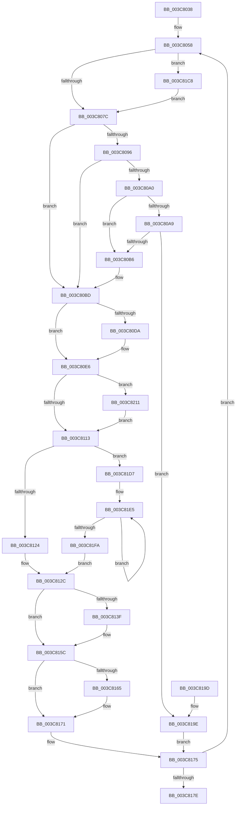

# KiOutSwapProcesses

- RVA: `0x003C8038`–`0x003C821B` (길이 `483` bytes)
- VA: `0x00000001403C8038`
- 실행 섹션: `.text`
- PDB 이름 있음: `예`; PDB Function 태그: `아니요`
- unwind 정보 RVA: `0x0008E91C`
- 디코드: `117`개 명령, `483/483` bytes 표시
- 미해석 바이트: `0` (있으면 어셈블리에 `.byte`로 보존)

> 이 문서는 커널 이미지의 기계어와 PDB 기호를 분석해 생성했습니다. 4번과 5번은 함수 원형과 자료형을 바이너리 사용 방식에서 추정한 C 해석이며 원본 소스 복구 결과는 아닙니다.

## 1. Dependencies

- 직접 호출 지점: **9**; 고유 호출 대상: **5**
- 직접 호출자로 확인된 함수: **1**
- RIP 상대 이미지 참조: **5**

### Outgoing calls
- `0x003C807F` → [KiAcquireKobjectLockSafe](../25/KiAcquireKobjectLockSafe_function_00251C90.md) (function, `0x00251C90`)
- `0x003C80E1` → [KiLowerIrqlProcessIrqlFlags](../4F/KiLowerIrqlProcessIrqlFlags_function_004F5698.md) (function, `0x004F5698`)
- `0x003C80F1` → [MmOutSwapProcess](MmOutSwapProcess_function_003C8224.md) (function, `0x003C8224`)
- `0x003C8116` → [KiAcquireKobjectLockSafe](../25/KiAcquireKobjectLockSafe_function_00251C90.md) (function, `0x00251C90`)
- `0x003C8146` → [KiAcquireKobjectLockSafe](../25/KiAcquireKobjectLockSafe_function_00251C90.md) (function, `0x00251C90`)
- `0x003C816C` → [KiLowerIrqlProcessIrqlFlags](../4F/KiLowerIrqlProcessIrqlFlags_function_004F5698.md) (function, `0x004F5698`)
- `0x003C81C1` → [KiReadyOutSwappedThreads](../39/KiReadyOutSwappedThreads_function_00396E30.md) (function, `0x00396E30`)
- `0x003C81CD` → [KiRaiseIrqlProcessIrqlFlags](../4F/KiRaiseIrqlProcessIrqlFlags_function_004F56FC.md) (function, `0x004F56FC`)
- `0x003C8211` → [KiRaiseIrqlProcessIrqlFlags](../4F/KiRaiseIrqlProcessIrqlFlags_function_004F56FC.md) (function, `0x004F56FC`)

### Direct callers
- [KeSwapProcessOrStack](../5C/KeSwapProcessOrStack_function_005C5E00.md) at `0x005C5E70`

### Static image references
- `0x003C806F` → RVA `0x00FC6D20` (`ALMOSTRO`; read)
- `0x003C813F` → RVA `0x00F22D80` (`.data`; read)
- `0x003C814B` → RVA `0x00F22D84` (`.data`; write)
- `0x003C8151` → RVA `0x00F22D80` (`.data`; read/write)
- `0x003C81D7` → RVA `0x00F22D98` (`.data`; read)

## 2. Other-region calls and transfers

- 다른 실행 섹션으로 향하는 call: **0**
- 별도 외부 분기/꼬리 이동을 확인하지 못했습니다.

## 3. Assembly (complete function range)

```asm
003C8038  48 8B C4                        mov rax, rsp
003C803B  48 89 58 08                     mov qword ptr [rax + 8], rbx
003C803F  48 89 68 10                     mov qword ptr [rax + 0x10], rbp
003C8043  48 89 70 18                     mov qword ptr [rax + 0x18], rsi
003C8047  48 89 78 20                     mov qword ptr [rax + 0x20], rdi
003C804B  41 54                           push r12
003C804D  41 56                           push r14
003C804F  41 57                           push r15
003C8051  48 83 EC 20                     sub rsp, 0x20
003C8055  48 8B F1                        mov rsi, rcx
003C8058  4C 8B E6                        mov r12, rsi
003C805B  48 8D 5E 88                     lea rbx, [rsi - 0x78]
003C805F  48 8B 36                        mov rsi, qword ptr [rsi]
003C8062  B8 02 00 00 00                  mov eax, 2
003C8067  45 0F 20 C6                     mov r14, cr8
003C806B  44 0F 22 C0                     mov cr8, rax
003C806F  83 3D AA EC BF 00 00            cmp dword ptr [rip + 0xbfecaa], 0
003C8076  0F 85 4C 01 00 00               jne 0x1403c81c8
003C807C  48 8B CB                        mov rcx, rbx
003C807F  E8 0C 9C E8 FF                  call 0x140251c90
003C8084  8B 83 08 01 00 00               mov eax, dword ptr [rbx + 0x108]
003C808A  48 8D 7B 68                     lea rdi, [rbx + 0x68]
003C808E  4C 8B 07                        mov r8, qword ptr [rdi]
003C8091  4C 3B C7                        cmp r8, rdi
003C8094  74 27                           je 0x1403c80bd
003C8096  8B C8                           mov ecx, eax
003C8098  83 E1 07                        and ecx, 7
003C809B  80 F9 06                        cmp cl, 6
003C809E  74 1D                           je 0x1403c80bd
003C80A0  48 8B 07                        mov rax, qword ptr [rdi]
003C80A3  48 39 78 08                     cmp qword ptr [rax + 8], rdi
003C80A7  75 0D                           jne 0x1403c80b6
003C80A9  48 8B 57 08                     mov rdx, qword ptr [rdi + 8]
003C80AD  48 39 3A                        cmp qword ptr [rdx], rdi
003C80B0  0F 84 E8 00 00 00               je 0x1403c819e
003C80B6  B9 03 00 00 00                  mov ecx, 3
003C80BB  CD 29                           int 0x29
003C80BD  83 F0 FD                        xor eax, 0xfffffffd
003C80C0  83 E0 07                        and eax, 7
003C80C3  F0 31 83 08 01 00 00            lock xor dword ptr [rbx + 0x108], eax
003C80CA  F0 81 23 7F FF FF FF            lock and dword ptr [rbx], 0xffffff7f
003C80D1  83 3D 48 EC BF 00 00            cmp dword ptr [rip + 0xbfec48], 0
003C80D8  74 0C                           je 0x1403c80e6
003C80DA  44 0F 20 C1                     mov rcx, cr8
003C80DE  41 8A D6                        mov dl, r14b
003C80E1  E8 B2 D5 12 00                  call 0x1404f5698
003C80E6  45 0F B6 FE                     movzx r15d, r14b
003C80EA  45 0F 22 C7                     mov cr8, r15
003C80EE  48 8B CB                        mov rcx, rbx
003C80F1  E8 2E 01 00 00                  call 0x1403c8224
003C80F6  40 32 ED                        xor bpl, bpl
003C80F9  44 0F 20 C1                     mov rcx, cr8
003C80FD  BA 02 00 00 00                  mov edx, 2
003C8102  44 0F 22 C2                     mov cr8, rdx
003C8106  83 3D 13 EC BF 00 00            cmp dword ptr [rip + 0xbfec13], 0
003C810D  0F 85 FE 00 00 00               jne 0x1403c8211
003C8113  48 8B CB                        mov rcx, rbx
003C8116  E8 75 9B E8 FF                  call 0x140251c90
003C811B  48 39 3F                        cmp qword ptr [rdi], rdi
003C811E  0F 85 B3 00 00 00               jne 0x1403c81d7
003C8124  B8 04 00 00 00                  mov eax, 4
003C8129  8D 78 FD                        lea edi, [rax - 3]
003C812C  F0 31 83 08 01 00 00            lock xor dword ptr [rbx + 0x108], eax
003C8133  F0 81 23 7F FF FF FF            lock and dword ptr [rbx], 0xffffff7f
003C813A  40 84 ED                        test bpl, bpl
003C813D  74 1D                           je 0x1403c815c
003C813F  48 8D 0D 3A AC B5 00            lea rcx, [rip + 0xb5ac3a]
003C8146  E8 45 9B E8 FF                  call 0x140251c90
003C814B  89 3D 33 AC B5 00               mov dword ptr [rip + 0xb5ac33], edi
003C8151  F0 81 25 24 AC B5 00 7F FF FF FF  lock and dword ptr [rip + 0xb5ac24], 0xffffff7f
003C815C  83 3D BD EB BF 00 00            cmp dword ptr [rip + 0xbfebbd], 0
003C8163  74 0C                           je 0x1403c8171
003C8165  44 0F 20 C1                     mov rcx, cr8
003C8169  41 8A D6                        mov dl, r14b
003C816C  E8 27 D5 12 00                  call 0x1404f5698
003C8171  45 0F 22 C7                     mov cr8, r15
003C8175  48 85 F6                        test rsi, rsi
003C8178  0F 85 DA FE FF FF               jne 0x1403c8058
003C817E  48 8B 5C 24 40                  mov rbx, qword ptr [rsp + 0x40]
003C8183  48 8B 6C 24 48                  mov rbp, qword ptr [rsp + 0x48]
003C8188  48 8B 74 24 50                  mov rsi, qword ptr [rsp + 0x50]
003C818D  48 8B 7C 24 58                  mov rdi, qword ptr [rsp + 0x58]
003C8192  48 83 C4 20                     add rsp, 0x20
003C8196  41 5F                           pop r15
003C8198  41 5E                           pop r14
003C819A  41 5C                           pop r12
003C819C  C3                              ret
003C819D  CC                              int3
003C819E  48 89 02                        mov qword ptr [rdx], rax
003C81A1  48 89 50 08                     mov qword ptr [rax + 8], rdx
003C81A5  48 89 7F 08                     mov qword ptr [rdi + 8], rdi
003C81A9  48 89 3F                        mov qword ptr [rdi], rdi
003C81AC  F0 83 B3 08 01 00 00 03         lock xor dword ptr [rbx + 0x108], 3
003C81B4  F0 81 23 7F FF FF FF            lock and dword ptr [rbx], 0xffffff7f
003C81BB  41 8A D6                        mov dl, r14b
003C81BE  49 8B C8                        mov rcx, r8
003C81C1  E8 6A EC FC FF                  call 0x140396e30
003C81C6  EB AD                           jmp 0x1403c8175
003C81C8  8A D0                           mov dl, al
003C81CA  41 8A CE                        mov cl, r14b
003C81CD  E8 2A D5 12 00                  call 0x1404f56fc
003C81D2  E9 A5 FE FF FF                  jmp 0x1403c807c
003C81D7  0F 0D 0D BA AB B5 00            prefetchw byte ptr [rip + 0xb5abba]
003C81DE  48 8B 05 B3 AB B5 00            mov rax, qword ptr [rip + 0xb5abb3]
003C81E5  49 89 04 24                     mov qword ptr [r12], rax
003C81E9  48 8B C8                        mov rcx, rax
003C81EC  F0 4C 0F B1 25 A3 AB B5 00      lock cmpxchg qword ptr [rip + 0xb5aba3], r12
003C81F5  48 3B C1                        cmp rax, rcx
003C81F8  75 EB                           jne 0x1403c81e5
003C81FA  BF 01 00 00 00                  mov edi, 1
003C81FF  40 0F B6 ED                     movzx ebp, bpl
003C8203  48 85 C0                        test rax, rax
003C8206  0F 44 EF                        cmove ebp, edi
003C8209  8D 47 06                        lea eax, [rdi + 6]
003C820C  E9 1B FF FF FF                  jmp 0x1403c812c
003C8211  E8 E6 D4 12 00                  call 0x1404f56fc
003C8216  E9 F8 FE FF FF                  jmp 0x1403c8113
```

## 4. C-style interpretation (structured pseudocode)

```c
__int64 __fastcall KiOutSwapProcesses(__int64 a1)
{
    __int64 result;
    __int64 v_rbp;
    __int64 v_rsp;
    unsigned __int64 v_stack_p10;
    unsigned __int64 v_stack_p18;
    unsigned __int64 v_stack_p20;
    unsigned __int64 v_stack_p8;

    *(unsigned __int64 *)(v_rsp + 8) = v_rbx;
    *(unsigned __int64 *)(v_rsp + 16) = v_rbp;
    *(unsigned __int64 *)(v_rsp + 24) = v_rsi;
    *(unsigned __int64 *)(v_rsp + 32) = v_rdi;
    v_rsp = (v_rsp) - (32);
loc_003C8058:
    if ((*(unsigned int *)(v_rip + 12577962)) != 0) goto loc_003C81C8;
loc_003C807C:
    result = KiAcquireKobjectLockSafe(a1 - 120, a2, a3, a4);
    if ((*(unsigned __int64 *)(a1 - 120 + 104)) == (a1 - 120 + 104)) goto loc_003C80BD;
    a1 = (unsigned int)(((unsigned int)((unsigned int)((unsigned int)(*(unsigned int *)(a1 - 120 + 264))))) & (7));
    if (((unsigned __int8)(a1)) == 6) goto loc_003C80BD;
    if ((*(unsigned __int64 *)(*(unsigned __int64 *)(a1 - 120 + 104) + 8)) != (a1 - 120 + 104)) goto loc_003C80B6;
    if ((*(unsigned __int64 *)(*(unsigned __int64 *)(a1 - 120 + 104 + 8))) == (a1 - 120 + 104)) goto loc_003C819E;
loc_003C80B6:
loc_003C80BD:
    result = (unsigned int)((*(unsigned __int64 *)(a1 - 120 + 104)) ^ (0xFFFFFFFDULL));
    result = (unsigned int)((result) & (7));
    if ((*(unsigned int *)(v_rip + 12577864)) != 0) {
        a1 = 2;
        a2 = (unsigned __int8)(v_cr8);
        result = KiLowerIrqlProcessIrqlFlags(a1, a2, *(unsigned __int64 *)(a1 - 120 + 104), a4);
    }
    result = MmOutSwapProcess(a1 - 120, a2, *(unsigned __int64 *)(a1 - 120 + 104), a4);
    v_rbp = 0;
    if ((*(unsigned int *)(v_rip + 12577811)) != 0) goto loc_003C8211;
loc_003C8113:
    result = KiAcquireKobjectLockSafe(a1 - 120, 2, *(unsigned __int64 *)(a1 - 120 + 104), a4);
    if ((*(unsigned __int64 *)(a1 - 120 + 104)) != (a1 - 120 + 104)) goto loc_003C81D7;
loc_003C812C:
    result = 4;
    if (0 != 0) {
        a1 = v_rip + 11906106;
        result = KiAcquireKobjectLockSafe(a1, 2, *(unsigned __int64 *)(a1 - 120 + 104), a4);
        *(unsigned int *)(v_rip + 11906099) = (unsigned int)(4 - 3);
    }
    if ((*(unsigned int *)(v_rip + 12577725)) != 0) {
        a1 = 2;
        a2 = (unsigned __int8)(v_cr8);
        result = KiLowerIrqlProcessIrqlFlags(a1, a2, *(unsigned __int64 *)(a1 - 120 + 104), a4);
    }
loc_003C8175:
    if (*(unsigned __int64 *)(a1) != 0) goto loc_003C8058;
    v_rsp = (v_rsp) + (32);
    return result;
loc_003C819E:
    *(unsigned __int64 *)(a2) = result;
    *(unsigned __int64 *)(result + 8) = a2;
    *(unsigned __int64 *)(v_stack_p20 + 8) = v_stack_p20;
    *(unsigned __int64 *)(v_stack_p20) = v_stack_p20;
    result = KiReadyOutSwappedThreads(*(unsigned __int64 *)(a1 - 120 + 104), (unsigned __int8)(v_cr8), *(unsigned __int64 *)(a1 - 120 + 104), a4);
    goto loc_003C8175;
loc_003C81C8:
    result = KiRaiseIrqlProcessIrqlFlags((unsigned __int8)(v_cr8), (unsigned __int8)(result), *(unsigned __int64 *)(a1 - 120 + 104), a4);
    goto loc_003C807C;
loc_003C81D7:
loc_003C81E5:
    *(unsigned __int64 *)(a1) = *(unsigned __int64 *)(v_rip + 11905971);
    if ((*(unsigned __int64 *)(v_rip + 11905971)) != (*(unsigned __int64 *)(v_rip + 11905971))) goto loc_003C81E5;
    v_rbp = (unsigned __int8)(v_stack_p10);
    if (*(unsigned __int64 *)(v_rip + 11905971) == 0) { v_rbp = 1; }
    goto loc_003C812C;
loc_003C8211:
    result = KiRaiseIrqlProcessIrqlFlags(*(unsigned __int64 *)(v_rip + 11905971), (unsigned __int8)(result), *(unsigned __int64 *)(a1 - 120 + 104), a4);
    goto loc_003C8113;
}
```

## 5. (Beta) C Style

```c
int64_t KiOutSwapProcesses(int64_t Arg1)
{
    int64_t result;
    int64_t local_rbp;
    int64_t local_rsp;
    uint64_t v_stack_p10;
    uint64_t v_stack_p18;
    uint64_t v_stack_p20;
    uint64_t v_stack_p8;

    *(uint64_t *)(local_rsp + 0x8) = local_rbx;
    *(uint64_t *)(local_rsp + 0x10) = local_rbp;
    *(uint64_t *)(local_rsp + 0x18) = local_rsi;
    *(uint64_t *)(local_rsp + 0x20) = local_rdi;
    local_rsp = (local_rsp) - (32);
loc_003C8058:
    if ((*(uint32_t *)(v_rip + 0xBFECAA)) != 0) goto loc_003C81C8;
loc_003C807C:
    result = KiAcquireKobjectLockSafe(Arg1 - 120, a2, a3, a4);
    if ((*(uint64_t *)(Arg1 - 0x78 + 0x68)) == (Arg1 - 120 + 104)) goto loc_003C80BD;
    Arg1 = (uint32_t)(((uint32_t)((uint32_t)((uint32_t)(*(uint32_t *)(Arg1 - 0x78 + 0x108))))) & (7));
    if (((uint8_t)(Arg1)) == 6) goto loc_003C80BD;
    if ((*(uint64_t *)(*(uint64_t *)(Arg1 - 0x78 + 0x68) + 0x8)) != (Arg1 - 120 + 104)) goto loc_003C80B6;
    if ((*(uint64_t *)(*(uint64_t *)(Arg1 - 0x78 + 0x68 + 0x8))) == (Arg1 - 120 + 104)) goto loc_003C819E;
loc_003C80B6:
loc_003C80BD:
    result = (uint32_t)((*(uint64_t *)(Arg1 - 0x78 + 0x68)) ^ (0xFFFFFFFDULL));
    result = (uint32_t)((result) & (7));
    if ((*(uint32_t *)(v_rip + 0xBFEC48)) != 0) {
        Arg1 = 2;
        a2 = (uint8_t)(v_cr8);
        result = KiLowerIrqlProcessIrqlFlags(Arg1, a2, *(uint64_t *)(Arg1 - 0x78 + 0x68), a4);
    }
    result = MmOutSwapProcess(Arg1 - 120, a2, *(uint64_t *)(Arg1 - 0x78 + 0x68), a4);
    local_rbp = 0;
    if ((*(uint32_t *)(v_rip + 0xBFEC13)) != 0) goto loc_003C8211;
loc_003C8113:
    result = KiAcquireKobjectLockSafe(Arg1 - 120, 2, *(uint64_t *)(Arg1 - 0x78 + 0x68), a4);
    if ((*(uint64_t *)(Arg1 - 0x78 + 0x68)) != (Arg1 - 120 + 104)) goto loc_003C81D7;
loc_003C812C:
    result = 4;
    if (0 != 0) {
        Arg1 = v_rip + 11906106;
        result = KiAcquireKobjectLockSafe(Arg1, 2, *(uint64_t *)(Arg1 - 0x78 + 0x68), a4);
        *(uint32_t *)(v_rip + 0xB5AC33) = (uint32_t)(4 - 3);
    }
    if ((*(uint32_t *)(v_rip + 0xBFEBBD)) != 0) {
        Arg1 = 2;
        a2 = (uint8_t)(v_cr8);
        result = KiLowerIrqlProcessIrqlFlags(Arg1, a2, *(uint64_t *)(Arg1 - 0x78 + 0x68), a4);
    }
loc_003C8175:
    if (*(uint64_t *)(Arg1) != 0) goto loc_003C8058;
    local_rsp = (local_rsp) + (32);
    return result;
loc_003C819E:
    *(uint64_t *)(a2) = result;
    *(uint64_t *)(result + 0x8) = a2;
    *(uint64_t *)(v_stack_p20 + 0x8) = v_stack_p20;
    *(uint64_t *)(v_stack_p20) = v_stack_p20;
    result = KiReadyOutSwappedThreads(*(uint64_t *)(Arg1 - 0x78 + 0x68), (uint8_t)(v_cr8), *(uint64_t *)(Arg1 - 0x78 + 0x68), a4);
    goto loc_003C8175;
loc_003C81C8:
    result = KiRaiseIrqlProcessIrqlFlags((uint8_t)(v_cr8), (uint8_t)(result), *(uint64_t *)(Arg1 - 0x78 + 0x68), a4);
    goto loc_003C807C;
loc_003C81D7:
loc_003C81E5:
    *(uint64_t *)(Arg1) = *(uint64_t *)(v_rip + 0xB5ABB3);
    if ((*(uint64_t *)(v_rip + 0xB5ABB3)) != (*(uint64_t *)(v_rip + 0xB5ABB3))) goto loc_003C81E5;
    local_rbp = (uint8_t)(v_stack_p10);
    if (*(uint64_t *)(v_rip + 0xB5ABB3) == 0) { local_rbp = 1; }
    goto loc_003C812C;
loc_003C8211:
    result = KiRaiseIrqlProcessIrqlFlags(*(uint64_t *)(v_rip + 0xB5ABB3), (uint8_t)(result), *(uint64_t *)(Arg1 - 0x78 + 0x68), a4);
    goto loc_003C8113;
}
```

## 6. Execution-region graph

[열기: 2D/3D 그래프와 함수 탐색 컨트롤 패널](../../../control-panel.html?section=text&rva=0x003C8038&view=graph)

- 2D 그래프는 위에서 아래로 흐르고, 3D 그래프는 빈 공간을 드래그해 회전합니다. Shift+드래그는 이동, 휠은 확대·축소, 함수 노드 선택은 대상 보고서 이동입니다.

### Static fallback


