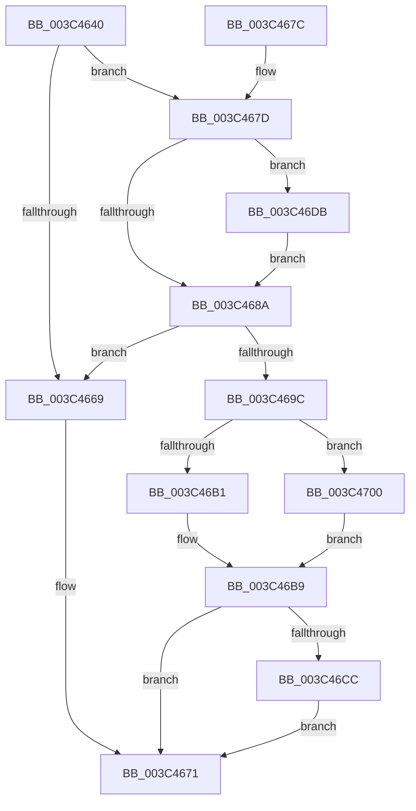

# KiPriQueueThreadPriorityChanged

- RVA: `0x003C4640`–`0x003C4710` (길이 `208` bytes)
- VA: `0x00000001403C4640`
- 실행 섹션: `.text`
- PDB 이름 있음: `예`; PDB Function 태그: `아니요`
- unwind 정보 RVA: `0x0008E3E8`
- 디코드: `52`개 명령, `208/208` bytes 표시
- 미해석 바이트: `0` (있으면 어셈블리에 `.byte`로 보존)

> 이 문서는 커널 이미지의 기계어와 PDB 기호를 분석해 생성했습니다. 4번과 5번은 함수 원형과 자료형을 바이너리 사용 방식에서 추정한 C 해석이며 원본 소스 복구 결과는 아닙니다.

## 1. Dependencies

- 직접 호출 지점: **3**; 고유 호출 대상: **3**
- 직접 호출자로 확인된 함수: **4**
- RIP 상대 이미지 참조: **0**

### Outgoing calls
- `0x003C46B4` → [KiActivateWaiterPriQueue](KiActivateWaiterPriQueue_function_003C69FC.md) (function, `0x003C69FC`)
- `0x003C46D4` → [KiProcessThreadWaitList](../25/KiProcessThreadWaitList_function_00252CC0.md) (function, `0x00252CC0`)
- `0x003C4709` → [KiActivateWaiterQueueWithNoLocks](../20/KiActivateWaiterQueueWithNoLocks_function_0020CEB0.md) (function, `0x0020CEB0`)

### Direct callers
- [KeSetPriorityAndQuantumProcess](KeSetPriorityAndQuantumProcess_function_003C2EC0.md) at `0x003C322A`
- [KeSetActualBasePriorityThread](KeSetActualBasePriorityThread_function_003C4370.md) at `0x003C4587`
- [KeSetBasePriorityThread](KeSetBasePriorityThread_function_003C6EB0.md) at `0x003C7226`
- [sub_006E7EC2](../6E/Unknown_function_006E7EC2.md) at `0x006E7FB7`

### Static image references
- 디코드된 RIP-relative 메모리 참조가 없습니다.

## 2. Other-region calls and transfers

- 다른 실행 섹션으로 향하는 call: **0**
- 별도 외부 분기/꼬리 이동을 확인하지 못했습니다.

## 3. Assembly (complete function range)

```asm
003C4640  48 89 5C 24 08                  mov qword ptr [rsp + 8], rbx
003C4645  56                              push rsi
003C4646  48 83 EC 20                     sub rsp, 0x20
003C464A  4C 0F BE 82 33 02 00 00         movsx r8, byte ptr [rdx + 0x233]
003C4652  4C 8B CA                        mov r9, rdx
003C4655  8B 92 1C 02 00 00               mov edx, dword ptr [rdx + 0x21c]
003C465B  45 32 DB                        xor r11b, r11b
003C465E  0F B6 DA                        movzx ebx, dl
003C4661  4C 8B D1                        mov r10, rcx
003C4664  41 3B D8                        cmp ebx, r8d
003C4667  75 14                           jne 0x1403c467d
003C4669  49 C7 41 40 00 00 00 00         mov qword ptr [r9 + 0x40], 0
003C4671  48 8B 5C 24 30                  mov rbx, qword ptr [rsp + 0x30]
003C4676  48 83 C4 20                     add rsp, 0x20
003C467A  5E                              pop rsi
003C467B  C3                              ret
003C467C  CC                              int3
003C467D  BE 01 00 00 00                  mov esi, 1
003C4682  81 E2 00 01 00 00               and edx, 0x100
003C4688  74 51                           je 0x1403c46db
003C468A  41 0F B6 C0                     movzx eax, r8b
003C468E  0B D0                           or edx, eax
003C4690  41 89 91 1C 02 00 00            mov dword ptr [r9 + 0x21c], edx
003C4697  45 84 DB                        test r11b, r11b
003C469A  74 CD                           je 0x1403c4669
003C469C  F0 41 0F BA 2A 07               lock bts dword ptr [r10], 7
003C46A2  49 C7 41 40 00 00 00 00         mov qword ptr [r9 + 0x40], 0
003C46AA  0F 93 C0                        setae al
003C46AD  84 C0                           test al, al
003C46AF  74 4F                           je 0x1403c4700
003C46B1  49 8B CA                        mov rcx, r10
003C46B4  E8 43 23 00 00                  call 0x1403c69fc
003C46B9  65 48 8B 0C 25 20 00 00 00      mov rcx, qword ptr gs:[0x20]
003C46C2  48 83 B9 08 2D 00 00 00         cmp qword ptr [rcx + 0x2d08], 0
003C46CA  74 A5                           je 0x1403c4671
003C46CC  45 33 C9                        xor r9d, r9d
003C46CF  45 33 C0                        xor r8d, r8d
003C46D2  8B D6                           mov edx, esi
003C46D4  E8 E7 E5 E8 FF                  call 0x140252cc0
003C46D9  EB 96                           jmp 0x1403c4671
003C46DB  49 8B 89 E8 00 00 00            mov rcx, qword ptr [r9 + 0xe8]
003C46E2  F0 FF 8C 99 18 02 00 00         lock dec dword ptr [rcx + rbx*4 + 0x218]
003C46EA  F0 42 01 B4 81 18 02 00 00      lock add dword ptr [rcx + r8*4 + 0x218], esi
003C46F3  44 3B C3                        cmp r8d, ebx
003C46F6  45 0F B6 DB                     movzx r11d, r11b
003C46FA  44 0F 4C DE                     cmovl r11d, esi
003C46FE  EB 8A                           jmp 0x1403c468a
003C4700  45 33 C0                        xor r8d, r8d
003C4703  49 8B D2                        mov rdx, r10
003C4706  49 8B C9                        mov rcx, r9
003C4709  E8 A2 87 E4 FF                  call 0x14020ceb0
003C470E  EB A9                           jmp 0x1403c46b9
```

## 4. C-style interpretation (structured pseudocode)

```c
__int64 __fastcall KiPriQueueThreadPriorityChanged(__int64 a1, __int64 a2)
{
    __int64 result;
    __int64 v_r11;
    __int64 v_rsp;
    unsigned __int64 v_stack_p8;

    v_stack_p8 = v_rbx;
    v_rsp = (v_rsp) - (32);
    v_r11 = 0;
    if (((unsigned int)((unsigned __int8)((unsigned int)(*(unsigned int *)(a2 + 540))))) != ((unsigned int)((__int8)(*(unsigned __int8 *)(a2 + 563))))) goto loc_003C467D;
loc_003C4669:
    *(unsigned __int64 *)(a2 + 64) = 0;
loc_003C4671:
    v_rsp = (v_rsp) + (32);
    return result;
loc_003C467D:
    a2 = (unsigned int)(((unsigned int)(*(unsigned int *)(a2 + 540))) & (256));
    if (condition_is_equal) goto loc_003C46DB;
loc_003C468A:
    a2 = (unsigned int)((a2) | ((unsigned int)((unsigned __int8)((__int8)(*(unsigned __int8 *)(a2 + 563))))));
    *(unsigned int *)(a2 + 540) = (unsigned int)(a2);
    if (0 == 0) goto loc_003C4669;
    *(unsigned __int64 *)(a2 + 64) = 0;
    result = (condition_is_above_or_equal) ? 1 : 0;
    if ((unsigned __int8)(result) == 0) goto loc_003C4700;
    result = KiActivateWaiterPriQueue(a1, a2, (__int8)(*(unsigned __int8 *)(a2 + 563)), a2);
loc_003C46B9:
    if ((*(unsigned __int64 *)(*(unsigned __int64 *)(gs_base + (0 + 32)) + 11528)) == 0) goto loc_003C4671;
    a4 = 0;
    a3 = 0;
    result = KiProcessThreadWaitList(*(unsigned __int64 *)(gs_base + (0 + 32)), 1, a3, a4);
    goto loc_003C4671;
loc_003C46DB:
    v_r11 = 0;
    if (0 < ((unsigned int)(v_stack_p8))) { v_r11 = 1; }
    goto loc_003C468A;
loc_003C4700:
    a3 = 0;
    result = KiActivateWaiterQueueWithNoLocks(0, a1, a3, a4);
    goto loc_003C46B9;
}
```

## 5. (Beta) C Style

```c
int64_t KiPriQueueThreadPriorityChanged(void *Arg1, void *Arg2)
{
    uint8_t *arg1 = (uint8_t *)Arg1;
    uint8_t *arg2 = (uint8_t *)Arg2;

    int64_t result;
    int64_t local_r11;
    int64_t local_rsp;
    uint64_t v_stack_p8;

    v_stack_p8 = local_rbx;
    local_rsp = (local_rsp) - (32);
    local_r11 = 0;
    if (((uint32_t)((uint8_t)((uint32_t)(*(uint32_t *)(arg2 + 0x21C))))) != ((uint32_t)((int8_t)(*(uint8_t *)(arg2 + 0x233))))) goto loc_003C467D;
loc_003C4669:
    *(uint64_t *)(arg2 + 0x40) = 0;
loc_003C4671:
    local_rsp = (local_rsp) + (32);
    return result;
loc_003C467D:
    Arg2 = (uint32_t)(((uint32_t)(*(uint32_t *)(arg2 + 0x21C))) & (256));
    if (condition_is_equal) goto loc_003C46DB;
loc_003C468A:
    Arg2 = (uint32_t)((Arg2) | ((uint32_t)((uint8_t)((int8_t)(*(uint8_t *)(arg2 + 0x233))))));
    *(uint32_t *)(arg2 + 0x21C) = (uint32_t)(Arg2);
    if (0 == 0) goto loc_003C4669;
    *(uint64_t *)(arg2 + 0x40) = 0;
    result = (condition_is_above_or_equal) ? 1 : 0;
    if ((uint8_t)(result) == 0) goto loc_003C4700;
    result = KiActivateWaiterPriQueue(Arg1, Arg2, (int8_t)(*(uint8_t *)(arg2 + 0x233)), Arg2);
loc_003C46B9:
    if ((*(uint64_t *)(*(uint64_t *)(gs_base + (0 + 0x20)) + 0x2D08)) == 0) goto loc_003C4671;
    a4 = 0;
    a3 = 0;
    result = KiProcessThreadWaitList(*(uint64_t *)(gs_base + (0 + 0x20)), 1, a3, a4);
    goto loc_003C4671;
loc_003C46DB:
    local_r11 = 0;
    if (0 < ((uint32_t)(v_stack_p8))) { local_r11 = 1; }
    goto loc_003C468A;
loc_003C4700:
    a3 = 0;
    result = KiActivateWaiterQueueWithNoLocks(0, Arg1, a3, a4);
    goto loc_003C46B9;
}
```

### 관측된 메모리 오프셋

구조체 형식이 확인되지 않은 접근은 인자 기준의 오프셋으로만 기록했습니다.

| 기준 인자 | 오프셋 표현 | 폭 (bit) | 접근 |
|---|---:|---:|---|
| `Arg1` | `+ 0x0` | `32` | `R/W` |
| `Arg2` | `+ 0x40` | `64` | `W` |
| `Arg2` | `+ 0xE8` | `64` | `R` |
| `Arg2` | `+ 0x21C` | `32` | `R` |
| `Arg2` | `+ 0x21C` | `32` | `W` |
| `Arg2` | `+ 0x233` | `8` | `R` |

## 6. Execution-region graph

[열기: 2D/3D 그래프와 함수 탐색 컨트롤 패널](../../../control-panel.html?section=text&rva=0x003C4640&view=graph)

- 2D 그래프는 위에서 아래로 흐르고, 3D 그래프는 빈 공간을 드래그해 회전합니다. Shift+드래그는 이동, 휠은 확대·축소, 함수 노드 선택은 대상 보고서 이동입니다.

### Static fallback


