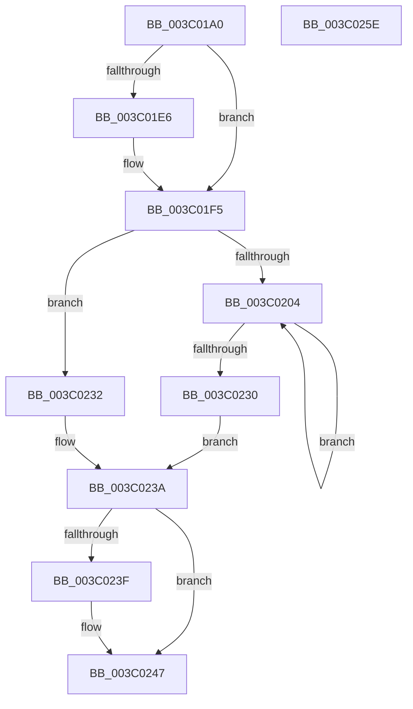

# KiQueryCpuPartitionAffinityProcess

- RVA: `0x003C01A0`–`0x003C025F` (길이 `191` bytes)
- VA: `0x00000001403C01A0`
- 실행 섹션: `.text`
- PDB 이름 있음: `예`; PDB Function 태그: `아니요`
- unwind 정보 RVA: `0x0008DF5C`
- 디코드: `57`개 명령, `191/191` bytes 표시
- 미해석 바이트: `0` (있으면 어셈블리에 `.byte`로 보존)

> 이 문서는 커널 이미지의 기계어와 PDB 기호를 분석해 생성했습니다. 4번과 5번은 함수 원형과 자료형을 바이너리 사용 방식에서 추정한 C 해석이며 원본 소스 복구 결과는 아닙니다.

## 1. Dependencies

- 직접 호출 지점: **7**; 고유 호출 대상: **7**
- 직접 호출자로 확인된 함수: **1**
- RIP 상대 이미지 참조: **0**

### Outgoing calls
- `0x003C01CD` → [memset](../6C/memset_function_006C6C40.md) (function, `0x006C6C40`)
- `0x003C01EB` → [KiAcquireCpuPartitionAssignmentLock](../43/KiAcquireCpuPartitionAssignmentLock_function_0043F974.md) (function, `0x0043F974`)
- `0x003C020F` → [KeAcquireSpinLockAtDpcLevel](../20/KeAcquireSpinLockAtDpcLevel_function_00208430.md) (function, `0x00208430`)
- `0x003C021D` → [KeOrAffinityEx2](../2C/KeOrAffinityEx2_function_002CF930.md) (function, `0x002CF930`)
- `0x003C0226` → [KxReleaseSpinLock](../20/KxReleaseSpinLock_function_00206670.md) (function, `0x00206670`)
- `0x003C0235` → [KiQueryCpuPartitionAffinity](../4F/KiQueryCpuPartitionAffinity_function_004F548C.md) (function, `0x004F548C`)
- `0x003C0242` → [KiReleaseCpuPartitionAssignmentLock](../43/KiReleaseCpuPartitionAssignmentLock_function_0043F9C0.md) (function, `0x0043F9C0`)

### Direct callers
- [KiUpdateProcessAvailableCpuState](KiUpdateProcessAvailableCpuState_function_003C00B4.md) at `0x003C010B`

### Static image references
- 디코드된 RIP-relative 메모리 참조가 없습니다.

## 2. Other-region calls and transfers

- 다른 실행 섹션으로 향하는 call: **0**
- 별도 외부 분기/꼬리 이동을 확인하지 못했습니다.

## 3. Assembly (complete function range)

```asm
003C01A0  48 89 5C 24 08                  mov qword ptr [rsp + 8], rbx
003C01A5  48 89 6C 24 10                  mov qword ptr [rsp + 0x10], rbp
003C01AA  56                              push rsi
003C01AB  57                              push rdi
003C01AC  41 54                           push r12
003C01AE  41 56                           push r14
003C01B0  41 57                           push r15
003C01B2  48 83 EC 20                     sub rsp, 0x20
003C01B6  45 8A E0                        mov r12b, r8b
003C01B9  4C 8B F9                        mov r15, rcx
003C01BC  44 0F B7 02                     movzx r8d, word ptr [rdx]
003C01C0  48 8D 4A 08                     lea rcx, [rdx + 8]
003C01C4  4C 8B F2                        mov r14, rdx
003C01C7  49 C1 E0 03                     shl r8, 3
003C01CB  33 D2                           xor edx, edx
003C01CD  E8 6E 6A 30 00                  call 0x1406c6c40
003C01D2  66 41 C7 06 01 00               mov word ptr [r14], 1
003C01D8  44 0F 20 C5                     mov rbp, cr8
003C01DC  40 88 6C 24 60                  mov byte ptr [rsp + 0x60], bpl
003C01E1  45 84 E4                        test r12b, r12b
003C01E4  75 0F                           jne 0x1403c01f5
003C01E6  48 8D 4C 24 60                  lea rcx, [rsp + 0x60]
003C01EB  E8 84 F7 07 00                  call 0x14043f974
003C01F0  40 8A 6C 24 60                  mov bpl, byte ptr [rsp + 0x60]
003C01F5  49 81 C7 B0 01 00 00            add r15, 0x1b0
003C01FC  49 8B 37                        mov rsi, qword ptr [r15]
003C01FF  49 3B F7                        cmp rsi, r15
003C0202  74 2E                           je 0x1403c0232
003C0204  48 8B 5E E8                     mov rbx, qword ptr [rsi - 0x18]
003C0208  48 8B 36                        mov rsi, qword ptr [rsi]
003C020B  48 8D 4B 08                     lea rcx, [rbx + 8]
003C020F  E8 1C 82 E4 FF                  call 0x140208430
003C0214  48 8B 13                        mov rdx, qword ptr [rbx]
003C0217  4D 8B C6                        mov r8, r14
003C021A  49 8B CE                        mov rcx, r14
003C021D  E8 0E F7 F0 FF                  call 0x1402cf930
003C0222  48 8D 4B 08                     lea rcx, [rbx + 8]
003C0226  E8 45 64 E4 FF                  call 0x140206670
003C022B  49 3B F7                        cmp rsi, r15
003C022E  75 D4                           jne 0x1403c0204
003C0230  EB 08                           jmp 0x1403c023a
003C0232  49 8B D6                        mov rdx, r14
003C0235  E8 52 52 13 00                  call 0x1404f548c
003C023A  45 84 E4                        test r12b, r12b
003C023D  75 08                           jne 0x1403c0247
003C023F  40 8A CD                        mov cl, bpl
003C0242  E8 79 F7 07 00                  call 0x14043f9c0
003C0247  48 8B 5C 24 50                  mov rbx, qword ptr [rsp + 0x50]
003C024C  48 8B 6C 24 58                  mov rbp, qword ptr [rsp + 0x58]
003C0251  48 83 C4 20                     add rsp, 0x20
003C0255  41 5F                           pop r15
003C0257  41 5E                           pop r14
003C0259  41 5C                           pop r12
003C025B  5F                              pop rdi
003C025C  5E                              pop rsi
003C025D  C3                              ret
003C025E  CC                              int3
```

## 4. C-style interpretation (structured pseudocode)

```c
__int64 __fastcall KiQueryCpuPartitionAffinityProcess(__int64 a1, __int64 a2, unsigned __int8 a3)
{
    __int64 result;
    __int64 v_r15;
    __int64 v_rbp;
    __int64 v_rsp;
    unsigned __int64 v_stack_p10;
    unsigned __int8 v_stack_p18;
    unsigned __int64 v_stack_p8;

    v_stack_p8 = v_rbx;
    v_stack_p10 = v_rbp;
    v_rsp = (v_rsp) - (32);
    a3 = (*(unsigned __int16 *)(a2)) << (3);
    a2 = 0;
    result = memset(a2 + 8, a2, a3, a4);
    *(unsigned __int16 *)(a2) = 1;
    v_stack_p18 = (unsigned __int8)(v_cr8);
    v_rbp = v_cr8;
    if (a3 == 0) {
        a1 = v_stack_p18;
        result = KiAcquireCpuPartitionAssignmentLock(a1, a2, a3, a4);
        v_rbp = v_stack_p18;
    }
    v_r15 = (a1) + (432);
    if ((*(unsigned __int64 *)(v_r15)) == v_r15) goto loc_003C0232;
loc_003C0204:
    result = KeAcquireSpinLockAtDpcLevel(*(unsigned __int64 *)(*(unsigned __int64 *)(v_r15) - 24) + 8, a2, a3, a4);
    result = KeOrAffinityEx2(0, *(unsigned __int64 *)(*(unsigned __int64 *)(*(unsigned __int64 *)(v_r15) - 24)), 0, a4);
    result = KxReleaseSpinLock(*(unsigned __int64 *)(*(unsigned __int64 *)(v_r15) - 24) + 8, *(unsigned __int64 *)(*(unsigned __int64 *)(*(unsigned __int64 *)(v_r15) - 24)), 0, a4);
    if ((*(unsigned __int64 *)(*(unsigned __int64 *)(v_r15))) != v_r15) goto loc_003C0204;
    goto loc_003C023A;
loc_003C0232:
    result = KiQueryCpuPartitionAffinity(*(unsigned __int64 *)(*(unsigned __int64 *)(v_r15) - 24) + 8, 0, 0, a4);
loc_003C023A:
    if (a3 == 0) {
        a1 = (unsigned __int8)(v_rbp);
        result = KiReleaseCpuPartitionAssignmentLock(a1, 0, 0, a4);
    }
    v_rsp = (v_rsp) + (32);
    return result;
}
```

## 5. (Beta) C Style

```c
int64_t KiQueryCpuPartitionAffinityProcess(void *Arg1, void *Arg2, uint8_t Arg3)
{
    uint8_t *arg1 = (uint8_t *)Arg1;
    uint8_t *arg2 = (uint8_t *)Arg2;

    int64_t result;
    int64_t local_r15;
    int64_t local_rbp;
    int64_t local_rsp;
    uint64_t v_stack_p10;
    uint8_t v_stack_p18;
    uint64_t v_stack_p8;

    v_stack_p8 = local_rbx;
    v_stack_p10 = local_rbp;
    local_rsp = (local_rsp) - (32);
    Arg3 = (*(uint16_t *)(arg2)) << (3);
    Arg2 = 0;
    result = memset(Arg2 + 8, Arg2, Arg3, a4);
    *(uint16_t *)(arg2) = 1;
    v_stack_p18 = (uint8_t)(v_cr8);
    local_rbp = v_cr8;
    if (Arg3 == 0) {
        Arg1 = v_stack_p18;
        result = KiAcquireCpuPartitionAssignmentLock(Arg1, Arg2, Arg3, a4);
        local_rbp = v_stack_p18;
    }
    local_r15 = (Arg1) + (432);
    if ((*(uint64_t *)(local_r15)) == local_r15) goto loc_003C0232;
loc_003C0204:
    result = KeAcquireSpinLockAtDpcLevel(*(uint64_t *)(*(uint64_t *)(local_r15) - 0x18) + 8, Arg2, Arg3, a4);
    result = KeOrAffinityEx2(0, *(uint64_t *)(*(uint64_t *)(*(uint64_t *)(local_r15) - 0x18)), 0, a4);
    result = KxReleaseSpinLock(*(uint64_t *)(*(uint64_t *)(local_r15) - 0x18) + 8, *(uint64_t *)(*(uint64_t *)(*(uint64_t *)(local_r15) - 0x18)), 0, a4);
    if ((*(uint64_t *)(*(uint64_t *)(local_r15))) != local_r15) goto loc_003C0204;
    goto loc_003C023A;
loc_003C0232:
    result = KiQueryCpuPartitionAffinity(*(uint64_t *)(*(uint64_t *)(local_r15) - 0x18) + 8, 0, 0, a4);
loc_003C023A:
    if (Arg3 == 0) {
        Arg1 = (uint8_t)(local_rbp);
        result = KiReleaseCpuPartitionAssignmentLock(Arg1, 0, 0, a4);
    }
    local_rsp = (local_rsp) + (32);
    return result;
}
```

### 관측된 메모리 오프셋

구조체 형식이 확인되지 않은 접근은 인자 기준의 오프셋으로만 기록했습니다.

| 기준 인자 | 오프셋 표현 | 폭 (bit) | 접근 |
|---|---:|---:|---|
| `Arg1` | `+ 0x0` | `64` | `R` |
| `Arg2` | `+ 0x0` | `16` | `R` |
| `Arg2` | `+ 0x0` | `16` | `W` |
| `Arg2` | `+ 0x8` | `64` | `R` |

## 6. Execution-region graph

[열기: 2D/3D 그래프와 함수 탐색 컨트롤 패널](../../../control-panel.html?section=text&rva=0x003C01A0&view=graph)

- 2D 그래프는 위에서 아래로 흐르고, 3D 그래프는 빈 공간을 드래그해 회전합니다. Shift+드래그는 이동, 휠은 확대·축소, 함수 노드 선택은 대상 보고서 이동입니다.

### Static fallback


