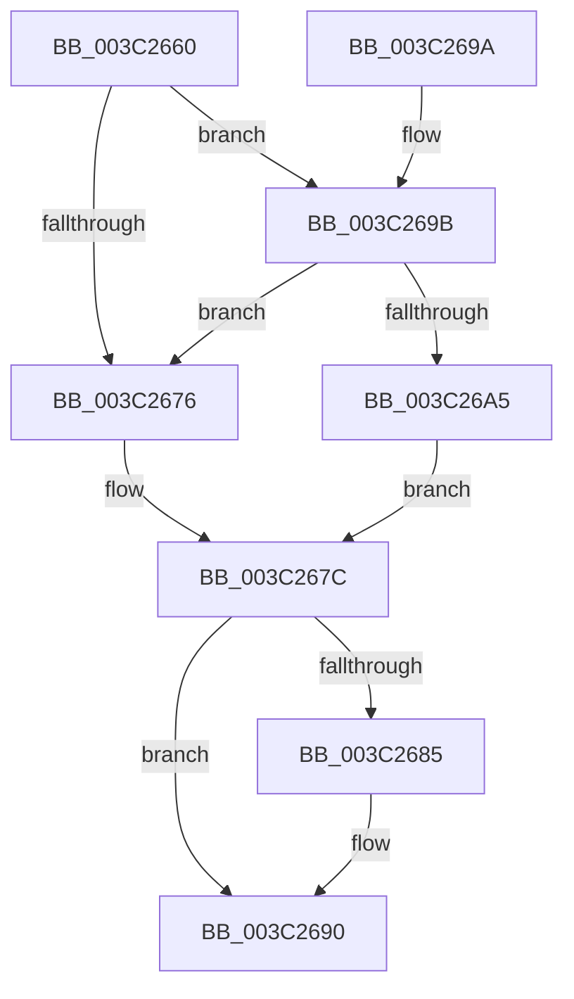

# KiReleaseProcessLockExclusive

- RVA: `0x003C2660`–`0x003C26B1` (길이 `81` bytes)
- VA: `0x00000001403C2660`
- 실행 섹션: `.text`
- PDB 이름 있음: `예`; PDB Function 태그: `아니요`
- unwind 정보 RVA: `0x00068804`
- 디코드: `23`개 명령, `81/81` bytes 표시
- 미해석 바이트: `0` (있으면 어셈블리에 `.byte`로 보존)

> 이 문서는 커널 이미지의 기계어와 PDB 기호를 분석해 생성했습니다. 4번과 5번은 함수 원형과 자료형을 바이너리 사용 방식에서 추정한 C 해석이며 원본 소스 복구 결과는 아닙니다.

## 1. Dependencies

- 직접 호출 지점: **2**; 고유 호출 대상: **2**
- 직접 호출자로 확인된 함수: **10**
- RIP 상대 이미지 참조: **3**

### Outgoing calls
- `0x003C268B` → [KiLowerIrqlProcessIrqlFlags](../4F/KiLowerIrqlProcessIrqlFlags_function_004F5698.md) (function, `0x004F5698`)
- `0x003C26AA` → [ExpReleaseSpinLockExclusiveFromDpcLevelInstrumented](../2C/ExpReleaseSpinLockExclusiveFromDpcLevelInstrumented_function_002C0F44.md) (function, `0x002C0F44`)

### Direct callers
- [KeThawMultiProcess](../20/KeThawMultiProcess_function_00202A04.md) at `0x00202AD4`
- [sub_00249EBD](../24/Unknown_function_00249EBD.md) at `0x00249ED4`
- [KeSetAffinityProcess](KeSetAffinityProcess_function_003C0A60.md) at `0x003C0CA2`
- [KeForceResumeProcess](KeForceResumeProcess_function_003C1BE4.md) at `0x003C1C49`
- [KeSetProcessPpmPolicy](KeSetProcessPpmPolicy_function_003C1CCC.md) at `0x003C1D5C`
- [KeSetQuantumProcess](KeSetQuantumProcess_function_003C1EF0.md) at `0x003C1F46`
- [KeSetExecuteOptions](KeSetExecuteOptions_function_003C1F54.md) at `0x003C2061`
- [KeSetDisableQuantumProcess](KeSetDisableQuantumProcess_function_003C2128.md) at `0x003C2182`
- [KeStartThread](KeStartThread_function_003C21B8.md) at `0x003C2545`
- [KeSetExpectedConcurrencyCountProcess](../5C/KeSetExpectedConcurrencyCountProcess_function_005C1AC0.md) at `0x005C1B24`

### Static image references
- `0x003C266D` → RVA `0x00FC6B06` (`ALMOSTRO`; read)
- `0x003C267C` → RVA `0x00FC6D20` (`ALMOSTRO`; read)
- `0x003C269B` → RVA `0x00F0DE58` (`.data`; read)

## 2. Other-region calls and transfers

- 다른 실행 섹션으로 향하는 call: **0**
- 별도 외부 분기/꼬리 이동을 확인하지 못했습니다.

## 3. Assembly (complete function range)

```asm
003C2660  40 53                           push rbx
003C2662  48 83 EC 20                     sub rsp, 0x20
003C2666  48 83 C1 40                     add rcx, 0x40
003C266A  0F B6 DA                        movzx ebx, dl
003C266D  F6 05 92 44 C0 00 01            test byte ptr [rip + 0xc04492], 1
003C2674  75 25                           jne 0x1403c269b
003C2676  C7 01 00 00 00 00               mov dword ptr [rcx], 0
003C267C  83 3D 9D 46 C0 00 00            cmp dword ptr [rip + 0xc0469d], 0
003C2683  74 0B                           je 0x1403c2690
003C2685  44 0F 20 C1                     mov rcx, cr8
003C2689  8A D3                           mov dl, bl
003C268B  E8 08 30 13 00                  call 0x1404f5698
003C2690  44 0F 22 C3                     mov cr8, rbx
003C2694  48 83 C4 20                     add rsp, 0x20
003C2698  5B                              pop rbx
003C2699  C3                              ret
003C269A  CC                              int3
003C269B  8B 05 B7 B7 B4 00               mov eax, dword ptr [rip + 0xb4b7b7]
003C26A1  85 C0                           test eax, eax
003C26A3  75 D1                           jne 0x1403c2676
003C26A5  48 8B 54 24 28                  mov rdx, qword ptr [rsp + 0x28]
003C26AA  E8 95 E8 EF FF                  call 0x1402c0f44
003C26AF  EB CB                           jmp 0x1403c267c
```

## 4. C-style interpretation (structured pseudocode)

```c
__int64 __fastcall KiReleaseProcessLockExclusive(__int64 a1, unsigned __int8 a2)
{
    __int64 result;
    __int64 v_rsp;
    unsigned __int64 v_stack_p28;

    v_rsp = (v_rsp) - (32);
    a1 = (a1) + (64);
    if (((*(unsigned __int8 *)(v_rip + 12600466)) & (1)) != 0) goto loc_003C269B;
loc_003C2676:
    *(unsigned int *)(a1) = 0;
loc_003C267C:
    if ((*(unsigned int *)(v_rip + 12600989)) != 0) {
        a1 = v_cr8;
        a2 = a2;
        result = KiLowerIrqlProcessIrqlFlags(a1, a2, a3, a4);
    }
    v_rsp = (v_rsp) + (32);
    return result;
loc_003C269B:
    if ((unsigned int)((unsigned int)(*(unsigned int *)(v_rip + 11843511))) != 0) goto loc_003C2676;
    result = ExpReleaseSpinLockExclusiveFromDpcLevelInstrumented(a1, v_stack_p28, a3, a4);
    goto loc_003C267C;
}
```

## 5. (Beta) C Style

```c
int64_t KiReleaseProcessLockExclusive(void *Arg1, uint8_t Arg2)
{
    uint8_t *arg1 = (uint8_t *)Arg1;

    int64_t result;
    int64_t local_rsp;
    uint64_t v_stack_p28;

    local_rsp = (local_rsp) - (32);
    Arg1 = (Arg1) + (64);
    if (((*(uint8_t *)(v_rip + 0xC04492)) & (1)) != 0) goto loc_003C269B;
loc_003C2676:
    *(uint32_t *)(arg1) = 0;
loc_003C267C:
    if ((*(uint32_t *)(v_rip + 0xC0469D)) != 0) {
        Arg1 = v_cr8;
        Arg2 = Arg2;
        result = KiLowerIrqlProcessIrqlFlags(Arg1, Arg2, a3, a4);
    }
    local_rsp = (local_rsp) + (32);
    return result;
loc_003C269B:
    if ((uint32_t)((uint32_t)(*(uint32_t *)(v_rip + 0xB4B7B7))) != 0) goto loc_003C2676;
    result = ExpReleaseSpinLockExclusiveFromDpcLevelInstrumented(Arg1, v_stack_p28, a3, a4);
    goto loc_003C267C;
}
```

### 관측된 메모리 오프셋

구조체 형식이 확인되지 않은 접근은 인자 기준의 오프셋으로만 기록했습니다.

| 기준 인자 | 오프셋 표현 | 폭 (bit) | 접근 |
|---|---:|---:|---|
| `Arg1` | `+ 0x0` | `32` | `W` |

## 6. Execution-region graph

[열기: 2D/3D 그래프와 함수 탐색 컨트롤 패널](../../../control-panel.html?section=text&rva=0x003C2660&view=graph)

- 2D 그래프는 위에서 아래로 흐르고, 3D 그래프는 빈 공간을 드래그해 회전합니다. Shift+드래그는 이동, 휠은 확대·축소, 함수 노드 선택은 대상 보고서 이동입니다.

### Static fallback


