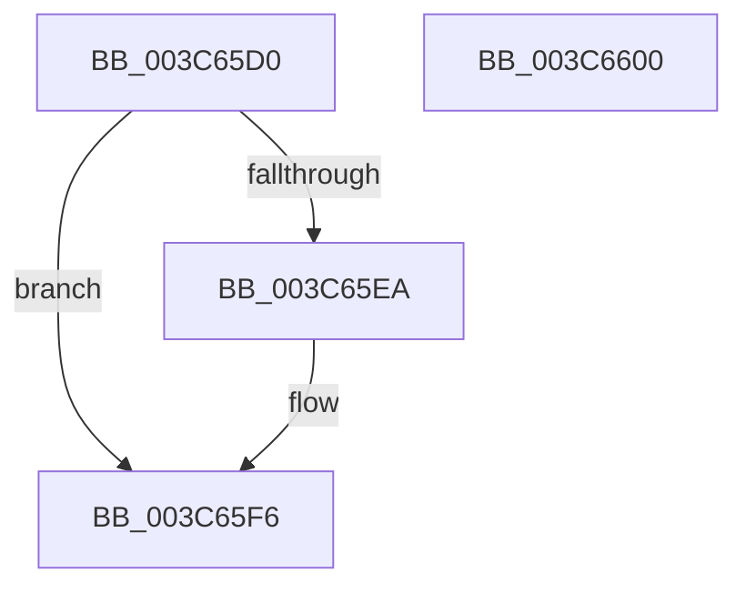

# KiReleaseThreadLockLowerIrql

- RVA: `0x003C65D0`–`0x003C6601` (길이 `49` bytes)
- VA: `0x00000001403C65D0`
- 실행 섹션: `.text`
- PDB 이름 있음: `예`; PDB Function 태그: `아니요`
- unwind 정보 RVA: `0x0005CF00`
- 디코드: `14`개 명령, `49/49` bytes 표시
- 미해석 바이트: `0` (있으면 어셈블리에 `.byte`로 보존)

> 이 문서는 커널 이미지의 기계어와 PDB 기호를 분석해 생성했습니다. 4번과 5번은 함수 원형과 자료형을 바이너리 사용 방식에서 추정한 C 해석이며 원본 소스 복구 결과는 아닙니다.

## 1. Dependencies

- 직접 호출 지점: **1**; 고유 호출 대상: **1**
- 직접 호출자로 확인된 함수: **23**
- RIP 상대 이미지 참조: **1**

### Outgoing calls
- `0x003C65F1` → [KiLowerIrqlProcessIrqlFlags](../4F/KiLowerIrqlProcessIrqlFlags_function_004F5698.md) (function, `0x004F5698`)

### Direct callers
- [KiSchedulerApc](../20/KiSchedulerApc_function_00202BC0.md) at `0x00202E4A`
- [sub_002177B0](../21/Unknown_function_002177B0.md) at `0x002177CA`
- [sub_00218280](../21/Unknown_function_00218280.md) at `0x0021829A`
- [sub_00218AB1](../21/Unknown_function_00218AB1.md) at `0x00218ACF`
- [sub_0028F390](../28/Unknown_function_0028F390.md) at `0x0028F3AF`
- [PspSynchronizeThreadIsolationDomains](PspSynchronizeThreadIsolationDomains_function_003C479C.md) at `0x003C47DA`
- [KeRemoveQueueApc](KeRemoveQueueApc_function_003C4820.md) at `0x003C4854`
- [KiUpdateTebSchedulingPropertiesCurrentThread](KiUpdateTebSchedulingPropertiesCurrentThread_function_003C4938.md) at `0x003C49AF`
- [KeWaitForAlertByThreadId](KeWaitForAlertByThreadId_function_003C4B14.md) at `0x003C4EA1`
- [KeRemovePriQueue](KeRemovePriQueue_function_003C5090.md) at `0x003C54AC`
- [KiWaitForAllObjects](KiWaitForAllObjects_function_003C5800.md) at `0x003C5E70`
- [KiFlushQueueApc](KiFlushQueueApc_function_003C653C.md) at `0x003C6593`
- [KeSetThreadPpmPolicy](KeSetThreadPpmPolicy_function_003C6C30.md) at `0x003C6D34`
- [KeQueryPrimaryGroupAffinityThread](KeQueryPrimaryGroupAffinityThread_function_003C7238.md) at `0x003C7294`
- [sub_003C76A0](Unknown_function_003C76A0.md) at `0x003C76BE`
- [sub_003C7C10](Unknown_function_003C7C10.md) at `0x003C7C2A`
- [KeQueryEffectivePriorityThread](KeQueryEffectivePriorityThread_function_003C7CA0.md) at `0x003C7DFC`
- [KeQueryCpuSetsThread](KeQueryCpuSetsThread_function_003C7F9C.md) at `0x003C8015`
- [KeEnumerateQueueApc](../5B/KeEnumerateQueueApc_function_005BE290.md) at `0x005BE310`
- [KeQueryCurrentWaitInformationThread](../5C/KeQueryCurrentWaitInformationThread_function_005C3650.md) at `0x005C36A6`
- [KeQueryCurrentWaitInformationThread](../5C/KeQueryCurrentWaitInformationThread_function_005C3650.md) at `0x005C36D5`
- [KeAbCrossThreadDelete](../5C/KeAbCrossThreadDelete_function_005C517C.md) at `0x005C54BE`
- [KeAbCrossThreadDelete](../5C/KeAbCrossThreadDelete_function_005C517C.md) at `0x005C5568`
- [KeAbCrossThreadDelete](../5C/KeAbCrossThreadDelete_function_005C517C.md) at `0x005C557A`
- [sub_006D6528](../6D/Unknown_function_006D6528.md) at `0x006D652F`
- [sub_006E8202](../6E/Unknown_function_006E8202.md) at `0x006E8235`

### Static image references
- `0x003C65DE` → RVA `0x00FC6D20` (`ALMOSTRO`; read)

## 2. Other-region calls and transfers

- 다른 실행 섹션으로 향하는 call: **0**
- 별도 외부 분기/꼬리 이동을 확인하지 못했습니다.

## 3. Assembly (complete function range)

```asm
003C65D0  40 53                           push rbx
003C65D2  48 83 EC 20                     sub rsp, 0x20
003C65D6  48 C7 41 40 00 00 00 00         mov qword ptr [rcx + 0x40], 0
003C65DE  83 3D 3B 07 C0 00 00            cmp dword ptr [rip + 0xc0073b], 0
003C65E5  0F B6 DA                        movzx ebx, dl
003C65E8  74 0C                           je 0x1403c65f6
003C65EA  44 0F 20 C1                     mov rcx, cr8
003C65EE  0F B6 D3                        movzx edx, bl
003C65F1  E8 A2 F0 12 00                  call 0x1404f5698
003C65F6  44 0F 22 C3                     mov cr8, rbx
003C65FA  48 83 C4 20                     add rsp, 0x20
003C65FE  5B                              pop rbx
003C65FF  C3                              ret
003C6600  CC                              int3
```

## 4. C-style interpretation (structured pseudocode)

```c
__int64 __fastcall KiReleaseThreadLockLowerIrql(__int64 a1, unsigned __int8 a2)
{
    __int64 result;
    __int64 v_rsp;

    v_rsp = (v_rsp) - (32);
    *(unsigned __int64 *)(a1 + 64) = 0;
    if ((*(unsigned int *)(v_rip + 12584763)) != 0) {
        a1 = v_cr8;
        a2 = a2;
        result = KiLowerIrqlProcessIrqlFlags(a1, a2, a3, a4);
    }
    v_rsp = (v_rsp) + (32);
    return result;
}
```

## 5. (Beta) C Style

```c
int64_t KiReleaseThreadLockLowerIrql(void *Arg1, uint8_t Arg2)
{
    uint8_t *arg1 = (uint8_t *)Arg1;

    int64_t result;
    int64_t local_rsp;

    local_rsp = (local_rsp) - (32);
    *(uint64_t *)(arg1 + 0x40) = 0;
    if ((*(uint32_t *)(v_rip + 0xC0073B)) != 0) {
        Arg1 = v_cr8;
        Arg2 = Arg2;
        result = KiLowerIrqlProcessIrqlFlags(Arg1, Arg2, a3, a4);
    }
    local_rsp = (local_rsp) + (32);
    return result;
}
```

### 관측된 메모리 오프셋

구조체 형식이 확인되지 않은 접근은 인자 기준의 오프셋으로만 기록했습니다.

| 기준 인자 | 오프셋 표현 | 폭 (bit) | 접근 |
|---|---:|---:|---|
| `Arg1` | `+ 0x40` | `64` | `W` |

## 6. Execution-region graph

[열기: 2D/3D 그래프와 함수 탐색 컨트롤 패널](../../../control-panel.html?section=text&rva=0x003C65D0&view=graph)

- 2D 그래프는 위에서 아래로 흐르고, 3D 그래프는 빈 공간을 드래그해 회전합니다. Shift+드래그는 이동, 휠은 확대·축소, 함수 노드 선택은 대상 보고서 이동입니다.

### Static fallback


