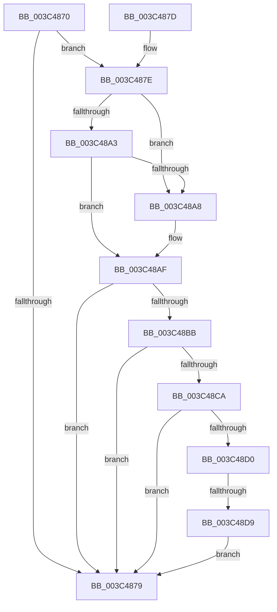

# KiRemoveQueueApc

- RVA: `0x003C4870`–`0x003C48DF` (길이 `111` bytes)
- VA: `0x00000001403C4870`
- 실행 섹션: `.text`
- PDB 이름 있음: `예`; PDB Function 태그: `예`
- unwind 정보 RVA: `0x000DB714`
- 디코드: `34`개 명령, `111/111` bytes 표시
- 미해석 바이트: `0` (있으면 어셈블리에 `.byte`로 보존)

> 이 문서는 커널 이미지의 기계어와 PDB 기호를 분석해 생성했습니다. 4번과 5번은 함수 원형과 자료형을 바이너리 사용 방식에서 추정한 C 해석이며 원본 소스 복구 결과는 아닙니다.

## 1. Dependencies

- 직접 호출 지점: **0**; 고유 호출 대상: **0**
- 직접 호출자로 확인된 함수: **2**
- RIP 상대 이미지 참조: **0**

### Outgoing calls
- 직접 디코드된 call 명령이 없습니다.

### Direct callers
- [KiSchedulerApc](../20/KiSchedulerApc_function_00202BC0.md) at `0x00202EBA`
- [KeRemoveQueueApc](KeRemoveQueueApc_function_003C4820.md) at `0x003C4846`

### Static image references
- 디코드된 RIP-relative 메모리 참조가 없습니다.

## 2. Other-region calls and transfers

- 다른 실행 섹션으로 향하는 call: **0**
- call이 아닌 외부 분기/꼬리 이동: **1**
  - `0x003C48D3` → `0x006E80FC` (`tail-transfer`)

## 3. Assembly (complete function range)

```asm
003C4870  44 8A 41 52                     mov r8b, byte ptr [rcx + 0x52]
003C4874  45 84 C0                        test r8b, r8b
003C4877  75 05                           jne 0x1403c487e
003C4879  41 8A C0                        mov al, r8b
003C487C  C3                              ret
003C487D  CC                              int3
003C487E  48 8B 51 08                     mov rdx, qword ptr [rcx + 8]
003C4882  4C 8D 51 10                     lea r10, [rcx + 0x10]
003C4886  4C 0F BE 59 51                  movsx r11, byte ptr [rcx + 0x51]
003C488B  48 81 C2 98 00 00 00            add rdx, 0x98
003C4892  C6 41 52 00                     mov byte ptr [rcx + 0x52], 0
003C4896  4D 8B 0A                        mov r9, qword ptr [r10]
003C4899  49 8B 42 08                     mov rax, qword ptr [r10 + 8]
003C489D  4D 39 51 08                     cmp qword ptr [r9 + 8], r10
003C48A1  75 05                           jne 0x1403c48a8
003C48A3  4C 39 10                        cmp qword ptr [rax], r10
003C48A6  74 07                           je 0x1403c48af
003C48A8  B9 03 00 00 00                  mov ecx, 3
003C48AD  CD 29                           int 0x29
003C48AF  4C 89 08                        mov qword ptr [rax], r9
003C48B2  49 89 41 08                     mov qword ptr [r9 + 8], rax
003C48B6  49 3B C1                        cmp rax, r9
003C48B9  75 BE                           jne 0x1403c4879
003C48BB  4D 8B CB                        mov r9, r11
003C48BE  49 C1 E1 04                     shl r9, 4
003C48C2  4C 03 CA                        add r9, rdx
003C48C5  4D 39 0A                        cmp qword ptr [r10], r9
003C48C8  75 AF                           jne 0x1403c4879
003C48CA  4C 39 49 18                     cmp qword ptr [rcx + 0x18], r9
003C48CE  75 A9                           jne 0x1403c4879
003C48D0  45 84 DB                        test r11b, r11b
003C48D3  0F 85 23 38 32 00               jne 0x1406e80fc
003C48D9  44 88 5A 29                     mov byte ptr [rdx + 0x29], r11b
003C48DD  EB 9A                           jmp 0x1403c4879
```

## 4. C-style interpretation (structured pseudocode)

```c
__int64 __fastcall KiRemoveQueueApc(__int64 a1)
{
    if ((unsigned __int8)(*(unsigned __int8 *)(a1 + 82)) != 0) goto loc_003C487E;
loc_003C4879:
    return (unsigned __int8)(*(unsigned __int8 *)(a1 + 82));
loc_003C487E:
    a2 = (*(unsigned __int64 *)(a1 + 8)) + (152);
    *(unsigned __int8 *)(a1 + 82) = 0;
    if ((*(unsigned __int64 *)(*(unsigned __int64 *)(a1 + 16) + 8)) != (a1 + 16)) goto loc_003C48A8;
    if ((*(unsigned __int64 *)(*(unsigned __int64 *)(a1 + 16 + 8))) != (a1 + 16)) {
        a1 = 3;
    }
    *(unsigned __int64 *)(*(unsigned __int64 *)(a1 + 16 + 8)) = *(unsigned __int64 *)(a1 + 16);
    *(unsigned __int64 *)(*(unsigned __int64 *)(a1 + 16) + 8) = *(unsigned __int64 *)(a1 + 16 + 8);
    if ((*(unsigned __int64 *)(a1 + 16 + 8)) != (*(unsigned __int64 *)(a1 + 16))) goto loc_003C4879;
    a4 = ((__int8)(*(unsigned __int8 *)(a1 + 81))) << (4);
    a4 = (a4) + (a2);
    if ((*(unsigned __int64 *)(a1 + 16)) != a4) goto loc_003C4879;
    if ((*(unsigned __int64 *)(a1 + 24)) != a4) goto loc_003C4879;
    *(unsigned __int8 *)(a2 + 41) = (unsigned __int8)((__int8)(*(unsigned __int8 *)(a1 + 81)));
    goto loc_003C4879;
}
```

## 5. (Beta) C Style

```c
int64_t KiRemoveQueueApc(void *Arg1)
{
    uint8_t *arg1 = (uint8_t *)Arg1;

    if ((uint8_t)(*(uint8_t *)(arg1 + 0x52)) != 0) goto loc_003C487E;
loc_003C4879:
    return (uint8_t)(*(uint8_t *)(arg1 + 0x52));
loc_003C487E:
    a2 = (*(uint64_t *)(arg1 + 0x8)) + (152);
    *(uint8_t *)(arg1 + 0x52) = 0;
    if ((*(uint64_t *)(*(uint64_t *)(arg1 + 0x10) + 0x8)) != (Arg1 + 16)) goto loc_003C48A8;
    if ((*(uint64_t *)(*(uint64_t *)(arg1 + 0x10 + 0x8))) != (Arg1 + 16)) {
        Arg1 = 3;
    }
    *(uint64_t *)(*(uint64_t *)(arg1 + 0x10 + 0x8)) = *(uint64_t *)(arg1 + 0x10);
    *(uint64_t *)(*(uint64_t *)(arg1 + 0x10) + 0x8) = *(uint64_t *)(arg1 + 0x10 + 0x8);
    if ((*(uint64_t *)(arg1 + 0x10 + 0x8)) != (*(uint64_t *)(arg1 + 0x10))) goto loc_003C4879;
    a4 = ((int8_t)(*(uint8_t *)(arg1 + 0x51))) << (4);
    a4 = (a4) + (a2);
    if ((*(uint64_t *)(arg1 + 0x10)) != a4) goto loc_003C4879;
    if ((*(uint64_t *)(arg1 + 0x18)) != a4) goto loc_003C4879;
    *(uint8_t *)(a2 + 0x29) = (uint8_t)((int8_t)(*(uint8_t *)(arg1 + 0x51)));
    goto loc_003C4879;
}
```

### 관측된 메모리 오프셋

구조체 형식이 확인되지 않은 접근은 인자 기준의 오프셋으로만 기록했습니다.

| 기준 인자 | 오프셋 표현 | 폭 (bit) | 접근 |
|---|---:|---:|---|
| `Arg1` | `+ 0x0` | `64` | `R` |
| `Arg1` | `+ 0x8` | `64` | `R` |
| `Arg1` | `+ 0x10` | `64` | `R` |
| `Arg1` | `+ 0x51` | `8` | `R` |
| `Arg1` | `+ 0x52` | `8` | `R` |
| `Arg1` | `+ 0x52` | `8` | `W` |

## 6. Execution-region graph

[열기: 2D/3D 그래프와 함수 탐색 컨트롤 패널](../../../control-panel.html?section=text&rva=0x003C4870&view=graph)

- 2D 그래프는 위에서 아래로 흐르고, 3D 그래프는 빈 공간을 드래그해 회전합니다. Shift+드래그는 이동, 휠은 확대·축소, 함수 노드 선택은 대상 보고서 이동입니다.

### Static fallback


