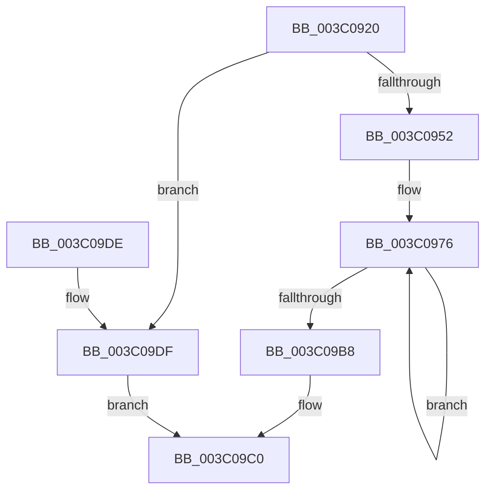

# KiSelectIdealProcessorForProcess

- RVA: `0x003C0920`–`0x003C09E5` (길이 `197` bytes)
- VA: `0x00000001403C0920`
- 실행 섹션: `.text`
- PDB 이름 있음: `예`; PDB Function 태그: `아니요`
- unwind 정보 RVA: `0x0008E014`
- 디코드: `49`개 명령, `197/197` bytes 표시
- 미해석 바이트: `0` (있으면 어셈블리에 `.byte`로 보존)

> 이 문서는 커널 이미지의 기계어와 PDB 기호를 분석해 생성했습니다. 4번과 5번은 함수 원형과 자료형을 바이너리 사용 방식에서 추정한 C 해석이며 원본 소스 복구 결과는 아닙니다.

## 1. Dependencies

- 직접 호출 지점: **0**; 고유 호출 대상: **0**
- 직접 호출자로 확인된 함수: **1**
- RIP 상대 이미지 참조: **2**

### Outgoing calls
- 직접 디코드된 call 명령이 없습니다.

### Direct callers
- [KiSetIdealNodeProcessByGroup](KiSetIdealNodeProcessByGroup_function_003C0888.md) at `0x003C08F8`

### Static image references
- `0x003C098A` → RVA `0x00F231B8` (`.data`; read)
- `0x003C09A1` → RVA `0x00FC8C40` (`ALMOSTRO`; read)

## 2. Other-region calls and transfers

- 다른 실행 섹션으로 향하는 call: **0**
- 별도 외부 분기/꼬리 이동을 확인하지 못했습니다.

## 3. Assembly (complete function range)

```asm
003C0920  48 89 5C 24 10                  mov qword ptr [rsp + 0x10], rbx
003C0925  48 89 7C 24 18                  mov qword ptr [rsp + 0x18], rdi
003C092A  48 8B 1A                        mov rbx, qword ptr [rdx]
003C092D  4C 8B C9                        mov r9, rcx
003C0930  48 8B B9 A8 00 00 00            mov rdi, qword ptr [rcx + 0xa8]
003C0937  48 8B 81 80 00 00 00            mov rax, qword ptr [rcx + 0x80]
003C093E  44 0F B7 42 08                  movzx r8d, word ptr [rdx + 8]
003C0943  48 23 C3                        and rax, rbx
003C0946  48 8B D7                        mov rdx, rdi
003C0949  48 85 FF                        test rdi, rdi
003C094C  0F 84 8D 00 00 00               je 0x1403c09df
003C0952  44 0F B6 51 7C                  movzx r10d, byte ptr [rcx + 0x7c]
003C0957  B8 01 00 00 00                  mov eax, 1
003C095C  41 83 E2 3F                     and r10d, 0x3f
003C0960  45 8B D8                        mov r11d, r8d
003C0963  41 8B CA                        mov ecx, r10d
003C0966  48 D3 E0                        shl rax, cl
003C0969  48 FF C8                        dec rax
003C096C  48 F7 D0                        not rax
003C096F  48 23 D0                        and rdx, rax
003C0972  41 C1 E3 06                     shl r11d, 6
003C0976  41 8B C2                        mov eax, r10d
003C0979  48 0F B3 C2                     btr rdx, rax
003C097D  48 8B C2                        mov rax, rdx
003C0980  48 8B D7                        mov rdx, rdi
003C0983  48 85 C0                        test rax, rax
003C0986  48 0F 45 D0                     cmovne rdx, rax
003C098A  48 8B 05 27 28 B6 00            mov rax, qword ptr [rip + 0xb62827]
003C0991  83 64 24 08 00                  and dword ptr [rsp + 8], 0
003C0996  4C 0F BC D2                     bsf r10, rdx
003C099A  43 8D 0C 13                     lea ecx, [r11 + r10]
003C099E  8B 04 88                        mov eax, dword ptr [rax + rcx*4]
003C09A1  48 8D 0D 98 82 C0 00            lea rcx, [rip + 0xc08298]
003C09A8  48 8B 0C C1                     mov rcx, qword ptr [rcx + rax*8]
003C09AC  48 8B C3                        mov rax, rbx
003C09AF  48 23 81 70 8E 00 00            and rax, qword ptr [rcx + 0x8e70]
003C09B6  74 BE                           je 0x1403c0976
003C09B8  48 0F BC C0                     bsf rax, rax
003C09BC  41 88 41 7C                     mov byte ptr [r9 + 0x7c], al
003C09C0  48 8B 5C 24 10                  mov rbx, qword ptr [rsp + 0x10]
003C09C5  48 8B 7C 24 18                  mov rdi, qword ptr [rsp + 0x18]
003C09CA  41 C1 E0 06                     shl r8d, 6
003C09CE  44 03 C0                        add r8d, eax
003C09D1  48 8B 05 E0 27 B6 00            mov rax, qword ptr [rip + 0xb627e0]
003C09D8  42 0F B7 04 80                  movzx eax, word ptr [rax + r8*4]
003C09DD  C3                              ret
003C09DE  CC                              int3
003C09DF  48 0F BC C0                     bsf rax, rax
003C09E3  EB DB                           jmp 0x1403c09c0
```

## 4. C-style interpretation (structured pseudocode)

```c
__int64 __fastcall KiSelectIdealProcessorForProcess(__int64 a1, __int64 a2)
{
    __int64 result;
    __int64 v_r10;
    __int64 v_r11;
    unsigned __int64 v_stack_p10;
    unsigned __int64 v_stack_p18;
    unsigned int v_stack_p8;

    v_stack_p10 = v_rbx;
    v_stack_p18 = v_rdi;
    result = (*(unsigned __int64 *)(a1 + 128)) & (*(unsigned __int64 *)(a2));
    if (*(unsigned __int64 *)(a1 + 168) == 0) goto loc_003C09DF;
    v_r10 = (unsigned int)((*(unsigned __int8 *)(a1 + 124)) & (63));
    result = (1) << ((unsigned __int8)((unsigned int)((unsigned int)(v_r10))));
    result = (result) - 1;
    result = ~(result);
    a2 = (*(unsigned __int64 *)(a1 + 168)) & (result);
    v_r11 = (unsigned int)(((unsigned int)((unsigned int)(*(unsigned __int16 *)(a2 + 8)))) << (6));
loc_003C0976:
    a2 = *(unsigned __int64 *)(a1 + 168);
    if (a2 != 0) { a2 = a2; }
    result = (*(unsigned __int64 *)(a2)) & (*(unsigned __int64 *)(*(unsigned __int64 *)(v_rip + 12616344 + (unsigned int)(*(unsigned int *)(*(unsigned __int64 *)(v_rip + 11937831) + v_r11 + v_r10 * 1 * 4)) * 8) + 36464));
    if (condition_is_equal) goto loc_003C0976;
    *(unsigned __int8 *)(a1 + 124) = (unsigned __int8)(result);
loc_003C09C0:
    a3 = (unsigned int)((*(unsigned __int16 *)(a2 + 8)) << (6));
    a3 = (unsigned int)((a3) + ((unsigned int)(result)));
    return *(unsigned __int16 *)(*(unsigned __int64 *)(v_rip + 11937760) + a3 * 4);
loc_003C09DF:
    goto loc_003C09C0;
}
```

## 5. (Beta) C Style

```c
int64_t KiSelectIdealProcessorForProcess(void *Arg1, void *Arg2)
{
    uint8_t *arg1 = (uint8_t *)Arg1;
    uint8_t *arg2 = (uint8_t *)Arg2;

    int64_t result;
    int64_t local_r10;
    int64_t local_r11;
    uint64_t v_stack_p10;
    uint64_t v_stack_p18;
    uint32_t v_stack_p8;

    v_stack_p10 = local_rbx;
    v_stack_p18 = local_rdi;
    result = (*(uint64_t *)(arg1 + 0x80)) & (*(uint64_t *)(arg2));
    if (*(uint64_t *)(arg1 + 0xA8) == 0) goto loc_003C09DF;
    local_r10 = (uint32_t)((*(uint8_t *)(arg1 + 0x7C)) & (63));
    result = (1) << ((uint8_t)((uint32_t)((uint32_t)(local_r10))));
    result = (result) - 1;
    result = ~(result);
    Arg2 = (*(uint64_t *)(arg1 + 0xA8)) & (result);
    local_r11 = (uint32_t)(((uint32_t)((uint32_t)(*(uint16_t *)(arg2 + 0x8)))) << (6));
loc_003C0976:
    Arg2 = *(uint64_t *)(arg1 + 0xA8);
    if (Arg2 != NULL) { Arg2 = Arg2; }
    result = (*(uint64_t *)(arg2)) & (*(uint64_t *)(*(uint64_t *)(v_rip + 0xC08298 + (uint32_t)(*(uint32_t *)(*(uint64_t *)(v_rip + 0xB62827) + local_r11 + local_r10 * 1 * 4)) * 8) + 0x8E70));
    if (condition_is_equal) goto loc_003C0976;
    *(uint8_t *)(arg1 + 0x7C) = (uint8_t)(result);
loc_003C09C0:
    a3 = (uint32_t)((*(uint16_t *)(arg2 + 0x8)) << (6));
    a3 = (uint32_t)((a3) + ((uint32_t)(result)));
    return *(uint16_t *)(*(uint64_t *)(v_rip + 0xB627E0) + a3 * 4);
loc_003C09DF:
    goto loc_003C09C0;
}
```

### 관측된 메모리 오프셋

구조체 형식이 확인되지 않은 접근은 인자 기준의 오프셋으로만 기록했습니다.

| 기준 인자 | 오프셋 표현 | 폭 (bit) | 접근 |
|---|---:|---:|---|
| `Arg1` | `+ 0x7C` | `8` | `R` |
| `Arg1` | `+ 0x7C` | `8` | `W` |
| `Arg1` | `+ 0x80` | `64` | `R` |
| `Arg1` | `+ 0xA8` | `64` | `R` |
| `Arg2` | `+ 0x0` | `64` | `R` |
| `Arg2` | `+ 0x8` | `16` | `R` |

## 6. Execution-region graph

[열기: 2D/3D 그래프와 함수 탐색 컨트롤 패널](../../../control-panel.html?section=text&rva=0x003C0920&view=graph)

- 2D 그래프는 위에서 아래로 흐르고, 3D 그래프는 빈 공간을 드래그해 회전합니다. Shift+드래그는 이동, 휠은 확대·축소, 함수 노드 선택은 대상 보고서 이동입니다.

### Static fallback


