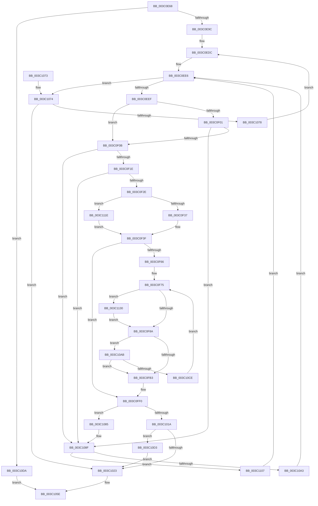

# KiSelectIdealProcessorSetForGroup

- RVA: `0x003C0E68`–`0x003C113C` (길이 `724` bytes)
- VA: `0x00000001403C0E68`
- 실행 섹션: `.text`
- PDB 이름 있음: `예`; PDB Function 태그: `아니요`
- unwind 정보 RVA: `0x0008E0A0`
- 디코드: `186`개 명령, `724/724` bytes 표시
- 미해석 바이트: `0` (있으면 어셈블리에 `.byte`로 보존)

> 이 문서는 커널 이미지의 기계어와 PDB 기호를 분석해 생성했습니다. 4번과 5번은 함수 원형과 자료형을 바이너리 사용 방식에서 추정한 C 해석이며 원본 소스 복구 결과는 아닙니다.

## 1. Dependencies

- 직접 호출 지점: **4**; 고유 호출 대상: **2**
- 직접 호출자로 확인된 함수: **2**
- RIP 상대 이미지 참조: **3**

### Outgoing calls
- `0x003C0EA9` → [KeGetPrcb](../2D/KeGetPrcb_function_002D85D0.md) (function, `0x002D85D0`)
- `0x003C0F75` → [KeGetPrcb](../2D/KeGetPrcb_function_002D85D0.md) (function, `0x002D85D0`)
- `0x003C10BE` → [KiFindBiasedProcessorIndex](KiFindBiasedProcessorIndex_function_003C185C.md) (function, `0x003C185C`)
- `0x003C1126` → [KiFindBiasedProcessorIndex](KiFindBiasedProcessorIndex_function_003C185C.md) (function, `0x003C185C`)

### Direct callers
- [KiSelectIdealProcessorSetsForProcess](KiSelectIdealProcessorSetsForProcess_function_003C0D40.md) at `0x003C0DFE`
- [KiAdjustProcessIdealProcessorSetsForThreadCreation](KiAdjustProcessIdealProcessorSetsForThreadCreation_function_003C2710.md) at `0x003C2855`

### Static image references
- `0x003C0EF1` → RVA `0x00FCF6C0` (`CACHEALI`; read)
- `0x003C108F` → RVA `0x00FC5000` (`ALMOSTRO`; read)
- `0x003C110F` → RVA `0x00E2DBD0` (`.data`; read)

## 2. Other-region calls and transfers

- 다른 실행 섹션으로 향하는 call: **0**
- 별도 외부 분기/꼬리 이동을 확인하지 못했습니다.

## 3. Assembly (complete function range)

```asm
003C0E68  48 8B C4                        mov rax, rsp
003C0E6B  4C 89 48 20                     mov qword ptr [rax + 0x20], r9
003C0E6F  44 89 40 18                     mov dword ptr [rax + 0x18], r8d
003C0E73  66 89 50 10                     mov word ptr [rax + 0x10], dx
003C0E77  48 89 48 08                     mov qword ptr [rax + 8], rcx
003C0E7B  53                              push rbx
003C0E7C  55                              push rbp
003C0E7D  56                              push rsi
003C0E7E  57                              push rdi
003C0E7F  41 54                           push r12
003C0E81  41 55                           push r13
003C0E83  41 56                           push r14
003C0E85  41 57                           push r15
003C0E87  48 83 EC 68                     sub rsp, 0x68
003C0E8B  33 DB                           xor ebx, ebx
003C0E8D  0F B7 C2                        movzx eax, dx
003C0E90  4C 8B F1                        mov r14, rcx
003C0E93  48 39 19                        cmp qword ptr [rcx], rbx
003C0E96  0F 84 3E 02 00 00               je 0x1403c10da
003C0E9C  8B C8                           mov ecx, eax
003C0E9E  89 5C 24 30                     mov dword ptr [rsp + 0x30], ebx
003C0EA2  8B F3                           mov esi, ebx
003C0EA4  48 89 5C 24 48                  mov qword ptr [rsp + 0x48], rbx
003C0EA9  E8 22 77 F1 FF                  call 0x1402d85d0
003C0EAE  4C 8B 94 24 C8 00 00 00         mov r10, qword ptr [rsp + 0xc8]
003C0EB6  44 8A CB                        mov r9b, bl
003C0EB9  88 5C 24 20                     mov byte ptr [rsp + 0x20], bl
003C0EBD  8B FB                           mov edi, ebx
003C0EBF  89 5C 24 2C                     mov dword ptr [rsp + 0x2c], ebx
003C0EC3  BD 00 08 00 00                  mov ebp, 0x800
003C0EC8  48 8B 88 C0 00 00 00            mov rcx, qword ptr [rax + 0xc0]
003C0ECF  44 0F B7 81 8A 00 00 00         movzx r8d, word ptr [rcx + 0x8a]
003C0ED7  44 89 44 24 3C                  mov dword ptr [rsp + 0x3c], r8d
003C0EDC  44 8B FB                        mov r15d, ebx
003C0EDF  89 5C 24 34                     mov dword ptr [rsp + 0x34], ebx
003C0EE3  41 8B C8                        mov ecx, r8d
003C0EE6  83 F9 FF                        cmp ecx, -1
003C0EE9  0F 84 85 01 00 00               je 0x1403c1074
003C0EEF  8B C1                           mov eax, ecx
003C0EF1  48 8D 15 C8 E7 C0 00            lea rdx, [rip + 0xc0e7c8]
003C0EF8  48 8B 14 C2                     mov rdx, qword ptr [rdx + rax*8]
003C0EFC  45 84 C9                        test r9b, r9b
003C0EFF  75 0A                           jne 0x1403c0f0b
003C0F01  F6 42 0A 01                     test byte ptr [rdx + 0xa], 1
003C0F05  0F 85 84 01 00 00               jne 0x1403c108f
003C0F0B  41 0F B7 46 08                  movzx eax, word ptr [r14 + 8]
003C0F10  4C 8B 6C C2 20                  mov r13, qword ptr [rdx + rax*8 + 0x20]
003C0F15  4D 85 ED                        test r13, r13
003C0F18  0F 84 71 01 00 00               je 0x1403c108f
003C0F1E  4D 8B A5 80 00 00 00            mov r12, qword ptr [r13 + 0x80]
003C0F25  4D 23 26                        and r12, qword ptr [r14]
003C0F28  0F 84 61 01 00 00               je 0x1403c108f
003C0F2E  41 3B C8                        cmp ecx, r8d
003C0F31  0F 85 E7 01 00 00               jne 0x1403c111e
003C0F37  0F B7 84 24 B8 00 00 00         movzx eax, word ptr [rsp + 0xb8]
003C0F3F  44 8B 8C 24 C0 00 00 00         mov r9d, dword ptr [rsp + 0xc0]
003C0F47  4C 8B C3                        mov r8, rbx
003C0F4A  0F B7 C8                        movzx ecx, ax
003C0F4D  8B D3                           mov edx, ebx
003C0F4F  49 8B 85 A8 00 00 00            mov rax, qword ptr [r13 + 0xa8]
003C0F56  48 89 44 24 50                  mov qword ptr [rsp + 0x50], rax
003C0F5B  8B C3                           mov eax, ebx
003C0F5D  44 2B CE                        sub r9d, esi
003C0F60  0F 84 8A 00 00 00               je 0x1403c0ff0
003C0F66  4C 8B 7C 24 50                  mov r15, qword ptr [rsp + 0x50]
003C0F6B  8B EB                           mov ebp, ebx
003C0F6D  44 8B F3                        mov r14d, ebx
003C0F70  8B F8                           mov edi, eax
003C0F72  41 8B F1                        mov esi, r9d
003C0F75  E8 56 76 F1 FF                  call 0x1402d85d0
003C0F7A  48 8B 88 70 8E 00 00            mov rcx, qword ptr [rax + 0x8e70]
003C0F81  48 85 C9                        test rcx, rcx
003C0F84  0F 84 A6 01 00 00               je 0x1403c1130
003C0F8A  48 8B C1                        mov rax, rcx
003C0F8D  48 F7 D0                        not rax
003C0F90  4C 23 F8                        and r15, rax
003C0F93  41 8D 46 01                     lea eax, [r14 + 1]
003C0F97  49 23 CC                        and rcx, r12
003C0F9A  0F 44 C5                        cmove eax, ebp
003C0F9D  48 0B F9                        or rdi, rcx
003C0FA0  8B E8                           mov ebp, eax
003C0FA2  F3 48 0F B8 C1                  popcnt rax, rcx
003C0FA7  44 03 F0                        add r14d, eax
003C0FAA  4D 85 FF                        test r15, r15
003C0FAD  0F 85 F8 00 00 00               jne 0x1403c10ab
003C0FB3  8B 74 24 30                     mov esi, dword ptr [rsp + 0x30]
003C0FB7  44 8B 7C 24 34                  mov r15d, dword ptr [rsp + 0x34]
003C0FBC  4C 8B 94 24 C8 00 00 00         mov r10, qword ptr [rsp + 0xc8]
003C0FC4  48 89 7C 24 40                  mov qword ptr [rsp + 0x40], rdi
003C0FC9  4C 8B 44 24 40                  mov r8, qword ptr [rsp + 0x40]
003C0FCE  8B 7C 24 2C                     mov edi, dword ptr [rsp + 0x2c]
003C0FD2  44 89 74 24 28                  mov dword ptr [rsp + 0x28], r14d
003C0FD7  8B 54 24 28                     mov edx, dword ptr [rsp + 0x28]
003C0FDB  4C 8B B4 24 B0 00 00 00         mov r14, qword ptr [rsp + 0xb0]
003C0FE3  89 6C 24 24                     mov dword ptr [rsp + 0x24], ebp
003C0FE7  BD 00 08 00 00                  mov ebp, 0x800
003C0FEC  8B 44 24 24                     mov eax, dword ptr [rsp + 0x24]
003C0FF0  03 C6                           add eax, esi
003C0FF2  4D 85 C0                        test r8, r8
003C0FF5  0F 44 C7                        cmove eax, edi
003C0FF8  03 F2                           add esi, edx
003C0FFA  8B F8                           mov edi, eax
003C0FFC  89 44 24 2C                     mov dword ptr [rsp + 0x2c], eax
003C1000  48 8B 44 24 48                  mov rax, qword ptr [rsp + 0x48]
003C1005  49 0B C0                        or rax, r8
003C1008  89 74 24 30                     mov dword ptr [rsp + 0x30], esi
003C100C  48 89 44 24 48                  mov qword ptr [rsp + 0x48], rax
003C1011  3B B4 24 C0 00 00 00            cmp esi, dword ptr [rsp + 0xc0]
003C1018  72 6B                           jb 0x1403c1085
003C101A  49 3B 06                        cmp rax, qword ptr [r14]
003C101D  0F 85 B0 00 00 00               jne 0x1403c10d3
003C1023  48 8B 84 24 D0 00 00 00         mov rax, qword ptr [rsp + 0xd0]
003C102B  48 8B 4C 24 48                  mov rcx, qword ptr [rsp + 0x48]
003C1030  48 89 08                        mov qword ptr [rax], rcx
003C1033  33 C9                           xor ecx, ecx
003C1035  48 8B 84 24 D8 00 00 00         mov rax, qword ptr [rsp + 0xd8]
003C103D  83 FF 02                        cmp edi, 2
003C1040  0F 47 DF                        cmova ebx, edi
003C1043  C1 E3 12                        shl ebx, 0x12
003C1046  48 89 08                        mov qword ptr [rax], rcx
003C1049  48 8D 50 04                     lea rdx, [rax + 4]
003C104D  89 18                           mov dword ptr [rax], ebx
003C104F  8D 4D 01                        lea ecx, [rbp + 1]
003C1052  8B 02                           mov eax, dword ptr [rdx]
003C1054  25 FF FF 03 00                  and eax, 0x3ffff
003C1059  C1 E1 12                        shl ecx, 0x12
003C105C  0B C1                           or eax, ecx
003C105E  FF C8                           dec eax
003C1060  89 02                           mov dword ptr [rdx], eax
003C1062  48 83 C4 68                     add rsp, 0x68
003C1066  41 5F                           pop r15
003C1068  41 5E                           pop r14
003C106A  41 5D                           pop r13
003C106C  41 5C                           pop r12
003C106E  5F                              pop rdi
003C106F  5E                              pop rsi
003C1070  5D                              pop rbp
003C1071  5B                              pop rbx
003C1072  C3                              ret
003C1073  CC                              int3
003C1074  85 F6                           test esi, esi
003C1076  75 AB                           jne 0x1403c1023
003C1078  41 B1 01                        mov r9b, 1
003C107B  44 88 4C 24 20                  mov byte ptr [rsp + 0x20], r9b
003C1080  E9 57 FE FF FF                  jmp 0x1403c0edc
003C1085  44 8B 44 24 3C                  mov r8d, dword ptr [rsp + 0x3c]
003C108A  44 8A 4C 24 20                  mov r9b, byte ptr [rsp + 0x20]
003C108F  0F B7 05 6A 3F C0 00            movzx eax, word ptr [rip + 0xc03f6a]
003C1096  41 FF C7                        inc r15d
003C1099  44 89 7C 24 34                  mov dword ptr [rsp + 0x34], r15d
003C109E  44 3B F8                        cmp r15d, eax
003C10A1  75 64                           jne 0x1403c1107
003C10A3  83 C9 FF                        or ecx, 0xffffffff
003C10A6  E9 3B FE FF FF                  jmp 0x1403c0ee6
003C10AB  41 0F B7 8D 88 00 00 00         movzx ecx, word ptr [r13 + 0x88]
003C10B3  4D 8B C7                        mov r8, r15
003C10B6  48 8B 94 24 C8 00 00 00         mov rdx, qword ptr [rsp + 0xc8]
003C10BE  E8 99 07 00 00                  call 0x1403c185c
003C10C3  8B C8                           mov ecx, eax
003C10C5  44 3B F6                        cmp r14d, esi
003C10C8  0F 83 E5 FE FF FF               jae 0x1403c0fb3
003C10CE  E9 A2 FE FF FF                  jmp 0x1403c0f75
003C10D3  8B EE                           mov ebp, esi
003C10D5  E9 49 FF FF FF                  jmp 0x1403c1023
003C10DA  48 8B 84 24 D0 00 00 00         mov rax, qword ptr [rsp + 0xd0]
003C10E2  33 C9                           xor ecx, ecx
003C10E4  48 89 18                        mov qword ptr [rax], rbx
003C10E7  48 8B 84 24 D8 00 00 00         mov rax, qword ptr [rsp + 0xd8]
003C10EF  48 8D 50 04                     lea rdx, [rax + 4]
003C10F3  48 89 08                        mov qword ptr [rax], rcx
003C10F6  8B 02                           mov eax, dword ptr [rdx]
003C10F8  25 FF FF 03 00                  and eax, 0x3ffff
003C10FD  0D 00 00 04 20                  or eax, 0x20040000
003C1102  E9 57 FF FF FF                  jmp 0x1403c105e
003C1107  41 0F AF C0                     imul eax, r8d
003C110B  41 8D 0C 07                     lea ecx, [r15 + rax]
003C110F  48 8B 05 BA CA A6 00            mov rax, qword ptr [rip + 0xa6caba]
003C1116  8B 0C 88                        mov ecx, dword ptr [rax + rcx*4]
003C1119  E9 C8 FD FF FF                  jmp 0x1403c0ee6
003C111E  8B C8                           mov ecx, eax
003C1120  4D 8B C4                        mov r8, r12
003C1123  49 8B D2                        mov rdx, r10
003C1126  E8 31 07 00 00                  call 0x1403c185c
003C112B  E9 0F FE FF FF                  jmp 0x1403c0f3f
003C1130  48 8B 88 C8 00 00 00            mov rcx, qword ptr [rax + 0xc8]
003C1137  E9 4E FE FF FF                  jmp 0x1403c0f8a
```

## 4. C-style interpretation (structured pseudocode)

```c
__int64 __fastcall KiSelectIdealProcessorSetForGroup(__int64 a1, unsigned __int16 a2, int a3, __int64 a4, __int64 a5, __int64 a6)
{
    __int64 result;
    __int64 v_r12;
    __int64 v_r14;
    __int64 v_r15;
    __int64 v_rbx;
    __int64 v_rdi;
    __int64 v_rsi;
    __int64 v_rsp;
    unsigned __int64 v_stack_m58;
    unsigned __int64 v_stack_m60;
    unsigned __int64 v_stack_m68;
    unsigned int v_stack_m6C;
    unsigned int v_stack_m74;
    unsigned int v_stack_m78;
    unsigned int v_stack_m7C;
    unsigned int v_stack_m80;
    unsigned int v_stack_m84;
    unsigned __int8 v_stack_m88;
    unsigned __int16 v_stack_p10;
    unsigned int v_stack_p18;
    unsigned __int64 v_stack_p20;
    unsigned int v_stack_p34;
    unsigned int v_stack_p3C;
    unsigned __int64 v_stack_p8;
    unsigned __int64 v_stack_pC8;

    *(unsigned __int64 *)(v_rsp + 32) = a4;
    *(unsigned int *)(v_rsp + 24) = a3;
    *(unsigned __int16 *)(v_rsp + 16) = a2;
    *(unsigned __int64 *)(v_rsp + 8) = a1;
    v_rsp = (v_rsp) - (104);
    v_rbx = 0;
    if ((*(unsigned __int64 *)(a1)) == 0) goto loc_003C10DA;
    v_stack_m78 = 0;
    v_stack_m60 = 0;
    result = KeGetPrcb((unsigned int)(a2), a2, a3, a4);
    v_stack_m88 = 0;
    v_stack_m7C = 0;
    v_stack_m6C = (unsigned int)(*(unsigned __int16 *)(*(unsigned __int64 *)(result + 192) + 138));
loc_003C0EDC:
    v_stack_m74 = 0;
loc_003C0EE6:
    if (((unsigned int)((unsigned int)((unsigned int)(*(unsigned __int16 *)(*(unsigned __int64 *)(result + 192) + 138))))) == -1) goto loc_003C1074;
    if (0 != 0) goto loc_003C0F0B;
    if (((*(unsigned __int8 *)(*(unsigned __int64 *)(v_rip + 12642248 + (unsigned int)((unsigned int)((unsigned int)((unsigned int)(*(unsigned __int16 *)(*(unsigned __int64 *)(result + 192) + 138))))) * 8) + 10)) & (1)) != 0) goto loc_003C108F;
loc_003C0F0B:
    if (*(unsigned __int64 *)(*(unsigned __int64 *)(v_rip + 12642248 + (unsigned int)((unsigned int)((unsigned int)((unsigned int)(*(unsigned __int16 *)(*(unsigned __int64 *)(result + 192) + 138))))) * 8) + *(unsigned __int16 *)(a1 + 8) * 8 + 32) == 0) goto loc_003C108F;
    v_r12 = (*(unsigned __int64 *)(*(unsigned __int64 *)(*(unsigned __int64 *)(v_rip + 12642248 + (unsigned int)((unsigned int)((unsigned int)((unsigned int)(*(unsigned __int16 *)(*(unsigned __int64 *)(result + 192) + 138))))) * 8) + *(unsigned __int16 *)(a1 + 8) * 8 + 32) + 128)) & (*(unsigned __int64 *)(a1));
    if (condition_is_equal) goto loc_003C108F;
    if (((unsigned int)((unsigned int)((unsigned int)(*(unsigned __int16 *)(*(unsigned __int64 *)(result + 192) + 138))))) != ((unsigned int)(*(unsigned __int16 *)(*(unsigned __int64 *)(result + 192) + 138)))) goto loc_003C111E;
loc_003C0F3F:
    v_stack_m58 = *(unsigned __int64 *)(*(unsigned __int64 *)(*(unsigned __int64 *)(v_rip + 12642248 + (unsigned int)((unsigned int)((unsigned int)((unsigned int)(*(unsigned __int16 *)(*(unsigned __int64 *)(result + 192) + 138))))) * 8) + *(unsigned __int16 *)(a1 + 8) * 8 + 32) + 168);
    a4 = (unsigned int)(((unsigned int)(v_stack_p18)) - (0));
    if (condition_is_equal) goto loc_003C0FF0;
loc_003C0F75:
    result = KeGetPrcb((unsigned __int16)(v_stack_p10), 0, 0, a4);
    if (*(unsigned __int64 *)(result + 36464) == 0) goto loc_003C1130;
loc_003C0F8A:
    result = ~(*(unsigned __int64 *)(result + 36464));
    v_r15 = (v_stack_m58) & (result);
    a1 = (*(unsigned __int64 *)(result + 36464)) & (v_r12);
    result = 0 + 1;
    if (condition_is_equal) { result = 0; }
    v_rdi = (0) | (a1);
    v_r14 = (unsigned int)((0) + ((unsigned int)(result)));
    if (v_r15 != 0) goto loc_003C10AB;
loc_003C0FB3:
    v_stack_m68 = v_rdi;
    v_stack_m80 = (unsigned int)(v_r14);
    v_stack_m84 = (unsigned int)((unsigned int)((unsigned int)(result)));
loc_003C0FF0:
    result = (unsigned int)(((unsigned int)(v_stack_m84)) + ((unsigned int)((unsigned int)(v_stack_m78))));
    if (v_stack_m68 == 0) { result = (unsigned int)((unsigned int)(v_stack_m7C)); }
    v_rsi = (unsigned int)(((unsigned int)(v_stack_m78)) + ((unsigned int)((unsigned int)(v_stack_m80))));
    v_stack_m7C = (unsigned int)(result);
    result = (v_stack_m60) | (v_stack_m68);
    v_stack_m78 = (unsigned int)(v_rsi);
    v_stack_m60 = result;
    if (((unsigned int)(v_rsi)) < v_stack_p18) goto loc_003C1085;
    if (result != (*(unsigned __int64 *)(v_stack_p8))) goto loc_003C10D3;
loc_003C1023:
    *(unsigned __int64 *)(a5) = v_stack_m60;
    a1 = 0;
    if (((unsigned int)((unsigned int)((unsigned int)(result)))) > 2) { v_rbx = (unsigned int)((unsigned int)((unsigned int)(result))); }
    v_rbx = (unsigned int)((v_rbx) << (18));
    *(unsigned __int64 *)(a6) = 0;
    *(unsigned int *)(a6) = (unsigned int)(v_rbx);
    result = (unsigned int)(((unsigned int)(*(unsigned int *)(a6 + 4))) & (0x3FFFFULL));
    a1 = (unsigned int)(((unsigned int)(0x800ULL) + 1) << (18));
    result = (unsigned int)((result) | ((unsigned int)(a1)));
loc_003C105E:
    result = (unsigned int)((result) - 1);
    *(unsigned int *)(a6 + 4) = (unsigned int)(result);
    v_rsp = (v_rsp) + (104);
    return result;
loc_003C1074:
    if ((unsigned int)(v_rsi) != 0) goto loc_003C1023;
    v_stack_p20 = 1;
    goto loc_003C0EDC;
loc_003C1085:
loc_003C108F:
    v_r15 = (unsigned int)(((unsigned int)(v_stack_m74)) + 1);
    v_stack_p34 = (unsigned int)(v_r15);
    if (((unsigned int)(v_r15)) != ((unsigned int)(*(unsigned __int16 *)(v_rip + 12599146)))) goto loc_003C1107;
    a1 = (unsigned int)((a1) | (0xFFFFFFFFULL));
    goto loc_003C0EE6;
loc_003C10AB:
    result = KiFindBiasedProcessorIndex(*(unsigned __int16 *)(*(unsigned __int64 *)(*(unsigned __int64 *)(v_rip + 12642248 + (unsigned int)((unsigned int)((unsigned int)((unsigned int)(*(unsigned __int16 *)(*(unsigned __int64 *)(result + 192) + 138))))) * 8) + *(unsigned __int16 *)(a1 + 8) * 8 + 32) + 136), v_stack_pC8, v_r15, v_stack_p20);
    if (((unsigned int)(v_stack_p8)) >= ((unsigned int)(v_rsi))) goto loc_003C0FB3;
    goto loc_003C0F75;
loc_003C10D3:
    goto loc_003C1023;
loc_003C10DA:
    a1 = 0;
    *(unsigned __int64 *)(a5) = v_rbx;
    *(unsigned __int64 *)(a6) = 0;
    result = (unsigned int)(((unsigned int)(*(unsigned int *)(a6 + 4))) & (0x3FFFFULL));
    result = (unsigned int)((result) | (0x20040000ULL));
    goto loc_003C105E;
loc_003C1107:
    result = (unsigned int)((result) * ((unsigned int)(v_r15)));
    goto loc_003C0EE6;
loc_003C111E:
    result = KiFindBiasedProcessorIndex((unsigned int)((unsigned int)(*(unsigned __int64 *)(v_rip + 10930874))), v_stack_p20, v_r12, v_stack_p20);
    goto loc_003C0F3F;
loc_003C1130:
    goto loc_003C0F8A;
}
```

## 5. (Beta) C Style

```c
int64_t KiSelectIdealProcessorSetForGroup(void *Arg1, uint16_t Arg2, int32_t Arg3, int64_t Arg4, void *Arg5, void *Arg6)
{
    uint8_t *arg1 = (uint8_t *)Arg1;
    uint8_t *arg5 = (uint8_t *)Arg5;
    uint8_t *arg6 = (uint8_t *)Arg6;

    int64_t result;
    int64_t local_r12;
    int64_t local_r14;
    int64_t local_r15;
    int64_t local_rbx;
    int64_t local_rdi;
    int64_t local_rsi;
    int64_t local_rsp;
    uint64_t v_stack_m58;
    uint64_t v_stack_m60;
    uint64_t v_stack_m68;
    uint32_t v_stack_m6C;
    uint32_t v_stack_m74;
    uint32_t v_stack_m78;
    uint32_t v_stack_m7C;
    uint32_t v_stack_m80;
    uint32_t v_stack_m84;
    uint8_t v_stack_m88;
    uint16_t v_stack_p10;
    uint32_t v_stack_p18;
    uint64_t v_stack_p20;
    uint32_t v_stack_p34;
    uint32_t v_stack_p3C;
    uint64_t v_stack_p8;
    uint64_t v_stack_pC8;

    *(uint64_t *)(local_rsp + 0x20) = Arg4;
    *(uint32_t *)(local_rsp + 0x18) = Arg3;
    *(uint16_t *)(local_rsp + 0x10) = Arg2;
    *(void **)(local_rsp + 0x8) = Arg1;
    local_rsp = (local_rsp) - (104);
    local_rbx = 0;
    if ((*(uint64_t *)(arg1)) == 0) goto loc_003C10DA;
    v_stack_m78 = 0;
    v_stack_m60 = 0;
    result = KeGetPrcb((uint32_t)(Arg2), Arg2, Arg3, Arg4);
    v_stack_m88 = 0;
    v_stack_m7C = 0;
    v_stack_m6C = (uint32_t)(*(uint16_t *)(*(uint64_t *)(result + 0xC0) + 0x8A));
loc_003C0EDC:
    v_stack_m74 = 0;
loc_003C0EE6:
    if (((uint32_t)((uint32_t)((uint32_t)(*(uint16_t *)(*(uint64_t *)(result + 0xC0) + 0x8A))))) == -1) goto loc_003C1074;
    if (0 != 0) goto loc_003C0F0B;
    if (((*(uint8_t *)(*(uint64_t *)(v_rip + 0xC0E7C8 + (uint32_t)((uint32_t)((uint32_t)((uint32_t)(*(uint16_t *)(*(uint64_t *)(result + 0xC0) + 0x8A))))) * 8) + 0xA)) & (1)) != 0) goto loc_003C108F;
loc_003C0F0B:
    if (*(uint64_t *)(*(uint64_t *)(v_rip + 0xC0E7C8 + (uint32_t)((uint32_t)((uint32_t)((uint32_t)(*(uint16_t *)(*(uint64_t *)(result + 0xC0) + 0x8A))))) * 8) + *(uint16_t *)(arg1 + 0x8) * 8 + 0x20) == 0) goto loc_003C108F;
    local_r12 = (*(uint64_t *)(*(uint64_t *)(*(uint64_t *)(v_rip + 0xC0E7C8 + (uint32_t)((uint32_t)((uint32_t)((uint32_t)(*(uint16_t *)(*(uint64_t *)(result + 0xC0) + 0x8A))))) * 8) + *(uint16_t *)(arg1 + 0x8) * 8 + 0x20) + 0x80)) & (*(uint64_t *)(arg1));
    if (condition_is_equal) goto loc_003C108F;
    if (((uint32_t)((uint32_t)((uint32_t)(*(uint16_t *)(*(uint64_t *)(result + 0xC0) + 0x8A))))) != ((uint32_t)(*(uint16_t *)(*(uint64_t *)(result + 0xC0) + 0x8A)))) goto loc_003C111E;
loc_003C0F3F:
    v_stack_m58 = *(uint64_t *)(*(uint64_t *)(*(uint64_t *)(v_rip + 0xC0E7C8 + (uint32_t)((uint32_t)((uint32_t)((uint32_t)(*(uint16_t *)(*(uint64_t *)(result + 0xC0) + 0x8A))))) * 8) + *(uint16_t *)(arg1 + 0x8) * 8 + 0x20) + 0xA8);
    Arg4 = (uint32_t)(((uint32_t)(v_stack_p18)) - (0));
    if (condition_is_equal) goto loc_003C0FF0;
loc_003C0F75:
    result = KeGetPrcb((uint16_t)(v_stack_p10), 0, 0, Arg4);
    if (*(uint64_t *)(result + 0x8E70) == 0) goto loc_003C1130;
loc_003C0F8A:
    result = ~(*(uint64_t *)(result + 0x8E70));
    local_r15 = (v_stack_m58) & (result);
    Arg1 = (*(uint64_t *)(result + 0x8E70)) & (local_r12);
    result = 0 + 1;
    if (condition_is_equal) { result = 0; }
    local_rdi = (0) | (Arg1);
    local_r14 = (uint32_t)((0) + ((uint32_t)(result)));
    if (local_r15 != 0) goto loc_003C10AB;
loc_003C0FB3:
    v_stack_m68 = local_rdi;
    v_stack_m80 = (uint32_t)(local_r14);
    v_stack_m84 = (uint32_t)((uint32_t)((uint32_t)(result)));
loc_003C0FF0:
    result = (uint32_t)(((uint32_t)(v_stack_m84)) + ((uint32_t)((uint32_t)(v_stack_m78))));
    if (v_stack_m68 == 0) { result = (uint32_t)((uint32_t)(v_stack_m7C)); }
    local_rsi = (uint32_t)(((uint32_t)(v_stack_m78)) + ((uint32_t)((uint32_t)(v_stack_m80))));
    v_stack_m7C = (uint32_t)(result);
    result = (v_stack_m60) | (v_stack_m68);
    v_stack_m78 = (uint32_t)(local_rsi);
    v_stack_m60 = result;
    if (((uint32_t)(local_rsi)) < v_stack_p18) goto loc_003C1085;
    if (result != (*(uint64_t *)(v_stack_p8))) goto loc_003C10D3;
loc_003C1023:
    *(uint64_t *)(arg5) = v_stack_m60;
    Arg1 = 0;
    if (((uint32_t)((uint32_t)((uint32_t)(result)))) > 2) { local_rbx = (uint32_t)((uint32_t)((uint32_t)(result))); }
    local_rbx = (uint32_t)((local_rbx) << (18));
    *(uint64_t *)(arg6) = 0;
    *(uint32_t *)(arg6) = (uint32_t)(local_rbx);
    result = (uint32_t)(((uint32_t)(*(uint32_t *)(arg6 + 0x4))) & (0x3FFFFULL));
    Arg1 = (uint32_t)(((uint32_t)(0x800ULL) + 1) << (18));
    result = (uint32_t)((result) | ((uint32_t)(Arg1)));
loc_003C105E:
    result = (uint32_t)((result) - 1);
    *(uint32_t *)(arg6 + 0x4) = (uint32_t)(result);
    local_rsp = (local_rsp) + (104);
    return result;
loc_003C1074:
    if ((uint32_t)(local_rsi) != 0) goto loc_003C1023;
    v_stack_p20 = 1;
    goto loc_003C0EDC;
loc_003C1085:
loc_003C108F:
    local_r15 = (uint32_t)(((uint32_t)(v_stack_m74)) + 1);
    v_stack_p34 = (uint32_t)(local_r15);
    if (((uint32_t)(local_r15)) != ((uint32_t)(*(uint16_t *)(v_rip + 0xC03F6A)))) goto loc_003C1107;
    Arg1 = (uint32_t)((Arg1) | (0xFFFFFFFFULL));
    goto loc_003C0EE6;
loc_003C10AB:
    result = KiFindBiasedProcessorIndex(*(uint16_t *)(*(uint64_t *)(*(uint64_t *)(v_rip + 0xC0E7C8 + (uint32_t)((uint32_t)((uint32_t)((uint32_t)(*(uint16_t *)(*(uint64_t *)(result + 0xC0) + 0x8A))))) * 8) + *(uint16_t *)(arg1 + 0x8) * 8 + 0x20) + 0x88), v_stack_pC8, local_r15, v_stack_p20);
    if (((uint32_t)(v_stack_p8)) >= ((uint32_t)(local_rsi))) goto loc_003C0FB3;
    goto loc_003C0F75;
loc_003C10D3:
    goto loc_003C1023;
loc_003C10DA:
    Arg1 = 0;
    *(uint64_t *)(arg5) = local_rbx;
    *(uint64_t *)(arg6) = 0;
    result = (uint32_t)(((uint32_t)(*(uint32_t *)(arg6 + 0x4))) & (0x3FFFFULL));
    result = (uint32_t)((result) | (0x20040000ULL));
    goto loc_003C105E;
loc_003C1107:
    result = (uint32_t)((result) * ((uint32_t)(local_r15)));
    goto loc_003C0EE6;
loc_003C111E:
    result = KiFindBiasedProcessorIndex((uint32_t)((uint32_t)(*(uint64_t *)(v_rip + 0xA6CABA))), v_stack_p20, local_r12, v_stack_p20);
    goto loc_003C0F3F;
loc_003C1130:
    goto loc_003C0F8A;
}
```

### 관측된 메모리 오프셋

구조체 형식이 확인되지 않은 접근은 인자 기준의 오프셋으로만 기록했습니다.

| 기준 인자 | 오프셋 표현 | 폭 (bit) | 접근 |
|---|---:|---:|---|
| `Arg1` | `+ 0x0` | `64` | `R` |
| `Arg5` | `+ 0x0` | `64` | `W` |
| `Arg6` | `+ 0x0` | `32` | `R` |
| `Arg6` | `+ 0x0` | `32` | `W` |
| `Arg6` | `+ 0x0` | `64` | `W` |
| `Arg6` | `+ 0x4` | `64` | `R` |

## 6. Execution-region graph

[열기: 2D/3D 그래프와 함수 탐색 컨트롤 패널](../../../control-panel.html?section=text&rva=0x003C0E68&view=graph)

- 2D 그래프는 위에서 아래로 흐르고, 3D 그래프는 빈 공간을 드래그해 회전합니다. Shift+드래그는 이동, 휠은 확대·축소, 함수 노드 선택은 대상 보고서 이동입니다.

### Static fallback


