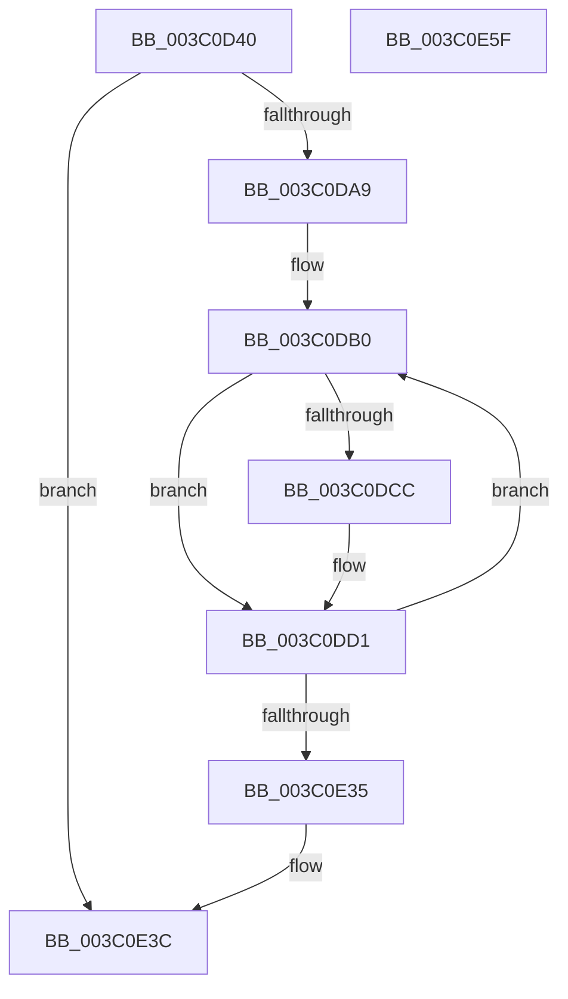

# KiSelectIdealProcessorSetsForProcess

- RVA: `0x003C0D40`–`0x003C0E60` (길이 `288` bytes)
- VA: `0x00000001403C0D40`
- 실행 섹션: `.text`
- PDB 이름 있음: `예`; PDB Function 태그: `아니요`
- unwind 정보 RVA: `0x0008E084`
- 디코드: `80`개 명령, `288/288` bytes 표시
- 미해석 바이트: `0` (있으면 어셈블리에 `.byte`로 보존)

> 이 문서는 커널 이미지의 기계어와 PDB 기호를 분석해 생성했습니다. 4번과 5번은 함수 원형과 자료형을 바이너리 사용 방식에서 추정한 C 해석이며 원본 소스 복구 결과는 아닙니다.

## 1. Dependencies

- 직접 호출 지점: **1**; 고유 호출 대상: **1**
- 직접 호출자로 확인된 함수: **3**
- RIP 상대 이미지 참조: **1**

### Outgoing calls
- `0x003C0DFE` → [KiSelectIdealProcessorSetForGroup](KiSelectIdealProcessorSetForGroup_function_003C0E68.md) (function, `0x003C0E68`)

### Direct callers
- [KiSetProcessConcurrencyCount](../24/KiSetProcessConcurrencyCount_function_00249F2C.md) at `0x00249FF1`
- [KeSetAffinityProcess](KeSetAffinityProcess_function_003C0A60.md) at `0x003C0BE2`
- [KiStartIdealProcessorAssignmentBlock](KiStartIdealProcessorAssignmentBlock_function_003C0D14.md) at `0x003C0D2C`

### Static image references
- `0x003C0D99` → RVA `0x00FC5018` (`ALMOSTRO`; read)

## 2. Other-region calls and transfers

- 다른 실행 섹션으로 향하는 call: **0**
- 별도 외부 분기/꼬리 이동을 확인하지 못했습니다.

## 3. Assembly (complete function range)

```asm
003C0D40  48 89 5C 24 08                  mov qword ptr [rsp + 8], rbx
003C0D45  4C 89 4C 24 20                  mov qword ptr [rsp + 0x20], r9
003C0D4A  4C 89 44 24 18                  mov qword ptr [rsp + 0x18], r8
003C0D4F  55                              push rbp
003C0D50  56                              push rsi
003C0D51  57                              push rdi
003C0D52  41 54                           push r12
003C0D54  41 55                           push r13
003C0D56  41 56                           push r14
003C0D58  41 57                           push r15
003C0D5A  48 8B EC                        mov rbp, rsp
003C0D5D  48 83 EC 50                     sub rsp, 0x50
003C0D61  44 8B 32                        mov r14d, dword ptr [rdx]
003C0D64  4C 8B F9                        mov r15, rcx
003C0D67  33 C9                           xor ecx, ecx
003C0D69  41 C1 EE 12                     shr r14d, 0x12
003C0D6D  48 89 4D 48                     mov qword ptr [rbp + 0x48], rcx
003C0D71  44 8B E9                        mov r13d, ecx
003C0D74  8B 5D 4C                        mov ebx, dword ptr [rbp + 0x4c]
003C0D77  0F B7 F9                        movzx edi, cx
003C0D7A  48 89 4D E0                     mov qword ptr [rbp - 0x20], rcx
003C0D7E  8D 41 02                        lea eax, [rcx + 2]
003C0D81  89 4D 48                        mov dword ptr [rbp + 0x48], ecx
003C0D84  44 3B F0                        cmp r14d, eax
003C0D87  44 0F 42 F0                     cmovb r14d, eax
003C0D8B  81 E3 FF FF 03 00               and ebx, 0x3ffff
003C0D91  81 CB 00 00 04 20               or ebx, 0x20040000
003C0D97  FF CB                           dec ebx
003C0D99  66 3B 0D 78 42 C0 00            cmp cx, word ptr [rip + 0xc04278]
003C0DA0  89 5D 4C                        mov dword ptr [rbp + 0x4c], ebx
003C0DA3  0F 83 93 00 00 00               jae 0x1403c0e3c
003C0DA9  49 8B F7                        mov rsi, r15
003C0DAC  48 C1 EE 0C                     shr rsi, 0xc
003C0DB0  49 8B 47 50                     mov rax, qword ptr [r15 + 0x50]
003C0DB4  0F 57 C0                        xorps xmm0, xmm0
003C0DB7  0F 11 45 F0                     movups xmmword ptr [rbp - 0x10], xmm0
003C0DBB  48 89 4D E8                     mov qword ptr [rbp - 0x18], rcx
003C0DBF  66 89 7D F8                     mov word ptr [rbp - 8], di
003C0DC3  44 0F B7 E7                     movzx r12d, di
003C0DC7  66 3B 38                        cmp di, word ptr [rax]
003C0DCA  73 05                           jae 0x1403c0dd1
003C0DCC  4A 8B 4C E0 08                  mov rcx, qword ptr [rax + r12*8 + 8]
003C0DD1  49 8B 97 B8 00 00 00            mov rdx, qword ptr [r15 + 0xb8]
003C0DD8  48 8D 45 E0                     lea rax, [rbp - 0x20]
003C0DDC  48 89 44 24 28                  mov qword ptr [rsp + 0x28], rax
003C0DE1  4C 8B CE                        mov r9, rsi
003C0DE4  48 89 4D F0                     mov qword ptr [rbp - 0x10], rcx
003C0DE8  48 8D 45 E8                     lea rax, [rbp - 0x18]
003C0DEC  45 8B C6                        mov r8d, r14d
003C0DEF  48 89 44 24 20                  mov qword ptr [rsp + 0x20], rax
003C0DF4  42 0F B7 54 62 50               movzx edx, word ptr [rdx + r12*2 + 0x50]
003C0DFA  48 8D 4D F0                     lea rcx, [rbp - 0x10]
003C0DFE  E8 65 00 00 00                  call 0x1403c0e68
003C0E03  44 3B 6D E0                     cmp r13d, dword ptr [rbp - 0x20]
003C0E07  48 8B 4D 50                     mov rcx, qword ptr [rbp + 0x50]
003C0E0B  44 0F 42 6D E0                  cmovb r13d, dword ptr [rbp - 0x20]
003C0E10  3B 5D E4                        cmp ebx, dword ptr [rbp - 0x1c]
003C0E13  48 8B 45 E8                     mov rax, qword ptr [rbp - 0x18]
003C0E17  0F 47 5D E4                     cmova ebx, dword ptr [rbp - 0x1c]
003C0E1B  66 FF C7                        inc di
003C0E1E  66 3B 3D F3 41 C0 00            cmp di, word ptr [rip + 0xc041f3]
003C0E25  4A 89 44 E1 08                  mov qword ptr [rcx + r12*8 + 8], rax
003C0E2A  B9 00 00 00 00                  mov ecx, 0
003C0E2F  0F 82 7B FF FF FF               jb 0x1403c0db0
003C0E35  89 5D 4C                        mov dword ptr [rbp + 0x4c], ebx
003C0E38  44 89 6D 48                     mov dword ptr [rbp + 0x48], r13d
003C0E3C  48 8B 4D 58                     mov rcx, qword ptr [rbp + 0x58]
003C0E40  48 8B 45 48                     mov rax, qword ptr [rbp + 0x48]
003C0E44  48 8B 9C 24 90 00 00 00         mov rbx, qword ptr [rsp + 0x90]
003C0E4C  48 89 01                        mov qword ptr [rcx], rax
003C0E4F  48 83 C4 50                     add rsp, 0x50
003C0E53  41 5F                           pop r15
003C0E55  41 5E                           pop r14
003C0E57  41 5D                           pop r13
003C0E59  41 5C                           pop r12
003C0E5B  5F                              pop rdi
003C0E5C  5E                              pop rsi
003C0E5D  5D                              pop rbp
003C0E5E  C3                              ret
003C0E5F  CC                              int3
```

## 4. C-style interpretation (structured pseudocode)

```c
__int64 __fastcall KiSelectIdealProcessorSetsForProcess(__int64 a1, __int64 a2, __int64 a3, __int64 a4)
{
    __int64 result;
    __int64 v_r13;
    __int64 v_r14;
    __int64 v_rbx;
    __int64 v_rdi;
    __int64 v_rsi;
    __int64 v_rsp;
    unsigned __int16 v_stack_m40;
    unsigned __int64 v_stack_m48;
    unsigned __int64 v_stack_m50;
    unsigned int v_stack_m54;
    unsigned __int64 v_stack_m58;
    unsigned __int64 v_stack_m60;
    unsigned __int64 v_stack_m68;
    unsigned __int64 v_stack_p10;
    unsigned int v_stack_p14;
    unsigned __int64 v_stack_p18;
    unsigned __int64 v_stack_p20;
    unsigned __int64 v_stack_p8;

    v_stack_p8 = v_rbx;
    v_stack_p20 = a4;
    v_stack_p18 = a3;
    v_rsp = (v_rsp) - (80);
    a1 = 0;
    v_r14 = (unsigned int)(((unsigned int)(*(unsigned int *)(a2))) >> (18));
    v_stack_p10 = 0;
    v_stack_m58 = 0;
    v_stack_p10 = 0;
    if (((unsigned int)(v_r14)) < ((unsigned int)(a1 + 2))) { v_r14 = (unsigned int)(a1 + 2); }
    v_rbx = (unsigned int)(((unsigned int)(v_stack_p14)) & (0x3FFFFULL));
    v_rbx = (unsigned int)((v_rbx) | (0x20040000ULL));
    v_rbx = (unsigned int)((v_rbx) - 1);
    v_stack_p14 = (unsigned int)(v_rbx);
    if (0 >= (*(unsigned __int16 *)(v_rip + 12599928))) goto loc_003C0E3C;
    v_rsi = (0) >> (12);
loc_003C0DB0:
    v_stack_m48 = v_xmm0;
    v_stack_m50 = 0;
    v_stack_m40 = 0;
    if (0 < (*(unsigned __int16 *)(*(unsigned __int64 *)(a1 + 80)))) {
        a1 = *(unsigned __int64 *)(*(unsigned __int64 *)(a1 + 80) + 0 * 8 + 8);
    }
    v_stack_m60 = v_stack_m58;
    v_stack_m48 = a1;
    v_stack_m68 = v_stack_m50;
    result = KiSelectIdealProcessorSetForGroup(v_stack_m48, *(unsigned __int16 *)(*(unsigned __int64 *)(a1 + 184) + 0 * 2 + 80), (unsigned int)((unsigned int)(v_r14)), v_rsi);
    v_r13 = 0;
    if (0 < v_stack_m58) { v_r13 = v_stack_m58; }
    if (((unsigned int)(v_rbx)) > v_stack_m54) { v_rbx = v_stack_m54; }
    v_rdi = (unsigned __int16)((0) + 1);
    *(unsigned __int64 *)(v_stack_p18 + 0 * 8 + 8) = v_stack_m50;
    if (((unsigned __int16)(v_rdi)) < (*(unsigned __int16 *)(v_rip + 12599795))) goto loc_003C0DB0;
    v_stack_p14 = (unsigned int)(v_rbx);
    v_stack_p10 = (unsigned int)(v_r13);
loc_003C0E3C:
    *(unsigned __int64 *)(v_stack_p20) = v_stack_p10;
    v_rsp = (v_rsp) + (80);
    return v_stack_p10;
}
```

## 5. (Beta) C Style

```c
int64_t KiSelectIdealProcessorSetsForProcess(void *Arg1, void *Arg2, int64_t Arg3, int64_t Arg4)
{
    uint8_t *arg1 = (uint8_t *)Arg1;
    uint8_t *arg2 = (uint8_t *)Arg2;

    int64_t result;
    int64_t local_r13;
    int64_t local_r14;
    int64_t local_rbx;
    int64_t local_rdi;
    int64_t local_rsi;
    int64_t local_rsp;
    uint16_t v_stack_m40;
    uint64_t v_stack_m48;
    uint64_t v_stack_m50;
    uint32_t v_stack_m54;
    uint64_t v_stack_m58;
    uint64_t v_stack_m60;
    uint64_t v_stack_m68;
    uint64_t v_stack_p10;
    uint32_t v_stack_p14;
    uint64_t v_stack_p18;
    uint64_t v_stack_p20;
    uint64_t v_stack_p8;

    v_stack_p8 = local_rbx;
    v_stack_p20 = Arg4;
    v_stack_p18 = Arg3;
    local_rsp = (local_rsp) - (80);
    Arg1 = 0;
    local_r14 = (uint32_t)(((uint32_t)(*(uint32_t *)(arg2))) >> (18));
    v_stack_p10 = 0;
    v_stack_m58 = 0;
    v_stack_p10 = 0;
    if (((uint32_t)(local_r14)) < ((uint32_t)(Arg1 + 2))) { local_r14 = (uint32_t)(Arg1 + 2); }
    local_rbx = (uint32_t)(((uint32_t)(v_stack_p14)) & (0x3FFFFULL));
    local_rbx = (uint32_t)((local_rbx) | (0x20040000ULL));
    local_rbx = (uint32_t)((local_rbx) - 1);
    v_stack_p14 = (uint32_t)(local_rbx);
    if (0 >= (*(uint16_t *)(v_rip + 0xC04278))) goto loc_003C0E3C;
    local_rsi = (0) >> (12);
loc_003C0DB0:
    v_stack_m48 = v_xmm0;
    v_stack_m50 = 0;
    v_stack_m40 = 0;
    if (0 < (*(uint16_t *)(*(uint64_t *)(arg1 + 0x50)))) {
        Arg1 = *(uint64_t *)(*(uint64_t *)(arg1 + 0x50) + 0x0 * 8 + 0x8);
    }
    v_stack_m60 = v_stack_m58;
    v_stack_m48 = Arg1;
    v_stack_m68 = v_stack_m50;
    result = KiSelectIdealProcessorSetForGroup(v_stack_m48, *(uint16_t *)(*(uint64_t *)(arg1 + 0xB8) + 0x0 * 2 + 0x50), (uint32_t)((uint32_t)(local_r14)), local_rsi);
    local_r13 = 0;
    if (0 < v_stack_m58) { local_r13 = v_stack_m58; }
    if (((uint32_t)(local_rbx)) > v_stack_m54) { local_rbx = v_stack_m54; }
    local_rdi = (uint16_t)((0) + 1);
    *(uint64_t *)(v_stack_p18 + 0x0 * 8 + 0x8) = v_stack_m50;
    if (((uint16_t)(local_rdi)) < (*(uint16_t *)(v_rip + 0xC041F3))) goto loc_003C0DB0;
    v_stack_p14 = (uint32_t)(local_rbx);
    v_stack_p10 = (uint32_t)(local_r13);
loc_003C0E3C:
    *(uint64_t *)(v_stack_p20) = v_stack_p10;
    local_rsp = (local_rsp) + (80);
    return v_stack_p10;
}
```

### 관측된 메모리 오프셋

구조체 형식이 확인되지 않은 접근은 인자 기준의 오프셋으로만 기록했습니다.

| 기준 인자 | 오프셋 표현 | 폭 (bit) | 접근 |
|---|---:|---:|---|
| `Arg1` | `+ 0x50` | `64` | `R` |
| `Arg1` | `+ 0xB8` | `64` | `R` |
| `Arg2` | `+ 0x0` | `32` | `R` |

## 6. Execution-region graph

[열기: 2D/3D 그래프와 함수 탐색 컨트롤 패널](../../../control-panel.html?section=text&rva=0x003C0D40&view=graph)

- 2D 그래프는 위에서 아래로 흐르고, 3D 그래프는 빈 공간을 드래그해 회전합니다. Shift+드래그는 이동, 휠은 확대·축소, 함수 노드 선택은 대상 보고서 이동입니다.

### Static fallback


