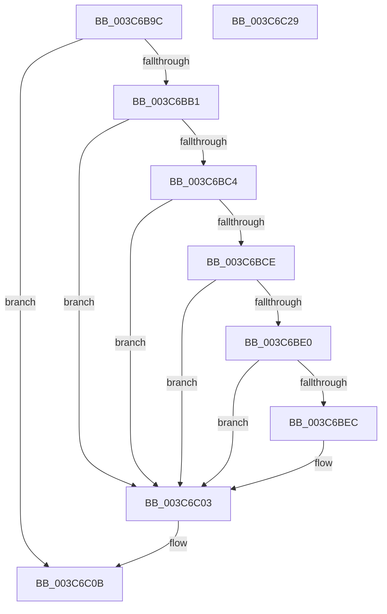

# KiSetBasePriorityAndClearDecrement

- RVA: `0x003C6B9C`–`0x003C6C2A` (길이 `142` bytes)
- VA: `0x00000001403C6B9C`
- 실행 섹션: `.text`
- PDB 이름 있음: `예`; PDB Function 태그: `아니요`
- unwind 정보 RVA: `0x0005CAAC`
- 디코드: `36`개 명령, `142/142` bytes 표시
- 미해석 바이트: `0` (있으면 어셈블리에 `.byte`로 보존)

> 이 문서는 커널 이미지의 기계어와 PDB 기호를 분석해 생성했습니다. 4번과 5번은 함수 원형과 자료형을 바이너리 사용 방식에서 추정한 C 해석이며 원본 소스 복구 결과는 아닙니다.

## 1. Dependencies

- 직접 호출 지점: **1**; 고유 호출 대상: **1**
- 직접 호출자로 확인된 함수: **4**
- RIP 상대 이미지 참조: **0**

### Outgoing calls
- `0x003C6BFE` → [KiAbQueueAutoBoostDpc](../20/KiAbQueueAutoBoostDpc_function_002074D0.md) (function, `0x002074D0`)

### Direct callers
- [KeSetPriorityAndQuantumProcess](KeSetPriorityAndQuantumProcess_function_003C2EC0.md) at `0x003C3127`
- [KeRemovePriQueue](KeRemovePriQueue_function_003C5090.md) at `0x003C554B`
- [KeSetBasePriorityThread](KeSetBasePriorityThread_function_003C6EB0.md) at `0x003C6FF1`
- [sub_006E7EC2](../6E/Unknown_function_006E7EC2.md) at `0x006E7F5A`

### Static image references
- 디코드된 RIP-relative 메모리 참조가 없습니다.

## 2. Other-region calls and transfers

- 다른 실행 섹션으로 향하는 call: **0**
- 별도 외부 분기/꼬리 이동을 확인하지 못했습니다.

## 3. Assembly (complete function range)

```asm
003C6B9C  48 89 5C 24 08                  mov qword ptr [rsp + 8], rbx
003C6BA1  57                              push rdi
003C6BA2  48 83 EC 20                     sub rsp, 0x20
003C6BA6  48 8B FA                        mov rdi, rdx
003C6BA9  48 8B D9                        mov rbx, rcx
003C6BAC  48 85 D2                        test rdx, rdx
003C6BAF  74 5A                           je 0x1403c6c0b
003C6BB1  8B 02                           mov eax, dword ptr [rdx]
003C6BB3  65 48 8B 0C 25 20 00 00 00      mov rcx, qword ptr gs:[0x20]
003C6BBC  3A 83 33 02 00 00               cmp al, byte ptr [rbx + 0x233]
003C6BC2  7D 3F                           jge 0x1403c6c03
003C6BC4  8A 83 19 03 00 00               mov al, byte ptr [rbx + 0x319]
003C6BCA  84 C0                           test al, al
003C6BCC  74 35                           je 0x1403c6c03
003C6BCE  48 8D 93 30 03 00 00            lea rdx, [rbx + 0x330]
003C6BD5  41 B9 01 00 00 00               mov r9d, 1
003C6BDB  4C 39 0A                        cmp qword ptr [rdx], r9
003C6BDE  75 23                           jne 0x1403c6c03
003C6BE0  4C 8D 81 70 91 00 00            lea r8, [rcx + 0x9170]
003C6BE7  4D 85 C0                        test r8, r8
003C6BEA  74 17                           je 0x1403c6c03
003C6BEC  49 8B 00                        mov rax, qword ptr [r8]
003C6BEF  48 89 02                        mov qword ptr [rdx], rax
003C6BF2  49 89 10                        mov qword ptr [r8], rdx
003C6BF5  66 F0 44 01 8B 64 03 00 00      lock add word ptr [rbx + 0x364], r9w
003C6BFE  E8 CD 08 E4 FF                  call 0x1402074d0
003C6C03  8A 07                           mov al, byte ptr [rdi]
003C6C05  88 83 33 02 00 00               mov byte ptr [rbx + 0x233], al
003C6C0B  B8 0F F0 00 00                  mov eax, 0xf00f
003C6C10  C6 83 66 03 00 00 00            mov byte ptr [rbx + 0x366], 0
003C6C17  66 21 83 06 02 00 00            and word ptr [rbx + 0x206], ax
003C6C1E  48 8B 5C 24 30                  mov rbx, qword ptr [rsp + 0x30]
003C6C23  48 83 C4 20                     add rsp, 0x20
003C6C27  5F                              pop rdi
003C6C28  C3                              ret
003C6C29  CC                              int3
```

## 4. C-style interpretation (structured pseudocode)

```c
__int64 __fastcall KiSetBasePriorityAndClearDecrement(__int64 a1, __int64 a2)
{
    __int64 result;
    __int64 v_rsp;
    unsigned __int64 v_stack_p8;

    v_stack_p8 = v_rbx;
    v_rsp = (v_rsp) - (32);
    if (a2 == 0) goto loc_003C6C0B;
    if (((unsigned __int8)((unsigned int)(*(unsigned int *)(a2)))) >= (*(unsigned __int8 *)(a1 + 563))) goto loc_003C6C03;
    if ((unsigned __int8)(*(unsigned __int8 *)(a1 + 793)) == 0) goto loc_003C6C03;
    if ((*(unsigned __int64 *)(a1 + 816)) != 1) goto loc_003C6C03;
    result = *(unsigned __int8 *)(a1 + 793);
    if (*(unsigned __int64 *)(gs_base + (0 + 32)) + 37232 != 0) {
        result = *(unsigned __int64 *)(*(unsigned __int64 *)(gs_base + (0 + 32)) + 37232);
        *(unsigned __int64 *)(a1 + 816) = result;
        *(unsigned __int64 *)(*(unsigned __int64 *)(gs_base + (0 + 32)) + 37232) = a1 + 816;
        result = KiAbQueueAutoBoostDpc(*(unsigned __int64 *)(gs_base + (0 + 32)), a1 + 816, *(unsigned __int64 *)(gs_base + (0 + 32)) + 37232, 1);
    }
    *(unsigned __int8 *)(a1 + 563) = (unsigned __int8)(*(unsigned __int8 *)(a2));
loc_003C6C0B:
    *(unsigned __int8 *)(a1 + 870) = 0;
    v_rsp = (v_rsp) + (32);
    return (unsigned int)(0xF00FULL);
}
```

## 5. (Beta) C Style

```c
int64_t KiSetBasePriorityAndClearDecrement(void *Arg1, void *Arg2)
{
    uint8_t *arg1 = (uint8_t *)Arg1;
    uint8_t *arg2 = (uint8_t *)Arg2;

    int64_t result;
    int64_t local_rsp;
    uint64_t v_stack_p8;

    v_stack_p8 = local_rbx;
    local_rsp = (local_rsp) - (32);
    if (Arg2 == NULL) goto loc_003C6C0B;
    if (((uint8_t)((uint32_t)(*(uint32_t *)(arg2)))) >= (*(uint8_t *)(arg1 + 0x233))) goto loc_003C6C03;
    if ((uint8_t)(*(uint8_t *)(arg1 + 0x319)) == 0) goto loc_003C6C03;
    if ((*(uint64_t *)(arg1 + 0x330)) != 1) goto loc_003C6C03;
    result = *(uint8_t *)(arg1 + 0x319);
    if (*(uint64_t *)(gs_base + (0 + 0x20)) + 37232 != 0) {
        result = *(uint64_t *)(*(uint64_t *)(gs_base + (0 + 0x20)) + 0x9170);
        *(uint64_t *)(arg1 + 0x330) = result;
        *(void **)(*(uint64_t *)(gs_base + (0 + 0x20)) + 0x9170) = Arg1 + 816;
        result = KiAbQueueAutoBoostDpc(*(uint64_t *)(gs_base + (0 + 0x20)), Arg1 + 816, *(uint64_t *)(gs_base + (0 + 0x20)) + 37232, 1);
    }
    *(uint8_t *)(arg1 + 0x233) = (uint8_t)(*(uint8_t *)(arg2));
loc_003C6C0B:
    *(uint8_t *)(arg1 + 0x366) = 0;
    local_rsp = (local_rsp) + (32);
    return (uint32_t)(0xF00FULL);
}
```

### 관측된 메모리 오프셋

구조체 형식이 확인되지 않은 접근은 인자 기준의 오프셋으로만 기록했습니다.

| 기준 인자 | 오프셋 표현 | 폭 (bit) | 접근 |
|---|---:|---:|---|
| `Arg1` | `+ 0x0` | `64` | `R` |
| `Arg1` | `+ 0x0` | `64` | `W` |
| `Arg1` | `+ 0x206` | `16` | `R/W` |
| `Arg1` | `+ 0x233` | `8` | `R` |
| `Arg1` | `+ 0x233` | `8` | `W` |
| `Arg1` | `+ 0x319` | `8` | `R` |
| `Arg1` | `+ 0x330` | `64` | `R` |
| `Arg1` | `+ 0x364` | `16` | `R/W` |
| `Arg1` | `+ 0x366` | `8` | `W` |
| `Arg2` | `+ 0x0` | `8` | `R` |

## 6. Execution-region graph

[열기: 2D/3D 그래프와 함수 탐색 컨트롤 패널](../../../control-panel.html?section=text&rva=0x003C6B9C&view=graph)

- 2D 그래프는 위에서 아래로 흐르고, 3D 그래프는 빈 공간을 드래그해 회전합니다. Shift+드래그는 이동, 휠은 확대·축소, 함수 노드 선택은 대상 보고서 이동입니다.

### Static fallback


