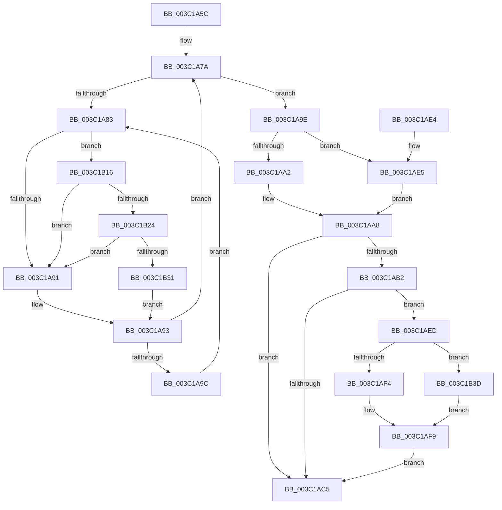

# KiSetDisableBoostThread

- RVA: `0x003C1A5C`–`0x003C1B44` (길이 `232` bytes)
- VA: `0x00000001403C1A5C`
- 실행 섹션: `.text`
- PDB 이름 있음: `예`; PDB Function 태그: `아니요`
- unwind 정보 RVA: `0x0008E170`
- 디코드: `65`개 명령, `232/232` bytes 표시
- 미해석 바이트: `0` (있으면 어셈블리에 `.byte`로 보존)

> 이 문서는 커널 이미지의 기계어와 PDB 기호를 분석해 생성했습니다. 4번과 5번은 함수 원형과 자료형을 바이너리 사용 방식에서 추정한 C 해석이며 원본 소스 복구 결과는 아닙니다.

## 1. Dependencies

- 직접 호출 지점: **6**; 고유 호출 대상: **6**
- 직접 호출자로 확인된 함수: **2**
- RIP 상대 이미지 참조: **2**

### Outgoing calls
- `0x003C1AF4` → [KiClearForegroundBoost](KiClearForegroundBoost_function_003C20D8.md) (function, `0x003C20D8`)
- `0x003C1B01` → [KiComputeThreadPriority](KiComputeThreadPriority_function_003C45F4.md) (function, `0x003C45F4`)
- `0x003C1B0F` → [KiSetPriorityThread](../22/KiSetPriorityThread_function_00220E78.md) (function, `0x00220E78`)
- `0x003C1B24` → [KiCheckVpBackingLongSpinWaitHypercall](../30/KiCheckVpBackingLongSpinWaitHypercall_function_0030F490.md) (function, `0x0030F490`)
- `0x003C1B33` → [HvlNotifyLongSpinWait](../30/HvlNotifyLongSpinWait_function_0030F460.md) (function, `0x0030F460`)
- `0x003C1B3D` → [KiSetForegroundBoost](KiSetForegroundBoost_function_003C343C.md) (function, `0x003C343C`)

### Direct callers
- [KeSetDisableBoostProcess](KeSetDisableBoostProcess_function_003C18B4.md) at `0x003C192D`
- [KeSetDisableBoostThread](KeSetDisableBoostThread_function_003C19BC.md) at `0x003C19F6`

### Static image references
- `0x003C1A85` → RVA `0x00FC52AC` (`ALMOSTRO`; reference)
- `0x003C1B16` → RVA `0x00FC6AB8` (`ALMOSTRO`; read)

## 2. Other-region calls and transfers

- 다른 실행 섹션으로 향하는 call: **0**
- 별도 외부 분기/꼬리 이동을 확인하지 못했습니다.

## 3. Assembly (complete function range)

```asm
003C1A5C  48 89 5C 24 08                  mov qword ptr [rsp + 8], rbx
003C1A61  48 89 6C 24 10                  mov qword ptr [rsp + 0x10], rbp
003C1A66  48 89 74 24 18                  mov qword ptr [rsp + 0x18], rsi
003C1A6B  57                              push rdi
003C1A6C  48 83 EC 20                     sub rsp, 0x20
003C1A70  49 8B E8                        mov rbp, r8
003C1A73  8B F2                           mov esi, edx
003C1A75  48 8B D9                        mov rbx, rcx
003C1A78  33 FF                           xor edi, edi
003C1A7A  F0 48 0F BA 6B 40 00            lock bts qword ptr [rbx + 0x40], 0
003C1A81  73 1B                           jae 0x1403c1a9e
003C1A83  FF C7                           inc edi
003C1A85  85 3D 21 38 C0 00               test dword ptr [rip + 0xc03821], edi
003C1A8B  0F 84 85 00 00 00               je 0x1403c1b16
003C1A91  F3 90                           pause
003C1A93  48 8B 43 40                     mov rax, qword ptr [rbx + 0x40]
003C1A97  48 85 C0                        test rax, rax
003C1A9A  74 DE                           je 0x1403c1a7a
003C1A9C  EB E5                           jmp 0x1403c1a83
003C1A9E  85 F6                           test esi, esi
003C1AA0  74 43                           je 0x1403c1ae5
003C1AA2  F0 0F BA 6B 78 03               lock bts dword ptr [rbx + 0x78], 3
003C1AA8  0F 92 C0                        setb al
003C1AAB  0F B6 F8                        movzx edi, al
003C1AAE  3B F7                           cmp esi, edi
003C1AB0  74 13                           je 0x1403c1ac5
003C1AB2  48 8B 83 20 02 00 00            mov rax, qword ptr [rbx + 0x220]
003C1AB9  8B 80 88 00 00 00               mov eax, dword ptr [rax + 0x88]
003C1ABF  0F BA E0 0D                     bt eax, 0xd
003C1AC3  72 28                           jb 0x1403c1aed
003C1AC5  48 8B 6C 24 38                  mov rbp, qword ptr [rsp + 0x38]
003C1ACA  8B C7                           mov eax, edi
003C1ACC  48 8B 74 24 40                  mov rsi, qword ptr [rsp + 0x40]
003C1AD1  48 C7 43 40 00 00 00 00         mov qword ptr [rbx + 0x40], 0
003C1AD9  48 8B 5C 24 30                  mov rbx, qword ptr [rsp + 0x30]
003C1ADE  48 83 C4 20                     add rsp, 0x20
003C1AE2  5F                              pop rdi
003C1AE3  C3                              ret
003C1AE4  CC                              int3
003C1AE5  F0 0F BA 73 78 03               lock btr dword ptr [rbx + 0x78], 3
003C1AEB  EB BB                           jmp 0x1403c1aa8
003C1AED  48 8B CB                        mov rcx, rbx
003C1AF0  85 F6                           test esi, esi
003C1AF2  74 49                           je 0x1403c1b3d
003C1AF4  E8 DF 05 00 00                  call 0x1403c20d8
003C1AF9  45 33 C0                        xor r8d, r8d
003C1AFC  33 D2                           xor edx, edx
003C1AFE  48 8B CB                        mov rcx, rbx
003C1B01  E8 EE 2A 00 00                  call 0x1403c45f4
003C1B06  44 8B C0                        mov r8d, eax
003C1B09  48 8B D5                        mov rdx, rbp
003C1B0C  48 8B CB                        mov rcx, rbx
003C1B0F  E8 64 F3 E5 FF                  call 0x140220e78
003C1B14  EB AF                           jmp 0x1403c1ac5
003C1B16  8B 05 9C 4F C0 00               mov eax, dword ptr [rip + 0xc04f9c]
003C1B1C  A8 40                           test al, 0x40
003C1B1E  0F 84 6D FF FF FF               je 0x1403c1a91
003C1B24  E8 67 D9 F4 FF                  call 0x14030f490
003C1B29  84 C0                           test al, al
003C1B2B  0F 84 60 FF FF FF               je 0x1403c1a91
003C1B31  8B CF                           mov ecx, edi
003C1B33  E8 28 D9 F4 FF                  call 0x14030f460
003C1B38  E9 56 FF FF FF                  jmp 0x1403c1a93
003C1B3D  E8 FA 18 00 00                  call 0x1403c343c
003C1B42  EB B5                           jmp 0x1403c1af9
```

## 4. C-style interpretation (structured pseudocode)

```c
__int64 __fastcall KiSetDisableBoostThread(__int64 a1, int a2, __int64 a3)
{
    __int64 result;
    __int64 v_rdi;
    __int64 v_rsp;
    unsigned __int64 v_stack_p10;
    unsigned __int64 v_stack_p18;
    unsigned __int64 v_stack_p8;

    v_stack_p8 = v_rbx;
    v_stack_p10 = v_rbp;
    v_stack_p18 = v_rsi;
    v_rsp = (v_rsp) - (32);
    v_rdi = 0;
loc_003C1A7A:
    if (condition_is_above_or_equal) goto loc_003C1A9E;
loc_003C1A83:
    v_rdi = (unsigned int)((v_rdi) + 1);
    if (((*(unsigned int *)(v_rip + 12597281)) & ((unsigned int)(v_rdi))) == 0) goto loc_003C1B16;
loc_003C1A91:
loc_003C1A93:
    if (*(unsigned __int64 *)(a1 + 64) == 0) goto loc_003C1A7A;
    goto loc_003C1A83;
loc_003C1A9E:
    if ((unsigned int)((unsigned int)(a2)) == 0) goto loc_003C1AE5;
loc_003C1AA8:
    result = (condition_is_below) ? 1 : 0;
    if (((unsigned int)((unsigned int)(a2))) == ((unsigned int)((unsigned __int8)(result)))) goto loc_003C1AC5;
    if (((unsigned int)((unsigned int)(a2))) < ((unsigned int)((unsigned __int8)(result)))) goto loc_003C1AED;
loc_003C1AC5:
    *(unsigned __int64 *)(a1 + 64) = 0;
    v_rsp = (v_rsp) + (32);
    return (unsigned int)((unsigned int)((unsigned __int8)(result)));
loc_003C1AE5:
    goto loc_003C1AA8;
loc_003C1AED:
    if ((unsigned int)(v_stack_p18) == 0) goto loc_003C1B3D;
    result = KiClearForegroundBoost(v_stack_p8, a2, a3, a4);
loc_003C1AF9:
    a3 = 0;
    a2 = 0;
    result = KiComputeThreadPriority(v_stack_p8, a2, a3, a4);
    result = KiSetPriorityThread(v_stack_p8, v_stack_p10, (unsigned int)((unsigned int)(result)), a4);
    goto loc_003C1AC5;
loc_003C1B16:
    if ((((unsigned __int8)((unsigned int)(*(unsigned int *)(v_rip + 12603292)))) & (64)) == 0) goto loc_003C1A91;
    result = KiCheckVpBackingLongSpinWaitHypercall(v_stack_p8, v_stack_p10, (unsigned int)((unsigned int)(result)), a4);
    if ((unsigned __int8)(result) == 0) goto loc_003C1A91;
    result = HvlNotifyLongSpinWait((unsigned int)((unsigned int)((unsigned __int8)(result))), v_stack_p10, (unsigned int)((unsigned int)(result)), a4);
    goto loc_003C1A93;
loc_003C1B3D:
    result = KiSetForegroundBoost((unsigned int)((unsigned int)((unsigned __int8)(result))), v_stack_p10, (unsigned int)((unsigned int)(result)), a4);
    goto loc_003C1AF9;
}
```

## 5. (Beta) C Style

```c
int64_t KiSetDisableBoostThread(void *Arg1, int32_t Arg2, int64_t Arg3)
{
    uint8_t *arg1 = (uint8_t *)Arg1;

    int64_t result;
    int64_t local_rdi;
    int64_t local_rsp;
    uint64_t v_stack_p10;
    uint64_t v_stack_p18;
    uint64_t v_stack_p8;

    v_stack_p8 = local_rbx;
    v_stack_p10 = local_rbp;
    v_stack_p18 = local_rsi;
    local_rsp = (local_rsp) - (32);
    local_rdi = 0;
loc_003C1A7A:
    if (condition_is_above_or_equal) goto loc_003C1A9E;
loc_003C1A83:
    local_rdi = (uint32_t)((local_rdi) + 1);
    if (((*(uint32_t *)(v_rip + 0xC03821)) & ((uint32_t)(local_rdi))) == 0) goto loc_003C1B16;
loc_003C1A91:
loc_003C1A93:
    if (*(uint64_t *)(arg1 + 0x40) == 0) goto loc_003C1A7A;
    goto loc_003C1A83;
loc_003C1A9E:
    if ((uint32_t)((uint32_t)(Arg2)) == 0) goto loc_003C1AE5;
loc_003C1AA8:
    result = (condition_is_below) ? 1 : 0;
    if (((uint32_t)((uint32_t)(Arg2))) == ((uint32_t)((uint8_t)(result)))) goto loc_003C1AC5;
    if (((uint32_t)((uint32_t)(Arg2))) < ((uint32_t)((uint8_t)(result)))) goto loc_003C1AED;
loc_003C1AC5:
    *(uint64_t *)(arg1 + 0x40) = 0;
    local_rsp = (local_rsp) + (32);
    return (uint32_t)((uint32_t)((uint8_t)(result)));
loc_003C1AE5:
    goto loc_003C1AA8;
loc_003C1AED:
    if ((uint32_t)(v_stack_p18) == 0) goto loc_003C1B3D;
    result = KiClearForegroundBoost(v_stack_p8, Arg2, Arg3, a4);
loc_003C1AF9:
    Arg3 = 0;
    Arg2 = 0;
    result = KiComputeThreadPriority(v_stack_p8, Arg2, Arg3, a4);
    result = KiSetPriorityThread(v_stack_p8, v_stack_p10, (uint32_t)((uint32_t)(result)), a4);
    goto loc_003C1AC5;
loc_003C1B16:
    if ((((uint8_t)((uint32_t)(*(uint32_t *)(v_rip + 0xC04F9C)))) & (64)) == 0) goto loc_003C1A91;
    result = KiCheckVpBackingLongSpinWaitHypercall(v_stack_p8, v_stack_p10, (uint32_t)((uint32_t)(result)), a4);
    if ((uint8_t)(result) == 0) goto loc_003C1A91;
    result = HvlNotifyLongSpinWait((uint32_t)((uint32_t)((uint8_t)(result))), v_stack_p10, (uint32_t)((uint32_t)(result)), a4);
    goto loc_003C1A93;
loc_003C1B3D:
    result = KiSetForegroundBoost((uint32_t)((uint32_t)((uint8_t)(result))), v_stack_p10, (uint32_t)((uint32_t)(result)), a4);
    goto loc_003C1AF9;
}
```

### 관측된 메모리 오프셋

구조체 형식이 확인되지 않은 접근은 인자 기준의 오프셋으로만 기록했습니다.

| 기준 인자 | 오프셋 표현 | 폭 (bit) | 접근 |
|---|---:|---:|---|
| `Arg1` | `+ 0x40` | `64` | `R` |
| `Arg1` | `+ 0x40` | `64` | `R/W` |
| `Arg1` | `+ 0x40` | `64` | `W` |
| `Arg1` | `+ 0x78` | `32` | `R/W` |
| `Arg1` | `+ 0x220` | `64` | `R` |

## 6. Execution-region graph

[열기: 2D/3D 그래프와 함수 탐색 컨트롤 패널](../../../control-panel.html?section=text&rva=0x003C1A5C&view=graph)

- 2D 그래프는 위에서 아래로 흐르고, 3D 그래프는 빈 공간을 드래그해 회전합니다. Shift+드래그는 이동, 휠은 확대·축소, 함수 노드 선택은 대상 보고서 이동입니다.

### Static fallback


