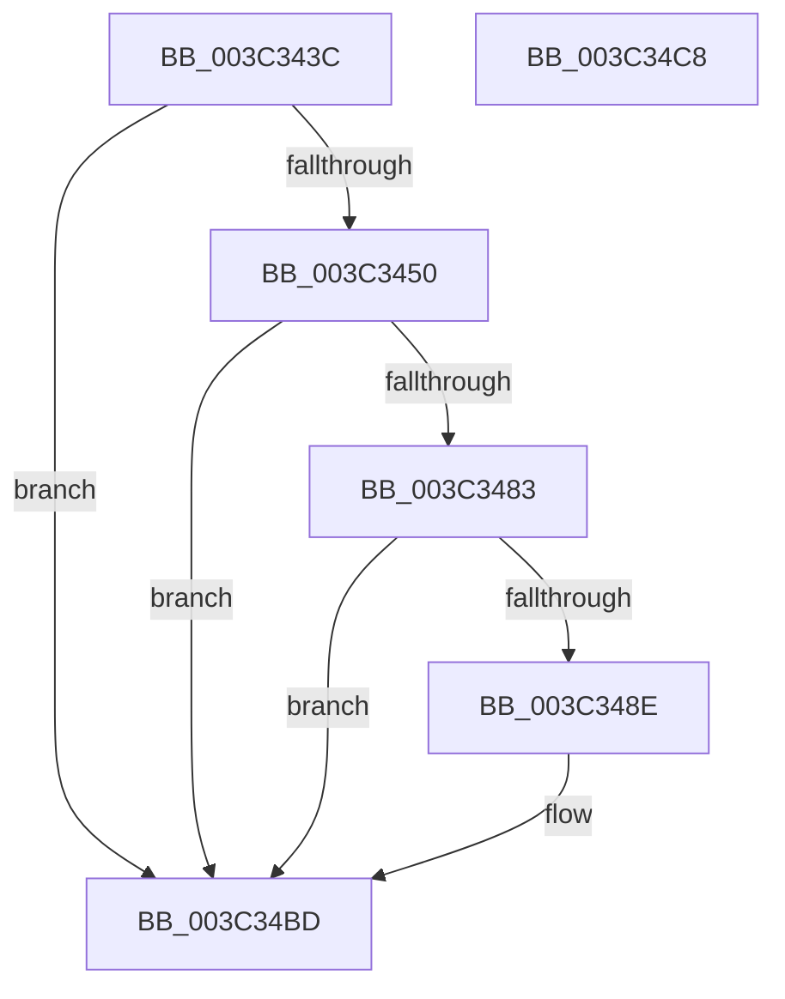

# KiSetForegroundBoost

- RVA: `0x003C343C`–`0x003C34C9` (길이 `141` bytes)
- VA: `0x00000001403C343C`
- 실행 섹션: `.text`
- PDB 이름 있음: `예`; PDB Function 태그: `아니요`
- unwind 정보 RVA: `0x0005CAAC`
- 디코드: `39`개 명령, `141/141` bytes 표시
- 미해석 바이트: `0` (있으면 어셈블리에 `.byte`로 보존)

> 이 문서는 커널 이미지의 기계어와 PDB 기호를 분석해 생성했습니다. 4번과 5번은 함수 원형과 자료형을 바이너리 사용 방식에서 추정한 C 해석이며 원본 소스 복구 결과는 아닙니다.

## 1. Dependencies

- 직접 호출 지점: **1**; 고유 호출 대상: **1**
- 직접 호출자로 확인된 함수: **4**
- RIP 상대 이미지 참조: **1**

### Outgoing calls
- `0x003C347A` → [Feature_StackingDecayBoosts__private_IsEnabledNoReportingNoInline](../4E/Feature_StackingDecayBoosts__private_IsEnabledNoReportingNoInline_function_004EF7C0.md) (function, `0x004EF7C0`)

### Direct callers
- [KiSetDisableBoostThread](KiSetDisableBoostThread_function_003C1A5C.md) at `0x003C1B3D`
- [KiInitializeForegroundBoostThread](KiInitializeForegroundBoostThread_function_003C28D8.md) at `0x003C2904`
- [KeSetPriorityAndQuantumProcess](KeSetPriorityAndQuantumProcess_function_003C2EC0.md) at `0x003C3042`
- [KeSetPriorityAndQuantumProcess](KeSetPriorityAndQuantumProcess_function_003C2EC0.md) at `0x003C32C8`
- [KiApplyForegroundBoostThread](../4F/KiApplyForegroundBoostThread_function_004F7DC0.md) at `0x004F7E3F`

### Static image references
- `0x003C3450` → RVA `0x00FC6C9C` (`ALMOSTRO`; read)

## 2. Other-region calls and transfers

- 다른 실행 섹션으로 향하는 call: **0**
- 별도 외부 분기/꼬리 이동을 확인하지 못했습니다.

## 3. Assembly (complete function range)

```asm
003C343C  48 89 5C 24 08                  mov qword ptr [rsp + 8], rbx
003C3441  57                              push rdi
003C3442  48 83 EC 20                     sub rsp, 0x20
003C3446  8B 41 78                        mov eax, dword ptr [rcx + 0x78]
003C3449  48 8B D9                        mov rbx, rcx
003C344C  A8 08                           test al, 8
003C344E  75 6D                           jne 0x1403c34bd
003C3450  8A 05 46 38 C0 00               mov al, byte ptr [rip + 0xc03846]
003C3456  BF 0F 00 00 00                  mov edi, 0xf
003C345B  40 22 C7                        and al, dil
003C345E  0F B6 D0                        movzx edx, al
003C3461  0F B7 81 06 02 00 00            movzx eax, word ptr [rcx + 0x206]
003C3468  B9 F0 FF 00 00                  mov ecx, 0xfff0
003C346D  66 23 C1                        and ax, cx
003C3470  66 0B D0                        or dx, ax
003C3473  66 89 93 06 02 00 00            mov word ptr [rbx + 0x206], dx
003C347A  E8 41 C3 12 00                  call 0x1404ef7c0
003C347F  85 C0                           test eax, eax
003C3481  74 3A                           je 0x1403c34bd
003C3483  0F BE 8B 66 03 00 00            movsx ecx, byte ptr [rbx + 0x366]
003C348A  84 C9                           test cl, cl
003C348C  74 2F                           je 0x1403c34bd
003C348E  0F BE 83 33 02 00 00            movsx eax, byte ptr [rbx + 0x233]
003C3495  0F B7 93 06 02 00 00            movzx edx, word ptr [rbx + 0x206]
003C349C  23 D7                           and edx, edi
003C349E  44 8D 04 10                     lea r8d, [rax + rdx]
003C34A2  41 83 F8 10                     cmp r8d, 0x10
003C34A6  44 0F 4D C7                     cmovge r8d, edi
003C34AA  03 C8                           add ecx, eax
003C34AC  03 CA                           add ecx, edx
003C34AE  83 F9 10                        cmp ecx, 0x10
003C34B1  0F 4D CF                        cmovge ecx, edi
003C34B4  41 2A C8                        sub cl, r8b
003C34B7  88 8B 66 03 00 00               mov byte ptr [rbx + 0x366], cl
003C34BD  48 8B 5C 24 30                  mov rbx, qword ptr [rsp + 0x30]
003C34C2  48 83 C4 20                     add rsp, 0x20
003C34C6  5F                              pop rdi
003C34C7  C3                              ret
003C34C8  CC                              int3
```

## 4. C-style interpretation (structured pseudocode)

```c
__int64 __fastcall KiSetForegroundBoost(__int64 a1)
{
    __int64 result;
    __int64 v_rsp;
    unsigned __int64 v_stack_p8;

    v_stack_p8 = v_rbx;
    v_rsp = (v_rsp) - (32);
    if ((((unsigned __int8)((unsigned int)(*(unsigned int *)(a1 + 120)))) & (8)) != 0) goto loc_003C34BD;
    result = (unsigned __int8)((*(unsigned __int8 *)(v_rip + 12597318)) & (15));
    result = (unsigned __int16)((*(unsigned __int16 *)(a1 + 518)) & ((unsigned __int16)((unsigned int)(0xFFF0ULL))));
    a2 = (unsigned __int16)(((unsigned __int8)(result)) | ((unsigned __int16)(result)));
    *(unsigned __int16 *)(a1 + 518) = (unsigned __int16)(a2);
    result = Feature_StackingDecayBoosts__private_IsEnabledNoReportingNoInline((unsigned int)(0xFFF0ULL), a2, a3, a4);
    if ((unsigned int)(result) == 0) goto loc_003C34BD;
    if ((unsigned __int8)((__int8)(*(unsigned __int8 *)(a1 + 870))) != 0) {
        result = (__int8)(*(unsigned __int8 *)(a1 + 563));
        a2 = *(unsigned __int16 *)(a1 + 518);
        a2 = (unsigned int)((a2) & (15));
        a3 = result + a2 * 1;
        if (((unsigned int)(a3)) >= 16) { a3 = 15; }
        a1 = (unsigned int)(((__int8)(*(unsigned __int8 *)(a1 + 870))) + ((unsigned int)(result)));
        a1 = (unsigned int)((a1) + ((unsigned int)(a2)));
        if (((unsigned int)(a1)) >= 16) { a1 = 15; }
        a1 = (unsigned __int8)((a1) - ((unsigned __int8)(a3)));
        *(unsigned __int8 *)(a1 + 870) = (unsigned __int8)(a1);
    }
    v_rsp = (v_rsp) + (32);
    return result;
}
```

## 5. (Beta) C Style

```c
int64_t KiSetForegroundBoost(void *Arg1)
{
    uint8_t *arg1 = (uint8_t *)Arg1;

    int64_t result;
    int64_t local_rsp;
    uint64_t v_stack_p8;

    v_stack_p8 = local_rbx;
    local_rsp = (local_rsp) - (32);
    if ((((uint8_t)((uint32_t)(*(uint32_t *)(arg1 + 0x78)))) & (8)) != 0) goto loc_003C34BD;
    result = (uint8_t)((*(uint8_t *)(v_rip + 0xC03846)) & (15));
    result = (uint16_t)((*(uint16_t *)(arg1 + 0x206)) & ((uint16_t)((uint32_t)(0xFFF0ULL))));
    a2 = (uint16_t)(((uint8_t)(result)) | ((uint16_t)(result)));
    *(uint16_t *)(arg1 + 0x206) = (uint16_t)(a2);
    result = Feature_StackingDecayBoosts__private_IsEnabledNoReportingNoInline((uint32_t)(0xFFF0ULL), a2, a3, a4);
    if ((uint32_t)(result) == 0) goto loc_003C34BD;
    if ((uint8_t)((int8_t)(*(uint8_t *)(arg1 + 0x366))) != 0) {
        result = (int8_t)(*(uint8_t *)(arg1 + 0x233));
        a2 = *(uint16_t *)(arg1 + 0x206);
        a2 = (uint32_t)((a2) & (15));
        a3 = result + a2 * 1;
        if (((uint32_t)(a3)) >= 16) { a3 = 15; }
        Arg1 = (uint32_t)(((int8_t)(*(uint8_t *)(arg1 + 0x366))) + ((uint32_t)(result)));
        Arg1 = (uint32_t)((Arg1) + ((uint32_t)(a2)));
        if (((uint32_t)(Arg1)) >= 16) { Arg1 = 15; }
        Arg1 = (uint8_t)((Arg1) - ((uint8_t)(a3)));
        *(uint8_t *)(arg1 + 0x366) = (uint8_t)(Arg1);
    }
    local_rsp = (local_rsp) + (32);
    return result;
}
```

### 관측된 메모리 오프셋

구조체 형식이 확인되지 않은 접근은 인자 기준의 오프셋으로만 기록했습니다.

| 기준 인자 | 오프셋 표현 | 폭 (bit) | 접근 |
|---|---:|---:|---|
| `Arg1` | `+ 0x78` | `32` | `R` |
| `Arg1` | `+ 0x206` | `16` | `R` |
| `Arg1` | `+ 0x206` | `16` | `W` |
| `Arg1` | `+ 0x233` | `8` | `R` |
| `Arg1` | `+ 0x366` | `8` | `R` |
| `Arg1` | `+ 0x366` | `8` | `W` |

## 6. Execution-region graph

[열기: 2D/3D 그래프와 함수 탐색 컨트롤 패널](../../../control-panel.html?section=text&rva=0x003C343C&view=graph)

- 2D 그래프는 위에서 아래로 흐르고, 3D 그래프는 빈 공간을 드래그해 회전합니다. Shift+드래그는 이동, 휠은 확대·축소, 함수 노드 선택은 대상 보고서 이동입니다.

### Static fallback


