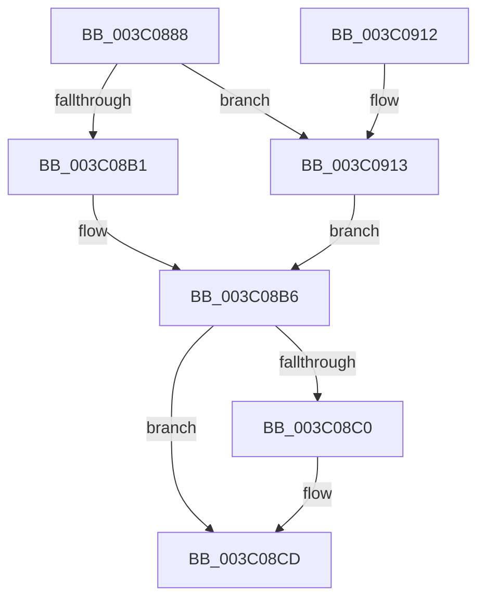

# KiSetIdealNodeProcessByGroup

- RVA: `0x003C0888`–`0x003C0918` (길이 `144` bytes)
- VA: `0x00000001403C0888`
- 실행 섹션: `.text`
- PDB 이름 있음: `예`; PDB Function 태그: `아니요`
- unwind 정보 RVA: `0x00087858`
- 디코드: `36`개 명령, `144/144` bytes 표시
- 미해석 바이트: `0` (있으면 어셈블리에 `.byte`로 보존)

> 이 문서는 커널 이미지의 기계어와 PDB 기호를 분석해 생성했습니다. 4번과 5번은 함수 원형과 자료형을 바이너리 사용 방식에서 추정한 C 해석이며 원본 소스 복구 결과는 아닙니다.

## 1. Dependencies

- 직접 호출 지점: **2**; 고유 호출 대상: **2**
- 직접 호출자로 확인된 함수: **3**
- RIP 상대 이미지 참조: **0**

### Outgoing calls
- `0x003C08C5` → [KeSelectNodeForAffinity](KeSelectNodeForAffinity_function_003C09EC.md) (function, `0x003C09EC`)
- `0x003C08F8` → [KiSelectIdealProcessorForProcess](KiSelectIdealProcessorForProcess_function_003C0920.md) (function, `0x003C0920`)

### Direct callers
- [KeSetAffinityProcess](KeSetAffinityProcess_function_003C0A60.md) at `0x003C0BAA`
- [KiExtendProcessAffinity](../5C/KiExtendProcessAffinity_function_005CA600.md) at `0x005CA6AE`
- [KeInitializeProcess](../../page/A6/KeInitializeProcess_function_00A63CF4.md) at `0x00A63F4E`

### Static image references
- 디코드된 RIP-relative 메모리 참조가 없습니다.

## 2. Other-region calls and transfers

- 다른 실행 섹션으로 향하는 call: **0**
- 별도 외부 분기/꼬리 이동을 확인하지 못했습니다.

## 3. Assembly (complete function range)

```asm
003C0888  48 89 5C 24 08                  mov qword ptr [rsp + 8], rbx
003C088D  57                              push rdi
003C088E  48 83 EC 30                     sub rsp, 0x30
003C0892  4C 8B 59 50                     mov r11, qword ptr [rcx + 0x50]
003C0896  0F 57 C0                        xorps xmm0, xmm0
003C0899  0F 11 44 24 20                  movups xmmword ptr [rsp + 0x20], xmm0
003C089E  48 8B D9                        mov rbx, rcx
003C08A1  66 44 89 44 24 28               mov word ptr [rsp + 0x28], r8w
003C08A7  41 0F B7 F8                     movzx edi, r8w
003C08AB  66 45 3B 03                     cmp r8w, word ptr [r11]
003C08AF  73 62                           jae 0x1403c0913
003C08B1  4D 8B 5C FB 08                  mov r11, qword ptr [r11 + rdi*8 + 8]
003C08B6  4C 89 5C 24 20                  mov qword ptr [rsp + 0x20], r11
003C08BB  48 85 D2                        test rdx, rdx
003C08BE  75 0D                           jne 0x1403c08cd
003C08C0  48 8D 4C 24 20                  lea rcx, [rsp + 0x20]
003C08C5  E8 22 01 00 00                  call 0x1403c09ec
003C08CA  48 8B D0                        mov rdx, rax
003C08CD  48 8B 4C FA 20                  mov rcx, qword ptr [rdx + rdi*8 + 0x20]
003C08D2  0F B7 02                        movzx eax, word ptr [rdx]
003C08D5  48 8D 54 24 20                  lea rdx, [rsp + 0x20]
003C08DA  48 8B 9B B8 00 00 00            mov rbx, qword ptr [rbx + 0xb8]
003C08E1  66 89 84 7B 90 00 00 00         mov word ptr [rbx + rdi*2 + 0x90], ax
003C08E9  48 8B 81 80 00 00 00            mov rax, qword ptr [rcx + 0x80]
003C08F0  49 23 C3                        and rax, r11
003C08F3  48 89 44 24 20                  mov qword ptr [rsp + 0x20], rax
003C08F8  E8 23 00 00 00                  call 0x1403c0920
003C08FD  66 89 44 7B 50                  mov word ptr [rbx + rdi*2 + 0x50], ax
003C0902  66 89 44 7B 10                  mov word ptr [rbx + rdi*2 + 0x10], ax
003C0907  48 8B 5C 24 40                  mov rbx, qword ptr [rsp + 0x40]
003C090C  48 83 C4 30                     add rsp, 0x30
003C0910  5F                              pop rdi
003C0911  C3                              ret
003C0912  CC                              int3
003C0913  45 33 DB                        xor r11d, r11d
003C0916  EB 9E                           jmp 0x1403c08b6
```

## 4. C-style interpretation (structured pseudocode)

```c
__int64 __fastcall KiSetIdealNodeProcessByGroup(__int64 a1, __int64 a2, unsigned __int16 a3)
{
    __int64 result;
    __int64 v_r11;
    __int64 v_rsp;
    unsigned __int16 v_stack_m10;
    unsigned __int64 v_stack_m18;
    unsigned __int64 v_stack_p8;

    v_stack_p8 = v_rbx;
    v_rsp = (v_rsp) - (48);
    v_stack_m18 = v_xmm0;
    v_stack_m10 = a3;
    if (a3 >= (*(unsigned __int16 *)(*(unsigned __int64 *)(a1 + 80)))) goto loc_003C0913;
loc_003C08B6:
    v_stack_m18 = *(unsigned __int64 *)(*(unsigned __int64 *)(a1 + 80) + a3 * 8 + 8);
    if (a2 == 0) {
        a1 = v_stack_m18;
        result = KeSelectNodeForAffinity(a1, a2, a3, a4);
        a2 = result;
    }
    *(unsigned __int16 *)(*(unsigned __int64 *)(a1 + 184) + a3 * 2 + 144) = (unsigned __int16)(*(unsigned __int16 *)(a2));
    result = (*(unsigned __int64 *)(*(unsigned __int64 *)(a2 + a3 * 8 + 32) + 128)) & (*(unsigned __int64 *)(*(unsigned __int64 *)(a1 + 80) + a3 * 8 + 8));
    v_stack_m18 = result;
    result = KiSelectIdealProcessorForProcess(*(unsigned __int64 *)(a2 + a3 * 8 + 32), v_stack_m18, a3, a4);
    *(unsigned __int16 *)(*(unsigned __int64 *)(a1 + 184) + a3 * 2 + 80) = (unsigned __int16)(result);
    *(unsigned __int16 *)(*(unsigned __int64 *)(a1 + 184) + a3 * 2 + 16) = (unsigned __int16)(result);
    v_rsp = (v_rsp) + (48);
    return result;
loc_003C0913:
    v_r11 = 0;
    goto loc_003C08B6;
}
```

## 5. (Beta) C Style

```c
int64_t KiSetIdealNodeProcessByGroup(void *Arg1, int64_t Arg2, uint16_t Arg3)
{
    uint8_t *arg1 = (uint8_t *)Arg1;

    int64_t result;
    int64_t local_r11;
    int64_t local_rsp;
    uint16_t v_stack_m10;
    uint64_t v_stack_m18;
    uint64_t v_stack_p8;

    v_stack_p8 = local_rbx;
    local_rsp = (local_rsp) - (48);
    v_stack_m18 = v_xmm0;
    v_stack_m10 = Arg3;
    if (Arg3 >= (*(uint16_t *)(*(uint64_t *)(arg1 + 0x50)))) goto loc_003C0913;
loc_003C08B6:
    v_stack_m18 = *(uint64_t *)(*(uint64_t *)(arg1 + 0x50) + Arg3 * 8 + 0x8);
    if (Arg2 == 0) {
        Arg1 = v_stack_m18;
        result = KeSelectNodeForAffinity(Arg1, Arg2, Arg3, a4);
        Arg2 = result;
    }
    *(uint16_t *)(*(uint64_t *)(arg1 + 0xB8) + Arg3 * 2 + 0x90) = (uint16_t)(*(uint16_t *)(Arg2));
    result = (*(uint64_t *)(*(uint64_t *)(Arg2 + Arg3 * 8 + 0x20) + 0x80)) & (*(uint64_t *)(*(uint64_t *)(arg1 + 0x50) + Arg3 * 8 + 0x8));
    v_stack_m18 = result;
    result = KiSelectIdealProcessorForProcess(*(uint64_t *)(Arg2 + Arg3 * 8 + 0x20), v_stack_m18, Arg3, a4);
    *(uint16_t *)(*(uint64_t *)(arg1 + 0xB8) + Arg3 * 2 + 0x50) = (uint16_t)(result);
    *(uint16_t *)(*(uint64_t *)(arg1 + 0xB8) + Arg3 * 2 + 0x10) = (uint16_t)(result);
    local_rsp = (local_rsp) + (48);
    return result;
loc_003C0913:
    local_r11 = 0;
    goto loc_003C08B6;
}
```

### 관측된 메모리 오프셋

구조체 형식이 확인되지 않은 접근은 인자 기준의 오프셋으로만 기록했습니다.

| 기준 인자 | 오프셋 표현 | 폭 (bit) | 접근 |
|---|---:|---:|---|
| `Arg1` | `+ 0x50` | `64` | `R` |
| `Arg1` | `+ 0xB8` | `64` | `R` |

## 6. Execution-region graph

[열기: 2D/3D 그래프와 함수 탐색 컨트롤 패널](../../../control-panel.html?section=text&rva=0x003C0888&view=graph)

- 2D 그래프는 위에서 아래로 흐르고, 3D 그래프는 빈 공간을 드래그해 회전합니다. Shift+드래그는 이동, 휠은 확대·축소, 함수 노드 선택은 대상 보고서 이동입니다.

### Static fallback


