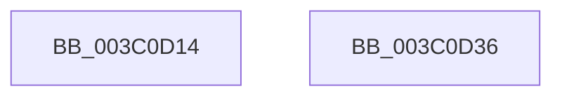

# KiStartIdealProcessorAssignmentBlock

- RVA: `0x003C0D14`–`0x003C0D37` (길이 `35` bytes)
- VA: `0x00000001403C0D14`
- 실행 섹션: `.text`
- PDB 이름 있음: `예`; PDB Function 태그: `아니요`
- unwind 정보 RVA: `0x0005C788`
- 디코드: `10`개 명령, `35/35` bytes 표시
- 미해석 바이트: `0` (있으면 어셈블리에 `.byte`로 보존)

> 이 문서는 커널 이미지의 기계어와 PDB 기호를 분석해 생성했습니다. 4번과 5번은 함수 원형과 자료형을 바이너리 사용 방식에서 추정한 C 해석이며 원본 소스 복구 결과는 아닙니다.

## 1. Dependencies

- 직접 호출 지점: **1**; 고유 호출 대상: **1**
- 직접 호출자로 확인된 함수: **1**
- RIP 상대 이미지 참조: **0**

### Outgoing calls
- `0x003C0D2C` → [KiSelectIdealProcessorSetsForProcess](KiSelectIdealProcessorSetsForProcess_function_003C0D40.md) (function, `0x003C0D40`)

### Direct callers
- [KeInitializeProcess](../../page/A6/KeInitializeProcess_function_00A63CF4.md) at `0x00A640B4`

### Static image references
- 디코드된 RIP-relative 메모리 참조가 없습니다.

## 2. Other-region calls and transfers

- 다른 실행 섹션으로 향하는 call: **0**
- 별도 외부 분기/꼬리 이동을 확인하지 못했습니다.

## 3. Assembly (complete function range)

```asm
003C0D14  48 83 EC 28                     sub rsp, 0x28
003C0D18  48 8B C2                        mov rax, rdx
003C0D1B  4C 8D 49 04                     lea r9, [rcx + 4]
003C0D1F  48 8B D1                        mov rdx, rcx
003C0D22  4C 8D 81 D0 00 00 00            lea r8, [rcx + 0xd0]
003C0D29  48 8B C8                        mov rcx, rax
003C0D2C  E8 0F 00 00 00                  call 0x1403c0d40
003C0D31  48 83 C4 28                     add rsp, 0x28
003C0D35  C3                              ret
003C0D36  CC                              int3
```

## 4. C-style interpretation (structured pseudocode)

```c
__int64 __fastcall KiStartIdealProcessorAssignmentBlock(__int64 a1, __int64 a2)
{
    __int64 result;
    __int64 v_rsp;

    v_rsp = (v_rsp) - (40);
    result = KiSelectIdealProcessorSetsForProcess(a2, a1, a1 + 208, a1 + 4);
    v_rsp = (v_rsp) + (40);
    return result;
}
```

## 5. (Beta) C Style

```c
int64_t KiStartIdealProcessorAssignmentBlock(void *Arg1, int64_t Arg2)
{
    uint8_t *arg1 = (uint8_t *)Arg1;

    int64_t result;
    int64_t local_rsp;

    local_rsp = (local_rsp) - (40);
    result = KiSelectIdealProcessorSetsForProcess(Arg2, Arg1, Arg1 + 208, Arg1 + 4);
    local_rsp = (local_rsp) + (40);
    return result;
}
```

### 관측된 메모리 오프셋

구조체 형식이 확인되지 않은 접근은 인자 기준의 오프셋으로만 기록했습니다.

| 기준 인자 | 오프셋 표현 | 폭 (bit) | 접근 |
|---|---:|---:|---|
| `Arg1` | `+ 0x4` | `64` | `R` |
| `Arg1` | `+ 0xD0` | `64` | `R` |

## 6. Execution-region graph

[열기: 2D/3D 그래프와 함수 탐색 컨트롤 패널](../../../control-panel.html?section=text&rva=0x003C0D14&view=graph)

- 2D 그래프는 위에서 아래로 흐르고, 3D 그래프는 빈 공간을 드래그해 회전합니다. Shift+드래그는 이동, 휠은 확대·축소, 함수 노드 선택은 대상 보고서 이동입니다.

### Static fallback


