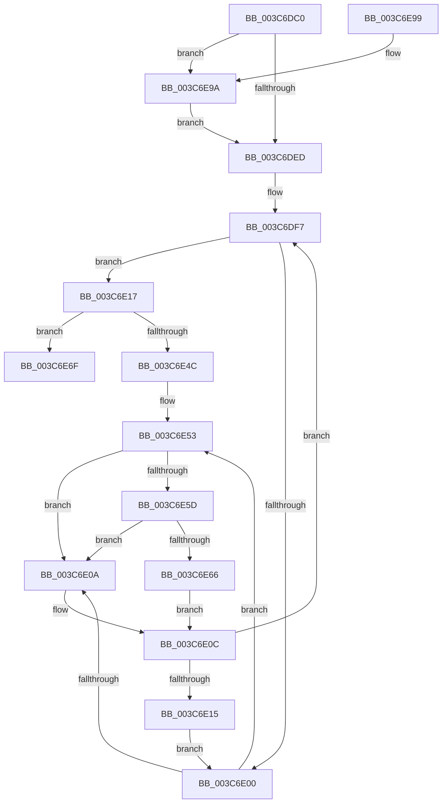

# KiSwitchPriQueue

- RVA: `0x003C6DC0`–`0x003C6EAA` (길이 `234` bytes)
- VA: `0x00000001403C6DC0`
- 실행 섹션: `.text`
- PDB 이름 있음: `예`; PDB Function 태그: `아니요`
- unwind 정보 RVA: `0x0008E614`
- 디코드: `60`개 명령, `234/234` bytes 표시
- 미해석 바이트: `0` (있으면 어셈블리에 `.byte`로 보존)

> 이 문서는 커널 이미지의 기계어와 PDB 기호를 분석해 생성했습니다. 4번과 5번은 함수 원형과 자료형을 바이너리 사용 방식에서 추정한 C 해석이며 원본 소스 복구 결과는 아닙니다.

## 1. Dependencies

- 직접 호출 지점: **4**; 고유 호출 대상: **4**
- 직접 호출자로 확인된 함수: **1**
- RIP 상대 이미지 참조: **2**

### Outgoing calls
- `0x003C6DF0` → [KiAcquireKobjectLockSafe](../25/KiAcquireKobjectLockSafe_function_00251C90.md) (function, `0x00251C90`)
- `0x003C6E5D` → [KiCheckVpBackingLongSpinWaitHypercall](../30/KiCheckVpBackingLongSpinWaitHypercall_function_0030F490.md) (function, `0x0030F490`)
- `0x003C6E68` → [HvlNotifyLongSpinWait](../30/HvlNotifyLongSpinWait_function_0030F460.md) (function, `0x0030F460`)
- `0x003C6EA0` → [KiActivateWaiterQueueWithNoLocks](../20/KiActivateWaiterQueueWithNoLocks_function_0020CEB0.md) (function, `0x0020CEB0`)

### Direct callers
- [KeRemovePriQueue](KeRemovePriQueue_function_003C5090.md) at `0x003C56D4`

### Static image references
- `0x003C6E02` → RVA `0x00FC52AC` (`ALMOSTRO`; reference)
- `0x003C6E53` → RVA `0x00FC6AB8` (`ALMOSTRO`; read)

## 2. Other-region calls and transfers

- 다른 실행 섹션으로 향하는 call: **0**
- 별도 외부 분기/꼬리 이동을 확인하지 못했습니다.

## 3. Assembly (complete function range)

```asm
003C6DC0  48 89 5C 24 08                  mov qword ptr [rsp + 8], rbx
003C6DC5  48 89 6C 24 10                  mov qword ptr [rsp + 0x10], rbp
003C6DCA  48 89 74 24 18                  mov qword ptr [rsp + 0x18], rsi
003C6DCF  57                              push rdi
003C6DD0  48 83 EC 20                     sub rsp, 0x20
003C6DD4  48 8D B9 08 02 00 00            lea rdi, [rcx + 0x208]
003C6DDB  49 8B C0                        mov rax, r8
003C6DDE  48 8B F2                        mov rsi, rdx
003C6DE1  48 8B D9                        mov rbx, rcx
003C6DE4  4D 85 C0                        test r8, r8
003C6DE7  0F 85 AD 00 00 00               jne 0x1403c6e9a
003C6DED  48 8B CE                        mov rcx, rsi
003C6DF0  E8 9B AE E8 FF                  call 0x140251c90
003C6DF5  33 ED                           xor ebp, ebp
003C6DF7  F0 48 0F BA 6B 40 00            lock bts qword ptr [rbx + 0x40], 0
003C6DFE  73 17                           jae 0x1403c6e17
003C6E00  FF C5                           inc ebp
003C6E02  85 2D A4 E4 BF 00               test dword ptr [rip + 0xbfe4a4], ebp
003C6E08  74 49                           je 0x1403c6e53
003C6E0A  F3 90                           pause
003C6E0C  48 8B 43 40                     mov rax, qword ptr [rbx + 0x40]
003C6E10  48 85 C0                        test rax, rax
003C6E13  74 E2                           je 0x1403c6df7
003C6E15  EB E9                           jmp 0x1403c6e00
003C6E17  48 89 B3 E8 00 00 00            mov qword ptr [rbx + 0xe8], rsi
003C6E1E  48 0F BE 83 33 02 00 00         movsx rax, byte ptr [rbx + 0x233]
003C6E26  89 83 1C 02 00 00               mov dword ptr [rbx + 0x21c], eax
003C6E2C  F0 FF 84 86 18 02 00 00         lock inc dword ptr [rsi + rax*4 + 0x218]
003C6E34  48 8D 86 A0 02 00 00            lea rax, [rsi + 0x2a0]
003C6E3B  48 C7 43 40 00 00 00 00         mov qword ptr [rbx + 0x40], 0
003C6E43  48 8B 48 08                     mov rcx, qword ptr [rax + 8]
003C6E47  48 39 01                        cmp qword ptr [rcx], rax
003C6E4A  74 23                           je 0x1403c6e6f
003C6E4C  B9 03 00 00 00                  mov ecx, 3
003C6E51  CD 29                           int 0x29
003C6E53  8B 05 5F FC BF 00               mov eax, dword ptr [rip + 0xbffc5f]
003C6E59  A8 40                           test al, 0x40
003C6E5B  74 AD                           je 0x1403c6e0a
003C6E5D  E8 2E 86 F4 FF                  call 0x14030f490
003C6E62  84 C0                           test al, al
003C6E64  74 A4                           je 0x1403c6e0a
003C6E66  8B CD                           mov ecx, ebp
003C6E68  E8 F3 85 F4 FF                  call 0x14030f460
003C6E6D  EB 9D                           jmp 0x1403c6e0c
003C6E6F  48 89 07                        mov qword ptr [rdi], rax
003C6E72  48 89 4F 08                     mov qword ptr [rdi + 8], rcx
003C6E76  48 89 39                        mov qword ptr [rcx], rdi
003C6E79  48 89 78 08                     mov qword ptr [rax + 8], rdi
003C6E7D  F0 81 26 7F FF FF FF            lock and dword ptr [rsi], 0xffffff7f
003C6E84  48 8B 5C 24 30                  mov rbx, qword ptr [rsp + 0x30]
003C6E89  48 8B 6C 24 38                  mov rbp, qword ptr [rsp + 0x38]
003C6E8E  48 8B 74 24 40                  mov rsi, qword ptr [rsp + 0x40]
003C6E93  48 83 C4 20                     add rsp, 0x20
003C6E97  5F                              pop rdi
003C6E98  C3                              ret
003C6E99  CC                              int3
003C6E9A  4C 8B C7                        mov r8, rdi
003C6E9D  48 8B D0                        mov rdx, rax
003C6EA0  E8 0B 60 E4 FF                  call 0x14020ceb0
003C6EA5  E9 43 FF FF FF                  jmp 0x1403c6ded
```

## 4. C-style interpretation (structured pseudocode)

```c
__int64 __fastcall KiSwitchPriQueue(__int64 a1, __int64 a2, __int64 a3)
{
    __int64 result;
    __int64 v_rbp;
    __int64 v_rsp;
    unsigned __int64 v_stack_p10;
    unsigned __int64 v_stack_p18;
    unsigned __int64 v_stack_p8;

    v_stack_p8 = v_rbx;
    v_stack_p10 = v_rbp;
    v_stack_p18 = v_rsi;
    v_rsp = (v_rsp) - (32);
    if (a3 != 0) goto loc_003C6E9A;
loc_003C6DED:
    result = KiAcquireKobjectLockSafe(a2, a2, a3, a4);
    v_rbp = 0;
loc_003C6DF7:
    if (condition_is_above_or_equal) goto loc_003C6E17;
loc_003C6E00:
    v_rbp = (unsigned int)((v_rbp) + 1);
    if (((*(unsigned int *)(v_rip + 12575908)) & ((unsigned int)(v_rbp))) == 0) goto loc_003C6E53;
loc_003C6E0A:
loc_003C6E0C:
    if (*(unsigned __int64 *)(a1 + 64) == 0) goto loc_003C6DF7;
    goto loc_003C6E00;
loc_003C6E17:
    *(unsigned __int64 *)(a1 + 232) = a2;
    *(unsigned int *)(a1 + 540) = (unsigned int)((__int8)(*(unsigned __int8 *)(a1 + 563)));
    *(unsigned __int64 *)(a1 + 64) = 0;
    if ((*(unsigned __int64 *)(*(unsigned __int64 *)(a2 + 672 + 8))) == (a2 + 672)) goto loc_003C6E6F;
loc_003C6E53:
    if ((((unsigned __int8)((unsigned int)(*(unsigned int *)(v_rip + 12581983)))) & (64)) == 0) goto loc_003C6E0A;
    result = KiCheckVpBackingLongSpinWaitHypercall(3, a2, a3, a4);
    if ((unsigned __int8)(result) == 0) goto loc_003C6E0A;
    result = HvlNotifyLongSpinWait((unsigned int)((unsigned int)(v_rbp)), a2, a3, a4);
    goto loc_003C6E0C;
loc_003C6E6F:
    *(unsigned __int64 *)(a1 + 520) = result;
    *(unsigned __int64 *)(a1 + 520 + 8) = (unsigned int)((unsigned int)(v_rbp));
    *(unsigned __int64 *)((unsigned int)((unsigned int)(v_rbp))) = a1 + 520;
    *(unsigned __int64 *)(result + 8) = a1 + 520;
    v_rsp = (v_rsp) + (32);
    return result;
loc_003C6E9A:
    result = KiActivateWaiterQueueWithNoLocks((unsigned int)((unsigned int)(v_rbp)), result, a1 + 520, a4);
    goto loc_003C6DED;
}
```

## 5. (Beta) C Style

```c
int64_t KiSwitchPriQueue(void *Arg1, void *Arg2, int64_t Arg3)
{
    uint8_t *arg1 = (uint8_t *)Arg1;
    uint8_t *arg2 = (uint8_t *)Arg2;

    int64_t result;
    int64_t local_rbp;
    int64_t local_rsp;
    uint64_t v_stack_p10;
    uint64_t v_stack_p18;
    uint64_t v_stack_p8;

    v_stack_p8 = local_rbx;
    v_stack_p10 = local_rbp;
    v_stack_p18 = local_rsi;
    local_rsp = (local_rsp) - (32);
    if (Arg3 != 0) goto loc_003C6E9A;
loc_003C6DED:
    result = KiAcquireKobjectLockSafe(Arg2, Arg2, Arg3, a4);
    local_rbp = 0;
loc_003C6DF7:
    if (condition_is_above_or_equal) goto loc_003C6E17;
loc_003C6E00:
    local_rbp = (uint32_t)((local_rbp) + 1);
    if (((*(uint32_t *)(v_rip + 0xBFE4A4)) & ((uint32_t)(local_rbp))) == 0) goto loc_003C6E53;
loc_003C6E0A:
loc_003C6E0C:
    if (*(uint64_t *)(arg1 + 0x40) == 0) goto loc_003C6DF7;
    goto loc_003C6E00;
loc_003C6E17:
    *(void **)(arg1 + 0xE8) = Arg2;
    *(uint32_t *)(arg1 + 0x21C) = (uint32_t)((int8_t)(*(uint8_t *)(arg1 + 0x233)));
    *(uint64_t *)(arg1 + 0x40) = 0;
    if ((*(uint64_t *)(*(uint64_t *)(arg2 + 0x2A0 + 0x8))) == (Arg2 + 672)) goto loc_003C6E6F;
loc_003C6E53:
    if ((((uint8_t)((uint32_t)(*(uint32_t *)(v_rip + 0xBFFC5F)))) & (64)) == 0) goto loc_003C6E0A;
    result = KiCheckVpBackingLongSpinWaitHypercall(3, Arg2, Arg3, a4);
    if ((uint8_t)(result) == 0) goto loc_003C6E0A;
    result = HvlNotifyLongSpinWait((uint32_t)((uint32_t)(local_rbp)), Arg2, Arg3, a4);
    goto loc_003C6E0C;
loc_003C6E6F:
    *(uint64_t *)(arg1 + 0x208) = result;
    *(uint64_t *)(arg1 + 0x208 + 0x8) = (uint32_t)((uint32_t)(local_rbp));
    *(void **)((uint32_t)((uint32_t)(local_rbp))) = Arg1 + 520;
    *(void **)(result + 0x8) = Arg1 + 520;
    local_rsp = (local_rsp) + (32);
    return result;
loc_003C6E9A:
    result = KiActivateWaiterQueueWithNoLocks((uint32_t)((uint32_t)(local_rbp)), result, Arg1 + 520, a4);
    goto loc_003C6DED;
}
```

### 관측된 메모리 오프셋

구조체 형식이 확인되지 않은 접근은 인자 기준의 오프셋으로만 기록했습니다.

| 기준 인자 | 오프셋 표현 | 폭 (bit) | 접근 |
|---|---:|---:|---|
| `Arg1` | `+ 0x0` | `64` | `W` |
| `Arg1` | `+ 0x8` | `64` | `W` |
| `Arg1` | `+ 0x40` | `64` | `R` |
| `Arg1` | `+ 0x40` | `64` | `R/W` |
| `Arg1` | `+ 0x40` | `64` | `W` |
| `Arg1` | `+ 0xE8` | `64` | `W` |
| `Arg1` | `+ 0x208` | `64` | `R` |
| `Arg1` | `+ 0x21C` | `32` | `W` |
| `Arg1` | `+ 0x233` | `8` | `R` |
| `Arg2` | `+ 0x0` | `32` | `R/W` |
| `Arg2` | `+ 0x8` | `64` | `R` |
| `Arg2` | `+ 0x8` | `64` | `W` |
| `Arg2` | `+ 0x218 + rax*4` | `32` | `R/W` |
| `Arg2` | `+ 0x2A0` | `64` | `R` |

## 6. Execution-region graph

[열기: 2D/3D 그래프와 함수 탐색 컨트롤 패널](../../../control-panel.html?section=text&rva=0x003C6DC0&view=graph)

- 2D 그래프는 위에서 아래로 흐르고, 3D 그래프는 빈 공간을 드래그해 회전합니다. Shift+드래그는 이동, 휠은 확대·축소, 함수 노드 선택은 대상 보고서 이동입니다.

### Static fallback


