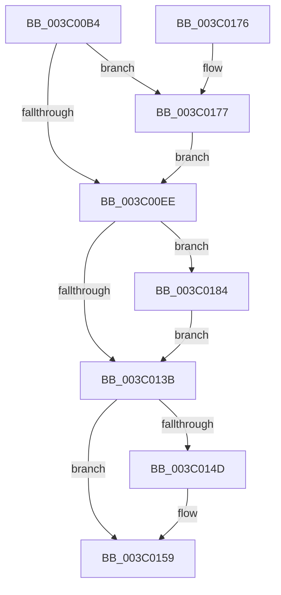

# KiUpdateProcessAvailableCpuState

- RVA: `0x003C00B4`–`0x003C019A` (길이 `230` bytes)
- VA: `0x00000001403C00B4`
- 실행 섹션: `.text`
- PDB 이름 있음: `예`; PDB Function 태그: `아니요`
- unwind 정보 RVA: `0x0007AE84`
- 디코드: `57`개 명령, `230/230` bytes 표시
- 미해석 바이트: `0` (있으면 어셈블리에 `.byte`로 보존)

> 이 문서는 커널 이미지의 기계어와 PDB 기호를 분석해 생성했습니다. 4번과 5번은 함수 원형과 자료형을 바이너리 사용 방식에서 추정한 C 해석이며 원본 소스 복구 결과는 아닙니다.

## 1. Dependencies

- 직접 호출 지점: **9**; 고유 호출 대상: **9**
- 직접 호출자로 확인된 함수: **5**
- RIP 상대 이미지 참조: **3**

### Outgoing calls
- `0x003C00F1` → [RtlWriteAcquireTickLock](../39/RtlWriteAcquireTickLock_function_0039D3B4.md) (function, `0x0039D3B4`)
- `0x003C010B` → [KiQueryCpuPartitionAffinityProcess](KiQueryCpuPartitionAffinityProcess_function_003C01A0.md) (function, `0x003C01A0`)
- `0x003C0114` → [ExAcquireSpinLockSharedAtDpcLevel](../24/ExAcquireSpinLockSharedAtDpcLevel_function_00248E30.md) (function, `0x00248E30`)
- `0x003C0124` → [KeAndAffinityEx2](KeAndAffinityEx2_function_003C0740.md) (function, `0x003C0740`)
- `0x003C012D` → [ExReleaseSpinLockSharedFromDpcLevel](../24/ExReleaseSpinLockSharedFromDpcLevel_function_0024A590.md) (function, `0x0024A590`)
- `0x003C0132` → [KeIsForceParkingEnabled](../21/KeIsForceParkingEnabled_function_00218F20.md) (function, `0x00218F20`)
- `0x003C0154` → [KiLowerIrqlProcessIrqlFlags](../4F/KiLowerIrqlProcessIrqlFlags_function_004F5698.md) (function, `0x004F5698`)
- `0x003C017A` → [KiRaiseIrqlProcessIrqlFlags](../4F/KiRaiseIrqlProcessIrqlFlags_function_004F56FC.md) (function, `0x004F56FC`)
- `0x003C0193` → [KiRemoveForceParkedProcessorsFromAffinity](../42/KiRemoveForceParkedProcessorsFromAffinity_function_00427F70.md) (function, `0x00427F70`)

### Direct callers
- [KeSetAffinityProcess](KeSetAffinityProcess_function_003C0A60.md) at `0x003C0C7E`
- [KeQueryProcessAvailableCpus](../5B/KeQueryProcessAvailableCpus_function_005B96FC.md) at `0x005B9753`
- [KeAssignCpuPartitionsToProcess](../5C/KeAssignCpuPartitionsToProcess_function_005C08D0.md) at `0x005C0A7C`
- [KeCpuPartitionMoveCpus](../5C/KeCpuPartitionMoveCpus_function_005C0B70.md) at `0x005C0CFF`
- [KeCpuPartitionMoveCpus](../5C/KeCpuPartitionMoveCpus_function_005C0B70.md) at `0x005C0D4C`
- [KeRegisterAvailableCpusChangeNotification](../../page/74/KeRegisterAvailableCpusChangeNotification_function_00745D7C.md) at `0x00745F66`

### Static image references
- `0x003C00E1` → RVA `0x00FC6D20` (`ALMOSTRO`; read)
- `0x003C00F6` → RVA `0x00FC6BF8` (`ALMOSTRO`; read)
- `0x003C0184` → RVA `0x00F23458` (`.data`; read)

## 2. Other-region calls and transfers

- 다른 실행 섹션으로 향하는 call: **0**
- 별도 외부 분기/꼬리 이동을 확인하지 못했습니다.

## 3. Assembly (complete function range)

```asm
003C00B4  48 89 5C 24 08                  mov qword ptr [rsp + 8], rbx
003C00B9  48 89 6C 24 10                  mov qword ptr [rsp + 0x10], rbp
003C00BE  48 89 74 24 18                  mov qword ptr [rsp + 0x18], rsi
003C00C3  57                              push rdi
003C00C4  48 83 EC 20                     sub rsp, 0x20
003C00C8  48 8B B9 C0 01 00 00            mov rdi, qword ptr [rcx + 0x1c0]
003C00CF  8A DA                           mov bl, dl
003C00D1  48 8B E9                        mov rbp, rcx
003C00D4  44 0F 20 C6                     mov rsi, cr8
003C00D8  BA 02 00 00 00                  mov edx, 2
003C00DD  44 0F 22 C2                     mov cr8, rdx
003C00E1  83 3D 38 6C C0 00 00            cmp dword ptr [rip + 0xc06c38], 0
003C00E8  0F 85 89 00 00 00               jne 0x1403c0177
003C00EE  48 8B CF                        mov rcx, rdi
003C00F1  E8 BE D2 FD FF                  call 0x14039d3b4
003C00F6  48 8B 0D FB 6A C0 00            mov rcx, qword ptr [rip + 0xc06afb]
003C00FD  44 8A C3                        mov r8b, bl
003C0100  48 8B 57 18                     mov rdx, qword ptr [rdi + 0x18]
003C0104  48 89 4F 08                     mov qword ptr [rdi + 8], rcx
003C0108  48 8B CD                        mov rcx, rbp
003C010B  E8 90 00 00 00                  call 0x1403c01a0
003C0110  48 8D 4D 40                     lea rcx, [rbp + 0x40]
003C0114  E8 17 8D E8 FF                  call 0x140248e30
003C0119  48 8B 4F 18                     mov rcx, qword ptr [rdi + 0x18]
003C011D  48 8B 55 50                     mov rdx, qword ptr [rbp + 0x50]
003C0121  4C 8B C1                        mov r8, rcx
003C0124  E8 17 06 00 00                  call 0x1403c0740
003C0129  48 8D 4D 40                     lea rcx, [rbp + 0x40]
003C012D  E8 5E A4 E8 FF                  call 0x14024a590
003C0132  E8 E9 8D E5 FF                  call 0x140218f20
003C0137  84 C0                           test al, al
003C0139  75 49                           jne 0x1403c0184
003C013B  48 8B 07                        mov rax, qword ptr [rdi]
003C013E  48 FF C0                        inc rax
003C0141  48 89 07                        mov qword ptr [rdi], rax
003C0144  83 3D D5 6B C0 00 00            cmp dword ptr [rip + 0xc06bd5], 0
003C014B  74 0C                           je 0x1403c0159
003C014D  44 0F 20 C1                     mov rcx, cr8
003C0151  40 8A D6                        mov dl, sil
003C0154  E8 3F 55 13 00                  call 0x1404f5698
003C0159  40 0F B6 C6                     movzx eax, sil
003C015D  44 0F 22 C0                     mov cr8, rax
003C0161  48 8B 5C 24 30                  mov rbx, qword ptr [rsp + 0x30]
003C0166  48 8B 6C 24 38                  mov rbp, qword ptr [rsp + 0x38]
003C016B  48 8B 74 24 40                  mov rsi, qword ptr [rsp + 0x40]
003C0170  48 83 C4 20                     add rsp, 0x20
003C0174  5F                              pop rdi
003C0175  C3                              ret
003C0176  CC                              int3
003C0177  40 8A CE                        mov cl, sil
003C017A  E8 7D 55 13 00                  call 0x1404f56fc
003C017F  E9 6A FF FF FF                  jmp 0x1403c00ee
003C0184  48 8B 05 CD 32 B6 00            mov rax, qword ptr [rip + 0xb632cd]
003C018B  48 8B 4F 18                     mov rcx, qword ptr [rdi + 0x18]
003C018F  48 89 47 10                     mov qword ptr [rdi + 0x10], rax
003C0193  E8 D8 7D 06 00                  call 0x140427f70
003C0198  EB A1                           jmp 0x1403c013b
```

## 4. C-style interpretation (structured pseudocode)

```c
__int64 __fastcall KiUpdateProcessAvailableCpuState(__int64 a1, unsigned __int8 a2)
{
    __int64 result;
    __int64 v_rsp;
    unsigned __int64 v_stack_p10;
    unsigned __int64 v_stack_p18;
    unsigned __int64 v_stack_p8;

    v_stack_p8 = v_rbx;
    v_stack_p10 = v_rbp;
    v_stack_p18 = v_rsi;
    v_rsp = (v_rsp) - (32);
    if ((*(unsigned int *)(v_rip + 12610616)) != 0) goto loc_003C0177;
loc_003C00EE:
    result = RtlWriteAcquireTickLock(*(unsigned __int64 *)(a1 + 448), 2, a3, a4);
    *(unsigned __int64 *)(*(unsigned __int64 *)(a1 + 448) + 8) = *(unsigned __int64 *)(v_rip + 12610299);
    result = KiQueryCpuPartitionAffinityProcess(a1, *(unsigned __int64 *)(*(unsigned __int64 *)(a1 + 448) + 24), a2, a4);
    result = ExAcquireSpinLockSharedAtDpcLevel(a1 + 64, *(unsigned __int64 *)(*(unsigned __int64 *)(a1 + 448) + 24), a2, a4);
    result = KeAndAffinityEx2(*(unsigned __int64 *)(*(unsigned __int64 *)(a1 + 448) + 24), *(unsigned __int64 *)(a1 + 80), *(unsigned __int64 *)(*(unsigned __int64 *)(a1 + 448) + 24), a4);
    result = ExReleaseSpinLockSharedFromDpcLevel(a1 + 64, *(unsigned __int64 *)(a1 + 80), *(unsigned __int64 *)(*(unsigned __int64 *)(a1 + 448) + 24), a4);
    result = KeIsForceParkingEnabled(a1 + 64, *(unsigned __int64 *)(a1 + 80), *(unsigned __int64 *)(*(unsigned __int64 *)(a1 + 448) + 24), a4);
    if ((unsigned __int8)(result) != 0) goto loc_003C0184;
loc_003C013B:
    result = (*(unsigned __int64 *)(*(unsigned __int64 *)(a1 + 448))) + 1;
    *(unsigned __int64 *)(*(unsigned __int64 *)(a1 + 448)) = result;
    if ((*(unsigned int *)(v_rip + 12610517)) != 0) {
        a1 = 2;
        a2 = (unsigned __int8)(v_cr8);
        result = KiLowerIrqlProcessIrqlFlags(a1, a2, *(unsigned __int64 *)(*(unsigned __int64 *)(a1 + 448) + 24), a4);
    }
    v_rsp = (v_rsp) + (32);
    return (unsigned __int8)(v_cr8);
loc_003C0177:
    result = KiRaiseIrqlProcessIrqlFlags((unsigned __int8)(v_stack_p18), a2, *(unsigned __int64 *)(*(unsigned __int64 *)(a1 + 448) + 24), a4);
    goto loc_003C00EE;
loc_003C0184:
    *(unsigned __int64 *)(*(unsigned __int64 *)(a1 + 448) + 16) = *(unsigned __int64 *)(v_rip + 11940557);
    result = KiRemoveForceParkedProcessorsFromAffinity(*(unsigned __int64 *)(*(unsigned __int64 *)(a1 + 448) + 24), a2, *(unsigned __int64 *)(*(unsigned __int64 *)(a1 + 448) + 24), a4);
    goto loc_003C013B;
}
```

## 5. (Beta) C Style

```c
int64_t KiUpdateProcessAvailableCpuState(void *Arg1, uint8_t Arg2)
{
    uint8_t *arg1 = (uint8_t *)Arg1;

    int64_t result;
    int64_t local_rsp;
    uint64_t v_stack_p10;
    uint64_t v_stack_p18;
    uint64_t v_stack_p8;

    v_stack_p8 = local_rbx;
    v_stack_p10 = local_rbp;
    v_stack_p18 = local_rsi;
    local_rsp = (local_rsp) - (32);
    if ((*(uint32_t *)(v_rip + 0xC06C38)) != 0) goto loc_003C0177;
loc_003C00EE:
    result = RtlWriteAcquireTickLock(*(uint64_t *)(arg1 + 0x1C0), 2, a3, a4);
    *(uint64_t *)(*(uint64_t *)(arg1 + 0x1C0) + 0x8) = *(uint64_t *)(v_rip + 0xC06AFB);
    result = KiQueryCpuPartitionAffinityProcess(Arg1, *(uint64_t *)(*(uint64_t *)(arg1 + 0x1C0) + 0x18), Arg2, a4);
    result = ExAcquireSpinLockSharedAtDpcLevel(Arg1 + 64, *(uint64_t *)(*(uint64_t *)(arg1 + 0x1C0) + 0x18), Arg2, a4);
    result = KeAndAffinityEx2(*(uint64_t *)(*(uint64_t *)(arg1 + 0x1C0) + 0x18), *(uint64_t *)(arg1 + 0x50), *(uint64_t *)(*(uint64_t *)(arg1 + 0x1C0) + 0x18), a4);
    result = ExReleaseSpinLockSharedFromDpcLevel(Arg1 + 64, *(uint64_t *)(arg1 + 0x50), *(uint64_t *)(*(uint64_t *)(arg1 + 0x1C0) + 0x18), a4);
    result = KeIsForceParkingEnabled(Arg1 + 64, *(uint64_t *)(arg1 + 0x50), *(uint64_t *)(*(uint64_t *)(arg1 + 0x1C0) + 0x18), a4);
    if ((uint8_t)(result) != 0) goto loc_003C0184;
loc_003C013B:
    result = (*(uint64_t *)(*(uint64_t *)(arg1 + 0x1C0))) + 1;
    *(uint64_t *)(*(uint64_t *)(arg1 + 0x1C0)) = result;
    if ((*(uint32_t *)(v_rip + 0xC06BD5)) != 0) {
        Arg1 = 2;
        Arg2 = (uint8_t)(v_cr8);
        result = KiLowerIrqlProcessIrqlFlags(Arg1, Arg2, *(uint64_t *)(*(uint64_t *)(arg1 + 0x1C0) + 0x18), a4);
    }
    local_rsp = (local_rsp) + (32);
    return (uint8_t)(v_cr8);
loc_003C0177:
    result = KiRaiseIrqlProcessIrqlFlags((uint8_t)(v_stack_p18), Arg2, *(uint64_t *)(*(uint64_t *)(arg1 + 0x1C0) + 0x18), a4);
    goto loc_003C00EE;
loc_003C0184:
    *(uint64_t *)(*(uint64_t *)(arg1 + 0x1C0) + 0x10) = *(uint64_t *)(v_rip + 0xB632CD);
    result = KiRemoveForceParkedProcessorsFromAffinity(*(uint64_t *)(*(uint64_t *)(arg1 + 0x1C0) + 0x18), Arg2, *(uint64_t *)(*(uint64_t *)(arg1 + 0x1C0) + 0x18), a4);
    goto loc_003C013B;
}
```

### 관측된 메모리 오프셋

구조체 형식이 확인되지 않은 접근은 인자 기준의 오프셋으로만 기록했습니다.

| 기준 인자 | 오프셋 표현 | 폭 (bit) | 접근 |
|---|---:|---:|---|
| `Arg1` | `+ 0x40` | `64` | `R` |
| `Arg1` | `+ 0x50` | `64` | `R` |
| `Arg1` | `+ 0x1C0` | `64` | `R` |

## 6. Execution-region graph

[열기: 2D/3D 그래프와 함수 탐색 컨트롤 패널](../../../control-panel.html?section=text&rva=0x003C00B4&view=graph)

- 2D 그래프는 위에서 아래로 흐르고, 3D 그래프는 빈 공간을 드래그해 회전합니다. Shift+드래그는 이동, 휠은 확대·축소, 함수 노드 선택은 대상 보고서 이동입니다.

### Static fallback


