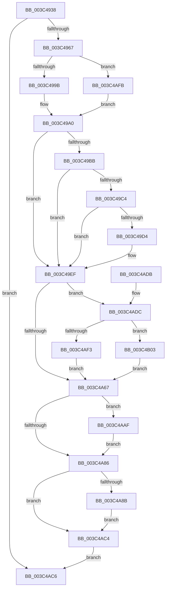

# KiUpdateTebSchedulingPropertiesCurrentThread

- RVA: `0x003C4938`–`0x003C4B0B` (길이 `467` bytes)
- VA: `0x00000001403C4938`
- 실행 섹션: `.text`
- PDB 이름 있음: `예`; PDB Function 태그: `아니요`
- unwind 정보 RVA: `0x0008E3F8`
- 디코드: `105`개 명령, `467/467` bytes 표시
- 미해석 바이트: `0` (있으면 어셈블리에 `.byte`로 보존)

> 이 문서는 커널 이미지의 기계어와 PDB 기호를 분석해 생성했습니다. 4번과 5번은 함수 원형과 자료형을 바이너리 사용 방식에서 추정한 C 해석이며 원본 소스 복구 결과는 아닙니다.

## 1. Dependencies

- 직접 호출 지점: **2**; 고유 호출 대상: **2**
- 직접 호출자로 확인된 함수: **2**
- RIP 상대 이미지 참조: **2**

### Outgoing calls
- `0x003C496F` → [KiAcquireThreadLockRaiseToDpc](../39/KiAcquireThreadLockRaiseToDpc_function_00396280.md) (function, `0x00396280`)
- `0x003C49AF` → [KiReleaseThreadLockLowerIrql](KiReleaseThreadLockLowerIrql_function_003C65D0.md) (function, `0x003C65D0`)

### Direct callers
- [KeUpdateTebSchedulingPropertiesCurrentThread](KeUpdateTebSchedulingPropertiesCurrentThread_function_003C48E8.md) at `0x003C48FD`
- [KiUpdateTebApc](KiUpdateTebApc_function_003C4920.md) at `0x003C4924`

### Static image references
- `0x003C49BB` → RVA `0x00FC6AE8` (`ALMOSTRO`; read)
- `0x003C49C4` → RVA `0x00F231B0` (`.data`; read)

## 2. Other-region calls and transfers

- 다른 실행 섹션으로 향하는 call: **0**
- 별도 외부 분기/꼬리 이동을 확인하지 못했습니다.

## 3. Assembly (complete function range)

```asm
003C4938  48 8B C4                        mov rax, rsp
003C493B  48 89 58 18                     mov qword ptr [rax + 0x18], rbx
003C493F  56                              push rsi
003C4940  57                              push rdi
003C4941  41 54                           push r12
003C4943  41 56                           push r14
003C4945  41 57                           push r15
003C4947  48 83 EC 50                     sub rsp, 0x50
003C494B  48 8B D9                        mov rbx, rcx
003C494E  83 60 10 00                     and dword ptr [rax + 0x10], 0
003C4952  C6 40 08 00                     mov byte ptr [rax + 8], 0
003C4956  33 F6                           xor esi, esi
003C4958  33 FF                           xor edi, edi
003C495A  48 39 B1 F0 00 00 00            cmp qword ptr [rcx + 0xf0], rsi
003C4961  0F 84 5F 01 00 00               je 0x1403c4ac6
003C4967  48 21 70 C0                     and qword ptr [rax - 0x40], rsi
003C496B  48 8D 50 08                     lea rdx, [rax + 8]
003C496F  E8 0C 19 FD FF                  call 0x140396280
003C4974  44 8B BB C4 00 00 00            mov r15d, dword ptr [rbx + 0xc4]
003C497B  44 0F B7 B3 30 02 00 00         movzx r14d, word ptr [rbx + 0x230]
003C4983  66 44 89 74 24 38               mov word ptr [rsp + 0x38], r14w
003C4989  4C 8B A3 28 02 00 00            mov r12, qword ptr [rbx + 0x228]
003C4990  66 45 3B 34 24                  cmp r14w, word ptr [r12]
003C4995  0F 83 60 01 00 00               jae 0x1403c4afb
003C499B  4F 8B 64 F4 08                  mov r12, qword ptr [r12 + r14*8 + 8]
003C49A0  4C 89 64 24 30                  mov qword ptr [rsp + 0x30], r12
003C49A5  8A 94 24 80 00 00 00            mov dl, byte ptr [rsp + 0x80]
003C49AC  48 8B CB                        mov rcx, rbx
003C49AF  E8 1C 1C 00 00                  call 0x1403c65d0
003C49B4  32 D2                           xor dl, dl
003C49B6  45 85 FF                        test r15d, r15d
003C49B9  74 34                           je 0x1403c49ef
003C49BB  44 3B 3D 26 21 C0 00            cmp r15d, dword ptr [rip + 0xc02126]
003C49C2  73 2B                           jae 0x1403c49ef
003C49C4  48 8B 05 E5 E7 B5 00            mov rax, qword ptr [rip + 0xb5e7e5]
003C49CB  46 8B 04 B8                     mov r8d, dword ptr [rax + r15*4]
003C49CF  45 85 C0                        test r8d, r8d
003C49D2  74 1B                           je 0x1403c49ef
003C49D4  41 8B C0                        mov eax, r8d
003C49D7  C1 E8 06                        shr eax, 6
003C49DA  66 89 84 24 88 00 00 00         mov word ptr [rsp + 0x88], ax
003C49E2  41 8A D0                        mov dl, r8b
003C49E5  80 E2 3F                        and dl, 0x3f
003C49E8  88 94 24 8A 00 00 00            mov byte ptr [rsp + 0x8a], dl
003C49EF  8A 8C 24 8A 00 00 00            mov cl, byte ptr [rsp + 0x8a]
003C49F6  88 8C 24 8B 00 00 00            mov byte ptr [rsp + 0x8b], cl
003C49FD  0F B7 84 24 88 00 00 00         movzx eax, word ptr [rsp + 0x88]
003C4A05  66 89 84 24 80 00 00 00         mov word ptr [rsp + 0x80], ax
003C4A0D  80 E1 1F                        and cl, 0x1f
003C4A10  88 8C 24 82 00 00 00            mov byte ptr [rsp + 0x82], cl
003C4A17  80 E2 1F                        and dl, 0x1f
003C4A1A  88 94 24 83 00 00 00            mov byte ptr [rsp + 0x83], dl
003C4A21  45 33 C9                        xor r9d, r9d
003C4A24  4C 89 4C 24 20                  mov qword ptr [rsp + 0x20], r9
003C4A29  66 44 89 74 24 24               mov word ptr [rsp + 0x24], r14w
003C4A2F  49 8B C4                        mov rax, r12
003C4A32  48 C1 E8 20                     shr rax, 0x20
003C4A36  41 0B C4                        or eax, r12d
003C4A39  89 44 24 20                     mov dword ptr [rsp + 0x20], eax
003C4A3D  0F 57 C0                        xorps xmm0, xmm0
003C4A40  0F 11 44 24 40                  movups xmmword ptr [rsp + 0x40], xmm0
003C4A45  66 44 89 74 24 48               mov word ptr [rsp + 0x48], r14w
003C4A4B  4C 89 64 24 40                  mov qword ptr [rsp + 0x40], r12
003C4A50  48 8B 8B F0 00 00 00            mov rcx, qword ptr [rbx + 0xf0]
003C4A57  48 8B 93 20 02 00 00            mov rdx, qword ptr [rbx + 0x220]
003C4A5E  48 39 B2 10 03 00 00            cmp qword ptr [rdx + 0x310], rsi
003C4A65  75 75                           jne 0x1403c4adc
003C4A67  8B 84 24 88 00 00 00            mov eax, dword ptr [rsp + 0x88]
003C4A6E  89 81 44 17 00 00               mov dword ptr [rcx + 0x1744], eax
003C4A74  0F 10 44 24 30                  movups xmm0, xmmword ptr [rsp + 0x30]
003C4A79  F3 0F 7F 81 60 18 00 00         movdqu xmmword ptr [rcx + 0x1860], xmm0
003C4A81  48 85 F6                        test rsi, rsi
003C4A84  75 29                           jne 0x1403c4aaf
003C4A86  48 85 FF                        test rdi, rdi
003C4A89  74 39                           je 0x1403c4ac4
003C4A8B  8B 84 24 80 00 00 00            mov eax, dword ptr [rsp + 0x80]
003C4A92  89 87 74 0F 00 00               mov dword ptr [rdi + 0xf74], eax
003C4A98  F2 0F 10 44 24 20               movsd xmm0, qword ptr [rsp + 0x20]
003C4A9E  F2 0F 11 87 20 10 00 00         movsd qword ptr [rdi + 0x1020], xmm0
003C4AA6  44 89 8F 28 10 00 00            mov dword ptr [rdi + 0x1028], r9d
003C4AAD  EB 15                           jmp 0x1403c4ac4
003C4AAF  89 86 44 17 00 00               mov dword ptr [rsi + 0x1744], eax
003C4AB5  0F 10 44 24 40                  movups xmm0, xmmword ptr [rsp + 0x40]
003C4ABA  F3 0F 7F 86 60 18 00 00         movdqu xmmword ptr [rsi + 0x1860], xmm0
003C4AC2  EB C2                           jmp 0x1403c4a86
003C4AC4  EB 00                           jmp 0x1403c4ac6
003C4AC6  48 8B 9C 24 90 00 00 00         mov rbx, qword ptr [rsp + 0x90]
003C4ACE  48 83 C4 50                     add rsp, 0x50
003C4AD2  41 5F                           pop r15
003C4AD4  41 5E                           pop r14
003C4AD6  41 5C                           pop r12
003C4AD8  5F                              pop rdi
003C4AD9  5E                              pop rsi
003C4ADA  C3                              ret
003C4ADB  CC                              int3
003C4ADC  48 8D 81 00 20 00 00            lea rax, [rcx + 0x2000]
003C4AE3  41 B8 64 86 00 00               mov r8d, 0x8664
003C4AE9  66 44 39 82 EC 06 00 00         cmp word ptr [rdx + 0x6ec], r8w
003C4AF1  74 10                           je 0x1403c4b03
003C4AF3  48 8B F8                        mov rdi, rax
003C4AF6  E9 6C FF FF FF                  jmp 0x1403c4a67
003C4AFB  45 33 E4                        xor r12d, r12d
003C4AFE  E9 9D FE FF FF                  jmp 0x1403c49a0
003C4B03  48 8B F0                        mov rsi, rax
003C4B06  E9 5C FF FF FF                  jmp 0x1403c4a67
```

## 4. C-style interpretation (structured pseudocode)

```c
__int64 __fastcall KiUpdateTebSchedulingPropertiesCurrentThread(__int64 a1, __int64 a2, __int64 a3, int a4)
{
    __int64 result;
    __int64 v_r12;
    __int64 v_rdi;
    __int64 v_rsi;
    __int64 v_rsp;
    unsigned __int16 v_stack_m30;
    unsigned __int64 v_stack_m38;
    unsigned __int16 v_stack_m40;
    unsigned __int64 v_stack_m48;
    unsigned __int16 v_stack_m54;
    unsigned __int64 v_stack_m58;
    unsigned __int16 v_stack_p10;
    unsigned __int8 v_stack_p12;
    unsigned __int8 v_stack_p13;
    unsigned __int64 v_stack_p18;
    unsigned __int8 v_stack_p8;
    unsigned __int8 v_stack_pA;
    unsigned __int8 v_stack_pB;

    *(unsigned __int64 *)(v_rsp + 24) = v_rbx;
    v_rsp = (v_rsp) - (80);
    *(unsigned __int8 *)(v_rsp + 8) = 0;
    v_rsi = 0;
    v_rdi = 0;
    if ((*(unsigned __int64 *)(a1 + 240)) == 0) goto loc_003C4AC6;
    result = KiAcquireThreadLockRaiseToDpc(a1, v_rsp + 8, a3, a4);
    v_stack_m40 = (unsigned __int16)(*(unsigned __int16 *)(a1 + 560));
    if (((unsigned __int16)(*(unsigned __int16 *)(a1 + 560))) >= (*(unsigned __int16 *)(*(unsigned __int64 *)(a1 + 552)))) goto loc_003C4AFB;
loc_003C49A0:
    v_stack_m48 = *(unsigned __int64 *)(*(unsigned __int64 *)(a1 + 552) + *(unsigned __int16 *)(a1 + 560) * 8 + 8);
    result = KiReleaseThreadLockLowerIrql(a1, v_stack_p8, a3, a4);
    a2 = 0;
    if ((unsigned int)((unsigned int)(*(unsigned int *)(a1 + 196))) == 0) goto loc_003C49EF;
    if (((unsigned int)((unsigned int)(*(unsigned int *)(a1 + 196)))) >= (*(unsigned int *)(v_rip + 12591398))) goto loc_003C49EF;
    result = *(unsigned __int64 *)(v_rip + 11921381);
    if ((unsigned int)((unsigned int)(*(unsigned int *)(*(unsigned __int64 *)(v_rip + 11921381) + (unsigned int)(*(unsigned int *)(a1 + 196)) * 4))) != 0) {
        result = (unsigned int)((unsigned int)(*(unsigned int *)(*(unsigned __int64 *)(v_rip + 11921381) + (unsigned int)(*(unsigned int *)(a1 + 196)) * 4)));
        result = (unsigned int)((result) >> (6));
        v_stack_p10 = (unsigned __int16)(result);
        a2 = (unsigned __int8)((unsigned int)(*(unsigned int *)(*(unsigned __int64 *)(v_rip + 11921381) + (unsigned int)(*(unsigned int *)(a1 + 196)) * 4)));
        a2 = (unsigned __int8)((a2) & (63));
        v_stack_p12 = (unsigned __int8)(a2);
    }
    v_stack_p13 = (unsigned __int8)(v_stack_p12);
    v_stack_p8 = (unsigned __int16)(v_stack_p10);
    a1 = (unsigned __int8)((v_stack_p12) & (31));
    v_stack_pA = (unsigned __int8)(a1);
    a2 = (unsigned __int8)((a2) & (31));
    v_stack_pB = (unsigned __int8)(a2);
    a4 = 0;
    v_stack_m58 = 0;
    v_stack_m54 = (unsigned __int16)(*(unsigned __int16 *)(a1 + 560));
    result = (*(unsigned __int64 *)(*(unsigned __int64 *)(a1 + 552) + *(unsigned __int16 *)(a1 + 560) * 8 + 8)) >> (32);
    result = (unsigned int)((result) | ((unsigned int)(*(unsigned __int64 *)(*(unsigned __int64 *)(a1 + 552) + *(unsigned __int16 *)(a1 + 560) * 8 + 8))));
    v_stack_m58 = (unsigned int)(result);
    v_stack_m38 = v_xmm0;
    v_stack_m30 = (unsigned __int16)(*(unsigned __int16 *)(a1 + 560));
    v_stack_m38 = *(unsigned __int64 *)(*(unsigned __int64 *)(a1 + 552) + *(unsigned __int16 *)(a1 + 560) * 8 + 8);
    if ((*(unsigned __int64 *)(*(unsigned __int64 *)(a1 + 544) + 784)) != 0) goto loc_003C4ADC;
loc_003C4A67:
    *(unsigned int *)(*(unsigned __int64 *)(a1 + 240) + 5956) = (unsigned int)((unsigned int)(v_stack_p10));
    *(unsigned __int64 *)(*(unsigned __int64 *)(a1 + 240) + 6240) = v_xmm0;
    if (0 != 0) goto loc_003C4AAF;
loc_003C4A86:
    if (0 == 0) goto loc_003C4AC4;
    *(unsigned int *)(v_rdi + 3956) = (unsigned int)((unsigned int)(v_stack_p8));
    *(unsigned __int64 *)(v_rdi + 4128) = v_xmm0;
    *(unsigned int *)(v_rdi + 4136) = 0;
    goto loc_003C4AC4;
loc_003C4AAF:
    *(unsigned int *)(v_rsi + 5956) = (unsigned int)((unsigned int)(v_stack_p8));
    *(unsigned __int64 *)(v_rsi + 6240) = v_xmm0;
    goto loc_003C4A86;
loc_003C4AC4:
    goto loc_003C4AC6;
loc_003C4AC6:
    v_rsp = (v_rsp) + (80);
    return (unsigned int)(v_stack_p8);
loc_003C4ADC:
    if ((*(unsigned __int16 *)(*(unsigned __int64 *)(a1 + 544) + 1772)) == ((unsigned __int16)((unsigned int)(0x8664ULL)))) goto loc_003C4B03;
    goto loc_003C4A67;
loc_003C4AFB:
    v_r12 = 0;
    goto loc_003C49A0;
loc_003C4B03:
    goto loc_003C4A67;
}
```

## 5. (Beta) C Style

```c
int64_t KiUpdateTebSchedulingPropertiesCurrentThread(void *Arg1, int64_t Arg2, int64_t Arg3, int32_t Arg4)
{
    uint8_t *arg1 = (uint8_t *)Arg1;

    int64_t result;
    int64_t local_r12;
    int64_t local_rdi;
    int64_t local_rsi;
    int64_t local_rsp;
    uint16_t v_stack_m30;
    uint64_t v_stack_m38;
    uint16_t v_stack_m40;
    uint64_t v_stack_m48;
    uint16_t v_stack_m54;
    uint64_t v_stack_m58;
    uint16_t v_stack_p10;
    uint8_t v_stack_p12;
    uint8_t v_stack_p13;
    uint64_t v_stack_p18;
    uint8_t v_stack_p8;
    uint8_t v_stack_pA;
    uint8_t v_stack_pB;

    *(uint64_t *)(local_rsp + 0x18) = local_rbx;
    local_rsp = (local_rsp) - (80);
    *(uint8_t *)(local_rsp + 0x8) = 0;
    local_rsi = 0;
    local_rdi = 0;
    if ((*(uint64_t *)(arg1 + 0xF0)) == 0) goto loc_003C4AC6;
    result = KiAcquireThreadLockRaiseToDpc(Arg1, local_rsp + 8, Arg3, Arg4);
    v_stack_m40 = (uint16_t)(*(uint16_t *)(arg1 + 0x230));
    if (((uint16_t)(*(uint16_t *)(arg1 + 0x230))) >= (*(uint16_t *)(*(uint64_t *)(arg1 + 0x228)))) goto loc_003C4AFB;
loc_003C49A0:
    v_stack_m48 = *(uint64_t *)(*(uint64_t *)(arg1 + 0x228) + *(uint16_t *)(arg1 + 0x230) * 8 + 0x8);
    result = KiReleaseThreadLockLowerIrql(Arg1, v_stack_p8, Arg3, Arg4);
    Arg2 = 0;
    if ((uint32_t)((uint32_t)(*(uint32_t *)(arg1 + 0xC4))) == 0) goto loc_003C49EF;
    if (((uint32_t)((uint32_t)(*(uint32_t *)(arg1 + 0xC4)))) >= (*(uint32_t *)(v_rip + 0xC02126))) goto loc_003C49EF;
    result = *(uint64_t *)(v_rip + 0xB5E7E5);
    if ((uint32_t)((uint32_t)(*(uint32_t *)(*(uint64_t *)(v_rip + 0xB5E7E5) + (uint32_t)(*(uint32_t *)(arg1 + 0xC4)) * 4))) != 0) {
        result = (uint32_t)((uint32_t)(*(uint32_t *)(*(uint64_t *)(v_rip + 0xB5E7E5) + (uint32_t)(*(uint32_t *)(arg1 + 0xC4)) * 4)));
        result = (uint32_t)((result) >> (6));
        v_stack_p10 = (uint16_t)(result);
        Arg2 = (uint8_t)((uint32_t)(*(uint32_t *)(*(uint64_t *)(v_rip + 0xB5E7E5) + (uint32_t)(*(uint32_t *)(arg1 + 0xC4)) * 4)));
        Arg2 = (uint8_t)((Arg2) & (63));
        v_stack_p12 = (uint8_t)(Arg2);
    }
    v_stack_p13 = (uint8_t)(v_stack_p12);
    v_stack_p8 = (uint16_t)(v_stack_p10);
    Arg1 = (uint8_t)((v_stack_p12) & (31));
    v_stack_pA = (uint8_t)(Arg1);
    Arg2 = (uint8_t)((Arg2) & (31));
    v_stack_pB = (uint8_t)(Arg2);
    Arg4 = 0;
    v_stack_m58 = 0;
    v_stack_m54 = (uint16_t)(*(uint16_t *)(arg1 + 0x230));
    result = (*(uint64_t *)(*(uint64_t *)(arg1 + 0x228) + *(uint16_t *)(arg1 + 0x230) * 8 + 0x8)) >> (32);
    result = (uint32_t)((result) | ((uint32_t)(*(uint64_t *)(*(uint64_t *)(arg1 + 0x228) + *(uint16_t *)(arg1 + 0x230) * 8 + 0x8))));
    v_stack_m58 = (uint32_t)(result);
    v_stack_m38 = v_xmm0;
    v_stack_m30 = (uint16_t)(*(uint16_t *)(arg1 + 0x230));
    v_stack_m38 = *(uint64_t *)(*(uint64_t *)(arg1 + 0x228) + *(uint16_t *)(arg1 + 0x230) * 8 + 0x8);
    if ((*(uint64_t *)(*(uint64_t *)(arg1 + 0x220) + 0x310)) != 0) goto loc_003C4ADC;
loc_003C4A67:
    *(uint32_t *)(*(uint64_t *)(arg1 + 0xF0) + 0x1744) = (uint32_t)((uint32_t)(v_stack_p10));
    *(uint64_t *)(*(uint64_t *)(arg1 + 0xF0) + 0x1860) = v_xmm0;
    if (0 != 0) goto loc_003C4AAF;
loc_003C4A86:
    if (0 == 0) goto loc_003C4AC4;
    *(uint32_t *)(local_rdi + 0xF74) = (uint32_t)((uint32_t)(v_stack_p8));
    *(uint64_t *)(local_rdi + 0x1020) = v_xmm0;
    *(uint32_t *)(local_rdi + 0x1028) = 0;
    goto loc_003C4AC4;
loc_003C4AAF:
    *(uint32_t *)(local_rsi + 0x1744) = (uint32_t)((uint32_t)(v_stack_p8));
    *(uint64_t *)(local_rsi + 0x1860) = v_xmm0;
    goto loc_003C4A86;
loc_003C4AC4:
    goto loc_003C4AC6;
loc_003C4AC6:
    local_rsp = (local_rsp) + (80);
    return (uint32_t)(v_stack_p8);
loc_003C4ADC:
    if ((*(uint16_t *)(*(uint64_t *)(arg1 + 0x220) + 0x6EC)) == ((uint16_t)((uint32_t)(0x8664ULL)))) goto loc_003C4B03;
    goto loc_003C4A67;
loc_003C4AFB:
    local_r12 = 0;
    goto loc_003C49A0;
loc_003C4B03:
    goto loc_003C4A67;
}
```

### 관측된 메모리 오프셋

구조체 형식이 확인되지 않은 접근은 인자 기준의 오프셋으로만 기록했습니다.

| 기준 인자 | 오프셋 표현 | 폭 (bit) | 접근 |
|---|---:|---:|---|
| `Arg1` | `+ 0xC4` | `32` | `R` |
| `Arg1` | `+ 0xF0` | `64` | `R` |
| `Arg1` | `+ 0x220` | `64` | `R` |
| `Arg1` | `+ 0x228` | `64` | `R` |
| `Arg1` | `+ 0x230` | `16` | `R` |

## 6. Execution-region graph

[열기: 2D/3D 그래프와 함수 탐색 컨트롤 패널](../../../control-panel.html?section=text&rva=0x003C4938&view=graph)

- 2D 그래프는 위에서 아래로 흐르고, 3D 그래프는 빈 공간을 드래그해 회전합니다. Shift+드래그는 이동, 휠은 확대·축소, 함수 노드 선택은 대상 보고서 이동입니다.

### Static fallback


