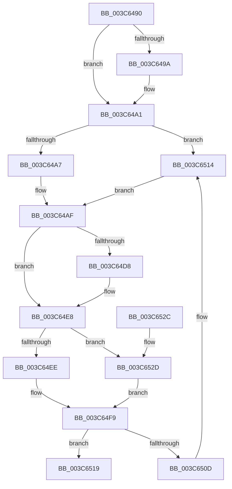

# KiWaitSatisfyMutant

- RVA: `0x003C6490`–`0x003C6536` (길이 `166` bytes)
- VA: `0x00000001403C6490`
- 실행 섹션: `.text`
- PDB 이름 있음: `예`; PDB Function 태그: `아니요`
- unwind 정보 RVA: `0x0006EDE0`
- 디코드: `44`개 명령, `166/166` bytes 표시
- 미해석 바이트: `0` (있으면 어셈블리에 `.byte`로 보존)

> 이 문서는 커널 이미지의 기계어와 PDB 기호를 분석해 생성했습니다. 4번과 5번은 함수 원형과 자료형을 바이너리 사용 방식에서 추정한 C 해석이며 원본 소스 복구 결과는 아닙니다.

## 1. Dependencies

- 직접 호출 지점: **0**; 고유 호출 대상: **0**
- 직접 호출자로 확인된 함수: **3**
- RIP 상대 이미지 참조: **0**

### Outgoing calls
- 직접 디코드된 call 명령이 없습니다.

### Direct callers
- [sub_0020D8DF](../20/Unknown_function_0020D8DF.md) at `0x0020D9E5`
- [KeReleaseMutantEx](../39/KeReleaseMutantEx_function_00396850.md) at `0x00396B80`
- [KiWaitForAllObjects](KiWaitForAllObjects_function_003C5800.md) at `0x003C5CD0`

### Static image references
- 디코드된 RIP-relative 메모리 참조가 없습니다.

## 2. Other-region calls and transfers

- 다른 실행 섹션으로 향하는 call: **0**
- 별도 외부 분기/꼬리 이동을 확인하지 못했습니다.

## 3. Assembly (complete function range)

```asm
003C6490  48 83 EC 28                     sub rsp, 0x28
003C6494  80 79 31 00                     cmp byte ptr [rcx + 0x31], 0
003C6498  74 07                           je 0x1403c64a1
003C649A  66 FF 8A E4 01 00 00            dec word ptr [rdx + 0x1e4]
003C64A1  49 39 50 08                     cmp qword ptr [r8 + 8], rdx
003C64A5  75 6D                           jne 0x1403c6514
003C64A7  45 0F B6 88 BA 38 00 00         movzx r9d, byte ptr [r8 + 0x38ba]
003C64AF  33 C0                           xor eax, eax
003C64B1  0F 57 C0                        xorps xmm0, xmm0
003C64B4  48 89 44 24 10                  mov qword ptr [rsp + 0x10], rax
003C64B9  8B 01                           mov eax, dword ptr [rcx]
003C64BB  0F 11 04 24                     movups xmmword ptr [rsp], xmm0
003C64BF  89 04 24                        mov dword ptr [rsp], eax
003C64C2  44 88 4C 24 02                  mov byte ptr [rsp + 2], r9b
003C64C7  8B 04 24                        mov eax, dword ptr [rsp]
003C64CA  89 01                           mov dword ptr [rcx], eax
003C64CC  0F B6 41 30                     movzx eax, byte ptr [rcx + 0x30]
003C64D0  48 89 51 28                     mov qword ptr [rcx + 0x28], rdx
003C64D4  A8 01                           test al, 1
003C64D6  74 10                           je 0x1403c64e8
003C64D8  24 FE                           and al, 0xfe
003C64DA  88 41 30                        mov byte ptr [rcx + 0x30], al
003C64DD  48 81 8A C8 00 00 00 80 00 00 00  or qword ptr [rdx + 0xc8], 0x80
003C64E8  F6 41 30 02                     test byte ptr [rcx + 0x30], 2
003C64EC  75 3F                           jne 0x1403c652d
003C64EE  48 C7 82 D0 03 00 00 00 00 00 00  mov qword ptr [rdx + 0x3d0], 0
003C64F9  48 81 C2 08 03 00 00            add rdx, 0x308
003C6500  48 83 C1 18                     add rcx, 0x18
003C6504  48 8B 42 08                     mov rax, qword ptr [rdx + 8]
003C6508  48 39 10                        cmp qword ptr [rax], rdx
003C650B  74 0C                           je 0x1403c6519
003C650D  B9 03 00 00 00                  mov ecx, 3
003C6512  CD 29                           int 0x29
003C6514  45 32 C9                        xor r9b, r9b
003C6517  EB 96                           jmp 0x1403c64af
003C6519  48 89 11                        mov qword ptr [rcx], rdx
003C651C  48 89 41 08                     mov qword ptr [rcx + 8], rax
003C6520  48 89 08                        mov qword ptr [rax], rcx
003C6523  48 89 4A 08                     mov qword ptr [rdx + 8], rcx
003C6527  48 83 C4 28                     add rsp, 0x28
003C652B  C3                              ret
003C652C  CC                              int3
003C652D  48 89 8A D0 03 00 00            mov qword ptr [rdx + 0x3d0], rcx
003C6534  EB C3                           jmp 0x1403c64f9
```

## 4. C-style interpretation (structured pseudocode)

```c
__int64 __fastcall KiWaitSatisfyMutant(__int64 a1, __int64 a2, __int64 a3)
{
    __int64 result;
    __int64 v_rsp;
    unsigned __int64 v_stack_m18;
    unsigned __int8 v_stack_m26;
    unsigned __int64 v_stack_m28;

    v_rsp = (v_rsp) - (40);
    if ((*(unsigned __int8 *)(a1 + 49)) != 0) {
    }
    if ((*(unsigned __int64 *)(a3 + 8)) != a2) goto loc_003C6514;
loc_003C64AF:
    result = 0;
    v_stack_m18 = 0;
    v_stack_m28 = v_xmm0;
    v_stack_m28 = (unsigned int)((unsigned int)(*(unsigned int *)(a1)));
    v_stack_m26 = (unsigned __int8)(*(unsigned __int8 *)(a3 + 14522));
    *(unsigned int *)(a1) = (unsigned int)((unsigned int)(v_stack_m28));
    *(unsigned __int64 *)(a1 + 40) = a2;
    result = *(unsigned __int8 *)(a1 + 48);
    if ((((unsigned __int8)(*(unsigned __int8 *)(a1 + 48))) & (1)) != 0) {
        result = (unsigned __int8)((*(unsigned __int8 *)(a1 + 48)) & (254));
        *(unsigned __int8 *)(a1 + 48) = (unsigned __int8)(result);
    }
    if (((*(unsigned __int8 *)(a1 + 48)) & (2)) != 0) goto loc_003C652D;
    *(unsigned __int64 *)(a2 + 976) = 0;
loc_003C64F9:
    a2 = (a2) + (776);
    a1 = (a1) + (24);
    if ((*(unsigned __int64 *)(*(unsigned __int64 *)(a2 + 8))) == a2) goto loc_003C6519;
loc_003C6514:
    a4 = 0;
    goto loc_003C64AF;
loc_003C6519:
    *(unsigned __int64 *)(3) = a2;
    *(unsigned __int64 *)(3 + 8) = *(unsigned __int64 *)(a2 + 8);
    *(unsigned __int64 *)(*(unsigned __int64 *)(a2 + 8)) = 3;
    *(unsigned __int64 *)(a2 + 8) = 3;
    v_rsp = (v_rsp) + (40);
    return *(unsigned __int64 *)(a2 + 8);
loc_003C652D:
    *(unsigned __int64 *)(a2 + 976) = 3;
    goto loc_003C64F9;
}
```

## 5. (Beta) C Style

```c
int64_t KiWaitSatisfyMutant(void *Arg1, void *Arg2, void *Arg3)
{
    uint8_t *arg1 = (uint8_t *)Arg1;
    uint8_t *arg2 = (uint8_t *)Arg2;
    uint8_t *arg3 = (uint8_t *)Arg3;

    int64_t result;
    int64_t local_rsp;
    uint64_t v_stack_m18;
    uint8_t v_stack_m26;
    uint64_t v_stack_m28;

    local_rsp = (local_rsp) - (40);
    if ((*(uint8_t *)(arg1 + 0x31)) != 0) {
    }
    if ((*(uint64_t *)(arg3 + 0x8)) != Arg2) goto loc_003C6514;
loc_003C64AF:
    result = 0;
    v_stack_m18 = 0;
    v_stack_m28 = v_xmm0;
    v_stack_m28 = (uint32_t)((uint32_t)(*(uint32_t *)(arg1)));
    v_stack_m26 = (uint8_t)(*(uint8_t *)(arg3 + 0x38BA));
    *(uint32_t *)(arg1) = (uint32_t)((uint32_t)(v_stack_m28));
    *(void **)(arg1 + 0x28) = Arg2;
    result = *(uint8_t *)(arg1 + 0x30);
    if ((((uint8_t)(*(uint8_t *)(arg1 + 0x30))) & (1)) != 0) {
        result = (uint8_t)((*(uint8_t *)(arg1 + 0x30)) & (254));
        *(uint8_t *)(arg1 + 0x30) = (uint8_t)(result);
    }
    if (((*(uint8_t *)(arg1 + 0x30)) & (2)) != 0) goto loc_003C652D;
    *(uint64_t *)(arg2 + 0x3D0) = 0;
loc_003C64F9:
    Arg2 = (Arg2) + (776);
    Arg1 = (Arg1) + (24);
    if ((*(uint64_t *)(*(uint64_t *)(arg2 + 0x8))) == Arg2) goto loc_003C6519;
loc_003C6514:
    a4 = 0;
    goto loc_003C64AF;
loc_003C6519:
    *(void **)(3) = Arg2;
    *(uint64_t *)(3 + 0x8) = *(uint64_t *)(arg2 + 0x8);
    *(uint64_t *)(*(uint64_t *)(arg2 + 0x8)) = 3;
    *(uint64_t *)(arg2 + 0x8) = 3;
    local_rsp = (local_rsp) + (40);
    return *(uint64_t *)(arg2 + 0x8);
loc_003C652D:
    *(uint64_t *)(arg2 + 0x3D0) = 3;
    goto loc_003C64F9;
}
```

### 관측된 메모리 오프셋

구조체 형식이 확인되지 않은 접근은 인자 기준의 오프셋으로만 기록했습니다.

| 기준 인자 | 오프셋 표현 | 폭 (bit) | 접근 |
|---|---:|---:|---|
| `Arg1` | `+ 0x31` | `8` | `R` |
| `Arg2` | `+ 0x8` | `64` | `R` |
| `Arg2` | `+ 0x8` | `64` | `W` |
| `Arg2` | `+ 0xC8` | `64` | `R/W` |
| `Arg2` | `+ 0x1E4` | `16` | `R/W` |
| `Arg2` | `+ 0x3D0` | `64` | `W` |
| `Arg3` | `+ 0x8` | `64` | `R` |
| `Arg3` | `+ 0x38BA` | `8` | `R` |

## 6. Execution-region graph

[열기: 2D/3D 그래프와 함수 탐색 컨트롤 패널](../../../control-panel.html?section=text&rva=0x003C6490&view=graph)

- 2D 그래프는 위에서 아래로 흐르고, 3D 그래프는 빈 공간을 드래그해 회전합니다. Shift+드래그는 이동, 휠은 확대·축소, 함수 노드 선택은 대상 보고서 이동입니다.

### Static fallback


