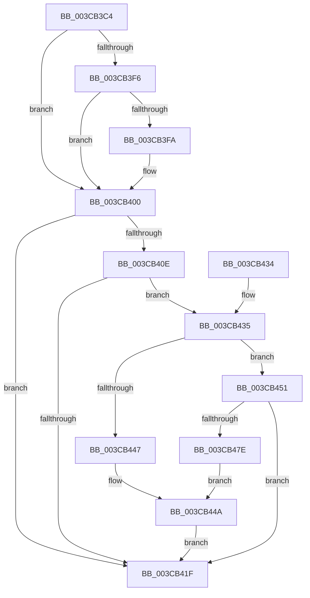

# MiCheckAndUpdateIoAttribution

- RVA: `0x003CB3C4`–`0x003CB483` (길이 `191` bytes)
- VA: `0x00000001403CB3C4`
- 실행 섹션: `.text`
- PDB 이름 있음: `예`; PDB Function 태그: `아니요`
- unwind 정보 RVA: `0x0008F74C`
- 디코드: `55`개 명령, `191/191` bytes 표시
- 미해석 바이트: `0` (있으면 어셈블리에 `.byte`로 보존)

> 이 문서는 커널 이미지의 기계어와 PDB 기호를 분석해 생성했습니다. 4번과 5번은 함수 원형과 자료형을 바이너리 사용 방식에서 추정한 C 해석이며 원본 소스 복구 결과는 아닙니다.

## 1. Dependencies

- 직접 호출 지점: **4**; 고유 호출 대상: **4**
- 직접 호출자로 확인된 함수: **2**
- RIP 상대 이미지 참조: **1**

### Outgoing calls
- `0x003CB416` → [IoReferenceIoAttributionFromThread](IoReferenceIoAttributionFromThread_function_003CB490.md) (function, `0x003CB490`)
- `0x003CB44A` → [IoDiskIoAttributionDereference](../34/IoDiskIoAttributionDereference_function_00349978.md) (function, `0x00349978`)
- `0x003CB455` → [ExAcquireSpinLockExclusiveAtDpcLevel](../24/ExAcquireSpinLockExclusiveAtDpcLevel_function_00248E80.md) (function, `0x00248E80`)
- `0x003CB473` → [ExReleaseSpinLockExclusiveFromDpcLevel](../24/ExReleaseSpinLockExclusiveFromDpcLevel_function_002497E0.md) (function, `0x002497E0`)

### Direct callers
- [MiValidFault](../32/MiValidFault_function_003280B4.md) at `0x00328272`
- [MiCompleteProtoPteFault](../34/MiCompleteProtoPteFault_function_00345710.md) at `0x00346004`

### Static image references
- `0x003CB3E6` → RVA `0x00E2DC80` (`.data`; read)

## 2. Other-region calls and transfers

- 다른 실행 섹션으로 향하는 call: **0**
- 별도 외부 분기/꼬리 이동을 확인하지 못했습니다.

## 3. Assembly (complete function range)

```asm
003CB3C4  48 8B C4                        mov rax, rsp
003CB3C7  48 89 58 10                     mov qword ptr [rax + 0x10], rbx
003CB3CB  48 89 68 18                     mov qword ptr [rax + 0x18], rbp
003CB3CF  48 89 70 20                     mov qword ptr [rax + 0x20], rsi
003CB3D3  57                              push rdi
003CB3D4  48 83 EC 20                     sub rsp, 0x20
003CB3D8  65 4C 8B 04 25 88 01 00 00      mov r8, qword ptr gs:[0x188]
003CB3E1  48 83 60 08 00                  and qword ptr [rax + 8], 0
003CB3E6  48 8B 15 93 28 A6 00            mov rdx, qword ptr [rip + 0xa62893]
003CB3ED  48 8B 41 10                     mov rax, qword ptr [rcx + 0x10]
003CB3F1  48 85 D2                        test rdx, rdx
003CB3F4  74 0A                           je 0x1403cb400
003CB3F6  A8 10                           test al, 0x10
003CB3F8  75 06                           jne 0x1403cb400
003CB3FA  48 F7 D2                        not rdx
003CB3FD  48 23 C2                        and rax, rdx
003CB400  48 C1 F8 10                     sar rax, 0x10
003CB404  48 8B 30                        mov rsi, qword ptr [rax]
003CB407  8B 46 38                        mov eax, dword ptr [rsi + 0x38]
003CB40A  A8 20                           test al, 0x20
003CB40C  75 11                           jne 0x1403cb41f
003CB40E  48 8D 54 24 30                  lea rdx, [rsp + 0x30]
003CB413  49 8B C8                        mov rcx, r8
003CB416  E8 75 00 00 00                  call 0x1403cb490
003CB41B  85 C0                           test eax, eax
003CB41D  79 16                           jns 0x1403cb435
003CB41F  48 8B 5C 24 38                  mov rbx, qword ptr [rsp + 0x38]
003CB424  48 8B 6C 24 40                  mov rbp, qword ptr [rsp + 0x40]
003CB429  48 8B 74 24 48                  mov rsi, qword ptr [rsp + 0x48]
003CB42E  48 83 C4 20                     add rsp, 0x20
003CB432  5F                              pop rdi
003CB433  C3                              ret
003CB434  CC                              int3
003CB435  48 8B 46 78                     mov rax, qword ptr [rsi + 0x78]
003CB439  48 8B 7C 24 30                  mov rdi, qword ptr [rsp + 0x30]
003CB43E  48 83 E0 F8                     and rax, 0xfffffffffffffff8
003CB442  48 3B F8                        cmp rdi, rax
003CB445  75 0A                           jne 0x1403cb451
003CB447  48 8B CF                        mov rcx, rdi
003CB44A  E8 29 E5 F7 FF                  call 0x140349978
003CB44F  EB CE                           jmp 0x1403cb41f
003CB451  48 8D 4E 48                     lea rcx, [rsi + 0x48]
003CB455  E8 26 DA E7 FF                  call 0x140248e80
003CB45A  48 8B 6E 78                     mov rbp, qword ptr [rsi + 0x78]
003CB45E  48 8D 4E 48                     lea rcx, [rsi + 0x48]
003CB462  48 8B C5                        mov rax, rbp
003CB465  48 83 E7 F8                     and rdi, 0xfffffffffffffff8
003CB469  83 E0 07                        and eax, 7
003CB46C  48 0B C7                        or rax, rdi
003CB46F  48 89 46 78                     mov qword ptr [rsi + 0x78], rax
003CB473  E8 68 E3 E7 FF                  call 0x1402497e0
003CB478  48 83 E5 F8                     and rbp, 0xfffffffffffffff8
003CB47C  74 A1                           je 0x1403cb41f
003CB47E  48 8B CD                        mov rcx, rbp
003CB481  EB C7                           jmp 0x1403cb44a
```

## 4. C-style interpretation (structured pseudocode)

```c
__int64 __fastcall MiCheckAndUpdateIoAttribution(__int64 a1)
{
    __int64 result;
    __int64 v_rbp;
    __int64 v_rdi;
    __int64 v_rsp;
    unsigned __int64 v_stack_p10;
    unsigned __int64 v_stack_p18;
    unsigned __int64 v_stack_p20;
    unsigned __int64 v_stack_p30;
    unsigned __int64 v_stack_p8;

    *(unsigned __int64 *)(v_rsp + 16) = v_rbx;
    *(unsigned __int64 *)(v_rsp + 24) = v_rbp;
    *(unsigned __int64 *)(v_rsp + 32) = v_rsi;
    v_rsp = (v_rsp) - (32);
    if (*(unsigned __int64 *)(v_rip + 10889363) == 0) goto loc_003CB400;
    result = *(unsigned __int64 *)(a1 + 16);
    if ((((unsigned __int8)(*(unsigned __int64 *)(a1 + 16))) & (16)) == 0) {
        a2 = ~(*(unsigned __int64 *)(v_rip + 10889363));
        result = (*(unsigned __int64 *)(a1 + 16)) & (a2);
    }
    result = (result) >> (16);
    if ((((unsigned __int8)((unsigned int)(*(unsigned int *)(*(unsigned __int64 *)(result) + 56)))) & (32)) != 0) goto loc_003CB41F;
    result = IoReferenceIoAttributionFromThread(*(unsigned __int64 *)(gs_base + (0 + 392)), v_stack_p8, *(unsigned __int64 *)(gs_base + (0 + 392)), a4);
    if (!sign_flag) goto loc_003CB435;
loc_003CB41F:
    v_rsp = (v_rsp) + (32);
    return result;
loc_003CB435:
    result = (*(unsigned __int64 *)(v_stack_p20 + 120)) & (-8);
    if (v_stack_p30 != result) goto loc_003CB451;
loc_003CB44A:
    result = IoDiskIoAttributionDereference(v_stack_p30, v_stack_p8, *(unsigned __int64 *)(gs_base + (0 + 392)), a4);
    goto loc_003CB41F;
loc_003CB451:
    result = ExAcquireSpinLockExclusiveAtDpcLevel(v_stack_p20 + 72, v_stack_p8, *(unsigned __int64 *)(gs_base + (0 + 392)), a4);
    v_rdi = (v_stack_p30) & (-8);
    result = (unsigned int)((*(unsigned __int64 *)(v_stack_p20 + 120)) & (7));
    result = (result) | (v_rdi);
    *(unsigned __int64 *)(v_stack_p20 + 120) = result;
    result = ExReleaseSpinLockExclusiveFromDpcLevel(v_stack_p20 + 72, v_stack_p8, *(unsigned __int64 *)(gs_base + (0 + 392)), a4);
    v_rbp = (*(unsigned __int64 *)(v_stack_p20 + 120)) & (-8);
    if (condition_is_equal) goto loc_003CB41F;
    goto loc_003CB44A;
}
```

## 5. (Beta) C Style

```c
int64_t MiCheckAndUpdateIoAttribution(void *Arg1)
{
    uint8_t *arg1 = (uint8_t *)Arg1;

    int64_t result;
    int64_t local_rbp;
    int64_t local_rdi;
    int64_t local_rsp;
    uint64_t v_stack_p10;
    uint64_t v_stack_p18;
    uint64_t v_stack_p20;
    uint64_t v_stack_p30;
    uint64_t v_stack_p8;

    *(uint64_t *)(local_rsp + 0x10) = local_rbx;
    *(uint64_t *)(local_rsp + 0x18) = local_rbp;
    *(uint64_t *)(local_rsp + 0x20) = local_rsi;
    local_rsp = (local_rsp) - (32);
    if (*(uint64_t *)(v_rip + 0xA62893) == 0) goto loc_003CB400;
    result = *(uint64_t *)(arg1 + 0x10);
    if ((((uint8_t)(*(uint64_t *)(arg1 + 0x10))) & (16)) == 0) {
        a2 = ~(*(uint64_t *)(v_rip + 0xA62893));
        result = (*(uint64_t *)(arg1 + 0x10)) & (a2);
    }
    result = (result) >> (16);
    if ((((uint8_t)((uint32_t)(*(uint32_t *)(*(uint64_t *)(result) + 0x38)))) & (32)) != 0) goto loc_003CB41F;
    result = IoReferenceIoAttributionFromThread(*(uint64_t *)(gs_base + (0 + 0x188)), v_stack_p8, *(uint64_t *)(gs_base + (0 + 0x188)), a4);
    if (!sign_flag) goto loc_003CB435;
loc_003CB41F:
    local_rsp = (local_rsp) + (32);
    return result;
loc_003CB435:
    result = (*(uint64_t *)(v_stack_p20 + 0x78)) & (-8);
    if (v_stack_p30 != result) goto loc_003CB451;
loc_003CB44A:
    result = IoDiskIoAttributionDereference(v_stack_p30, v_stack_p8, *(uint64_t *)(gs_base + (0 + 0x188)), a4);
    goto loc_003CB41F;
loc_003CB451:
    result = ExAcquireSpinLockExclusiveAtDpcLevel(v_stack_p20 + 72, v_stack_p8, *(uint64_t *)(gs_base + (0 + 0x188)), a4);
    local_rdi = (v_stack_p30) & (-8);
    result = (uint32_t)((*(uint64_t *)(v_stack_p20 + 0x78)) & (7));
    result = (result) | (local_rdi);
    *(uint64_t *)(v_stack_p20 + 0x78) = result;
    result = ExReleaseSpinLockExclusiveFromDpcLevel(v_stack_p20 + 72, v_stack_p8, *(uint64_t *)(gs_base + (0 + 0x188)), a4);
    local_rbp = (*(uint64_t *)(v_stack_p20 + 0x78)) & (-8);
    if (condition_is_equal) goto loc_003CB41F;
    goto loc_003CB44A;
}
```

### 관측된 메모리 오프셋

구조체 형식이 확인되지 않은 접근은 인자 기준의 오프셋으로만 기록했습니다.

| 기준 인자 | 오프셋 표현 | 폭 (bit) | 접근 |
|---|---:|---:|---|
| `Arg1` | `+ 0x10` | `64` | `R` |

## 6. Execution-region graph

[열기: 2D/3D 그래프와 함수 탐색 컨트롤 패널](../../../control-panel.html?section=text&rva=0x003CB3C4&view=graph)

- 2D 그래프는 위에서 아래로 흐르고, 3D 그래프는 빈 공간을 드래그해 회전합니다. Shift+드래그는 이동, 휠은 확대·축소, 함수 노드 선택은 대상 보고서 이동입니다.

### Static fallback


