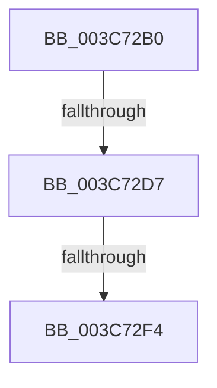

# MiDetachFromWorkingSet

- RVA: `0x003C72B0`–`0x003C7300` (길이 `80` bytes)
- VA: `0x00000001403C72B0`
- 실행 섹션: `.text`
- PDB 이름 있음: `예`; PDB Function 태그: `아니요`
- unwind 정보 RVA: `0x0008E648`
- 디코드: `14`개 명령, `80/80` bytes 표시
- 미해석 바이트: `0` (있으면 어셈블리에 `.byte`로 보존)

> 이 문서는 커널 이미지의 기계어와 PDB 기호를 분석해 생성했습니다. 4번과 5번은 함수 원형과 자료형을 바이너리 사용 방식에서 추정한 C 해석이며 원본 소스 복구 결과는 아닙니다.

## 1. Dependencies

- 직접 호출 지점: **0**; 고유 호출 대상: **0**
- 직접 호출자로 확인된 함수: **1**
- RIP 상대 이미지 참조: **1**

### Outgoing calls
- 직접 디코드된 call 명령이 없습니다.

### Direct callers
- [MiTrimOrAgeWorkingSet](../34/MiTrimOrAgeWorkingSet_function_0034EFC0.md) at `0x0034F243`

### Static image references
- `0x003C72BA` → RVA `0x00E0A740` (`.data`; read)

## 2. Other-region calls and transfers

- 다른 실행 섹션으로 향하는 call: **0**
- call이 아닌 외부 분기/꼬리 이동: **2**
  - `0x003C72D1` → [sub_003C75CE](Unknown_function_003C75CE.md) (`tail-transfer`)
  - `0x003C72EE` → [sub_003C75CE](Unknown_function_003C75CE.md) (`tail-transfer`)

## 3. Assembly (complete function range)

```asm
003C72B0  4C 8B DC                        mov r11, rsp
003C72B3  48 81 EC 98 00 00 00            sub rsp, 0x98
003C72BA  48 8B 05 7F 34 A4 00            mov rax, qword ptr [rip + 0xa4347f]
003C72C1  48 33 C4                        xor rax, rsp
003C72C4  48 89 44 24 70                  mov qword ptr [rsp + 0x70], rax
003C72C9  8B 81 B8 00 00 00               mov eax, dword ptr [rcx + 0xb8]
003C72CF  A8 0F                           test al, 0xf
003C72D1  0F 85 F7 02 00 00               jne 0x1403c75ce
003C72D7  65 48 8B 04 25 88 01 00 00      mov rax, qword ptr gs:[0x188]
003C72E0  48 81 C1 00 FC FF FF            add rcx, -0x400
003C72E7  48 39 88 20 02 00 00            cmp qword ptr [rax + 0x220], rcx
003C72EE  0F 84 DA 02 00 00               je 0x1403c75ce
003C72F4  65 48 8B 04 25 88 01 00 00      mov rax, qword ptr gs:[0x188]
003C72FD  0F 57 C0                        xorps xmm0, xmm0
```

## 4. C-style interpretation (structured pseudocode)

```c
__int64 __fastcall MiDetachFromWorkingSet(__int64 a1)
{
    __int64 result;
    __int64 v_rsp;
    unsigned __int64 v_stack_m28;

    v_rsp = (v_rsp) - (152);
    result = (*(unsigned __int64 *)(v_rip + 10761343)) ^ (v_rsp);
    v_stack_m28 = result;
    a1 = (a1) + (0xFFFFFFFFFFFFFC00ULL);
    return *(unsigned __int64 *)(gs_base + (0 + 392));
}
```

## 5. (Beta) C Style

```c
int64_t MiDetachFromWorkingSet(void *Arg1)
{
    uint8_t *arg1 = (uint8_t *)Arg1;

    int64_t result;
    int64_t local_rsp;
    uint64_t v_stack_m28;

    local_rsp = (local_rsp) - (152);
    result = (*(uint64_t *)(v_rip + 0xA4347F)) ^ (local_rsp);
    v_stack_m28 = result;
    Arg1 = (Arg1) + (0xFFFFFFFFFFFFFC00ULL);
    return *(uint64_t *)(gs_base + (0 + 0x188));
}
```

### 관측된 메모리 오프셋

구조체 형식이 확인되지 않은 접근은 인자 기준의 오프셋으로만 기록했습니다.

| 기준 인자 | 오프셋 표현 | 폭 (bit) | 접근 |
|---|---:|---:|---|
| `Arg1` | `+ 0xB8` | `32` | `R` |

## 6. Execution-region graph

[열기: 2D/3D 그래프와 함수 탐색 컨트롤 패널](../../../control-panel.html?section=text&rva=0x003C72B0&view=graph)

- 2D 그래프는 위에서 아래로 흐르고, 3D 그래프는 빈 공간을 드래그해 회전합니다. Shift+드래그는 이동, 휠은 확대·축소, 함수 노드 선택은 대상 보고서 이동입니다.

### Static fallback


