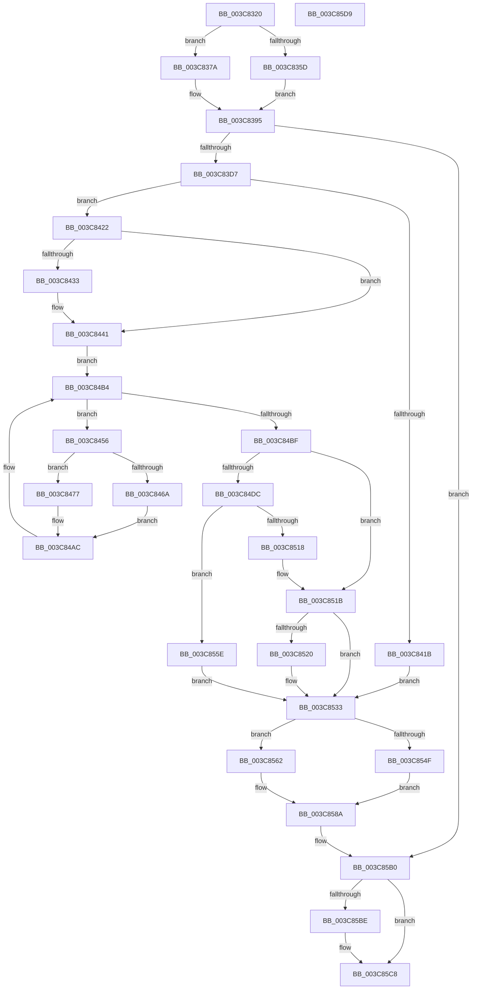

# MiReleaseOutSwappedProcessCommit

- RVA: `0x003C8320`–`0x003C85DA` (길이 `698` bytes)
- VA: `0x00000001403C8320`
- 실행 섹션: `.text`
- PDB 이름 있음: `예`; PDB Function 태그: `아니요`
- unwind 정보 RVA: `0x0008E968`
- 디코드: `180`개 명령, `698/698` bytes 표시
- 미해석 바이트: `0` (있으면 어셈블리에 `.byte`로 보존)

> 이 문서는 커널 이미지의 기계어와 PDB 기호를 분석해 생성했습니다. 4번과 5번은 함수 원형과 자료형을 바이너리 사용 방식에서 추정한 C 해석이며 원본 소스 복구 결과는 아닙니다.

## 1. Dependencies

- 직접 호출 지점: **21**; 고유 호출 대상: **18**
- 직접 호출자로 확인된 함수: **1**
- RIP 상대 이미지 참조: **4**

### Outgoing calls
- `0x003C8340` → [KeForceAttachProcess](../21/KeForceAttachProcess_function_00216650.md) (function, `0x00216650`)
- `0x003C83C6` → [MiAllocatePool](../35/MiAllocatePool_function_0035B540.md) (function, `0x0035B540`)
- `0x003C83DA` → [MiLockWorkingSetExclusive](../32/MiLockWorkingSetExclusive_function_003238A0.md) (function, `0x003238A0`)
- `0x003C840E` → [MiUnlockWorkingSetExclusive](../27/MiUnlockWorkingSetExclusive_function_0027EC70.md) (function, `0x0027EC70`)
- `0x003C8436` → [SmStoreExistsForProcess](../34/SmStoreExistsForProcess_function_00349F54.md) (function, `0x00349F54`)
- `0x003C8447` → [LOCK_ADDRESS_SPACE](../2A/LOCK_ADDRESS_SPACE_function_002A4944.md) (function, `0x002A4944`)
- `0x003C844F` → [MiGetFirstVad](../2A/MiGetFirstVad_function_002A8BBC.md) (function, `0x002A8BBC`)
- `0x003C8459` → [MiLockVad](../29/MiLockVad_function_00295810.md) (function, `0x00295810`)
- `0x003C8461` → [MiIsVadEligibleForCommitRelease](../4F/MiIsVadEligibleForCommitRelease_function_004FB6FC.md) (function, `0x004FB6FC`)
- `0x003C8470` → [MiUnlockVad](../2A/MiUnlockVad_function_002A59C8.md) (function, `0x002A59C8`)
- `0x003C8496` → [MiCheckCommitReleaseFromVad](../66/MiCheckCommitReleaseFromVad_function_0066EB90.md) (function, `0x0066EB90`)
- `0x003C84A4` → [MiUnlockVad](../2A/MiUnlockVad_function_002A59C8.md) (function, `0x002A59C8`)
- `0x003C84AF` → [MiGetNextVad](../29/MiGetNextVad_function_00297224.md) (function, `0x00297224`)
- `0x003C84C2` → [UNLOCK_ADDRESS_SPACE](../2A/UNLOCK_ADDRESS_SPACE_function_002A4844.md) (function, `0x002A4844`)
- `0x003C84E7` → [SmQueryStoreCommitUsage](../60/SmQueryStoreCommitUsage_function_0060EA80.md) (function, `0x0060EA80`)
- `0x003C852E` → [MiReturnCommit](../24/MiReturnCommit_function_00248410.md) (function, `0x00248410`)
- `0x003C8536` → [MiLockWorkingSetExclusive](../32/MiLockWorkingSetExclusive_function_003238A0.md) (function, `0x003238A0`)
- `0x003C859D` → [MiUnlockWorkingSetExclusive](../27/MiUnlockWorkingSetExclusive_function_0027EC70.md) (function, `0x0027EC70`)
- `0x003C85AB` → [MiLogOutswappedProcessCommitRelease](../66/MiLogOutswappedProcessCommitRelease_function_0066F388.md) (function, `0x0066F388`)
- `0x003C85B4` → [KeForceDetachProcess](KeForceDetachProcess_function_003C7770.md) (function, `0x003C7770`)
- `0x003C85C3` → [ExFreePoolWithTag](../../poolcode/B8/ExFreePoolWithTag_function_00B82870.md) (function, `0x00B82870`)

### Direct callers
- [MmOutSwapProcess](MmOutSwapProcess_function_003C8224.md) at `0x003C82B0`

### Static image references
- `0x003C835D` → RVA `0x00E38848` (`.data`; read)
- `0x003C836C` → RVA `0x00E38860` (`.data`; read)
- `0x003C83A1` → RVA `0x00E30088` (`.data`; read)
- `0x003C8413` → RVA `0x00FC5250` (`ALMOSTRO`; read)

## 2. Other-region calls and transfers

- 다른 실행 섹션으로 향하는 call: **1**
  - `0x003C85C3` → [ExFreePoolWithTag](../../poolcode/B8/ExFreePoolWithTag_function_00B82870.md) (`.text` → `POOLCODE`)
- 별도 외부 분기/꼬리 이동을 확인하지 못했습니다.

## 3. Assembly (complete function range)

```asm
003C8320  48 8B C4                        mov rax, rsp
003C8323  53                              push rbx
003C8324  55                              push rbp
003C8325  56                              push rsi
003C8326  57                              push rdi
003C8327  41 54                           push r12
003C8329  41 55                           push r13
003C832B  41 56                           push r14
003C832D  41 57                           push r15
003C832F  48 83 EC 48                     sub rsp, 0x48
003C8333  48 83 60 10 00                  and qword ptr [rax + 0x10], 0
003C8338  45 33 C0                        xor r8d, r8d
003C833B  33 D2                           xor edx, edx
003C833D  48 8B F1                        mov rsi, rcx
003C8340  E8 0B E3 E4 FF                  call 0x140216650
003C8345  48 8D BE 00 04 00 00            lea rdi, [rsi + 0x400]
003C834C  BB 01 00 00 00                  mov ebx, 1
003C8351  8B 87 B8 00 00 00               mov eax, dword ptr [rdi + 0xb8]
003C8357  24 0F                           and al, 0xf
003C8359  3A C3                           cmp al, bl
003C835B  75 1D                           jne 0x1403c837a
003C835D  4C 8D 3D E4 04 A7 00            lea r15, [rip + 0xa704e4]
003C8364  4C 89 BC 24 A8 00 00 00         mov qword ptr [rsp + 0xa8], r15
003C836C  4C 8D 3D ED 04 A7 00            lea r15, [rip + 0xa704ed]
003C8373  4C 89 7C 24 30                  mov qword ptr [rsp + 0x30], r15
003C8378  EB 1B                           jmp 0x1403c8395
003C837A  48 8D 87 C8 00 00 00            lea rax, [rdi + 0xc8]
003C8381  48 89 84 24 A8 00 00 00         mov qword ptr [rsp + 0xa8], rax
003C8389  48 8D 87 E0 00 00 00            lea rax, [rdi + 0xe0]
003C8390  48 89 44 24 30                  mov qword ptr [rsp + 0x30], rax
003C8395  0F B7 8F AE 00 00 00            movzx ecx, word ptr [rdi + 0xae]
003C839C  BA 38 00 00 00                  mov edx, 0x38
003C83A1  48 8B 05 E0 7C A6 00            mov rax, qword ptr [rip + 0xa67ce0]
003C83A8  41 B8 4D 69 43 72               mov r8d, 0x7243694d
003C83AE  65 4C 8B 24 25 88 01 00 00      mov r12, qword ptr gs:[0x188]
003C83B7  48 8B 2C C8                     mov rbp, qword ptr [rax + rcx*8]
003C83BB  8D 4A 08                        lea ecx, [rdx + 8]
003C83BE  48 89 AC 24 A0 00 00 00         mov qword ptr [rsp + 0xa0], rbp
003C83C6  E8 75 31 F9 FF                  call 0x14035b540
003C83CB  4C 8B F0                        mov r14, rax
003C83CE  48 85 C0                        test rax, rax
003C83D1  0F 84 D9 01 00 00               je 0x1403c85b0
003C83D7  48 8B CF                        mov rcx, rdi
003C83DA  E8 C1 B4 F5 FF                  call 0x1403238a0
003C83DF  8B 8F B8 00 00 00               mov ecx, dword ptr [rdi + 0xb8]
003C83E5  8A D0                           mov dl, al
003C83E7  89 8C 24 90 00 00 00            mov dword ptr [rsp + 0x90], ecx
003C83EE  C1 E9 18                        shr ecx, 0x18
003C83F1  80 C9 30                        or cl, 0x30
003C83F4  88 8C 24 93 00 00 00            mov byte ptr [rsp + 0x93], cl
003C83FB  8B 8C 24 90 00 00 00            mov ecx, dword ptr [rsp + 0x90]
003C8402  C1 E9 18                        shr ecx, 0x18
003C8405  88 8F BB 00 00 00               mov byte ptr [rdi + 0xbb], cl
003C840B  48 8B CF                        mov rcx, rdi
003C840E  E8 5D 68 EB FF                  call 0x14027ec70
003C8413  39 1D 37 CE BF 00               cmp dword ptr [rip + 0xbfce37], ebx
003C8419  75 07                           jne 0x1403c8422
003C841B  33 ED                           xor ebp, ebp
003C841D  E9 11 01 00 00                  jmp 0x1403c8533
003C8422  8B 85 B4 04 00 00               mov eax, dword ptr [rbp + 0x4b4]
003C8428  45 33 FF                        xor r15d, r15d
003C842B  45 33 ED                        xor r13d, r13d
003C842E  83 F8 FF                        cmp eax, -1
003C8431  74 0E                           je 0x1403c8441
003C8433  48 8B CE                        mov rcx, rsi
003C8436  E8 19 1B F8 FF                  call 0x140349f54
003C843B  85 C0                           test eax, eax
003C843D  44 0F 45 FB                     cmovne r15d, ebx
003C8441  48 8B D6                        mov rdx, rsi
003C8444  49 8B CC                        mov rcx, r12
003C8447  E8 F8 C4 ED FF                  call 0x1402a4944
003C844C  48 8B CE                        mov rcx, rsi
003C844F  E8 68 07 EE FF                  call 0x1402a8bbc
003C8454  EB 5E                           jmp 0x1403c84b4
003C8456  48 8B D5                        mov rdx, rbp
003C8459  E8 B2 D3 EC FF                  call 0x140295810
003C845E  48 8B CD                        mov rcx, rbp
003C8461  E8 96 32 13 00                  call 0x1404fb6fc
003C8466  85 C0                           test eax, eax
003C8468  75 0D                           jne 0x1403c8477
003C846A  48 8B D5                        mov rdx, rbp
003C846D  49 8B CC                        mov rcx, r12
003C8470  E8 53 D5 ED FF                  call 0x1402a59c8
003C8475  EB 35                           jmp 0x1403c84ac
003C8477  48 8B 8C 24 A0 00 00 00         mov rcx, qword ptr [rsp + 0xa0]
003C847F  49 8D 46 20                     lea rax, [r14 + 0x20]
003C8483  48 89 44 24 28                  mov qword ptr [rsp + 0x28], rax
003C8488  4C 8B CD                        mov r9, rbp
003C848B  4C 8B C7                        mov r8, rdi
003C848E  44 89 7C 24 20                  mov dword ptr [rsp + 0x20], r15d
003C8493  48 8B D6                        mov rdx, rsi
003C8496  E8 F5 66 2A 00                  call 0x14066eb90
003C849B  48 8B D5                        mov rdx, rbp
003C849E  49 8B CC                        mov rcx, r12
003C84A1  48 8B D8                        mov rbx, rax
003C84A4  E8 1F D5 ED FF                  call 0x1402a59c8
003C84A9  4C 03 EB                        add r13, rbx
003C84AC  48 8B CD                        mov rcx, rbp
003C84AF  E8 70 ED EC FF                  call 0x140297224
003C84B4  48 8B E8                        mov rbp, rax
003C84B7  49 8B CC                        mov rcx, r12
003C84BA  48 85 C0                        test rax, rax
003C84BD  75 97                           jne 0x1403c8456
003C84BF  48 8B D6                        mov rdx, rsi
003C84C2  E8 7D C3 ED FF                  call 0x1402a4844
003C84C7  33 C0                           xor eax, eax
003C84C9  49 8B DD                        mov rbx, r13
003C84CC  48 87 86 D0 04 00 00            xchg qword ptr [rsi + 0x4d0], rax
003C84D3  49 8B 6E 20                     mov rbp, qword ptr [r14 + 0x20]
003C84D7  45 85 FF                        test r15d, r15d
003C84DA  74 3F                           je 0x1403c851b
003C84DC  48 8D 94 24 98 00 00 00         lea rdx, [rsp + 0x98]
003C84E4  48 8B CE                        mov rcx, rsi
003C84E7  E8 94 65 24 00                  call 0x14060ea80
003C84EC  48 8B 8C 24 98 00 00 00         mov rcx, qword ptr [rsp + 0x98]
003C84F4  B8 00 00 00 00                  mov eax, 0
003C84F9  48 F7 C1 FF 0F 00 00            test rcx, 0xfff
003C8500  0F 95 C0                        setne al
003C8503  48 C1 E9 0C                     shr rcx, 0xc
003C8507  48 8D 14 08                     lea rdx, [rax + rcx]
003C850B  48 89 94 24 98 00 00 00         mov qword ptr [rsp + 0x98], rdx
003C8513  4C 3B EA                        cmp r13, rdx
003C8516  76 46                           jbe 0x1403c855e
003C8518  48 2B DA                        sub rbx, rdx
003C851B  48 85 DB                        test rbx, rbx
003C851E  74 13                           je 0x1403c8533
003C8520  48 8B 8C 24 A0 00 00 00         mov rcx, qword ptr [rsp + 0xa0]
003C8528  45 33 C0                        xor r8d, r8d
003C852B  48 8B D3                        mov rdx, rbx
003C852E  E8 DD FE E7 FF                  call 0x140248410
003C8533  48 8B CF                        mov rcx, rdi
003C8536  E8 65 B3 F5 FF                  call 0x1403238a0
003C853B  8B 8F B8 00 00 00               mov ecx, dword ptr [rdi + 0xb8]
003C8541  8A D0                           mov dl, al
003C8543  89 8C 24 90 00 00 00            mov dword ptr [rsp + 0x90], ecx
003C854A  48 85 DB                        test rbx, rbx
003C854D  75 13                           jne 0x1403c8562
003C854F  C1 E9 18                        shr ecx, 0x18
003C8552  80 E1 CF                        and cl, 0xcf
003C8555  88 8C 24 93 00 00 00            mov byte ptr [rsp + 0x93], cl
003C855C  EB 2C                           jmp 0x1403c858a
003C855E  33 DB                           xor ebx, ebx
003C8560  EB D1                           jmp 0x1403c8533
003C8562  8A 84 24 93 00 00 00            mov al, byte ptr [rsp + 0x93]
003C8569  24 EF                           and al, 0xef
003C856B  0C 20                           or al, 0x20
003C856D  88 84 24 93 00 00 00            mov byte ptr [rsp + 0x93], al
003C8574  48 8B 84 24 A8 00 00 00         mov rax, qword ptr [rsp + 0xa8]
003C857C  48 89 18                        mov qword ptr [rax], rbx
003C857F  48 8B 44 24 30                  mov rax, qword ptr [rsp + 0x30]
003C8584  4C 89 30                        mov qword ptr [rax], r14
003C8587  45 33 F6                        xor r14d, r14d
003C858A  8B 84 24 90 00 00 00            mov eax, dword ptr [rsp + 0x90]
003C8591  48 8B CF                        mov rcx, rdi
003C8594  C1 E8 18                        shr eax, 0x18
003C8597  88 87 BB 00 00 00               mov byte ptr [rdi + 0xbb], al
003C859D  E8 CE 66 EB FF                  call 0x14027ec70
003C85A2  4C 8B C5                        mov r8, rbp
003C85A5  48 8B D3                        mov rdx, rbx
003C85A8  48 8B CE                        mov rcx, rsi
003C85AB  E8 D8 6D 2A 00                  call 0x14066f388
003C85B0  33 D2                           xor edx, edx
003C85B2  33 C9                           xor ecx, ecx
003C85B4  E8 B7 F1 FF FF                  call 0x1403c7770
003C85B9  4D 85 F6                        test r14, r14
003C85BC  74 0A                           je 0x1403c85c8
003C85BE  33 D2                           xor edx, edx
003C85C0  49 8B CE                        mov rcx, r14
003C85C3  E8 A8 A2 7B 00                  call 0x140b82870
003C85C8  48 83 C4 48                     add rsp, 0x48
003C85CC  41 5F                           pop r15
003C85CE  41 5E                           pop r14
003C85D0  41 5D                           pop r13
003C85D2  41 5C                           pop r12
003C85D4  5F                              pop rdi
003C85D5  5E                              pop rsi
003C85D6  5D                              pop rbp
003C85D7  5B                              pop rbx
003C85D8  C3                              ret
003C85D9  CC                              int3
```

## 4. C-style interpretation (structured pseudocode)

```c
__int64 __fastcall MiReleaseOutSwappedProcessCommit(__int64 a1, int a2, int a3)
{
    __int64 result;
    __int64 v_r13;
    __int64 v_r14;
    __int64 v_r15;
    __int64 v_rbp;
    __int64 v_rbx;
    __int64 v_rsp;
    unsigned __int64 v_stack_m58;
    unsigned __int64 v_stack_m60;
    unsigned int v_stack_m68;
    unsigned __int64 v_stack_p10;
    unsigned __int64 v_stack_p18;
    unsigned __int64 v_stack_p20;
    unsigned int v_stack_p8;
    unsigned __int8 v_stack_pB;

    v_rsp = (v_rsp) - (72);
    a3 = 0;
    a2 = 0;
    result = KeForceAttachProcess(a1, a2, a3, a4);
    result = (unsigned __int8)(((unsigned int)(*(unsigned int *)(a1 + 1024 + 184))) & (15));
    if (((unsigned __int8)(result)) != 1) goto loc_003C837A;
    v_stack_p20 = v_rip + 10945764;
    v_stack_m58 = v_rip + 10945773;
    goto loc_003C8395;
loc_003C837A:
    v_stack_p20 = a1 + 1024 + 200;
    v_stack_m58 = a1 + 1024 + 224;
loc_003C8395:
    v_stack_p18 = *(unsigned __int64 *)(*(unsigned __int64 *)(v_rip + 10910944) + *(unsigned __int16 *)(a1 + 1024 + 174) * 8);
    result = MiAllocatePool(56 + 8, 56, (unsigned int)(0x7243694DULL), a4);
    if (result == 0) goto loc_003C85B0;
    result = MiLockWorkingSetExclusive(a1 + 1024, 56, (unsigned int)(0x7243694DULL), a4);
    v_stack_p8 = (unsigned int)((unsigned int)(*(unsigned int *)(a1 + 1024 + 184)));
    a1 = (unsigned int)(((unsigned int)(*(unsigned int *)(a1 + 1024 + 184))) >> (24));
    a1 = (unsigned __int8)((a1) | (48));
    v_stack_pB = (unsigned __int8)(a1);
    a1 = (unsigned int)(((unsigned int)(v_stack_p8)) >> (24));
    *(unsigned __int8 *)(a1 + 1024 + 187) = (unsigned __int8)(a1);
    result = MiUnlockWorkingSetExclusive(a1 + 1024, (unsigned __int8)(result), (unsigned int)(0x7243694DULL), a4);
    if ((*(unsigned int *)(v_rip + 12570167)) != 1) goto loc_003C8422;
    v_rbp = 0;
    goto loc_003C8533;
loc_003C8422:
    v_r15 = 0;
    v_r13 = 0;
    result = (unsigned int)(*(unsigned int *)(v_rbp + 1204));
    if (((unsigned int)((unsigned int)(*(unsigned int *)(v_rbp + 1204)))) != -1) {
        a1 = a1;
        result = SmStoreExistsForProcess(a1, (unsigned __int8)(result), (unsigned int)(0x7243694DULL), a4);
        if ((unsigned int)(result) != 0) { v_r15 = 1; }
    }
    result = LOCK_ADDRESS_SPACE(*(unsigned __int64 *)(gs_base + (0 + 392)), a1, (unsigned int)(0x7243694DULL), a4);
    result = MiGetFirstVad(a1, a1, (unsigned int)(0x7243694DULL), a4);
    goto loc_003C84B4;
loc_003C8456:
    result = MiLockVad(a1, 0, (unsigned int)(0x7243694DULL), a4);
    result = MiIsVadEligibleForCommitRelease(0, 0, (unsigned int)(0x7243694DULL), a4);
    if ((unsigned int)(result) != 0) goto loc_003C8477;
    result = MiUnlockVad(*(unsigned __int64 *)(gs_base + (0 + 392)), 0, (unsigned int)(0x7243694DULL), a4);
    goto loc_003C84AC;
loc_003C8477:
    v_stack_m60 = result + 32;
    v_stack_m68 = (unsigned int)(v_r15);
    result = MiCheckCommitReleaseFromVad(v_stack_p18, a1, a1 + 1024, 0);
    result = MiUnlockVad(*(unsigned __int64 *)(gs_base + (0 + 392)), 0, a1 + 1024, 0);
    v_r13 = (v_r13) + (result);
loc_003C84AC:
    result = MiGetNextVad(0, 0, a1 + 1024, 0);
loc_003C84B4:
    if (result != 0) goto loc_003C8456;
    result = UNLOCK_ADDRESS_SPACE(*(unsigned __int64 *)(gs_base + (0 + 392)), a1, a1 + 1024, 0);
    result = 0;
    if ((unsigned int)(v_r15) == 0) goto loc_003C851B;
    result = SmQueryStoreCommitUsage(a1, v_stack_p10, a1 + 1024, 0);
    result = (((v_stack_p10) & (0xFFFULL)) != 0) ? 1 : 0;
    a1 = (v_stack_p10) >> (12);
    v_stack_p10 = result + a1 * 1;
    if (v_r13 <= (result + a1 * 1)) goto loc_003C855E;
    v_rbx = (v_r13) - (result + a1 * 1);
loc_003C851B:
    if (v_rbx != 0) {
        a1 = v_stack_p18;
        a3 = 0;
        a2 = v_rbx;
        result = MiReturnCommit(a1, a2, a3, 0);
    }
    result = MiLockWorkingSetExclusive(a1 + 1024, a2, a3, 0);
    v_stack_p8 = (unsigned int)((unsigned int)(*(unsigned int *)(a1 + 1024 + 184)));
    if (v_rbx != 0) goto loc_003C8562;
    a1 = (unsigned int)(((unsigned int)(*(unsigned int *)(a1 + 1024 + 184))) >> (24));
    a1 = (unsigned __int8)((a1) & (207));
    v_stack_pB = (unsigned __int8)(a1);
    goto loc_003C858A;
loc_003C855E:
    v_rbx = 0;
    goto loc_003C8533;
loc_003C8562:
    result = (unsigned __int8)((v_stack_pB) & (239));
    result = (unsigned __int8)((result) | (32));
    v_stack_pB = (unsigned __int8)(result);
    *(unsigned __int64 *)(v_stack_p20) = 0;
    *(unsigned __int64 *)(v_stack_m58) = result;
    v_r14 = 0;
loc_003C858A:
    result = (unsigned int)(((unsigned int)(v_stack_p8)) >> (24));
    *(unsigned __int8 *)(a1 + 1024 + 187) = (unsigned __int8)(result);
    result = MiUnlockWorkingSetExclusive(a1 + 1024, (unsigned __int8)(result), a3, 0);
    result = MiLogOutswappedProcessCommitRelease(a1, 0, *(unsigned __int64 *)(result + 32), 0);
loc_003C85B0:
    a2 = 0;
    a1 = 0;
    result = KeForceDetachProcess(a1, a2, *(unsigned __int64 *)(result + 32), 0);
    if (0 != 0) {
        a2 = 0;
        a1 = 0;
        result = ExFreePoolWithTag(a1, a2, *(unsigned __int64 *)(result + 32), 0);
    }
    v_rsp = (v_rsp) + (72);
    return result;
}
```

## 5. (Beta) C Style

```c
int64_t MiReleaseOutSwappedProcessCommit(void *Arg1, int32_t Arg2, int32_t Arg3)
{
    uint8_t *arg1 = (uint8_t *)Arg1;

    int64_t result;
    int64_t local_r13;
    int64_t local_r14;
    int64_t local_r15;
    int64_t local_rbp;
    int64_t local_rbx;
    int64_t local_rsp;
    uint64_t v_stack_m58;
    uint64_t v_stack_m60;
    uint32_t v_stack_m68;
    uint64_t v_stack_p10;
    uint64_t v_stack_p18;
    uint64_t v_stack_p20;
    uint32_t v_stack_p8;
    uint8_t v_stack_pB;

    local_rsp = (local_rsp) - (72);
    Arg3 = 0;
    Arg2 = 0;
    result = KeForceAttachProcess(Arg1, Arg2, Arg3, a4);
    result = (uint8_t)(((uint32_t)(*(uint32_t *)(arg1 + 0x400 + 0xB8))) & (15));
    if (((uint8_t)(result)) != 1) goto loc_003C837A;
    v_stack_p20 = v_rip + 10945764;
    v_stack_m58 = v_rip + 10945773;
    goto loc_003C8395;
loc_003C837A:
    v_stack_p20 = Arg1 + 1024 + 200;
    v_stack_m58 = Arg1 + 1024 + 224;
loc_003C8395:
    v_stack_p18 = *(uint64_t *)(*(uint64_t *)(v_rip + 0xA67CE0) + *(uint16_t *)(arg1 + 0x400 + 0xAE) * 8);
    result = MiAllocatePool(56 + 8, 56, (uint32_t)(0x7243694DULL), a4);
    if (result == 0) goto loc_003C85B0;
    result = MiLockWorkingSetExclusive(Arg1 + 1024, 56, (uint32_t)(0x7243694DULL), a4);
    v_stack_p8 = (uint32_t)((uint32_t)(*(uint32_t *)(arg1 + 0x400 + 0xB8)));
    Arg1 = (uint32_t)(((uint32_t)(*(uint32_t *)(arg1 + 0x400 + 0xB8))) >> (24));
    Arg1 = (uint8_t)((Arg1) | (48));
    v_stack_pB = (uint8_t)(Arg1);
    Arg1 = (uint32_t)(((uint32_t)(v_stack_p8)) >> (24));
    *(uint8_t *)(arg1 + 0x400 + 0xBB) = (uint8_t)(Arg1);
    result = MiUnlockWorkingSetExclusive(Arg1 + 1024, (uint8_t)(result), (uint32_t)(0x7243694DULL), a4);
    if ((*(uint32_t *)(v_rip + 0xBFCE37)) != 1) goto loc_003C8422;
    local_rbp = 0;
    goto loc_003C8533;
loc_003C8422:
    local_r15 = 0;
    local_r13 = 0;
    result = (uint32_t)(*(uint32_t *)(local_rbp + 0x4B4));
    if (((uint32_t)((uint32_t)(*(uint32_t *)(local_rbp + 0x4B4)))) != -1) {
        Arg1 = Arg1;
        result = SmStoreExistsForProcess(Arg1, (uint8_t)(result), (uint32_t)(0x7243694DULL), a4);
        if ((uint32_t)(result) != 0) { local_r15 = 1; }
    }
    result = LOCK_ADDRESS_SPACE(*(uint64_t *)(gs_base + (0 + 0x188)), Arg1, (uint32_t)(0x7243694DULL), a4);
    result = MiGetFirstVad(Arg1, Arg1, (uint32_t)(0x7243694DULL), a4);
    goto loc_003C84B4;
loc_003C8456:
    result = MiLockVad(Arg1, 0, (uint32_t)(0x7243694DULL), a4);
    result = MiIsVadEligibleForCommitRelease(0, 0, (uint32_t)(0x7243694DULL), a4);
    if ((uint32_t)(result) != 0) goto loc_003C8477;
    result = MiUnlockVad(*(uint64_t *)(gs_base + (0 + 0x188)), 0, (uint32_t)(0x7243694DULL), a4);
    goto loc_003C84AC;
loc_003C8477:
    v_stack_m60 = result + 32;
    v_stack_m68 = (uint32_t)(local_r15);
    result = MiCheckCommitReleaseFromVad(v_stack_p18, Arg1, Arg1 + 1024, 0);
    result = MiUnlockVad(*(uint64_t *)(gs_base + (0 + 0x188)), 0, Arg1 + 1024, 0);
    local_r13 = (local_r13) + (result);
loc_003C84AC:
    result = MiGetNextVad(0, 0, Arg1 + 1024, 0);
loc_003C84B4:
    if (result != 0) goto loc_003C8456;
    result = UNLOCK_ADDRESS_SPACE(*(uint64_t *)(gs_base + (0 + 0x188)), Arg1, Arg1 + 1024, 0);
    result = 0;
    if ((uint32_t)(local_r15) == 0) goto loc_003C851B;
    result = SmQueryStoreCommitUsage(Arg1, v_stack_p10, Arg1 + 1024, 0);
    result = (((v_stack_p10) & (0xFFFULL)) != 0) ? 1 : 0;
    Arg1 = (v_stack_p10) >> (12);
    v_stack_p10 = result + Arg1 * 1;
    if (local_r13 <= (result + Arg1 * 1)) goto loc_003C855E;
    local_rbx = (local_r13) - (result + Arg1 * 1);
loc_003C851B:
    if (local_rbx != 0) {
        Arg1 = v_stack_p18;
        Arg3 = 0;
        Arg2 = local_rbx;
        result = MiReturnCommit(Arg1, Arg2, Arg3, 0);
    }
    result = MiLockWorkingSetExclusive(Arg1 + 1024, Arg2, Arg3, 0);
    v_stack_p8 = (uint32_t)((uint32_t)(*(uint32_t *)(arg1 + 0x400 + 0xB8)));
    if (local_rbx != 0) goto loc_003C8562;
    Arg1 = (uint32_t)(((uint32_t)(*(uint32_t *)(arg1 + 0x400 + 0xB8))) >> (24));
    Arg1 = (uint8_t)((Arg1) & (207));
    v_stack_pB = (uint8_t)(Arg1);
    goto loc_003C858A;
loc_003C855E:
    local_rbx = 0;
    goto loc_003C8533;
loc_003C8562:
    result = (uint8_t)((v_stack_pB) & (239));
    result = (uint8_t)((result) | (32));
    v_stack_pB = (uint8_t)(result);
    *(uint64_t *)(v_stack_p20) = 0;
    *(uint64_t *)(v_stack_m58) = result;
    local_r14 = 0;
loc_003C858A:
    result = (uint32_t)(((uint32_t)(v_stack_p8)) >> (24));
    *(uint8_t *)(arg1 + 0x400 + 0xBB) = (uint8_t)(result);
    result = MiUnlockWorkingSetExclusive(Arg1 + 1024, (uint8_t)(result), Arg3, 0);
    result = MiLogOutswappedProcessCommitRelease(Arg1, 0, *(uint64_t *)(result + 0x20), 0);
loc_003C85B0:
    Arg2 = 0;
    Arg1 = 0;
    result = KeForceDetachProcess(Arg1, Arg2, *(uint64_t *)(result + 0x20), 0);
    if (0 != 0) {
        Arg2 = 0;
        Arg1 = 0;
        result = ExFreePoolWithTag(Arg1, Arg2, *(uint64_t *)(result + 0x20), 0);
    }
    local_rsp = (local_rsp) + (72);
    return result;
}
```

### 관측된 메모리 오프셋

구조체 형식이 확인되지 않은 접근은 인자 기준의 오프셋으로만 기록했습니다.

| 기준 인자 | 오프셋 표현 | 폭 (bit) | 접근 |
|---|---:|---:|---|
| `Arg1` | `+ 0xAE` | `16` | `R` |
| `Arg1` | `+ 0xB8` | `32` | `R` |
| `Arg1` | `+ 0xBB` | `8` | `W` |
| `Arg1` | `+ 0xC8` | `64` | `R` |
| `Arg1` | `+ 0xE0` | `64` | `R` |
| `Arg1` | `+ 0x400` | `64` | `R` |
| `Arg1` | `+ 0x4D0` | `64` | `R/W` |

## 6. Execution-region graph

[열기: 2D/3D 그래프와 함수 탐색 컨트롤 패널](../../../control-panel.html?section=text&rva=0x003C8320&view=graph)

- 2D 그래프는 위에서 아래로 흐르고, 3D 그래프는 빈 공간을 드래그해 회전합니다. Shift+드래그는 이동, 휠은 확대·축소, 함수 노드 선택은 대상 보고서 이동입니다.

### Static fallback


