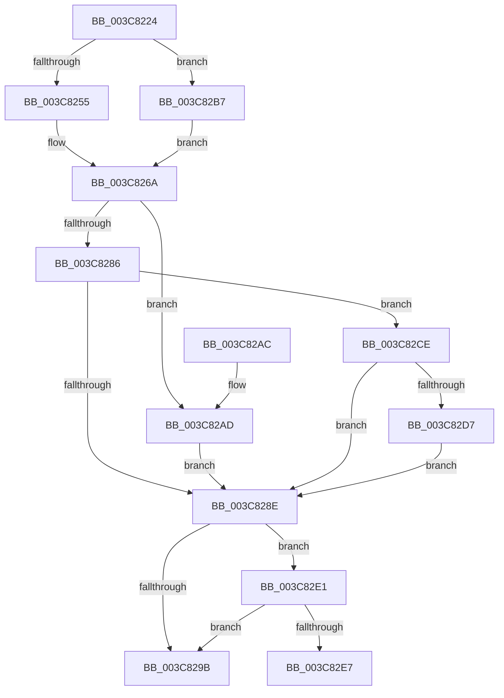

# MmOutSwapProcess

- RVA: `0x003C8224`–`0x003C831A` (길이 `246` bytes)
- VA: `0x00000001403C8224`
- 실행 섹션: `.text`
- PDB 이름 있음: `예`; PDB Function 태그: `예`
- unwind 정보 RVA: `0x0008E93C`
- 디코드: `73`개 명령, `246/246` bytes 표시
- 미해석 바이트: `0` (있으면 어셈블리에 `.byte`로 보존)

> 이 문서는 커널 이미지의 기계어와 PDB 기호를 분석해 생성했습니다. 4번과 5번은 함수 원형과 자료형을 바이너리 사용 방식에서 추정한 C 해석이며 원본 소스 복구 결과는 아닙니다.

## 1. Dependencies

- 직접 호출 지점: **3**; 고유 호출 대상: **3**
- 직접 호출자로 확인된 함수: **1**
- RIP 상대 이미지 참조: **4**

### Outgoing calls
- `0x003C82B0` → [MiReleaseOutSwappedProcessCommit](MiReleaseOutSwappedProcessCommit_function_003C8320.md) (function, `0x003C8320`)
- `0x003C82DA` → [MiReleaseCommitForResetPages](../66/MiReleaseCommitForResetPages_function_0066FAF8.md) (function, `0x0066FAF8`)
- `0x003C830F` → [ExAcquireSpinLockExclusive](../24/ExAcquireSpinLockExclusive_function_00248690.md) (function, `0x00248690`)

### Direct callers
- [KiOutSwapProcesses](KiOutSwapProcesses_function_003C8038.md) at `0x003C80F1`

### Static image references
- `0x003C8255` → RVA `0x00E38878` (`.data`; read)
- `0x003C825C` → RVA `0x00E38868` (`.data`; read)
- `0x003C8263` → RVA `0x00E38860` (`.data`; read)
- `0x003C82F5` → RVA `0x00E374C0` (`.data`; read)

## 2. Other-region calls and transfers

- 다른 실행 섹션으로 향하는 call: **0**
- call이 아닌 외부 분기/꼬리 이동: **1**
  - `0x003C8315` → [sub_006E82CE](../6E/Unknown_function_006E82CE.md) (`tail-transfer`)

## 3. Assembly (complete function range)

```asm
003C8224  40 55                           push rbp
003C8226  53                              push rbx
003C8227  56                              push rsi
003C8228  57                              push rdi
003C8229  41 54                           push r12
003C822B  41 55                           push r13
003C822D  41 56                           push r14
003C822F  41 57                           push r15
003C8231  48 8B EC                        mov rbp, rsp
003C8234  48 83 EC 48                     sub rsp, 0x48
003C8238  45 33 ED                        xor r13d, r13d
003C823B  48 8D B1 00 04 00 00            lea rsi, [rcx + 0x400]
003C8242  8B 86 B8 00 00 00               mov eax, dword ptr [rsi + 0xb8]
003C8248  48 8B F9                        mov rdi, rcx
003C824B  24 0F                           and al, 0xf
003C824D  44 88 6D DB                     mov byte ptr [rbp - 0x25], r13b
003C8251  3C 01                           cmp al, 1
003C8253  75 62                           jne 0x1403c82b7
003C8255  4C 8D 25 1C 06 A7 00            lea r12, [rip + 0xa7061c]
003C825C  48 8D 1D 05 06 A7 00            lea rbx, [rip + 0xa70605]
003C8263  48 8D 15 F6 05 A7 00            lea rdx, [rip + 0xa705f6]
003C826A  F0 83 89 F4 01 00 00 40         lock or dword ptr [rcx + 0x1f4], 0x40
003C8272  8B 8E B8 00 00 00               mov ecx, dword ptr [rsi + 0xb8]
003C8278  89 4D 48                        mov dword ptr [rbp + 0x48], ecx
003C827B  C1 E9 18                        shr ecx, 0x18
003C827E  8A C1                           mov al, cl
003C8280  24 30                           and al, 0x30
003C8282  3C 10                           cmp al, 0x10
003C8284  74 27                           je 0x1403c82ad
003C8286  80 E1 30                        and cl, 0x30
003C8289  80 F9 20                        cmp cl, 0x20
003C828C  74 40                           je 0x1403c82ce
003C828E  48 8B 86 90 00 00 00            mov rax, qword ptr [rsi + 0x90]
003C8295  48 83 F8 01                     cmp rax, 1
003C8299  74 46                           je 0x1403c82e1
003C829B  48 83 C4 48                     add rsp, 0x48
003C829F  41 5F                           pop r15
003C82A1  41 5E                           pop r14
003C82A3  41 5D                           pop r13
003C82A5  41 5C                           pop r12
003C82A7  5F                              pop rdi
003C82A8  5E                              pop rsi
003C82A9  5B                              pop rbx
003C82AA  5D                              pop rbp
003C82AB  C3                              ret
003C82AC  CC                              int3
003C82AD  48 8B CF                        mov rcx, rdi
003C82B0  E8 6B 00 00 00                  call 0x1403c8320
003C82B5  EB D7                           jmp 0x1403c828e
003C82B7  4C 8D A6 F8 00 00 00            lea r12, [rsi + 0xf8]
003C82BE  48 8D 9E E8 00 00 00            lea rbx, [rsi + 0xe8]
003C82C5  48 8D 96 E0 00 00 00            lea rdx, [rsi + 0xe0]
003C82CC  EB 9C                           jmp 0x1403c826a
003C82CE  48 8B 02                        mov rax, qword ptr [rdx]
003C82D1  4C 39 68 28                     cmp qword ptr [rax + 0x28], r13
003C82D5  74 B7                           je 0x1403c828e
003C82D7  48 8B CF                        mov rcx, rdi
003C82DA  E8 19 78 2A 00                  call 0x14066faf8
003C82DF  EB AD                           jmp 0x1403c828e
003C82E1  F6 45 4B 02                     test byte ptr [rbp + 0x4b], 2
003C82E5  75 B4                           jne 0x1403c829b
003C82E7  48 8D 45 E0                     lea rax, [rbp - 0x20]
003C82EB  66 C7 45 D8 07 01               mov word ptr [rbp - 0x28], 0x107
003C82F1  48 89 45 E8                     mov qword ptr [rbp - 0x18], rax
003C82F5  4C 8D 35 C4 F1 A6 00            lea r14, [rip + 0xa6f1c4]
003C82FC  48 8D 45 E0                     lea rax, [rbp - 0x20]
003C8300  C6 45 DA 06                     mov byte ptr [rbp - 0x26], 6
003C8304  49 8B CE                        mov rcx, r14
003C8307  48 89 45 E0                     mov qword ptr [rbp - 0x20], rax
003C830B  44 89 6D DC                     mov dword ptr [rbp - 0x24], r13d
003C830F  E8 7C 03 E8 FF                  call 0x140248690
003C8314  90                              nop
003C8315  E9 B4 FF 31 00                  jmp 0x1406e82ce
```

## 4. C-style interpretation (structured pseudocode)

```c
__int64 __fastcall MmOutSwapProcess(__int64 a1)
{
    __int64 result;
    __int64 v_r13;
    __int64 v_rsp;
    unsigned __int64 v_stack_m58;
    unsigned __int64 v_stack_m60;
    unsigned int v_stack_m64;
    unsigned __int8 v_stack_m65;
    unsigned __int8 v_stack_m66;
    unsigned __int16 v_stack_m68;
    unsigned int v_stack_p8;
    unsigned __int8 v_stack_pB;

    v_rsp = (v_rsp) - (72);
    v_r13 = 0;
    result = (unsigned __int8)(((unsigned int)(*(unsigned int *)(a1 + 1024 + 184))) & (15));
    v_stack_m65 = 0;
    if (((unsigned __int8)(result)) != 1) goto loc_003C82B7;
loc_003C826A:
    v_stack_p8 = (unsigned int)((unsigned int)(*(unsigned int *)(a1 + 1024 + 184)));
    a1 = (unsigned int)(((unsigned int)(*(unsigned int *)(a1 + 1024 + 184))) >> (24));
    result = (unsigned __int8)(((unsigned __int8)(a1)) & (48));
    if (((unsigned __int8)(result)) == 16) goto loc_003C82AD;
    a1 = (unsigned __int8)((a1) & (48));
    if (((unsigned __int8)(a1)) == 32) goto loc_003C82CE;
loc_003C828E:
    if ((*(unsigned __int64 *)(a1 + 1024 + 144)) == 1) goto loc_003C82E1;
loc_003C829B:
    v_rsp = (v_rsp) + (72);
    return *(unsigned __int64 *)(a1 + 1024 + 144);
loc_003C82AD:
    result = MiReleaseOutSwappedProcessCommit(a1, v_rip + 10946038, a3, a4);
    goto loc_003C828E;
loc_003C82B7:
    goto loc_003C826A;
loc_003C82CE:
    if ((*(unsigned __int64 *)(*(unsigned __int64 *)(a1 + 1024 + 224) + 40)) == 0) goto loc_003C828E;
    result = MiReleaseCommitForResetPages(a1, a1 + 1024 + 224, a3, a4);
    goto loc_003C828E;
loc_003C82E1:
    if (((v_stack_pB) & (2)) != 0) goto loc_003C829B;
    v_stack_m68 = 263;
    v_stack_m58 = v_stack_m60;
    v_stack_m66 = 6;
    v_stack_m60 = v_stack_m60;
    v_stack_m64 = 0;
    result = ExAcquireSpinLockExclusive(v_rip + 10940868, a1 + 1024 + 224, a3, a4);
}
```

## 5. (Beta) C Style

```c
int64_t MmOutSwapProcess(void *Arg1)
{
    uint8_t *arg1 = (uint8_t *)Arg1;

    int64_t result;
    int64_t local_r13;
    int64_t local_rsp;
    uint64_t v_stack_m58;
    uint64_t v_stack_m60;
    uint32_t v_stack_m64;
    uint8_t v_stack_m65;
    uint8_t v_stack_m66;
    uint16_t v_stack_m68;
    uint32_t v_stack_p8;
    uint8_t v_stack_pB;

    local_rsp = (local_rsp) - (72);
    local_r13 = 0;
    result = (uint8_t)(((uint32_t)(*(uint32_t *)(arg1 + 0x400 + 0xB8))) & (15));
    v_stack_m65 = 0;
    if (((uint8_t)(result)) != 1) goto loc_003C82B7;
loc_003C826A:
    v_stack_p8 = (uint32_t)((uint32_t)(*(uint32_t *)(arg1 + 0x400 + 0xB8)));
    Arg1 = (uint32_t)(((uint32_t)(*(uint32_t *)(arg1 + 0x400 + 0xB8))) >> (24));
    result = (uint8_t)(((uint8_t)(Arg1)) & (48));
    if (((uint8_t)(result)) == 16) goto loc_003C82AD;
    Arg1 = (uint8_t)((Arg1) & (48));
    if (((uint8_t)(Arg1)) == 32) goto loc_003C82CE;
loc_003C828E:
    if ((*(uint64_t *)(arg1 + 0x400 + 0x90)) == 1) goto loc_003C82E1;
loc_003C829B:
    local_rsp = (local_rsp) + (72);
    return *(uint64_t *)(arg1 + 0x400 + 0x90);
loc_003C82AD:
    result = MiReleaseOutSwappedProcessCommit(Arg1, v_rip + 10946038, a3, a4);
    goto loc_003C828E;
loc_003C82B7:
    goto loc_003C826A;
loc_003C82CE:
    if ((*(uint64_t *)(*(uint64_t *)(arg1 + 0x400 + 0xE0) + 0x28)) == 0) goto loc_003C828E;
    result = MiReleaseCommitForResetPages(Arg1, Arg1 + 1024 + 224, a3, a4);
    goto loc_003C828E;
loc_003C82E1:
    if (((v_stack_pB) & (2)) != 0) goto loc_003C829B;
    v_stack_m68 = 263;
    v_stack_m58 = v_stack_m60;
    v_stack_m66 = 6;
    v_stack_m60 = v_stack_m60;
    v_stack_m64 = 0;
    result = ExAcquireSpinLockExclusive(v_rip + 10940868, Arg1 + 1024 + 224, a3, a4);
}
```

### 관측된 메모리 오프셋

구조체 형식이 확인되지 않은 접근은 인자 기준의 오프셋으로만 기록했습니다.

| 기준 인자 | 오프셋 표현 | 폭 (bit) | 접근 |
|---|---:|---:|---|
| `Arg1` | `+ 0x90` | `64` | `R` |
| `Arg1` | `+ 0xB8` | `32` | `R` |
| `Arg1` | `+ 0xE0` | `64` | `R` |
| `Arg1` | `+ 0xE8` | `64` | `R` |
| `Arg1` | `+ 0xF8` | `64` | `R` |
| `Arg1` | `+ 0x1F4` | `32` | `R/W` |
| `Arg1` | `+ 0x400` | `64` | `R` |

## 6. Execution-region graph

[열기: 2D/3D 그래프와 함수 탐색 컨트롤 패널](../../../control-panel.html?section=text&rva=0x003C8224&view=graph)

- 2D 그래프는 위에서 아래로 흐르고, 3D 그래프는 빈 공간을 드래그해 회전합니다. Shift+드래그는 이동, 휠은 확대·축소, 함수 노드 선택은 대상 보고서 이동입니다.

### Static fallback


