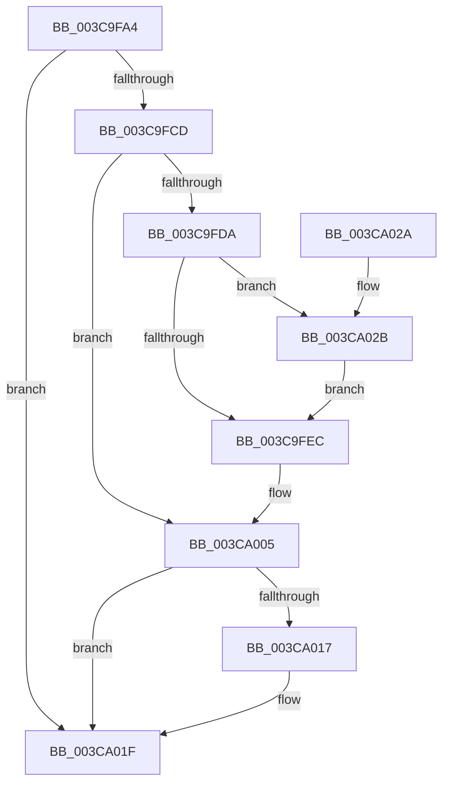

# MmUpdateSectionIoAttribution

- RVA: `0x003C9FA4`–`0x003CA034` (길이 `144` bytes)
- VA: `0x00000001403C9FA4`
- 실행 섹션: `.text`
- PDB 이름 있음: `예`; PDB Function 태그: `아니요`
- unwind 정보 RVA: `0x00060BE4`
- 디코드: `43`개 명령, `144/144` bytes 표시
- 미해석 바이트: `0` (있으면 어셈블리에 `.byte`로 보존)

> 이 문서는 커널 이미지의 기계어와 PDB 기호를 분석해 생성했습니다. 4번과 5번은 함수 원형과 자료형을 바이너리 사용 방식에서 추정한 C 해석이며 원본 소스 복구 결과는 아닙니다.

## 1. Dependencies

- 직접 호출 지점: **3**; 고유 호출 대상: **3**
- 직접 호출자로 확인된 함수: **1**
- RIP 상대 이미지 참조: **0**

### Outgoing calls
- `0x003C9FC0` → [MiLockSectionControlArea](../2B/MiLockSectionControlArea_function_002BC930.md) (function, `0x002BC930`)
- `0x003CA00D` → [MiReleaseSpinLockExclusive](../24/MiReleaseSpinLockExclusive_function_002482C0.md) (function, `0x002482C0`)
- `0x003CA01A` → [IoDiskIoAttributionDereference](../34/IoDiskIoAttributionDereference_function_00349978.md) (function, `0x00349978`)

### Direct callers
- [CcMapAndCopyInToCache](CcMapAndCopyInToCache_function_003CA7F0.md) at `0x003CB254`

### Static image references
- 디코드된 RIP-relative 메모리 참조가 없습니다.

## 2. Other-region calls and transfers

- 다른 실행 섹션으로 향하는 call: **0**
- 별도 외부 분기/꼬리 이동을 확인하지 못했습니다.

## 3. Assembly (complete function range)

```asm
003C9FA4  48 89 5C 24 08                  mov qword ptr [rsp + 8], rbx
003C9FA9  57                              push rdi
003C9FAA  48 83 EC 20                     sub rsp, 0x20
003C9FAE  48 8B FA                        mov rdi, rdx
003C9FB1  C6 44 24 40 00                  mov byte ptr [rsp + 0x40], 0
003C9FB6  33 DB                           xor ebx, ebx
003C9FB8  4C 8D 44 24 40                  lea r8, [rsp + 0x40]
003C9FBD  8D 53 01                        lea edx, [rbx + 1]
003C9FC0  E8 6B 29 EF FF                  call 0x1402bc930
003C9FC5  4C 8B C0                        mov r8, rax
003C9FC8  48 85 C0                        test rax, rax
003C9FCB  74 52                           je 0x1403ca01f
003C9FCD  48 8B 48 78                     mov rcx, qword ptr [rax + 0x78]
003C9FD1  48 83 E1 F8                     and rcx, 0xfffffffffffffff8
003C9FD5  48 3B F9                        cmp rdi, rcx
003C9FD8  74 2B                           je 0x1403ca005
003C9FDA  8D 4B 01                        lea ecx, [rbx + 1]
003C9FDD  F0 48 0F C1 4F 20               lock xadd qword ptr [rdi + 0x20], rcx
003C9FE3  48 FF C1                        inc rcx
003C9FE6  48 83 F9 01                     cmp rcx, 1
003C9FEA  7E 3F                           jle 0x1403ca02b
003C9FEC  48 8B 58 78                     mov rbx, qword ptr [rax + 0x78]
003C9FF0  48 8B C3                        mov rax, rbx
003C9FF3  48 33 C7                        xor rax, rdi
003C9FF6  48 83 E0 F8                     and rax, 0xfffffffffffffff8
003C9FFA  48 33 C3                        xor rax, rbx
003C9FFD  49 89 40 78                     mov qword ptr [r8 + 0x78], rax
003CA001  48 83 E3 F8                     and rbx, 0xfffffffffffffff8
003CA005  8A 54 24 40                     mov dl, byte ptr [rsp + 0x40]
003CA009  49 8D 48 48                     lea rcx, [r8 + 0x48]
003CA00D  E8 AE E2 E7 FF                  call 0x1402482c0
003CA012  48 85 DB                        test rbx, rbx
003CA015  74 08                           je 0x1403ca01f
003CA017  48 8B CB                        mov rcx, rbx
003CA01A  E8 59 F9 F7 FF                  call 0x140349978
003CA01F  48 8B 5C 24 30                  mov rbx, qword ptr [rsp + 0x30]
003CA024  48 83 C4 20                     add rsp, 0x20
003CA028  5F                              pop rdi
003CA029  C3                              ret
003CA02A  CC                              int3
003CA02B  B9 0E 00 00 00                  mov ecx, 0xe
003CA030  CD 29                           int 0x29
003CA032  EB B8                           jmp 0x1403c9fec
```

## 4. C-style interpretation (structured pseudocode)

```c
__int64 __fastcall MmUpdateSectionIoAttribution(__int64 a1, __int64 a2)
{
    __int64 result;
    __int64 v_rbx;
    __int64 v_rsp;
    unsigned __int8 v_stack_p18;
    unsigned __int64 v_stack_p8;

    v_stack_p8 = v_rbx;
    v_rsp = (v_rsp) - (32);
    v_stack_p18 = 0;
    v_rbx = 0;
    result = MiLockSectionControlArea(a1, v_rbx + 1, v_stack_p18, a4);
    if (result == 0) goto loc_003CA01F;
    a1 = (*(unsigned __int64 *)(result + 120)) & (-8);
    if (a2 == a1) goto loc_003CA005;
    a1 = (v_rbx + 1) + 1;
    if (a1 <= 1) goto loc_003CA02B;
loc_003C9FEC:
    result = (*(unsigned __int64 *)(result + 120)) ^ (a2);
    result = (result) & (-8);
    result = (result) ^ (*(unsigned __int64 *)(result + 120));
    *(unsigned __int64 *)(result + 120) = result;
    v_rbx = (*(unsigned __int64 *)(result + 120)) & (-8);
loc_003CA005:
    result = MiReleaseSpinLockExclusive(result + 72, v_stack_p18, result, a4);
    if (v_rbx != 0) {
        a1 = v_rbx;
        result = IoDiskIoAttributionDereference(a1, v_stack_p18, result, a4);
    }
    v_rsp = (v_rsp) + (32);
    return result;
loc_003CA02B:
    goto loc_003C9FEC;
}
```

## 5. (Beta) C Style

```c
int64_t MmUpdateSectionIoAttribution(int64_t Arg1, int64_t Arg2)
{
    int64_t result;
    int64_t local_rbx;
    int64_t local_rsp;
    uint8_t v_stack_p18;
    uint64_t v_stack_p8;

    v_stack_p8 = local_rbx;
    local_rsp = (local_rsp) - (32);
    v_stack_p18 = 0;
    local_rbx = 0;
    result = MiLockSectionControlArea(Arg1, local_rbx + 1, v_stack_p18, a4);
    if (result == 0) goto loc_003CA01F;
    Arg1 = (*(uint64_t *)(result + 0x78)) & (-8);
    if (Arg2 == Arg1) goto loc_003CA005;
    Arg1 = (local_rbx + 1) + 1;
    if (Arg1 <= 1) goto loc_003CA02B;
loc_003C9FEC:
    result = (*(uint64_t *)(result + 0x78)) ^ (Arg2);
    result = (result) & (-8);
    result = (result) ^ (*(uint64_t *)(result + 0x78));
    *(uint64_t *)(result + 0x78) = result;
    local_rbx = (*(uint64_t *)(result + 0x78)) & (-8);
loc_003CA005:
    result = MiReleaseSpinLockExclusive(result + 72, v_stack_p18, result, a4);
    if (local_rbx != 0) {
        Arg1 = local_rbx;
        result = IoDiskIoAttributionDereference(Arg1, v_stack_p18, result, a4);
    }
    local_rsp = (local_rsp) + (32);
    return result;
loc_003CA02B:
    goto loc_003C9FEC;
}
```

## 6. Execution-region graph

[열기: 2D/3D 그래프와 함수 탐색 컨트롤 패널](../../../control-panel.html?section=text&rva=0x003C9FA4&view=graph)

- 2D 그래프는 위에서 아래로 흐르고, 3D 그래프는 빈 공간을 드래그해 회전합니다. Shift+드래그는 이동, 휠은 확대·축소, 함수 노드 선택은 대상 보고서 이동입니다.

### Static fallback


