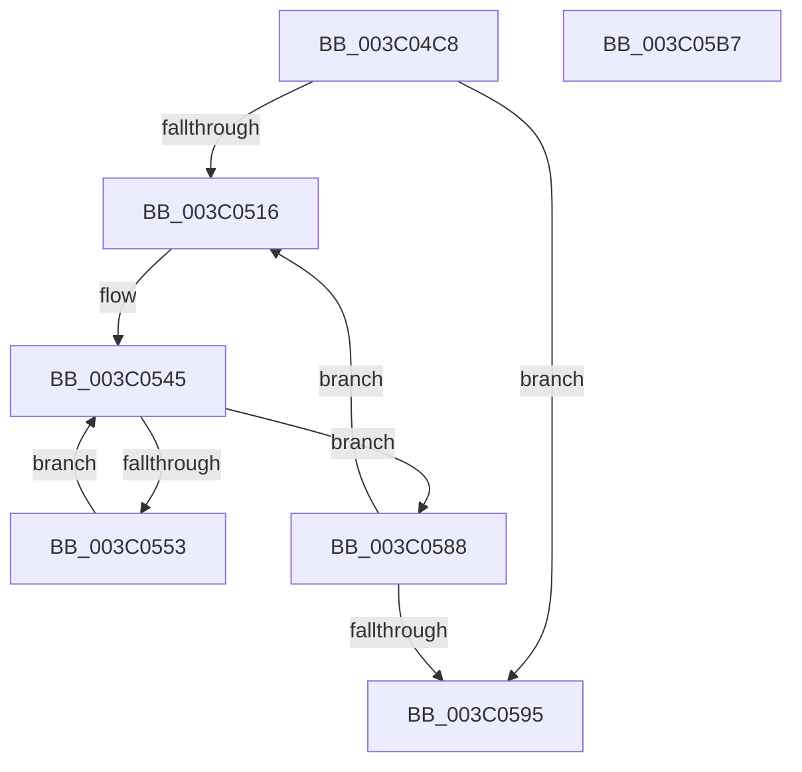

# PoCopyDeepIdleMask

- RVA: `0x003C04C8`–`0x003C05B8` (길이 `240` bytes)
- VA: `0x00000001403C04C8`
- 실행 섹션: `.text`
- PDB 이름 있음: `예`; PDB Function 태그: `아니요`
- unwind 정보 RVA: `0x0008DFA4`
- 디코드: `60`개 명령, `240/240` bytes 표시
- 미해석 바이트: `0` (있으면 어셈블리에 `.byte`로 보존)

> 이 문서는 커널 이미지의 기계어와 PDB 기호를 분석해 생성했습니다. 4번과 5번은 함수 원형과 자료형을 바이너리 사용 방식에서 추정한 C 해석이며 원본 소스 복구 결과는 아닙니다.

## 1. Dependencies

- 직접 호출 지점: **6**; 고유 호출 대상: **6**
- 직접 호출자로 확인된 함수: **7**
- RIP 상대 이미지 참조: **3**

### Outgoing calls
- `0x003C04FC` → [memset](../6C/memset_function_006C6C40.md) (function, `0x006C6C40`)
- `0x003C0540` → [RtlCopyVolatileMemory](../6B/RtlCopyVolatileMemory_function_006BC9D0.md) (function, `0x006BC9D0`)
- `0x003C054A` → [KeIsEmptyGroupMask](../25/KeIsEmptyGroupMask_function_002553B0.md) (function, `0x002553B0`)
- `0x003C0558` → [KeFindFirstSetRightGroupMask](../25/KeFindFirstSetRightGroupMask_function_00256BE4.md) (function, `0x00256BE4`)
- `0x003C0581` → [KeAddGroupAffinityEx](../25/KeAddGroupAffinityEx_function_0025B6C0.md) (function, `0x0025B6C0`)
- `0x003C059D` → [_security_check_cookie](../6A/_security_check_cookie_function_006AC640.md) (function, `0x006AC640`)

### Direct callers
- [PpmIdleSelectStates](../2C/PpmIdleSelectStates_function_002CFFE8.md) at `0x002D020A`
- [PpmCheckContinueExecution](../2D/PpmCheckContinueExecution_function_002D836C.md) at `0x002D844A`
- [KiForwardTick](../39/KiForwardTick_function_0039D40C.md) at `0x0039D497`
- [KiGetDeepIdleProcessors](KiGetDeepIdleProcessors_function_003C0268.md) at `0x003C029B`
- [KeFlushQueuedDpcs](KeFlushQueuedDpcs_function_003C0300.md) at `0x003C03B3`
- [PpmPostProcessMediaBuffering](../../page/A5/PpmPostProcessMediaBuffering_function_00A53004.md) at `0x00A53081`
- [sub_00B3B096](../../page/B3/Unknown_function_00B3B096.md) at `0x00B3B0BA`

### Static image references
- `0x003C04DC` → RVA `0x00E0A740` (`.data`; read)
- `0x003C0508` → RVA `0x00FC5000` (`ALMOSTRO`; read)
- `0x003C0518` → RVA `0x00FCF6C0` (`CACHEALI`; read)

## 2. Other-region calls and transfers

- 다른 실행 섹션으로 향하는 call: **0**
- 별도 외부 분기/꼬리 이동을 확인하지 못했습니다.

## 3. Assembly (complete function range)

```asm
003C04C8  48 89 5C 24 10                  mov qword ptr [rsp + 0x10], rbx
003C04CD  48 89 6C 24 18                  mov qword ptr [rsp + 0x18], rbp
003C04D2  48 89 74 24 20                  mov qword ptr [rsp + 0x20], rsi
003C04D7  57                              push rdi
003C04D8  48 83 EC 40                     sub rsp, 0x40
003C04DC  48 8B 05 5D A2 A4 00            mov rax, qword ptr [rip + 0xa4a25d]
003C04E3  48 33 C4                        xor rax, rsp
003C04E6  48 89 44 24 38                  mov qword ptr [rsp + 0x38], rax
003C04EB  44 0F B7 01                     movzx r8d, word ptr [rcx]
003C04EF  48 8B F9                        mov rdi, rcx
003C04F2  49 C1 E0 03                     shl r8, 3
003C04F6  48 83 C1 08                     add rcx, 8
003C04FA  33 D2                           xor edx, edx
003C04FC  E8 3F 67 30 00                  call 0x1406c6c40
003C0501  33 F6                           xor esi, esi
003C0503  BD 01 00 00 00                  mov ebp, 1
003C0508  66 3B 35 F1 4A C0 00            cmp si, word ptr [rip + 0xc04af1]
003C050F  8B DE                           mov ebx, esi
003C0511  66 89 2F                        mov word ptr [rdi], bp
003C0514  73 7F                           jae 0x1403c0595
003C0516  8B C3                           mov eax, ebx
003C0518  48 8D 15 A1 F1 C0 00            lea rdx, [rip + 0xc0f1a1]
003C051F  0F 57 C0                        xorps xmm0, xmm0
003C0522  48 8D 4C 24 28                  lea rcx, [rsp + 0x28]
003C0527  41 B8 10 00 00 00               mov r8d, 0x10
003C052D  F3 0F 7F 44 24 28               movdqu xmmword ptr [rsp + 0x28], xmm0
003C0533  48 8B 14 C2                     mov rdx, qword ptr [rdx + rax*8]
003C0537  48 89 54 24 20                  mov qword ptr [rsp + 0x20], rdx
003C053C  48 83 C2 10                     add rdx, 0x10
003C0540  E8 8B C4 2F 00                  call 0x1406bc9d0
003C0545  48 8D 4C 24 28                  lea rcx, [rsp + 0x28]
003C054A  E8 61 4E E9 FF                  call 0x1402553b0
003C054F  85 C0                           test eax, eax
003C0551  75 35                           jne 0x1403c0588
003C0553  48 8D 4C 24 28                  lea rcx, [rsp + 0x28]
003C0558  E8 87 66 E9 FF                  call 0x140256be4
003C055D  0F B7 D0                        movzx edx, ax
003C0560  48 8B CF                        mov rcx, rdi
003C0563  48 8D 44 24 28                  lea rax, [rsp + 0x28]
003C0568  48 0F B3 10                     btr qword ptr [rax], rdx
003C056C  48 8B 44 24 20                  mov rax, qword ptr [rsp + 0x20]
003C0571  48 8B 54 D0 20                  mov rdx, qword ptr [rax + rdx*8 + 0x20]
003C0576  4C 8B 42 40                     mov r8, qword ptr [rdx + 0x40]
003C057A  0F B7 92 88 00 00 00            movzx edx, word ptr [rdx + 0x88]
003C0581  E8 3A B1 E9 FF                  call 0x14025b6c0
003C0586  EB BD                           jmp 0x1403c0545
003C0588  0F B7 05 71 4A C0 00            movzx eax, word ptr [rip + 0xc04a71]
003C058F  03 DD                           add ebx, ebp
003C0591  3B D8                           cmp ebx, eax
003C0593  72 81                           jb 0x1403c0516
003C0595  48 8B 4C 24 38                  mov rcx, qword ptr [rsp + 0x38]
003C059A  48 33 CC                        xor rcx, rsp
003C059D  E8 9E C0 2E 00                  call 0x1406ac640
003C05A2  48 8B 5C 24 58                  mov rbx, qword ptr [rsp + 0x58]
003C05A7  48 8B 6C 24 60                  mov rbp, qword ptr [rsp + 0x60]
003C05AC  48 8B 74 24 68                  mov rsi, qword ptr [rsp + 0x68]
003C05B1  48 83 C4 40                     add rsp, 0x40
003C05B5  5F                              pop rdi
003C05B6  C3                              ret
003C05B7  CC                              int3
```

## 4. C-style interpretation (structured pseudocode)

```c
__int64 __fastcall PoCopyDeepIdleMask(__int64 a1, int a2)
{
    __int64 result;
    __int64 v_rbx;
    __int64 v_rsi;
    __int64 v_rsp;
    unsigned __int64 v_stack_m10;
    unsigned __int64 v_stack_m20;
    unsigned __int64 v_stack_m28;
    unsigned __int64 v_stack_p10;
    unsigned __int64 v_stack_p18;
    unsigned __int64 v_stack_p20;

    v_stack_p10 = v_rbx;
    v_stack_p18 = v_rbp;
    v_stack_p20 = v_rsi;
    v_rsp = (v_rsp) - (64);
    result = (*(unsigned __int64 *)(v_rip + 10789469)) ^ (v_rsp);
    v_stack_m10 = result;
    a3 = (*(unsigned __int16 *)(a1)) << (3);
    a1 = (a1) + (8);
    a2 = 0;
    result = memset(a1, a2, a3, a4);
    v_rsi = 0;
    *(unsigned __int16 *)(a1) = 1;
    if (0 >= (*(unsigned __int16 *)(v_rip + 12602097))) goto loc_003C0595;
loc_003C0516:
    v_stack_m20 = v_xmm0;
    v_stack_m28 = *(unsigned __int64 *)(v_rip + 12644769 + 0 * 8);
    a2 = (*(unsigned __int64 *)(v_rip + 12644769 + 0 * 8)) + (16);
    result = RtlCopyVolatileMemory(v_stack_m20, a2, 16, a4);
loc_003C0545:
    result = KeIsEmptyGroupMask(v_stack_m20, a2, 16, a4);
    if ((unsigned int)(result) != 0) goto loc_003C0588;
    result = KeFindFirstSetRightGroupMask(v_stack_m20, a2, 16, a4);
    result = KeAddGroupAffinityEx(a1, *(unsigned __int16 *)(*(unsigned __int64 *)(v_stack_m28 + (unsigned __int16)(result) * 8 + 32) + 136), *(unsigned __int64 *)(*(unsigned __int64 *)(v_stack_m28 + (unsigned __int16)(result) * 8 + 32) + 64), a4);
    goto loc_003C0545;
loc_003C0588:
    v_rbx = (unsigned int)((0) + (1));
    if (((unsigned int)(v_rbx)) < ((unsigned int)(*(unsigned __int16 *)(v_rip + 12601969)))) goto loc_003C0516;
loc_003C0595:
    a1 = (v_stack_m10) ^ (v_rsp);
    result = _security_check_cookie(a1, *(unsigned __int16 *)(*(unsigned __int64 *)(v_stack_m28 + (unsigned __int16)(result) * 8 + 32) + 136), *(unsigned __int64 *)(*(unsigned __int64 *)(v_stack_m28 + (unsigned __int16)(result) * 8 + 32) + 64), a4);
    v_rsp = (v_rsp) + (64);
    return result;
}
```

## 5. (Beta) C Style

```c
int64_t PoCopyDeepIdleMask(void *Arg1, int32_t Arg2)
{
    uint8_t *arg1 = (uint8_t *)Arg1;

    int64_t result;
    int64_t local_rbx;
    int64_t local_rsi;
    int64_t local_rsp;
    uint64_t v_stack_m10;
    uint64_t v_stack_m20;
    uint64_t v_stack_m28;
    uint64_t v_stack_p10;
    uint64_t v_stack_p18;
    uint64_t v_stack_p20;

    v_stack_p10 = local_rbx;
    v_stack_p18 = local_rbp;
    v_stack_p20 = local_rsi;
    local_rsp = (local_rsp) - (64);
    result = (*(uint64_t *)(v_rip + 0xA4A25D)) ^ (local_rsp);
    v_stack_m10 = result;
    a3 = (*(uint16_t *)(arg1)) << (3);
    Arg1 = (Arg1) + (8);
    Arg2 = 0;
    result = memset(Arg1, Arg2, a3, a4);
    local_rsi = 0;
    *(uint16_t *)(arg1) = 1;
    if (0 >= (*(uint16_t *)(v_rip + 0xC04AF1))) goto loc_003C0595;
loc_003C0516:
    v_stack_m20 = v_xmm0;
    v_stack_m28 = *(uint64_t *)(v_rip + 0xC0F1A1 + 0x0 * 8);
    Arg2 = (*(uint64_t *)(v_rip + 0xC0F1A1 + 0x0 * 8)) + (16);
    result = RtlCopyVolatileMemory(v_stack_m20, Arg2, 16, a4);
loc_003C0545:
    result = KeIsEmptyGroupMask(v_stack_m20, Arg2, 16, a4);
    if ((uint32_t)(result) != 0) goto loc_003C0588;
    result = KeFindFirstSetRightGroupMask(v_stack_m20, Arg2, 16, a4);
    result = KeAddGroupAffinityEx(Arg1, *(uint16_t *)(*(uint64_t *)(v_stack_m28 + (uint16_t)(result) * 8 + 0x20) + 0x88), *(uint64_t *)(*(uint64_t *)(v_stack_m28 + (uint16_t)(result) * 8 + 0x20) + 0x40), a4);
    goto loc_003C0545;
loc_003C0588:
    local_rbx = (uint32_t)((0) + (1));
    if (((uint32_t)(local_rbx)) < ((uint32_t)(*(uint16_t *)(v_rip + 0xC04A71)))) goto loc_003C0516;
loc_003C0595:
    Arg1 = (v_stack_m10) ^ (local_rsp);
    result = _security_check_cookie(Arg1, *(uint16_t *)(*(uint64_t *)(v_stack_m28 + (uint16_t)(result) * 8 + 0x20) + 0x88), *(uint64_t *)(*(uint64_t *)(v_stack_m28 + (uint16_t)(result) * 8 + 0x20) + 0x40), a4);
    local_rsp = (local_rsp) + (64);
    return result;
}
```

### 관측된 메모리 오프셋

구조체 형식이 확인되지 않은 접근은 인자 기준의 오프셋으로만 기록했습니다.

| 기준 인자 | 오프셋 표현 | 폭 (bit) | 접근 |
|---|---:|---:|---|
| `Arg1` | `+ 0x0` | `16` | `R` |
| `Arg1` | `+ 0x0` | `16` | `W` |

## 6. Execution-region graph

[열기: 2D/3D 그래프와 함수 탐색 컨트롤 패널](../../../control-panel.html?section=text&rva=0x003C04C8&view=graph)

- 2D 그래프는 위에서 아래로 흐르고, 3D 그래프는 빈 공간을 드래그해 회전합니다. Shift+드래그는 이동, 휠은 확대·축소, 함수 노드 선택은 대상 보고서 이동입니다.

### Static fallback


