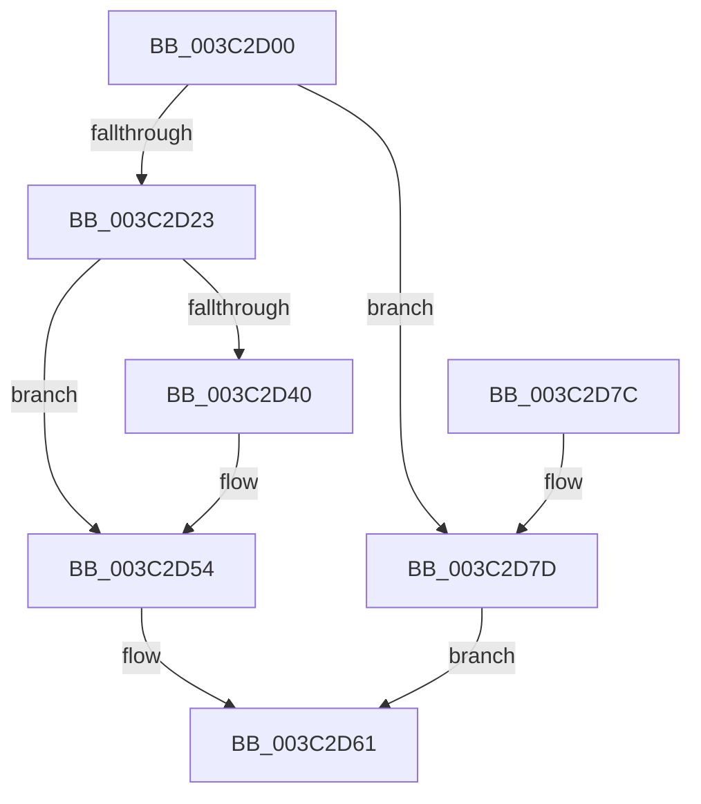

# PsAdjustWin32kPriorityFloor

- RVA: `0x003C2D00`–`0x003C2D86` (길이 `134` bytes)
- VA: `0x00000001403C2D00`
- 실행 섹션: `.text`
- PDB 이름 있음: `예`; PDB Function 태그: `아니요`
- unwind 정보 RVA: `0x0008E26C`
- 디코드: `37`개 명령, `134/134` bytes 표시
- 미해석 바이트: `0` (있으면 어셈블리에 `.byte`로 보존)

> 이 문서는 커널 이미지의 기계어와 PDB 기호를 분석해 생성했습니다. 4번과 5번은 함수 원형과 자료형을 바이너리 사용 방식에서 추정한 C 해석이며 원본 소스 복구 결과는 아닙니다.

## 1. Dependencies

- 직접 호출 지점: **3**; 고유 호출 대상: **3**
- 직접 호출자로 확인된 함수: **0**
- RIP 상대 이미지 참조: **0**

### Outgoing calls
- `0x003C2D2D` → [KeAcquireSpinLockRaiseToDpc](../20/KeAcquireSpinLockRaiseToDpc_function_00208470.md) (function, `0x00208470`)
- `0x003C2D48` → [KeAdjustPriorityFloor](KeAdjustPriorityFloor_function_003C3574.md) (function, `0x003C3574`)
- `0x003C2D5A` → [KeReleaseSpinLock](../39/KeReleaseSpinLock_function_00392BA0.md) (function, `0x00392BA0`)

### Direct callers
- 이 함수 시작 RVA로 연결되는 직접 call은 확인되지 않았습니다. 간접 호출은 완전히 역산할 수 없습니다.

### Static image references
- 디코드된 RIP-relative 메모리 참조가 없습니다.

## 2. Other-region calls and transfers

- 다른 실행 섹션으로 향하는 call: **0**
- 별도 외부 분기/꼬리 이동을 확인하지 못했습니다.

## 3. Assembly (complete function range)

```asm
003C2D00  48 8B C4                        mov rax, rsp
003C2D03  48 89 58 08                     mov qword ptr [rax + 8], rbx
003C2D07  48 89 68 10                     mov qword ptr [rax + 0x10], rbp
003C2D0B  48 89 70 18                     mov qword ptr [rax + 0x18], rsi
003C2D0F  48 89 78 20                     mov qword ptr [rax + 0x20], rdi
003C2D13  41 56                           push r14
003C2D15  48 83 EC 20                     sub rsp, 0x20
003C2D19  8B FA                           mov edi, edx
003C2D1B  48 8B D9                        mov rbx, rcx
003C2D1E  83 FA 10                        cmp edx, 0x10
003C2D21  77 5A                           ja 0x1403c2d7d
003C2D23  48 8D A9 78 07 00 00            lea rbp, [rcx + 0x778]
003C2D2A  48 8B CD                        mov rcx, rbp
003C2D2D  E8 3E 57 E4 FF                  call 0x140208470
003C2D32  0F BE B3 23 07 00 00            movsx esi, byte ptr [rbx + 0x723]
003C2D39  44 8A F0                        mov r14b, al
003C2D3C  3B F7                           cmp esi, edi
003C2D3E  74 14                           je 0x1403c2d54
003C2D40  44 8B C7                        mov r8d, edi
003C2D43  8B D6                           mov edx, esi
003C2D45  48 8B CB                        mov rcx, rbx
003C2D48  E8 27 08 00 00                  call 0x1403c3574
003C2D4D  40 88 BB 23 07 00 00            mov byte ptr [rbx + 0x723], dil
003C2D54  41 8A D6                        mov dl, r14b
003C2D57  48 8B CD                        mov rcx, rbp
003C2D5A  E8 41 FE FC FF                  call 0x140392ba0
003C2D5F  8B C6                           mov eax, esi
003C2D61  48 8B 5C 24 30                  mov rbx, qword ptr [rsp + 0x30]
003C2D66  48 8B 6C 24 38                  mov rbp, qword ptr [rsp + 0x38]
003C2D6B  48 8B 74 24 40                  mov rsi, qword ptr [rsp + 0x40]
003C2D70  48 8B 7C 24 48                  mov rdi, qword ptr [rsp + 0x48]
003C2D75  48 83 C4 20                     add rsp, 0x20
003C2D79  41 5E                           pop r14
003C2D7B  C3                              ret
003C2D7C  CC                              int3
003C2D7D  0F BE 81 23 07 00 00            movsx eax, byte ptr [rcx + 0x723]
003C2D84  EB DB                           jmp 0x1403c2d61
```

## 4. C-style interpretation (structured pseudocode)

```c
__int64 __fastcall PsAdjustWin32kPriorityFloor(__int64 a1, int a2)
{
    __int64 result;
    __int64 v_rsp;
    unsigned __int64 v_stack_p10;
    unsigned __int64 v_stack_p18;
    unsigned __int64 v_stack_p20;
    unsigned __int64 v_stack_p8;

    *(unsigned __int64 *)(v_rsp + 8) = v_rbx;
    *(unsigned __int64 *)(v_rsp + 16) = v_rbp;
    *(unsigned __int64 *)(v_rsp + 24) = v_rsi;
    *(unsigned __int64 *)(v_rsp + 32) = v_rdi;
    v_rsp = (v_rsp) - (32);
    if (a2 > 16) goto loc_003C2D7D;
    result = KeAcquireSpinLockRaiseToDpc(a1 + 1912, a2, a3, a4);
    if (((unsigned int)((__int8)(*(unsigned __int8 *)(a1 + 1827)))) != ((unsigned int)((unsigned int)(a2)))) {
        a3 = (unsigned int)((unsigned int)(a2));
        a2 = (unsigned int)((__int8)(*(unsigned __int8 *)(a1 + 1827)));
        a1 = a1;
        result = KeAdjustPriorityFloor(a1, a2, a3, a4);
        *(unsigned __int8 *)(a1 + 1827) = (unsigned __int8)((unsigned int)(a2));
    }
    result = KeReleaseSpinLock(a1 + 1912, (unsigned __int8)((unsigned __int8)(result)), a3, a4);
loc_003C2D61:
    v_rsp = (v_rsp) + (32);
    return (unsigned int)((unsigned int)((__int8)(*(unsigned __int8 *)(a1 + 1827))));
loc_003C2D7D:
    goto loc_003C2D61;
}
```

## 5. (Beta) C Style

```c
int64_t PsAdjustWin32kPriorityFloor(void *Arg1, int32_t Arg2)
{
    uint8_t *arg1 = (uint8_t *)Arg1;

    int64_t result;
    int64_t local_rsp;
    uint64_t v_stack_p10;
    uint64_t v_stack_p18;
    uint64_t v_stack_p20;
    uint64_t v_stack_p8;

    *(uint64_t *)(local_rsp + 0x8) = local_rbx;
    *(uint64_t *)(local_rsp + 0x10) = local_rbp;
    *(uint64_t *)(local_rsp + 0x18) = local_rsi;
    *(uint64_t *)(local_rsp + 0x20) = local_rdi;
    local_rsp = (local_rsp) - (32);
    if (Arg2 > 16) goto loc_003C2D7D;
    result = KeAcquireSpinLockRaiseToDpc(Arg1 + 1912, Arg2, a3, a4);
    if (((uint32_t)((int8_t)(*(uint8_t *)(arg1 + 0x723)))) != ((uint32_t)((uint32_t)(Arg2)))) {
        a3 = (uint32_t)((uint32_t)(Arg2));
        Arg2 = (uint32_t)((int8_t)(*(uint8_t *)(arg1 + 0x723)));
        Arg1 = Arg1;
        result = KeAdjustPriorityFloor(Arg1, Arg2, a3, a4);
        *(uint8_t *)(arg1 + 0x723) = (uint8_t)((uint32_t)(Arg2));
    }
    result = KeReleaseSpinLock(Arg1 + 1912, (uint8_t)((uint8_t)(result)), a3, a4);
loc_003C2D61:
    local_rsp = (local_rsp) + (32);
    return (uint32_t)((uint32_t)((int8_t)(*(uint8_t *)(arg1 + 0x723))));
loc_003C2D7D:
    goto loc_003C2D61;
}
```

### 관측된 메모리 오프셋

구조체 형식이 확인되지 않은 접근은 인자 기준의 오프셋으로만 기록했습니다.

| 기준 인자 | 오프셋 표현 | 폭 (bit) | 접근 |
|---|---:|---:|---|
| `Arg1` | `+ 0x723` | `8` | `R` |
| `Arg1` | `+ 0x723` | `8` | `W` |
| `Arg1` | `+ 0x778` | `64` | `R` |

## 6. Execution-region graph

[열기: 2D/3D 그래프와 함수 탐색 컨트롤 패널](../../../control-panel.html?section=text&rva=0x003C2D00&view=graph)

- 2D 그래프는 위에서 아래로 흐르고, 3D 그래프는 빈 공간을 드래그해 회전합니다. Shift+드래그는 이동, 휠은 확대·축소, 함수 노드 선택은 대상 보고서 이동입니다.

### Static fallback


