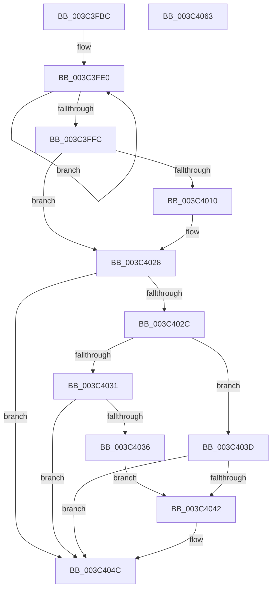

# PsSetIoPriorityThread

- RVA: `0x003C3FBC`–`0x003C4064` (길이 `168` bytes)
- VA: `0x00000001403C3FBC`
- 실행 섹션: `.text`
- PDB 이름 있음: `예`; PDB Function 태그: `아니요`
- unwind 정보 RVA: `0x00066400`
- 디코드: `49`개 명령, `168/168` bytes 표시
- 미해석 바이트: `0` (있으면 어셈블리에 `.byte`로 보존)

> 이 문서는 커널 이미지의 기계어와 PDB 기호를 분석해 생성했습니다. 4번과 5번은 함수 원형과 자료형을 바이너리 사용 방식에서 추정한 C 해석이며 원본 소스 복구 결과는 아닙니다.

## 1. Dependencies

- 직접 호출 지점: **2**; 고유 호출 대상: **2**
- 직접 호출자로 확인된 함수: **6**
- RIP 상대 이미지 참조: **1**

### Outgoing calls
- `0x003C4023` → [EtwTracePriority](EtwTracePriority_function_003C41A4.md) (function, `0x003C41A4`)
- `0x003C4047` → [KeAbProcessBaseIoPriorityChangeInternal](KeAbProcessBaseIoPriorityChangeInternal_function_003C406C.md) (function, `0x003C406C`)

### Direct callers
- [IoSetIoPriorityHintIntoThread](IoSetIoPriorityHintIntoThread_function_003C3A80.md) at `0x003C3A89`
- [IoApplyPriorityInfoThread](IoApplyPriorityInfoThread_function_003C3EC0.md) at `0x003C3EF0`
- [CmpSetIoPriorityThread](../4B/CmpSetIoPriorityThread_function_004B8298.md) at `0x004B829C`
- [sub_006F937E](../6F/Unknown_function_006F937E.md) at `0x006F9423`
- [sub_006F937E](../6F/Unknown_function_006F937E.md) at `0x006F94A8`
- [NtSetInformationThread](../../page/8C/NtSetInformationThread_function_008C9F60.md) at `0x008CAE6D`
- [NtSetInformationProcess](../../page/AE/NtSetInformationProcess_function_00AE5370.md) at `0x00AE6B06`

### Static image references
- `0x003C4004` → RVA `0x00FC6B04` (`ALMOSTRO`; read)

## 2. Other-region calls and transfers

- 다른 실행 섹션으로 향하는 call: **0**
- 별도 외부 분기/꼬리 이동을 확인하지 못했습니다.

## 3. Assembly (complete function range)

```asm
003C3FBC  48 89 5C 24 08                  mov qword ptr [rsp + 8], rbx
003C3FC1  48 89 6C 24 10                  mov qword ptr [rsp + 0x10], rbp
003C3FC6  48 89 74 24 18                  mov qword ptr [rsp + 0x18], rsi
003C3FCB  57                              push rdi
003C3FCC  48 83 EC 30                     sub rsp, 0x30
003C3FD0  48 8B F1                        mov rsi, rcx
003C3FD3  8B FA                           mov edi, edx
003C3FD5  8B CA                           mov ecx, edx
003C3FD7  C1 E1 09                        shl ecx, 9
003C3FDA  8B 86 A0 05 00 00               mov eax, dword ptr [rsi + 0x5a0]
003C3FE0  44 8B C0                        mov r8d, eax
003C3FE3  8B D8                           mov ebx, eax
003C3FE5  41 81 E0 FF F1 FF FF            and r8d, 0xfffff1ff
003C3FEC  44 0B C1                        or r8d, ecx
003C3FEF  F0 44 0F B1 86 A0 05 00 00      lock cmpxchg dword ptr [rsi + 0x5a0], r8d
003C3FF8  3B C3                           cmp eax, ebx
003C3FFA  75 E4                           jne 0x1403c3fe0
003C3FFC  C1 EB 09                        shr ebx, 9
003C3FFF  33 ED                           xor ebp, ebp
003C4001  83 E3 07                        and ebx, 7
003C4004  F7 05 F6 2A C0 00 00 20 00 00   test dword ptr [rip + 0xc02af6], 0x2000
003C400E  74 18                           je 0x1403c4028
003C4010  BA 34 05 00 00                  mov edx, 0x534
003C4015  48 89 6C 24 20                  mov qword ptr [rsp + 0x20], rbp
003C401A  44 8B CF                        mov r9d, edi
003C401D  44 8B C3                        mov r8d, ebx
003C4020  48 8B CE                        mov rcx, rsi
003C4023  E8 7C 01 00 00                  call 0x1403c41a4
003C4028  3B FB                           cmp edi, ebx
003C402A  74 20                           je 0x1403c404c
003C402C  83 FF 02                        cmp edi, 2
003C402F  7C 0C                           jl 0x1403c403d
003C4031  83 FB 02                        cmp ebx, 2
003C4034  73 16                           jae 0x1403c404c
003C4036  BD 01 00 00 00                  mov ebp, 1
003C403B  EB 05                           jmp 0x1403c4042
003C403D  83 FB 02                        cmp ebx, 2
003C4040  72 0A                           jb 0x1403c404c
003C4042  8B D5                           mov edx, ebp
003C4044  48 8B CE                        mov rcx, rsi
003C4047  E8 20 00 00 00                  call 0x1403c406c
003C404C  48 8B 6C 24 48                  mov rbp, qword ptr [rsp + 0x48]
003C4051  8B C3                           mov eax, ebx
003C4053  48 8B 5C 24 40                  mov rbx, qword ptr [rsp + 0x40]
003C4058  48 8B 74 24 50                  mov rsi, qword ptr [rsp + 0x50]
003C405D  48 83 C4 30                     add rsp, 0x30
003C4061  5F                              pop rdi
003C4062  C3                              ret
003C4063  CC                              int3
```

## 4. C-style interpretation (structured pseudocode)

```c
__int64 __fastcall PsSetIoPriorityThread(__int64 a1, int a2)
{
    __int64 result;
    __int64 v_rbp;
    __int64 v_rbx;
    __int64 v_rsp;
    unsigned __int64 v_stack_m18;
    unsigned __int64 v_stack_p10;
    unsigned __int64 v_stack_p18;
    unsigned __int64 v_stack_p8;

    v_stack_p8 = v_rbx;
    v_stack_p10 = v_rbp;
    v_stack_p18 = v_rsi;
    v_rsp = (v_rsp) - (48);
    a1 = (unsigned int)(((unsigned int)(a2)) << (9));
loc_003C3FE0:
    a3 = (unsigned int)(((unsigned int)((unsigned int)((unsigned int)(*(unsigned int *)(a1 + 1440))))) & (0xFFFFF1FFULL));
    a3 = (unsigned int)((a3) | ((unsigned int)(a1)));
    if (((unsigned int)((unsigned int)(*(unsigned int *)(a1 + 1440)))) != ((unsigned int)((unsigned int)((unsigned int)((unsigned int)(*(unsigned int *)(a1 + 1440))))))) goto loc_003C3FE0;
    v_rbx = (unsigned int)(((unsigned int)((unsigned int)((unsigned int)(*(unsigned int *)(a1 + 1440))))) >> (9));
    v_rbp = 0;
    v_rbx = (unsigned int)((v_rbx) & (7));
    result = (unsigned int)(*(unsigned int *)(a1 + 1440));
    if (((*(unsigned int *)(v_rip + 12593910)) & (0x2000ULL)) != 0) {
        a2 = 0x534ULL;
        v_stack_m18 = 0;
        a4 = (unsigned int)((unsigned int)(a2));
        a3 = (unsigned int)(v_rbx);
        a1 = a1;
        result = EtwTracePriority(a1, a2, a3, a4);
    }
    if (((unsigned int)((unsigned int)(a2))) == ((unsigned int)(v_rbx))) goto loc_003C404C;
    if (((unsigned int)((unsigned int)(a2))) < 2) goto loc_003C403D;
    if (((unsigned int)(v_rbx)) >= 2) goto loc_003C404C;
    goto loc_003C4042;
loc_003C403D:
    if (((unsigned int)(v_rbx)) >= 2) {
        a2 = 1;
        a1 = a1;
        result = KeAbProcessBaseIoPriorityChangeInternal(a1, a2, a3, a4);
    }
    v_rsp = (v_rsp) + (48);
    return (unsigned int)((unsigned int)(v_rbx));
}
```

## 5. (Beta) C Style

```c
int64_t PsSetIoPriorityThread(void *Arg1, int32_t Arg2)
{
    uint8_t *arg1 = (uint8_t *)Arg1;

    int64_t result;
    int64_t local_rbp;
    int64_t local_rbx;
    int64_t local_rsp;
    uint64_t v_stack_m18;
    uint64_t v_stack_p10;
    uint64_t v_stack_p18;
    uint64_t v_stack_p8;

    v_stack_p8 = local_rbx;
    v_stack_p10 = local_rbp;
    v_stack_p18 = local_rsi;
    local_rsp = (local_rsp) - (48);
    Arg1 = (uint32_t)(((uint32_t)(Arg2)) << (9));
loc_003C3FE0:
    a3 = (uint32_t)(((uint32_t)((uint32_t)((uint32_t)(*(uint32_t *)(arg1 + 0x5A0))))) & (0xFFFFF1FFULL));
    a3 = (uint32_t)((a3) | ((uint32_t)(Arg1)));
    if (((uint32_t)((uint32_t)(*(uint32_t *)(arg1 + 0x5A0)))) != ((uint32_t)((uint32_t)((uint32_t)((uint32_t)(*(uint32_t *)(arg1 + 0x5A0))))))) goto loc_003C3FE0;
    local_rbx = (uint32_t)(((uint32_t)((uint32_t)((uint32_t)(*(uint32_t *)(arg1 + 0x5A0))))) >> (9));
    local_rbp = 0;
    local_rbx = (uint32_t)((local_rbx) & (7));
    result = (uint32_t)(*(uint32_t *)(arg1 + 0x5A0));
    if (((*(uint32_t *)(v_rip + 0xC02AF6)) & (0x2000ULL)) != 0) {
        Arg2 = 0x534ULL;
        v_stack_m18 = 0;
        a4 = (uint32_t)((uint32_t)(Arg2));
        a3 = (uint32_t)(local_rbx);
        Arg1 = Arg1;
        result = EtwTracePriority(Arg1, Arg2, a3, a4);
    }
    if (((uint32_t)((uint32_t)(Arg2))) == ((uint32_t)(local_rbx))) goto loc_003C404C;
    if (((uint32_t)((uint32_t)(Arg2))) < 2) goto loc_003C403D;
    if (((uint32_t)(local_rbx)) >= 2) goto loc_003C404C;
    goto loc_003C4042;
loc_003C403D:
    if (((uint32_t)(local_rbx)) >= 2) {
        Arg2 = 1;
        Arg1 = Arg1;
        result = KeAbProcessBaseIoPriorityChangeInternal(Arg1, Arg2, a3, a4);
    }
    local_rsp = (local_rsp) + (48);
    return (uint32_t)((uint32_t)(local_rbx));
}
```

### 관측된 메모리 오프셋

구조체 형식이 확인되지 않은 접근은 인자 기준의 오프셋으로만 기록했습니다.

| 기준 인자 | 오프셋 표현 | 폭 (bit) | 접근 |
|---|---:|---:|---|
| `Arg1` | `+ 0x5A0` | `32` | `R` |

## 6. Execution-region graph

[열기: 2D/3D 그래프와 함수 탐색 컨트롤 패널](../../../control-panel.html?section=text&rva=0x003C3FBC&view=graph)

- 2D 그래프는 위에서 아래로 흐르고, 3D 그래프는 빈 공간을 드래그해 회전합니다. Shift+드래그는 이동, 휠은 확대·축소, 함수 노드 선택은 대상 보고서 이동입니다.

### Static fallback


