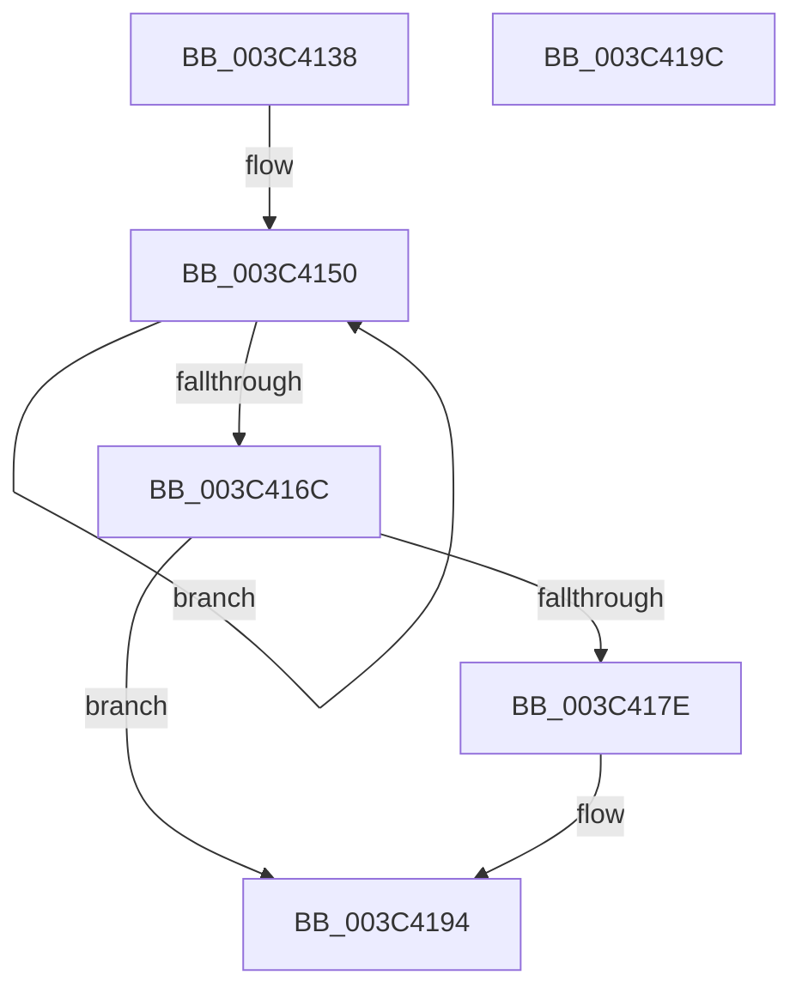

# PsSetPagePriorityThread

- RVA: `0x003C4138`–`0x003C419D` (길이 `101` bytes)
- VA: `0x00000001403C4138`
- 실행 섹션: `.text`
- PDB 이름 있음: `예`; PDB Function 태그: `아니요`
- unwind 정보 RVA: `0x00064C80`
- 디코드: `28`개 명령, `101/101` bytes 표시
- 미해석 바이트: `0` (있으면 어셈블리에 `.byte`로 보존)

> 이 문서는 커널 이미지의 기계어와 PDB 기호를 분석해 생성했습니다. 4번과 5번은 함수 원형과 자료형을 바이너리 사용 방식에서 추정한 C 해석이며 원본 소스 복구 결과는 아닙니다.

## 1. Dependencies

- 직접 호출 지점: **1**; 고유 호출 대상: **1**
- 직접 호출자로 확인된 함수: **8**
- RIP 상대 이미지 참조: **1**

### Outgoing calls
- `0x003C418F` → [EtwTracePriority](EtwTracePriority_function_003C41A4.md) (function, `0x003C41A4`)

### Direct callers
- [sub_002066BE](../20/Unknown_function_002066BE.md) at `0x00206749`
- [SmKmStoreHelperCommandProcess](SmKmStoreHelperCommandProcess_function_003C3AA4.md) at `0x003C3B4C`
- [SmKmStoreHelperCommandProcess](SmKmStoreHelperCommandProcess_function_003C3AA4.md) at `0x003C3BA3`
- [CcCompleteAsyncRead](../45/CcCompleteAsyncRead_function_0045E7DC.md) at `0x0045E8A3`
- [CcCompleteAsyncRead](../45/CcCompleteAsyncRead_function_0045E7DC.md) at `0x0045E9F6`
- [CcPerformReadAhead](../48/CcPerformReadAhead_function_0048F738.md) at `0x0048FA80`
- [CcPerformReadAhead](../48/CcPerformReadAhead_function_0048F738.md) at `0x0048FAEE`
- [CcCompleteAsyncRead$fin$1](../6D/CcCompleteAsyncRead_fin_1_function_006D3387.md) at `0x006D33F9`
- [NtSetInformationThread](../../page/8C/NtSetInformationThread_function_008C9F60.md) at `0x008CA775`
- [NtSetInformationProcess](../../page/AE/NtSetInformationProcess_function_00AE5370.md) at `0x00AE6C89`
- [MiInitSystem](../../init/C5/MiInitSystem_function_00C5E6C0.md) at `0x00C5E9C8`

### Static image references
- `0x003C4172` → RVA `0x00FC6B04` (`ALMOSTRO`; read)

## 2. Other-region calls and transfers

- 다른 실행 섹션으로 향하는 call: **0**
- 별도 외부 분기/꼬리 이동을 확인하지 못했습니다.

## 3. Assembly (complete function range)

```asm
003C4138  40 53                           push rbx
003C413A  48 83 EC 30                     sub rsp, 0x30
003C413E  4C 8B D1                        mov r10, rcx
003C4141  44 8B CA                        mov r9d, edx
003C4144  8B CA                           mov ecx, edx
003C4146  C1 E1 0C                        shl ecx, 0xc
003C4149  41 8B 82 A0 05 00 00            mov eax, dword ptr [r10 + 0x5a0]
003C4150  44 8B C0                        mov r8d, eax
003C4153  8B D8                           mov ebx, eax
003C4155  41 81 E0 FF 8F FF FF            and r8d, 0xffff8fff
003C415C  44 0B C1                        or r8d, ecx
003C415F  F0 45 0F B1 82 A0 05 00 00      lock cmpxchg dword ptr [r10 + 0x5a0], r8d
003C4168  3B C3                           cmp eax, ebx
003C416A  75 E4                           jne 0x1403c4150
003C416C  C1 EB 0C                        shr ebx, 0xc
003C416F  83 E3 07                        and ebx, 7
003C4172  F7 05 88 29 C0 00 00 20 00 00   test dword ptr [rip + 0xc02988], 0x2000
003C417C  74 16                           je 0x1403c4194
003C417E  48 83 64 24 20 00               and qword ptr [rsp + 0x20], 0
003C4184  BA 33 05 00 00                  mov edx, 0x533
003C4189  44 8B C3                        mov r8d, ebx
003C418C  49 8B CA                        mov rcx, r10
003C418F  E8 10 00 00 00                  call 0x1403c41a4
003C4194  8B C3                           mov eax, ebx
003C4196  48 83 C4 30                     add rsp, 0x30
003C419A  5B                              pop rbx
003C419B  C3                              ret
003C419C  CC                              int3
```

## 4. C-style interpretation (structured pseudocode)

```c
__int64 __fastcall PsSetPagePriorityThread(__int64 a1, int a2)
{
    __int64 result;
    __int64 v_rbx;
    __int64 v_rsp;
    unsigned __int64 v_stack_m18;

    v_rsp = (v_rsp) - (48);
    a1 = (unsigned int)(((unsigned int)(a2)) << (12));
loc_003C4150:
    a3 = (unsigned int)(((unsigned int)((unsigned int)((unsigned int)(*(unsigned int *)(a1 + 1440))))) & (0xFFFF8FFFULL));
    a3 = (unsigned int)((a3) | ((unsigned int)(a1)));
    if (((unsigned int)((unsigned int)(*(unsigned int *)(a1 + 1440)))) != ((unsigned int)((unsigned int)((unsigned int)((unsigned int)(*(unsigned int *)(a1 + 1440))))))) goto loc_003C4150;
    v_rbx = (unsigned int)(((unsigned int)((unsigned int)((unsigned int)(*(unsigned int *)(a1 + 1440))))) >> (12));
    v_rbx = (unsigned int)((v_rbx) & (7));
    result = (unsigned int)(*(unsigned int *)(a1 + 1440));
    if (((*(unsigned int *)(v_rip + 12593544)) & (0x2000ULL)) != 0) {
        a2 = 0x533ULL;
        a3 = (unsigned int)(v_rbx);
        a1 = a1;
        result = EtwTracePriority(a1, a2, a3, (unsigned int)(a2));
    }
    v_rsp = (v_rsp) + (48);
    return (unsigned int)((unsigned int)(v_rbx));
}
```

## 5. (Beta) C Style

```c
int64_t PsSetPagePriorityThread(void *Arg1, int32_t Arg2)
{
    uint8_t *arg1 = (uint8_t *)Arg1;

    int64_t result;
    int64_t local_rbx;
    int64_t local_rsp;
    uint64_t v_stack_m18;

    local_rsp = (local_rsp) - (48);
    Arg1 = (uint32_t)(((uint32_t)(Arg2)) << (12));
loc_003C4150:
    a3 = (uint32_t)(((uint32_t)((uint32_t)((uint32_t)(*(uint32_t *)(arg1 + 0x5A0))))) & (0xFFFF8FFFULL));
    a3 = (uint32_t)((a3) | ((uint32_t)(Arg1)));
    if (((uint32_t)((uint32_t)(*(uint32_t *)(arg1 + 0x5A0)))) != ((uint32_t)((uint32_t)((uint32_t)((uint32_t)(*(uint32_t *)(arg1 + 0x5A0))))))) goto loc_003C4150;
    local_rbx = (uint32_t)(((uint32_t)((uint32_t)((uint32_t)(*(uint32_t *)(arg1 + 0x5A0))))) >> (12));
    local_rbx = (uint32_t)((local_rbx) & (7));
    result = (uint32_t)(*(uint32_t *)(arg1 + 0x5A0));
    if (((*(uint32_t *)(v_rip + 0xC02988)) & (0x2000ULL)) != 0) {
        Arg2 = 0x533ULL;
        a3 = (uint32_t)(local_rbx);
        Arg1 = Arg1;
        result = EtwTracePriority(Arg1, Arg2, a3, (uint32_t)(Arg2));
    }
    local_rsp = (local_rsp) + (48);
    return (uint32_t)((uint32_t)(local_rbx));
}
```

### 관측된 메모리 오프셋

구조체 형식이 확인되지 않은 접근은 인자 기준의 오프셋으로만 기록했습니다.

| 기준 인자 | 오프셋 표현 | 폭 (bit) | 접근 |
|---|---:|---:|---|
| `Arg1` | `+ 0x5A0` | `32` | `R` |

## 6. Execution-region graph

[열기: 2D/3D 그래프와 함수 탐색 컨트롤 패널](../../../control-panel.html?section=text&rva=0x003C4138&view=graph)

- 2D 그래프는 위에서 아래로 흐르고, 3D 그래프는 빈 공간을 드래그해 회전합니다. Shift+드래그는 이동, 휠은 확대·축소, 함수 노드 선택은 대상 보고서 이동입니다.

### Static fallback


