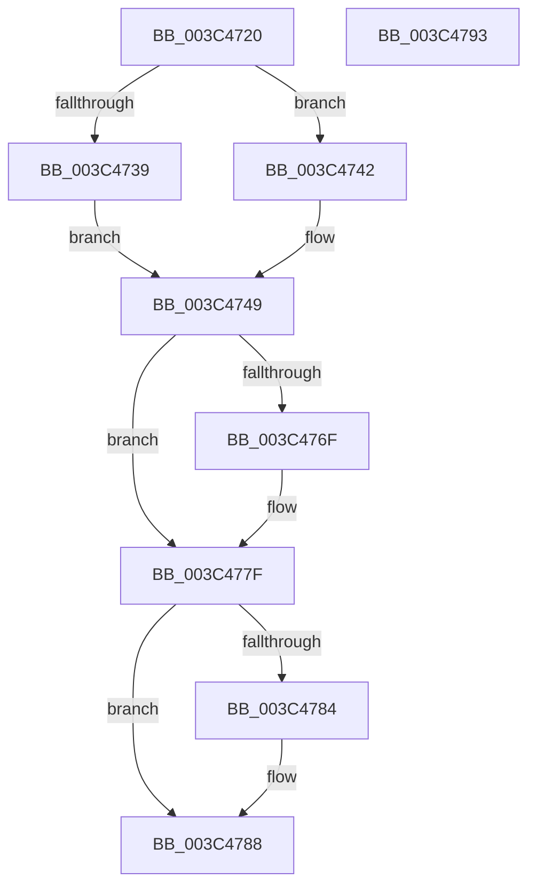

# PspLockThreadSecurityShared

- RVA: `0x003C4720`–`0x003C4794` (길이 `116` bytes)
- VA: `0x00000001403C4720`
- 실행 섹션: `.text`
- PDB 이름 있음: `예`; PDB Function 태그: `아니요`
- unwind 정보 RVA: `0x00068D5C`
- 디코드: `35`개 명령, `116/116` bytes 표시
- 미해석 바이트: `0` (있으면 어셈블리에 `.byte`로 보존)

> 이 문서는 커널 이미지의 기계어와 PDB 기호를 분석해 생성했습니다. 4번과 5번은 함수 원형과 자료형을 바이너리 사용 방식에서 추정한 C 해석이며 원본 소스 복구 결과는 아닙니다.

## 1. Dependencies

- 직접 호출 지점: **3**; 고유 호출 대상: **3**
- 직접 호출자로 확인된 함수: **32**
- RIP 상대 이미지 참조: **0**

### Outgoing calls
- `0x003C4730` → [Feature_ThreadLockGuardedRegion__private_IsEnabledDeviceUsageNoInline](../5E/Feature_ThreadLockGuardedRegion__private_IsEnabledDeviceUsageNoInline_function_005E2CEC.md) (function, `0x005E2CEC`)
- `0x003C4759` → [KeAbPreAcquire](../21/KeAbPreAcquire_function_00210230.md) (function, `0x00210230`)
- `0x003C477A` → [ExfAcquirePushLockSharedEx](../21/ExfAcquirePushLockSharedEx_function_0021044C.md) (function, `0x0021044C`)

### Direct callers
- [EtwpTraceThreadRundown](EtwpTraceThreadRundown_function_003C370C.md) at `0x003C3929`
- [PsLockThreadNameShared](../4F/PsLockThreadNameShared_function_004F3020.md) at `0x004F3024`
- [FsRtlpOplockGetThreadIntegrityLevel](../../page/6F/FsRtlpOplockGetThreadIntegrityLevel_function_006FD814.md) at `0x006FD845`
- [sub_0086B892](../../page/86/Unknown_function_0086B892.md) at `0x0086B8A6`
- [sub_00871FFC](../../page/87/Unknown_function_00871FFC.md) at `0x00872075`
- [CmpCmdHiveOpen](../../page/87/CmpCmdHiveOpen_function_00878404.md) at `0x0087863A`
- [CmpOpenHiveFile](../../page/87/CmpOpenHiveFile_function_0087A71C.md) at `0x0087ACC2`
- [AlpcpCreateSecurityContext](../../page/89/AlpcpCreateSecurityContext_function_00890D94.md) at `0x0089106C`
- [SeCreateClientSecurity](../../page/89/SeCreateClientSecurity_function_008911B0.md) at `0x008912E4`
- [AlpcpExposeTokenAttribute](../../page/89/AlpcpExposeTokenAttribute_function_00891390.md) at `0x0089166B`
- [sub_0089189E](../../page/89/Unknown_function_0089189E.md) at `0x008918AD`
- [sub_00891B72](../../page/89/Unknown_function_00891B72.md) at `0x00891B91`
- [sub_0089AE5C](../../page/89/Unknown_function_0089AE5C.md) at `0x0089AE6B`
- [ObCreateObjectEx](../../page/89/ObCreateObjectEx_function_0089B1E0.md) at `0x0089B629`
- [ObpLookupObjectName](../../page/89/ObpLookupObjectName_function_0089BE90.md) at `0x0089C1E8`
- [sub_008B4AB4](../../page/8B/Unknown_function_008B4AB4.md) at `0x008B4AC7`
- [sub_008B76B1](../../page/8B/Unknown_function_008B76B1.md) at `0x008B76C8`
- [NtOpenThreadTokenEx](../../page/8B/NtOpenThreadTokenEx_function_008B7840.md) at `0x008B7EA6`
- [ObInsertObjectEx](../../page/8B/ObInsertObjectEx_function_008B97A0.md) at `0x008B9CE8`
- [sub_008C4D01](../../page/8C/Unknown_function_008C4D01.md) at `0x008C4D12`
- [sub_008C6B6D](../../page/8C/Unknown_function_008C6B6D.md) at `0x008C6B84`
- [PspWow64ReadOrWriteThreadCpuArea](../../page/8C/PspWow64ReadOrWriteThreadCpuArea_function_008CD404.md) at `0x008CD487`
- [PspAllocateAndQueryNotificationChannel](../../page/91/PspAllocateAndQueryNotificationChannel_function_00917EE4.md) at `0x009182C2`
- [sub_00947B26](../../page/94/Unknown_function_00947B26.md) at `0x00947B3A`
- [sub_00957F93](../../page/95/Unknown_function_00957F93.md) at `0x00957FA4`
- [ObpReferenceCurrentDeviceMap](../../page/96/ObpReferenceCurrentDeviceMap_function_0096CBD0.md) at `0x0096CC63`
- [ExpWnfQueryCurrentUserSID](../../page/98/ExpWnfQueryCurrentUserSID_function_0098FFB0.md) at `0x00990096`
- [sub_0099C7E1](../../page/99/Unknown_function_0099C7E1.md) at `0x0099C7FE`
- [sub_009A2B7F](../../page/9A/Unknown_function_009A2B7F.md) at `0x009A2BE4`
- [sub_009A8F31](../../page/9A/Unknown_function_009A8F31.md) at `0x009A8F40`
- [MiIsUserQueryVmCallerTrusted](../../page/9F/MiIsUserQueryVmCallerTrusted_function_009FE378.md) at `0x009FE4BF`
- [NtQueryInformationThread](../../page/AE/NtQueryInformationThread_function_00AE3760.md) at `0x00AE4C2F`

### Static image references
- 디코드된 RIP-relative 메모리 참조가 없습니다.

## 2. Other-region calls and transfers

- 다른 실행 섹션으로 향하는 call: **0**
- 별도 외부 분기/꼬리 이동을 확인하지 못했습니다.

## 3. Assembly (complete function range)

```asm
003C4720  48 89 5C 24 10                  mov qword ptr [rsp + 0x10], rbx
003C4725  57                              push rdi
003C4726  48 83 EC 20                     sub rsp, 0x20
003C472A  48 8B DA                        mov rbx, rdx
003C472D  48 8B F9                        mov rdi, rcx
003C4730  E8 B7 E5 21 00                  call 0x1405e2cec
003C4735  85 C0                           test eax, eax
003C4737  74 09                           je 0x1403c4742
003C4739  66 FF 8B E6 01 00 00            dec word ptr [rbx + 0x1e6]
003C4740  EB 07                           jmp 0x1403c4749
003C4742  66 FF 8B E4 01 00 00            dec word ptr [rbx + 0x1e4]
003C4749  48 81 C7 90 05 00 00            add rdi, 0x590
003C4750  45 33 C0                        xor r8d, r8d
003C4753  48 8B CF                        mov rcx, rdi
003C4756  33 D2                           xor edx, edx
003C4758  90                              nop
003C4759  E8 D2 BA E4 FF                  call 0x140210230
003C475E  48 8B D8                        mov rbx, rax
003C4761  B9 11 00 00 00                  mov ecx, 0x11
003C4766  33 C0                           xor eax, eax
003C4768  F0 48 0F B1 0F                  lock cmpxchg qword ptr [rdi], rcx
003C476D  74 10                           je 0x1403c477f
003C476F  4C 8B CF                        mov r9, rdi
003C4772  4C 8B C3                        mov r8, rbx
003C4775  33 D2                           xor edx, edx
003C4777  48 8B CF                        mov rcx, rdi
003C477A  E8 CD BC E4 FF                  call 0x14021044c
003C477F  48 85 DB                        test rbx, rbx
003C4782  74 04                           je 0x1403c4788
003C4784  C6 43 0A 01                     mov byte ptr [rbx + 0xa], 1
003C4788  48 8B 5C 24 38                  mov rbx, qword ptr [rsp + 0x38]
003C478D  48 83 C4 20                     add rsp, 0x20
003C4791  5F                              pop rdi
003C4792  C3                              ret
003C4793  CC                              int3
```

## 4. C-style interpretation (structured pseudocode)

```c
__int64 __fastcall PspLockThreadSecurityShared(__int64 a1, __int64 a2, int a3)
{
    __int64 result;
    __int64 v_rdi;
    __int64 v_rsp;
    unsigned __int64 v_stack_p10;

    v_stack_p10 = v_rbx;
    v_rsp = (v_rsp) - (32);
    result = Feature_ThreadLockGuardedRegion__private_IsEnabledDeviceUsageNoInline(a1, a2, a3, a4);
    if ((unsigned int)(result) == 0) goto loc_003C4742;
    goto loc_003C4749;
loc_003C4742:
loc_003C4749:
    v_rdi = (a1) + (0x590ULL);
    a3 = 0;
    a2 = 0;
    result = KeAbPreAcquire(v_rdi, a2, a3, a4);
    result = 0;
    if (!(condition_is_equal)) {
        a4 = v_rdi;
        a3 = 0;
        a2 = 0;
        a1 = v_rdi;
        result = ExfAcquirePushLockSharedEx(a1, a2, a3, a4);
    }
    if (result != 0) {
        *(unsigned __int8 *)(result + 10) = 1;
    }
    v_rsp = (v_rsp) + (32);
    return result;
}
```

## 5. (Beta) C Style

```c
int64_t PspLockThreadSecurityShared(void *Arg1, void *Arg2, int32_t Arg3)
{
    uint8_t *arg1 = (uint8_t *)Arg1;
    uint8_t *arg2 = (uint8_t *)Arg2;

    int64_t result;
    int64_t local_rdi;
    int64_t local_rsp;
    uint64_t v_stack_p10;

    v_stack_p10 = local_rbx;
    local_rsp = (local_rsp) - (32);
    result = Feature_ThreadLockGuardedRegion__private_IsEnabledDeviceUsageNoInline(Arg1, Arg2, Arg3, a4);
    if ((uint32_t)(result) == 0) goto loc_003C4742;
    goto loc_003C4749;
loc_003C4742:
loc_003C4749:
    local_rdi = (Arg1) + (0x590ULL);
    Arg3 = 0;
    Arg2 = 0;
    result = KeAbPreAcquire(local_rdi, Arg2, Arg3, a4);
    result = 0;
    if (!(condition_is_equal)) {
        a4 = local_rdi;
        Arg3 = 0;
        Arg2 = 0;
        Arg1 = local_rdi;
        result = ExfAcquirePushLockSharedEx(Arg1, Arg2, Arg3, a4);
    }
    if (result != 0) {
        *(uint8_t *)(result + 0xA) = 1;
    }
    local_rsp = (local_rsp) + (32);
    return result;
}
```

### 관측된 메모리 오프셋

구조체 형식이 확인되지 않은 접근은 인자 기준의 오프셋으로만 기록했습니다.

| 기준 인자 | 오프셋 표현 | 폭 (bit) | 접근 |
|---|---:|---:|---|
| `Arg1` | `+ 0x0` | `64` | `R` |
| `Arg2` | `+ 0x1E4` | `16` | `R/W` |
| `Arg2` | `+ 0x1E6` | `16` | `R/W` |

## 6. Execution-region graph

[열기: 2D/3D 그래프와 함수 탐색 컨트롤 패널](../../../control-panel.html?section=text&rva=0x003C4720&view=graph)

- 2D 그래프는 위에서 아래로 흐르고, 3D 그래프는 빈 공간을 드래그해 회전합니다. Shift+드래그는 이동, 휠은 확대·축소, 함수 노드 선택은 대상 보고서 이동입니다.

### Static fallback


