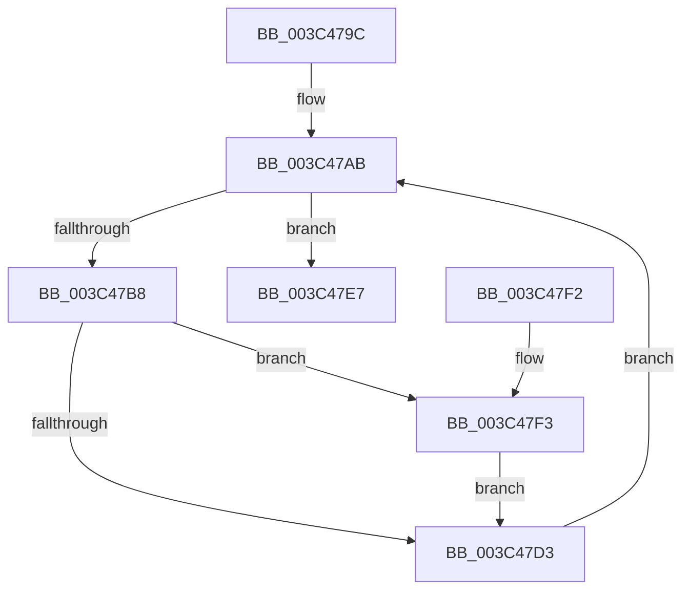

# PspSynchronizeThreadIsolationDomains

- RVA: `0x003C479C`–`0x003C480E` (길이 `114` bytes)
- VA: `0x00000001403C479C`
- 실행 섹션: `.text`
- PDB 이름 있음: `예`; PDB Function 태그: `아니요`
- unwind 정보 RVA: `0x0007CED0`
- 디코드: `32`개 명령, `114/114` bytes 표시
- 미해석 바이트: `0` (있으면 어셈블리에 `.byte`로 보존)

> 이 문서는 커널 이미지의 기계어와 PDB 기호를 분석해 생성했습니다. 4번과 5번은 함수 원형과 자료형을 바이너리 사용 방식에서 추정한 C 해석이며 원본 소스 복구 결과는 아닙니다.

## 1. Dependencies

- 직접 호출 지점: **4**; 고유 호출 대상: **4**
- 직접 호출자로 확인된 함수: **6**
- RIP 상대 이미지 참조: **0**

### Outgoing calls
- `0x003C47AB` → [PsGetNextProcessThread](../../page/8C/PsGetNextProcessThread_function_008C9CF0.md) (function, `0x008C9CF0`)
- `0x003C47C5` → [KiAcquireThreadLockRaiseToDpc](../39/KiAcquireThreadLockRaiseToDpc_function_00396280.md) (function, `0x00396280`)
- `0x003C47DA` → [KiReleaseThreadLockLowerIrql](KiReleaseThreadLockLowerIrql_function_003C65D0.md) (function, `0x003C65D0`)
- `0x003C4807` → [KiAdjustUserIsolationDomainThread](../5C/KiAdjustUserIsolationDomainThread_function_005C3B54.md) (function, `0x005C3B54`)

### Direct callers
- [PsSetVmProcessorHostProcess](../../page/78/PsSetVmProcessorHostProcess_function_00783CEC.md) at `0x00783D84`
- [PspAssignPrimaryToken](../../page/78/PspAssignPrimaryToken_function_00784870.md) at `0x007849BB`
- [PspCombineSecurityDomains](../../page/8A/PspCombineSecurityDomains_function_008A18C0.md) at `0x008A1B66`
- [PspOneDirectionSecurityDomainCombine](../../page/8A/PspOneDirectionSecurityDomainCombine_function_008A23BC.md) at `0x008A25A5`
- [PspDisablePrimaryTokenExchange](../../page/8D/PspDisablePrimaryTokenExchange_function_008D5C10.md) at `0x008D5CBD`
- [NtSetInformationProcess](../../page/AE/NtSetInformationProcess_function_00AE5370.md) at `0x00AE8747`

### Static image references
- 디코드된 RIP-relative 메모리 참조가 없습니다.

## 2. Other-region calls and transfers

- 다른 실행 섹션으로 향하는 call: **1**
  - `0x003C47AB` → [PsGetNextProcessThread](../../page/8C/PsGetNextProcessThread_function_008C9CF0.md) (`.text` → `PAGE`)
- 별도 외부 분기/꼬리 이동을 확인하지 못했습니다.

## 3. Assembly (complete function range)

```asm
003C479C  48 89 5C 24 08                  mov qword ptr [rsp + 8], rbx
003C47A1  57                              push rdi
003C47A2  48 83 EC 20                     sub rsp, 0x20
003C47A6  48 8B F9                        mov rdi, rcx
003C47A9  33 D2                           xor edx, edx
003C47AB  E8 40 55 50 00                  call 0x1408c9cf0
003C47B0  48 8B D8                        mov rbx, rax
003C47B3  48 85 C0                        test rax, rax
003C47B6  74 2F                           je 0x1403c47e7
003C47B8  C6 44 24 38 FF                  mov byte ptr [rsp + 0x38], 0xff
003C47BD  48 8D 54 24 38                  lea rdx, [rsp + 0x38]
003C47C2  48 8B C8                        mov rcx, rax
003C47C5  E8 B6 1A FD FF                  call 0x140396280
003C47CA  F6 83 61 04 00 00 03            test byte ptr [rbx + 0x461], 3
003C47D1  75 20                           jne 0x1403c47f3
003C47D3  8A 54 24 38                     mov dl, byte ptr [rsp + 0x38]
003C47D7  48 8B CB                        mov rcx, rbx
003C47DA  E8 F1 1D 00 00                  call 0x1403c65d0
003C47DF  48 8B D3                        mov rdx, rbx
003C47E2  48 8B CF                        mov rcx, rdi
003C47E5  EB C4                           jmp 0x1403c47ab
003C47E7  48 8B 5C 24 30                  mov rbx, qword ptr [rsp + 0x30]
003C47EC  48 83 C4 20                     add rsp, 0x20
003C47F0  5F                              pop rdi
003C47F1  C3                              ret
003C47F2  CC                              int3
003C47F3  48 8B 93 20 02 00 00            mov rdx, qword ptr [rbx + 0x220]
003C47FA  41 B0 01                        mov r8b, 1
003C47FD  48 8B CB                        mov rcx, rbx
003C4800  48 8B 92 60 07 00 00            mov rdx, qword ptr [rdx + 0x760]
003C4807  E8 48 F3 1F 00                  call 0x1405c3b54
003C480C  EB C5                           jmp 0x1403c47d3
```

## 4. C-style interpretation (structured pseudocode)

```c
__int64 __fastcall PspSynchronizeThreadIsolationDomains(__int64 a1, int a2)
{
    __int64 result;
    __int64 v_rsp;
    unsigned __int8 v_stack_p10;
    unsigned __int64 v_stack_p8;

    v_stack_p8 = v_rbx;
    v_rsp = (v_rsp) - (32);
    a2 = 0;
loc_003C47AB:
    result = PsGetNextProcessThread(a1, a2, a3, a4);
    if (result == 0) goto loc_003C47E7;
    v_stack_p10 = 255;
    result = KiAcquireThreadLockRaiseToDpc(result, v_stack_p10, a3, a4);
    if (((*(unsigned __int8 *)(result + 1121)) & (3)) != 0) goto loc_003C47F3;
loc_003C47D3:
    result = KiReleaseThreadLockLowerIrql(result, v_stack_p10, a3, a4);
    goto loc_003C47AB;
loc_003C47E7:
    v_rsp = (v_rsp) + (32);
    return result;
loc_003C47F3:
    result = KiAdjustUserIsolationDomainThread(v_stack_p8, *(unsigned __int64 *)(*(unsigned __int64 *)(v_stack_p8 + 544) + 1888), 1, a4);
    goto loc_003C47D3;
}
```

## 5. (Beta) C Style

```c
int64_t PspSynchronizeThreadIsolationDomains(int64_t Arg1, int32_t Arg2)
{
    int64_t result;
    int64_t local_rsp;
    uint8_t v_stack_p10;
    uint64_t v_stack_p8;

    v_stack_p8 = local_rbx;
    local_rsp = (local_rsp) - (32);
    Arg2 = 0;
loc_003C47AB:
    result = PsGetNextProcessThread(Arg1, Arg2, a3, a4);
    if (result == 0) goto loc_003C47E7;
    v_stack_p10 = 255;
    result = KiAcquireThreadLockRaiseToDpc(result, v_stack_p10, a3, a4);
    if (((*(uint8_t *)(result + 0x461)) & (3)) != 0) goto loc_003C47F3;
loc_003C47D3:
    result = KiReleaseThreadLockLowerIrql(result, v_stack_p10, a3, a4);
    goto loc_003C47AB;
loc_003C47E7:
    local_rsp = (local_rsp) + (32);
    return result;
loc_003C47F3:
    result = KiAdjustUserIsolationDomainThread(v_stack_p8, *(uint64_t *)(*(uint64_t *)(v_stack_p8 + 0x220) + 0x760), 1, a4);
    goto loc_003C47D3;
}
```

## 6. Execution-region graph

[열기: 2D/3D 그래프와 함수 탐색 컨트롤 패널](../../../control-panel.html?section=text&rva=0x003C479C&view=graph)

- 2D 그래프는 위에서 아래로 흐르고, 3D 그래프는 빈 공간을 드래그해 회전합니다. Shift+드래그는 이동, 휠은 확대·축소, 함수 노드 선택은 대상 보고서 이동입니다.

### Static fallback


