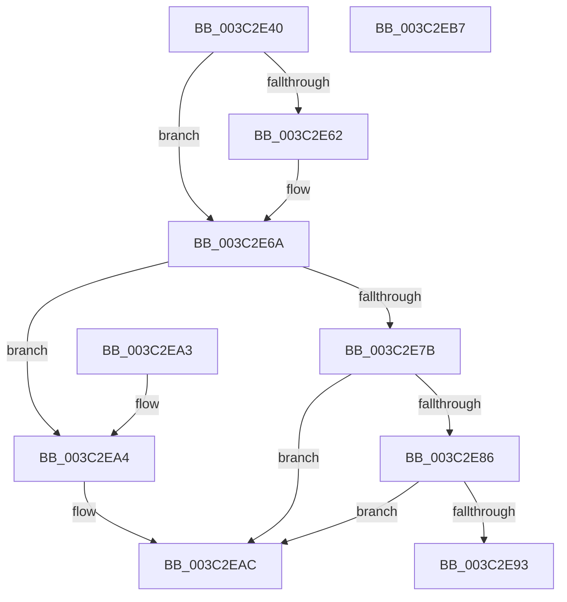

# PspUnlockThreadSecurityShared

- RVA: `0x003C2E40`–`0x003C2EB8` (길이 `120` bytes)
- VA: `0x00000001403C2E40`
- 실행 섹션: `.text`
- PDB 이름 있음: `예`; PDB Function 태그: `아니요`
- unwind 정보 RVA: `0x0008E298`
- 디코드: `36`개 명령, `120/120` bytes 표시
- 미해석 바이트: `0` (있으면 어셈블리에 `.byte`로 보존)

> 이 문서는 커널 이미지의 기계어와 PDB 기호를 분석해 생성했습니다. 4번과 5번은 함수 원형과 자료형을 바이너리 사용 방식에서 추정한 C 해석이며 원본 소스 복구 결과는 아닙니다.

## 1. Dependencies

- 직접 호출 지점: **5**; 고유 호출 대상: **5**
- 직접 호출자로 확인된 함수: **37**
- RIP 상대 이미지 참조: **0**

### Outgoing calls
- `0x003C2E65` → [ExfReleasePushLockShared](../26/ExfReleasePushLockShared_function_00263440.md) (function, `0x00263440`)
- `0x003C2E6D` → [KeAbPostRelease](../2E/KeAbPostRelease_function_002E1600.md) (function, `0x002E1600`)
- `0x003C2E72` → [Feature_ThreadLockGuardedRegion__private_IsEnabledDeviceUsageNoInline](../5E/Feature_ThreadLockGuardedRegion__private_IsEnabledDeviceUsageNoInline_function_005E2CEC.md) (function, `0x005E2CEC`)
- `0x003C2E93` → [KiCheckForKernelApcDelivery](../2E/KiCheckForKernelApcDelivery_function_002E2C80.md) (function, `0x002E2C80`)
- `0x003C2EA7` → [KiLeaveCriticalRegionUnsafe](../25/KiLeaveCriticalRegionUnsafe_function_0025F010.md) (function, `0x0025F010`)

### Direct callers
- [EtwpTraceThreadRundown](EtwpTraceThreadRundown_function_003C370C.md) at `0x003C39C4`
- [PsUnlockThreadNameShared](../4F/PsUnlockThreadNameShared_function_004F4394.md) at `0x004F4398`
- [FsRtlpOplockGetThreadIntegrityLevel](../../page/6F/FsRtlpOplockGetThreadIntegrityLevel_function_006FD814.md) at `0x006FD882`
- [sub_0086B892](../../page/86/Unknown_function_0086B892.md) at `0x0086B8DF`
- [sub_00871FFC](../../page/87/Unknown_function_00871FFC.md) at `0x008720B5`
- [CmpCmdHiveOpen](../../page/87/CmpCmdHiveOpen_function_00878404.md) at `0x0087869A`
- [CmpOpenHiveFile](../../page/87/CmpOpenHiveFile_function_0087A71C.md) at `0x0087AD30`
- [AlpcpCreateSecurityContext](../../page/89/AlpcpCreateSecurityContext_function_00890D94.md) at `0x008910C8`
- [SeCreateClientSecurity](../../page/89/SeCreateClientSecurity_function_008911B0.md) at `0x00891341`
- [SeCreateClientSecurity](../../page/89/SeCreateClientSecurity_function_008911B0.md) at `0x0089137F`
- [AlpcpExposeTokenAttribute](../../page/89/AlpcpExposeTokenAttribute_function_00891390.md) at `0x008916D2`
- [sub_0089189E](../../page/89/Unknown_function_0089189E.md) at `0x00891903`
- [sub_00891938](../../page/89/Unknown_function_00891938.md) at `0x0089193E`
- [sub_00891B72](../../page/89/Unknown_function_00891B72.md) at `0x00891BF3`
- [sub_00891C3F](../../page/89/Unknown_function_00891C3F.md) at `0x00891C45`
- [sub_0089AE5C](../../page/89/Unknown_function_0089AE5C.md) at `0x0089AEA8`
- [ObCreateObjectEx](../../page/89/ObCreateObjectEx_function_0089B1E0.md) at `0x0089B667`
- [ObpLookupObjectName](../../page/89/ObpLookupObjectName_function_0089BE90.md) at `0x0089C225`
- [sub_008B4AB4](../../page/8B/Unknown_function_008B4AB4.md) at `0x008B4B06`
- [sub_008B76B1](../../page/8B/Unknown_function_008B76B1.md) at `0x008B7707`
- [NtOpenThreadTokenEx](../../page/8B/NtOpenThreadTokenEx_function_008B7840.md) at `0x008B7F12`
- [ObInsertObjectEx](../../page/8B/ObInsertObjectEx_function_008B97A0.md) at `0x008B9D30`
- [sub_008C4D01](../../page/8C/Unknown_function_008C4D01.md) at `0x008C4D4B`
- [sub_008C6B6D](../../page/8C/Unknown_function_008C6B6D.md) at `0x008C6BBE`
- [PspWow64ReadOrWriteThreadCpuArea](../../page/8C/PspWow64ReadOrWriteThreadCpuArea_function_008CD404.md) at `0x008CD747`
- [PspWow64ReadOrWriteThreadCpuArea](../../page/8C/PspWow64ReadOrWriteThreadCpuArea_function_008CD404.md) at `0x008CD780`
- [PspAllocateAndQueryNotificationChannel](../../page/91/PspAllocateAndQueryNotificationChannel_function_00917EE4.md) at `0x009182F0`
- [sub_00947B26](../../page/94/Unknown_function_00947B26.md) at `0x00947B74`
- [sub_00957F93](../../page/95/Unknown_function_00957F93.md) at `0x00958005`
- [ObpReferenceCurrentDeviceMap](../../page/96/ObpReferenceCurrentDeviceMap_function_0096CBD0.md) at `0x0096CCA0`
- [ExpWnfQueryCurrentUserSID](../../page/98/ExpWnfQueryCurrentUserSID_function_0098FFB0.md) at `0x009900CE`
- [sub_0099C7E1](../../page/99/Unknown_function_0099C7E1.md) at `0x0099C877`
- [sub_009A2B7F](../../page/9A/Unknown_function_009A2B7F.md) at `0x009A2C40`
- [sub_009A2C69](../../page/9A/Unknown_function_009A2C69.md) at `0x009A2C6F`
- [sub_009A8F31](../../page/9A/Unknown_function_009A8F31.md) at `0x009A8F78`
- [sub_009A8FCE](../../page/9A/Unknown_function_009A8FCE.md) at `0x009A8FD4`
- [MiIsUserQueryVmCallerTrusted](../../page/9F/MiIsUserQueryVmCallerTrusted_function_009FE378.md) at `0x009FE4EC`
- [NtQueryInformationThread](../../page/AE/NtQueryInformationThread_function_00AE3760.md) at `0x00AE4CD0`
- [NtQueryInformationThread$fin$2](../../page/B1/NtQueryInformationThread_fin_2_function_00B140CC.md) at `0x00B140EA`

### Static image references
- 디코드된 RIP-relative 메모리 참조가 없습니다.

## 2. Other-region calls and transfers

- 다른 실행 섹션으로 향하는 call: **0**
- 별도 외부 분기/꼬리 이동을 확인하지 못했습니다.

## 3. Assembly (complete function range)

```asm
003C2E40  48 89 5C 24 10                  mov qword ptr [rsp + 0x10], rbx
003C2E45  57                              push rdi
003C2E46  48 83 EC 20                     sub rsp, 0x20
003C2E4A  48 8D B9 90 05 00 00            lea rdi, [rcx + 0x590]
003C2E51  48 8B DA                        mov rbx, rdx
003C2E54  33 C9                           xor ecx, ecx
003C2E56  B8 11 00 00 00                  mov eax, 0x11
003C2E5B  F0 48 0F B1 0F                  lock cmpxchg qword ptr [rdi], rcx
003C2E60  74 08                           je 0x1403c2e6a
003C2E62  48 8B CF                        mov rcx, rdi
003C2E65  E8 D6 05 EA FF                  call 0x140263440
003C2E6A  48 8B CF                        mov rcx, rdi
003C2E6D  E8 8E E7 F1 FF                  call 0x1402e1600
003C2E72  E8 75 FE 21 00                  call 0x1405e2cec
003C2E77  85 C0                           test eax, eax
003C2E79  74 29                           je 0x1403c2ea4
003C2E7B  90                              nop
003C2E7C  66 83 83 E6 01 00 00 01         add word ptr [rbx + 0x1e6], 1
003C2E84  75 26                           jne 0x1403c2eac
003C2E86  48 8D 83 98 00 00 00            lea rax, [rbx + 0x98]
003C2E8D  90                              nop
003C2E8E  48 39 00                        cmp qword ptr [rax], rax
003C2E91  74 19                           je 0x1403c2eac
003C2E93  E8 E8 FD F1 FF                  call 0x1402e2c80
003C2E98  48 8B 5C 24 38                  mov rbx, qword ptr [rsp + 0x38]
003C2E9D  48 83 C4 20                     add rsp, 0x20
003C2EA1  5F                              pop rdi
003C2EA2  C3                              ret
003C2EA3  CC                              int3
003C2EA4  48 8B CB                        mov rcx, rbx
003C2EA7  E8 64 C1 E9 FF                  call 0x14025f010
003C2EAC  48 8B 5C 24 38                  mov rbx, qword ptr [rsp + 0x38]
003C2EB1  48 83 C4 20                     add rsp, 0x20
003C2EB5  5F                              pop rdi
003C2EB6  C3                              ret
003C2EB7  CC                              int3
```

## 4. C-style interpretation (structured pseudocode)

```c
__int64 __fastcall PspUnlockThreadSecurityShared(__int64 a1, __int64 a2)
{
    __int64 result;
    __int64 v_rsp;
    unsigned __int64 v_stack_p10;
    unsigned __int64 v_stack_p38;

    v_stack_p10 = v_rbx;
    v_rsp = (v_rsp) - (32);
    a1 = 0;
    result = 17;
    if (!(condition_is_equal)) {
        a1 = a1 + 1424;
        result = ExfReleasePushLockShared(a1, a2, a3, a4);
    }
    result = KeAbPostRelease(a1 + 1424, a2, a3, a4);
    result = Feature_ThreadLockGuardedRegion__private_IsEnabledDeviceUsageNoInline(a1 + 1424, a2, a3, a4);
    if ((unsigned int)(result) == 0) goto loc_003C2EA4;
    if ((unsigned int)(result) != 0) goto loc_003C2EAC;
    if ((*(unsigned __int64 *)(a2 + 152)) == (a2 + 152)) goto loc_003C2EAC;
    result = KiCheckForKernelApcDelivery(a1 + 1424, a2, a3, a4);
    v_rsp = (v_rsp) + (32);
    return result;
loc_003C2EA4:
    result = KiLeaveCriticalRegionUnsafe(v_stack_p10, a2, a3, a4);
loc_003C2EAC:
    v_rsp = (v_rsp) + (32);
    return result;
}
```

## 5. (Beta) C Style

```c
int64_t PspUnlockThreadSecurityShared(void *Arg1, void *Arg2)
{
    uint8_t *arg1 = (uint8_t *)Arg1;
    uint8_t *arg2 = (uint8_t *)Arg2;

    int64_t result;
    int64_t local_rsp;
    uint64_t v_stack_p10;
    uint64_t v_stack_p38;

    v_stack_p10 = local_rbx;
    local_rsp = (local_rsp) - (32);
    Arg1 = 0;
    result = 17;
    if (!(condition_is_equal)) {
        Arg1 = Arg1 + 1424;
        result = ExfReleasePushLockShared(Arg1, Arg2, a3, a4);
    }
    result = KeAbPostRelease(Arg1 + 1424, Arg2, a3, a4);
    result = Feature_ThreadLockGuardedRegion__private_IsEnabledDeviceUsageNoInline(Arg1 + 1424, Arg2, a3, a4);
    if ((uint32_t)(result) == 0) goto loc_003C2EA4;
    if ((uint32_t)(result) != 0) goto loc_003C2EAC;
    if ((*(uint64_t *)(arg2 + 0x98)) == (Arg2 + 152)) goto loc_003C2EAC;
    result = KiCheckForKernelApcDelivery(Arg1 + 1424, Arg2, a3, a4);
    local_rsp = (local_rsp) + (32);
    return result;
loc_003C2EA4:
    result = KiLeaveCriticalRegionUnsafe(v_stack_p10, Arg2, a3, a4);
loc_003C2EAC:
    local_rsp = (local_rsp) + (32);
    return result;
}
```

### 관측된 메모리 오프셋

구조체 형식이 확인되지 않은 접근은 인자 기준의 오프셋으로만 기록했습니다.

| 기준 인자 | 오프셋 표현 | 폭 (bit) | 접근 |
|---|---:|---:|---|
| `Arg1` | `+ 0x0` | `64` | `R` |
| `Arg1` | `+ 0x590` | `64` | `R` |
| `Arg2` | `+ 0x0` | `64` | `R` |
| `Arg2` | `+ 0x98` | `64` | `R` |
| `Arg2` | `+ 0x1E6` | `16` | `R/W` |

## 6. Execution-region graph

[열기: 2D/3D 그래프와 함수 탐색 컨트롤 패널](../../../control-panel.html?section=text&rva=0x003C2E40&view=graph)

- 2D 그래프는 위에서 아래로 흐르고, 3D 그래프는 빈 공간을 드래그해 회전합니다. Shift+드래그는 이동, 휠은 확대·축소, 함수 노드 선택은 대상 보고서 이동입니다.

### Static fallback


