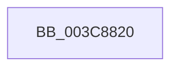

# RtlDecompressBufferXpressHuff

- RVA: `0x003C8820`–`0x003C8840` (길이 `32` bytes)
- VA: `0x00000001403C8820`
- 실행 섹션: `.text`
- PDB 이름 있음: `예`; PDB Function 태그: `아니요`
- unwind 정보 RVA: `0x0008F494`
- 디코드: `9`개 명령, `32/32` bytes 표시
- 미해석 바이트: `0` (있으면 어셈블리에 `.byte`로 보존)

> 이 문서는 커널 이미지의 기계어와 PDB 기호를 분석해 생성했습니다. 4번과 5번은 함수 원형과 자료형을 바이너리 사용 방식에서 추정한 C 해석이며 원본 소스 복구 결과는 아닙니다.

## 1. Dependencies

- 직접 호출 지점: **0**; 고유 호출 대상: **0**
- 직접 호출자로 확인된 함수: **0**
- RIP 상대 이미지 참조: **0**

### Outgoing calls
- 직접 디코드된 call 명령이 없습니다.

### Direct callers
- 이 함수 시작 RVA로 연결되는 직접 call은 확인되지 않았습니다. 간접 호출은 완전히 역산할 수 없습니다.

### Static image references
- 디코드된 RIP-relative 메모리 참조가 없습니다.

## 2. Other-region calls and transfers

- 다른 실행 섹션으로 향하는 call: **0**
- call이 아닌 외부 분기/꼬리 이동: **1**
  - `0x003C883A` → [sub_003C8D20](Unknown_function_003C8D20.md) (`tail-transfer`)

## 3. Assembly (complete function range)

```asm
003C8820  40 53                           push rbx
003C8822  55                              push rbp
003C8823  41 54                           push r12
003C8825  48 83 EC 30                     sub rsp, 0x30
003C8829  48 8B AC 24 80 00 00 00         mov rbp, qword ptr [rsp + 0x80]
003C8831  49 8B D8                        mov rbx, r8
003C8834  4C 8B E1                        mov r12, rcx
003C8837  48 85 ED                        test rbp, rbp
003C883A  0F 84 E0 04 00 00               je 0x1403c8d20
```

## 4. C-style interpretation (structured pseudocode)

```c
void __fastcall RtlDecompressBufferXpressHuff(__int64 a1, __int64 a2, __int64 a3, __int64 a4, __int64 a5, __int64 a6, __int64 a7)
{
    __int64 v_rsp;

    v_rsp = (v_rsp) - (48);
}
```

## 5. (Beta) C Style

```c
void RtlDecompressBufferXpressHuff(int64_t Arg1, int64_t Arg2, int64_t Arg3, int64_t Arg4, uint64_t Arg5, uint64_t Arg6, int64_t Arg7)
{
    int64_t local_rsp;

    local_rsp = (local_rsp) - (48);
}
```

## 6. Execution-region graph

[열기: 2D/3D 그래프와 함수 탐색 컨트롤 패널](../../../control-panel.html?section=text&rva=0x003C8820&view=graph)

- 2D 그래프는 위에서 아래로 흐르고, 3D 그래프는 빈 공간을 드래그해 회전합니다. Shift+드래그는 이동, 휠은 확대·축소, 함수 노드 선택은 대상 보고서 이동입니다.

### Static fallback


