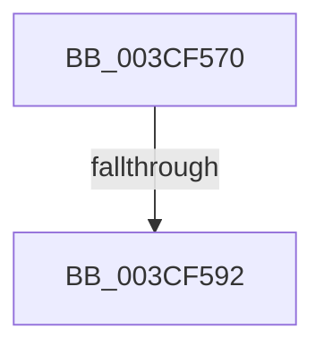

# RtlFindNextForwardRunClearCapped

- RVA: `0x003CF570`–`0x003CF594` (길이 `36` bytes)
- VA: `0x00000001403CF570`
- 실행 섹션: `.text`
- PDB 이름 있음: `예`; PDB Function 태그: `아니요`
- unwind 정보 RVA: `0x00090630`
- 디코드: `12`개 명령, `36/36` bytes 표시
- 미해석 바이트: `0` (있으면 어셈블리에 `.byte`로 보존)

> 이 문서는 커널 이미지의 기계어와 PDB 기호를 분석해 생성했습니다. 4번과 5번은 함수 원형과 자료형을 바이너리 사용 방식에서 추정한 C 해석이며 원본 소스 복구 결과는 아닙니다.

## 1. Dependencies

- 직접 호출 지점: **0**; 고유 호출 대상: **0**
- 직접 호출자로 확인된 함수: **0**
- RIP 상대 이미지 참조: **0**

### Outgoing calls
- 직접 디코드된 call 명령이 없습니다.

### Direct callers
- 이 함수 시작 RVA로 연결되는 직접 call은 확인되지 않았습니다. 간접 호출은 완전히 역산할 수 없습니다.

### Static image references
- 디코드된 RIP-relative 메모리 참조가 없습니다.

## 2. Other-region calls and transfers

- 다른 실행 섹션으로 향하는 call: **0**
- call이 아닌 외부 분기/꼬리 이동: **1**
  - `0x003CF58C` → [sub_003CF678](Unknown_function_003CF678.md) (`tail-transfer`)

## 3. Assembly (complete function range)

```asm
003CF570  48 89 5C 24 18                  mov qword ptr [rsp + 0x18], rbx
003CF575  48 89 74 24 20                  mov qword ptr [rsp + 0x20], rsi
003CF57A  57                              push rdi
003CF57B  41 56                           push r14
003CF57D  8B 31                           mov esi, dword ptr [rcx]
003CF57F  45 33 D2                        xor r10d, r10d
003CF582  8B FA                           mov edi, edx
003CF584  4D 8B F1                        mov r14, r9
003CF587  41 8B D8                        mov ebx, r8d
003CF58A  3B F2                           cmp esi, edx
003CF58C  0F 86 E6 00 00 00               jbe 0x1403cf678
003CF592  8B C7                           mov eax, edi
```

## 4. C-style interpretation (structured pseudocode)

```c
__int64 __fastcall RtlFindNextForwardRunClearCapped(__int64 a1, int a2, int a3, __int64 a4)
{
    __int64 v_r10;
    unsigned __int64 v_stack_p18;
    unsigned __int64 v_stack_p20;

    v_stack_p18 = v_rbx;
    v_stack_p20 = v_rsi;
    v_r10 = 0;
    return (unsigned int)((unsigned int)((unsigned int)(a2)));
}
```

## 5. (Beta) C Style

```c
int64_t RtlFindNextForwardRunClearCapped(void *Arg1, int32_t Arg2, int32_t Arg3, int64_t Arg4)
{
    uint8_t *arg1 = (uint8_t *)Arg1;

    int64_t local_r10;
    uint64_t v_stack_p18;
    uint64_t v_stack_p20;

    v_stack_p18 = local_rbx;
    v_stack_p20 = local_rsi;
    local_r10 = 0;
    return (uint32_t)((uint32_t)((uint32_t)(Arg2)));
}
```

### 관측된 메모리 오프셋

구조체 형식이 확인되지 않은 접근은 인자 기준의 오프셋으로만 기록했습니다.

| 기준 인자 | 오프셋 표현 | 폭 (bit) | 접근 |
|---|---:|---:|---|
| `Arg1` | `+ 0x0` | `32` | `R` |

## 6. Execution-region graph

[열기: 2D/3D 그래프와 함수 탐색 컨트롤 패널](../../../control-panel.html?section=text&rva=0x003CF570&view=graph)

- 2D 그래프는 위에서 아래로 흐르고, 3D 그래프는 빈 공간을 드래그해 회전합니다. Shift+드래그는 이동, 휠은 확대·축소, 함수 노드 선택은 대상 보고서 이동입니다.

### Static fallback


