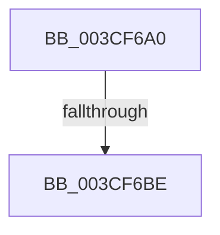

# RtlFindNextForwardRunClear

- RVA: `0x003CF6A0`–`0x003CF6C1` (길이 `33` bytes)
- VA: `0x00000001403CF6A0`
- 실행 섹션: `.text`
- PDB 이름 있음: `예`; PDB Function 태그: `아니요`
- unwind 정보 RVA: `0x000906A4`
- 디코드: `10`개 명령, `33/33` bytes 표시
- 미해석 바이트: `0` (있으면 어셈블리에 `.byte`로 보존)

> 이 문서는 커널 이미지의 기계어와 PDB 기호를 분석해 생성했습니다. 4번과 5번은 함수 원형과 자료형을 바이너리 사용 방식에서 추정한 C 해석이며 원본 소스 복구 결과는 아닙니다.

## 1. Dependencies

- 직접 호출 지점: **0**; 고유 호출 대상: **0**
- 직접 호출자로 확인된 함수: **8**
- RIP 상대 이미지 참조: **0**

### Outgoing calls
- 직접 디코드된 call 명령이 없습니다.

### Direct callers
- [HalpIrtAllocateIndex](../../page/70/HalpIrtAllocateIndex_function_0070A9D4.md) at `0x0070AB09`
- [MiPrepareToHotPatchImage](../../page/80/MiPrepareToHotPatchImage_function_00806820.md) at `0x00806D3A`
- [HvpGenerateLogMetadata](../../page/9B/HvpGenerateLogMetadata_function_009B68B0.md) at `0x009B691B`
- [HvpCountSetRangesInVector](../../page/9B/HvpCountSetRangesInVector_function_009B6974.md) at `0x009B699D`
- [MiHandleDriverNonPagedSections](../../page/A4/MiHandleDriverNonPagedSections_function_00A4AEA8.md) at `0x00A4AF5C`
- [PnprMirrorMarkedPages](../../pagelk/B6/PnprMirrorMarkedPages_function_00B6480C.md) at `0x00B64937`
- [PopGetRemainingHibernateRangeDataSize](../../pagelk/B6/PopGetRemainingHibernateRangeDataSize_function_00B6D7A0.md) at `0x00B6D7EE`
- [ViThunkSnapSharedExports](../../pagevrfy/BB/ViThunkSnapSharedExports_function_00BB642C.md) at `0x00BB647C`

### Static image references
- 디코드된 RIP-relative 메모리 참조가 없습니다.

## 2. Other-region calls and transfers

- 다른 실행 섹션으로 향하는 call: **0**
- call이 아닌 외부 분기/꼬리 이동: **1**
  - `0x003CF6B8` → [sub_003CF78F](Unknown_function_003CF78F.md) (`tail-transfer`)

## 3. Assembly (complete function range)

```asm
003CF6A0  48 89 5C 24 18                  mov qword ptr [rsp + 0x18], rbx
003CF6A5  48 89 7C 24 20                  mov qword ptr [rsp + 0x20], rdi
003CF6AA  41 56                           push r14
003CF6AC  8B 39                           mov edi, dword ptr [rcx]
003CF6AE  33 DB                           xor ebx, ebx
003CF6B0  44 8B DA                        mov r11d, edx
003CF6B3  4D 8B F0                        mov r14, r8
003CF6B6  3B FA                           cmp edi, edx
003CF6B8  0F 86 D1 00 00 00               jbe 0x1403cf78f
003CF6BE  41 8B C3                        mov eax, r11d
```

## 4. C-style interpretation (structured pseudocode)

```c
__int64 __fastcall RtlFindNextForwardRunClear(__int64 a1, int a2, __int64 a3)
{
    __int64 v_rbx;
    unsigned __int64 v_stack_p18;
    unsigned __int64 v_stack_p20;

    v_stack_p18 = v_rbx;
    v_stack_p20 = v_rdi;
    v_rbx = 0;
    return (unsigned int)((unsigned int)((unsigned int)(a2)));
}
```

## 5. (Beta) C Style

```c
int64_t RtlFindNextForwardRunClear(void *Arg1, int32_t Arg2, int64_t Arg3)
{
    uint8_t *arg1 = (uint8_t *)Arg1;

    int64_t local_rbx;
    uint64_t v_stack_p18;
    uint64_t v_stack_p20;

    v_stack_p18 = local_rbx;
    v_stack_p20 = local_rdi;
    local_rbx = 0;
    return (uint32_t)((uint32_t)((uint32_t)(Arg2)));
}
```

### 관측된 메모리 오프셋

구조체 형식이 확인되지 않은 접근은 인자 기준의 오프셋으로만 기록했습니다.

| 기준 인자 | 오프셋 표현 | 폭 (bit) | 접근 |
|---|---:|---:|---|
| `Arg1` | `+ 0x0` | `32` | `R` |

## 6. Execution-region graph

[열기: 2D/3D 그래프와 함수 탐색 컨트롤 패널](../../../control-panel.html?section=text&rva=0x003CF6A0&view=graph)

- 2D 그래프는 위에서 아래로 흐르고, 3D 그래프는 빈 공간을 드래그해 회전합니다. Shift+드래그는 이동, 휠은 확대·축소, 함수 노드 선택은 대상 보고서 이동입니다.

### Static fallback


