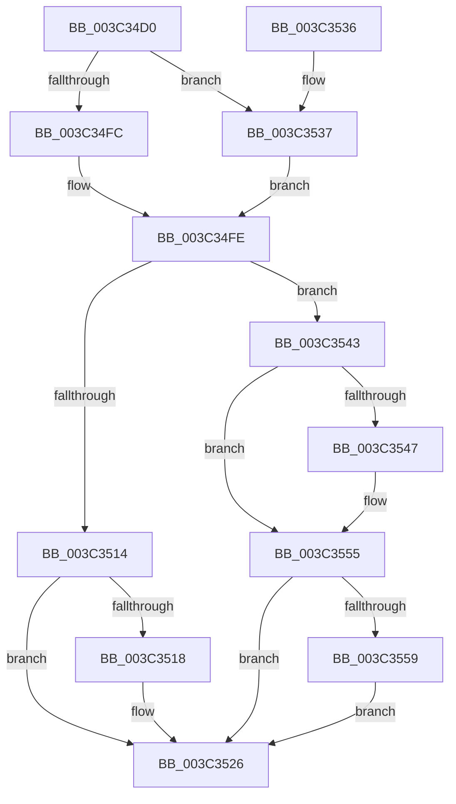

# SMKM_STORE&lt;SM_TRAITS&gt;::SmStUpdateMemoryCondition

- RVA: `0x003C34D0`–`0x003C356B` (길이 `155` bytes)
- VA: `0x00000001403C34D0`
- 실행 섹션: `.text`
- PDB 이름 있음: `예`; PDB Function 태그: `아니요`
- unwind 정보 RVA: `0x00081628`
- 디코드: `43`개 명령, `155/155` bytes 표시
- 미해석 바이트: `0` (있으면 어셈블리에 `.byte`로 보존)

> 이 문서는 커널 이미지의 기계어와 PDB 기호를 분석해 생성했습니다. 4번과 5번은 함수 원형과 자료형을 바이너리 사용 방식에서 추정한 C 해석이며 원본 소스 복구 결과는 아닙니다.

## 1. Dependencies

- 직접 호출 지점: **4**; 고유 호출 대상: **3**
- 직접 호출자로 확인된 함수: **1**
- RIP 상대 이미지 참조: **1**

### Outgoing calls
- `0x003C350A` → [KeQueryPriorityThread](../38/KeQueryPriorityThread_function_0038F4F0.md) (function, `0x0038F4F0`)
- `0x003C3521` → [KeSetActualBasePriorityThread](KeSetActualBasePriorityThread_function_003C4370.md) (function, `0x003C4370`)
- `0x003C3550` → [KeSetActualBasePriorityThread](KeSetActualBasePriorityThread_function_003C4370.md) (function, `0x003C4370`)
- `0x003C3564` → [ST_STORE<SM_TRAITS>::StDmLazyWorkItemQueue](ST_STORE_SM_TRAITS_StDmLazyWorkItemQueue_function_003C2080.md) (function, `0x003C2080`)

### Direct callers
- [SMKM_STORE_MGR&lt;SM_TRAITS&gt;::SmUpdateMemoryConditions](../34/SMKM_STORE_MGR_SM_TRAITS_SmUpdateMemoryConditions_function_0034BD60.md) at `0x0034BDC8`

### Static image references
- `0x003C3537` → RVA `0x00038018` (`.rdata`; read)

## 2. Other-region calls and transfers

- 다른 실행 섹션으로 향하는 call: **0**
- 별도 외부 분기/꼬리 이동을 확인하지 못했습니다.

## 3. Assembly (complete function range)

```asm
003C34D0  48 89 5C 24 08                  mov qword ptr [rsp + 8], rbx
003C34D5  48 89 74 24 10                  mov qword ptr [rsp + 0x10], rsi
003C34DA  57                              push rdi
003C34DB  48 83 EC 20                     sub rsp, 0x20
003C34DF  8B F2                           mov esi, edx
003C34E1  48 8B D9                        mov rbx, rcx
003C34E4  40 88 B1 96 1A 00 00            mov byte ptr [rcx + 0x1a96], sil
003C34EB  0F B6 81 96 1A 00 00            movzx eax, byte ptr [rcx + 0x1a96]
003C34F2  8B B9 98 1D 00 00               mov edi, dword ptr [rcx + 0x1d98]
003C34F8  3C 04                           cmp al, 4
003C34FA  75 3B                           jne 0x1403c3537
003C34FC  8B C7                           mov eax, edi
003C34FE  48 8B 8B 58 1B 00 00            mov rcx, qword ptr [rbx + 0x1b58]
003C3505  3B C7                           cmp eax, edi
003C3507  0F 4D F8                        cmovge edi, eax
003C350A  E8 E1 BF FC FF                  call 0x14038f4f0
003C350F  83 FE 04                        cmp esi, 4
003C3512  7C 2F                           jl 0x1403c3543
003C3514  3B C7                           cmp eax, edi
003C3516  7E 0E                           jle 0x1403c3526
003C3518  48 8B 8B 58 1B 00 00            mov rcx, qword ptr [rbx + 0x1b58]
003C351F  8B D7                           mov edx, edi
003C3521  E8 4A 0E 00 00                  call 0x1403c4370
003C3526  48 8B 5C 24 30                  mov rbx, qword ptr [rsp + 0x30]
003C352B  48 8B 74 24 38                  mov rsi, qword ptr [rsp + 0x38]
003C3530  48 83 C4 20                     add rsp, 0x20
003C3534  5F                              pop rdi
003C3535  C3                              ret
003C3536  CC                              int3
003C3537  48 8D 0D DA 4A C7 FF            lea rcx, [rip - 0x38b526]
003C353E  8B 04 81                        mov eax, dword ptr [rcx + rax*4]
003C3541  EB BB                           jmp 0x1403c34fe
003C3543  3B C7                           cmp eax, edi
003C3545  74 0E                           je 0x1403c3555
003C3547  48 8B 8B 58 1B 00 00            mov rcx, qword ptr [rbx + 0x1b58]
003C354E  8B D7                           mov edx, edi
003C3550  E8 1B 0E 00 00                  call 0x1403c4370
003C3555  85 F6                           test esi, esi
003C3557  7F CD                           jg 0x1403c3526
003C3559  48 8D 93 50 1A 00 00            lea rdx, [rbx + 0x1a50]
003C3560  48 8D 4B 50                     lea rcx, [rbx + 0x50]
003C3564  E8 17 EB FF FF                  call 0x1403c2080
003C3569  EB BB                           jmp 0x1403c3526
```

## 4. C-style interpretation (structured pseudocode)

```c
__int64 __fastcall SMKM_STORE_SM_TRAITS___SmStUpdateMemoryCondition(__int64 a1, int a2)
{
    __int64 result;
    __int64 v_rdi;
    __int64 v_rsp;
    unsigned __int64 v_stack_p10;
    unsigned __int64 v_stack_p8;

    v_stack_p8 = v_rbx;
    v_stack_p10 = v_rsi;
    v_rsp = (v_rsp) - (32);
    *(unsigned __int8 *)(a1 + 6806) = (unsigned __int8)((unsigned int)(a2));
    if (((unsigned __int8)(*(unsigned __int8 *)(a1 + 6806))) != 4) goto loc_003C3537;
loc_003C34FE:
    v_rdi = (unsigned int)(*(unsigned int *)(a1 + 7576));
    if (((unsigned int)((unsigned int)((unsigned int)((unsigned int)(*(unsigned int *)(a1 + 7576)))))) >= ((unsigned int)((unsigned int)(*(unsigned int *)(a1 + 7576))))) { v_rdi = (unsigned int)((unsigned int)((unsigned int)((unsigned int)(*(unsigned int *)(a1 + 7576))))); }
    result = KeQueryPriorityThread(*(unsigned __int64 *)(a1 + 7000), a2, a3, a4);
    if (((unsigned int)((unsigned int)(a2))) < 4) goto loc_003C3543;
    if (((unsigned int)(result)) >= = ((unsigned int)(v_rdi))) {
        a1 = *(unsigned __int64 *)(a1 + 7000);
        a2 = (unsigned int)(v_rdi);
        result = KeSetActualBasePriorityThread(a1, a2, a3, a4);
    }
    v_rsp = (v_rsp) + (32);
    return result;
loc_003C3537:
    goto loc_003C34FE;
loc_003C3543:
    result = (unsigned int)(*(unsigned int *)(v_rip - 3716390 + result * 4));
    if (((unsigned int)((unsigned int)(*(unsigned int *)(v_rip - 3716390 + result * 4)))) != ((unsigned int)(v_rdi))) {
        a1 = *(unsigned __int64 *)(v_stack_p8 + 7000);
        a2 = (unsigned int)(v_rdi);
        result = KeSetActualBasePriorityThread(a1, a2, a3, a4);
    }
    if (condition_is_greater) goto loc_003C3526;
    result = ST_STORE_SM_TRAITS___StDmLazyWorkItemQueue(v_stack_p8 + 80, v_stack_p8 + 6736, a3, a4);
    goto loc_003C3526;
}
```

## 5. (Beta) C Style

```c
int64_t SMKM_STORE_SM_TRAITS___SmStUpdateMemoryCondition(void *Arg1, int32_t Arg2)
{
    uint8_t *arg1 = (uint8_t *)Arg1;

    int64_t result;
    int64_t local_rdi;
    int64_t local_rsp;
    uint64_t v_stack_p10;
    uint64_t v_stack_p8;

    v_stack_p8 = local_rbx;
    v_stack_p10 = local_rsi;
    local_rsp = (local_rsp) - (32);
    *(uint8_t *)(arg1 + 0x1A96) = (uint8_t)((uint32_t)(Arg2));
    if (((uint8_t)(*(uint8_t *)(arg1 + 0x1A96))) != 4) goto loc_003C3537;
loc_003C34FE:
    local_rdi = (uint32_t)(*(uint32_t *)(arg1 + 0x1D98));
    if (((uint32_t)((uint32_t)((uint32_t)((uint32_t)(*(uint32_t *)(arg1 + 0x1D98)))))) >= ((uint32_t)((uint32_t)(*(uint32_t *)(arg1 + 0x1D98))))) { local_rdi = (uint32_t)((uint32_t)((uint32_t)((uint32_t)(*(uint32_t *)(arg1 + 0x1D98))))); }
    result = KeQueryPriorityThread(*(uint64_t *)(arg1 + 0x1B58), Arg2, a3, a4);
    if (((uint32_t)((uint32_t)(Arg2))) < 4) goto loc_003C3543;
    if (((uint32_t)(result)) >= = ((uint32_t)(local_rdi))) {
        Arg1 = *(uint64_t *)(arg1 + 0x1B58);
        Arg2 = (uint32_t)(local_rdi);
        result = KeSetActualBasePriorityThread(Arg1, Arg2, a3, a4);
    }
    local_rsp = (local_rsp) + (32);
    return result;
loc_003C3537:
    goto loc_003C34FE;
loc_003C3543:
    result = (uint32_t)(*(uint32_t *)(v_rip - 0x38B526 + result * 4));
    if (((uint32_t)((uint32_t)(*(uint32_t *)(v_rip - 0x38B526 + result * 4)))) != ((uint32_t)(local_rdi))) {
        Arg1 = *(uint64_t *)(v_stack_p8 + 0x1B58);
        Arg2 = (uint32_t)(local_rdi);
        result = KeSetActualBasePriorityThread(Arg1, Arg2, a3, a4);
    }
    if (condition_is_greater) goto loc_003C3526;
    result = ST_STORE_SM_TRAITS___StDmLazyWorkItemQueue(v_stack_p8 + 80, v_stack_p8 + 6736, a3, a4);
    goto loc_003C3526;
}
```

### 관측된 메모리 오프셋

구조체 형식이 확인되지 않은 접근은 인자 기준의 오프셋으로만 기록했습니다.

| 기준 인자 | 오프셋 표현 | 폭 (bit) | 접근 |
|---|---:|---:|---|
| `Arg1` | `+ 0x50` | `64` | `R` |
| `Arg1` | `+ 0x1A50` | `64` | `R` |
| `Arg1` | `+ 0x1A96` | `8` | `R` |
| `Arg1` | `+ 0x1A96` | `8` | `W` |
| `Arg1` | `+ 0x1B58` | `64` | `R` |
| `Arg1` | `+ 0x1D98` | `32` | `R` |

## 6. Execution-region graph

[열기: 2D/3D 그래프와 함수 탐색 컨트롤 패널](../../../control-panel.html?section=text&rva=0x003C34D0&view=graph)

- 2D 그래프는 위에서 아래로 흐르고, 3D 그래프는 빈 공간을 드래그해 회전합니다. Shift+드래그는 이동, 휠은 확대·축소, 함수 노드 선택은 대상 보고서 이동입니다.

### Static fallback


