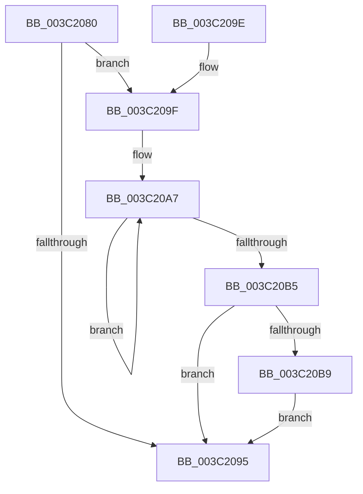

# ST_STORE&lt;SM_TRAITS&gt;::StDmLazyWorkItemQueue

- RVA: `0x003C2080`–`0x003C20D0` (길이 `80` bytes)
- VA: `0x00000001403C2080`
- 실행 섹션: `.text`
- PDB 이름 있음: `예`; PDB Function 태그: `아니요`
- unwind 정보 RVA: `0x0008E1E4`
- 디코드: `25`개 명령, `80/80` bytes 표시
- 미해석 바이트: `0` (있으면 어셈블리에 `.byte`로 보존)

> 이 문서는 커널 이미지의 기계어와 PDB 기호를 분석해 생성했습니다. 4번과 5번은 함수 원형과 자료형을 바이너리 사용 방식에서 추정한 C 해석이며 원본 소스 복구 결과는 아닙니다.

## 1. Dependencies

- 직접 호출 지점: **1**; 고유 호출 대상: **1**
- 직접 호출자로 확인된 함수: **4**
- RIP 상대 이미지 참조: **0**

### Outgoing calls
- `0x003C20C6` → [SMKM_STORE<SM_TRAITS>::SmStWorkItemQueue](../31/SMKM_STORE_SM_TRAITS_SmStWorkItemQueue_function_00317A34.md) (function, `0x00317A34`)

### Direct callers
- [SMKM_STORE&lt;SM_TRAITS&gt;::SmStDirectReadIssue](../20/SMKM_STORE_SM_TRAITS_SmStDirectReadIssue_function_00203444.md) at `0x002034F4`
- [SMKM_STORE&lt;SM_TRAITS&gt;::SmStUpdateMemoryCondition](SMKM_STORE_SM_TRAITS_SmStUpdateMemoryCondition_function_003C34D0.md) at `0x003C3564`
- [ST_STORE&lt;SM_TRAITS&gt;::StDmUpdateRegionLazyCleanup](../4B/ST_STORE_SM_TRAITS_StDmUpdateRegionLazyCleanup_function_004BC8DC.md) at `0x004BC959`
- [sub_006F84D2](../6F/Unknown_function_006F84D2.md) at `0x006F85E2`

### Static image references
- 디코드된 RIP-relative 메모리 참조가 없습니다.

## 2. Other-region calls and transfers

- 다른 실행 섹션으로 향하는 call: **0**
- 별도 외부 분기/꼬리 이동을 확인하지 못했습니다.

## 3. Assembly (complete function range)

```asm
003C2080  40 53                           push rbx
003C2082  48 83 EC 20                     sub rsp, 0x20
003C2086  45 33 C0                        xor r8d, r8d
003C2089  4C 8B C9                        mov r9, rcx
003C208C  41 8D 58 01                     lea ebx, [r8 + 1]
003C2090  84 5A 0C                        test byte ptr [rdx + 0xc], bl
003C2093  74 0A                           je 0x1403c209f
003C2095  41 8B C0                        mov eax, r8d
003C2098  48 83 C4 20                     add rsp, 0x20
003C209C  5B                              pop rbx
003C209D  C3                              ret
003C209E  CC                              int3
003C209F  0F 0D 4A 0C                     prefetchw byte ptr [rdx + 0xc]
003C20A3  0F B7 42 0C                     movzx eax, word ptr [rdx + 0xc]
003C20A7  0F B7 C8                        movzx ecx, ax
003C20AA  66 0B CB                        or cx, bx
003C20AD  66 F0 0F B1 4A 0C               lock cmpxchg word ptr [rdx + 0xc], cx
003C20B3  75 F2                           jne 0x1403c20a7
003C20B5  84 C3                           test bl, al
003C20B7  75 DC                           jne 0x1403c2095
003C20B9  49 8B 89 20 03 00 00            mov rcx, qword ptr [r9 + 0x320]
003C20C0  41 B8 02 00 00 00               mov r8d, 2
003C20C6  E8 69 59 F5 FF                  call 0x140317a34
003C20CB  44 8B C3                        mov r8d, ebx
003C20CE  EB C5                           jmp 0x1403c2095
```

## 4. C-style interpretation (structured pseudocode)

```c
__int64 __fastcall ST_STORE_SM_TRAITS___StDmLazyWorkItemQueue(__int64 a1, __int64 a2, int a3)
{
    __int64 result;
    __int64 v_rsp;

    v_rsp = (v_rsp) - (32);
    a3 = 0;
    if (((*(unsigned __int8 *)(a2 + 12)) & ((unsigned __int8)(a3 + 1))) == 0) goto loc_003C209F;
loc_003C2095:
    v_rsp = (v_rsp) + (32);
    return 0;
loc_003C209F:
loc_003C20A7:
    a1 = (unsigned __int16)(((unsigned __int16)(*(unsigned __int16 *)(a2 + 12))) | ((unsigned __int16)(a3 + 1)));
    if (condition_is_not_equal) goto loc_003C20A7;
    if ((((unsigned __int8)(a3 + 1)) & ((unsigned __int8)(*(unsigned __int16 *)(a2 + 12)))) != 0) goto loc_003C2095;
    result = SMKM_STORE_SM_TRAITS___SmStWorkItemQueue(*(unsigned __int64 *)(a1 + 800), a2, 2, a1);
    goto loc_003C2095;
}
```

## 5. (Beta) C Style

```c
int64_t ST_STORE_SM_TRAITS___StDmLazyWorkItemQueue(void *Arg1, void *Arg2, int32_t Arg3)
{
    uint8_t *arg1 = (uint8_t *)Arg1;
    uint8_t *arg2 = (uint8_t *)Arg2;

    int64_t result;
    int64_t local_rsp;

    local_rsp = (local_rsp) - (32);
    Arg3 = 0;
    if (((*(uint8_t *)(arg2 + 0xC)) & ((uint8_t)(Arg3 + 1))) == 0) goto loc_003C209F;
loc_003C2095:
    local_rsp = (local_rsp) + (32);
    return 0;
loc_003C209F:
loc_003C20A7:
    Arg1 = (uint16_t)(((uint16_t)(*(uint16_t *)(arg2 + 0xC))) | ((uint16_t)(Arg3 + 1)));
    if (condition_is_not_equal) goto loc_003C20A7;
    if ((((uint8_t)(Arg3 + 1)) & ((uint8_t)(*(uint16_t *)(arg2 + 0xC)))) != 0) goto loc_003C2095;
    result = SMKM_STORE_SM_TRAITS___SmStWorkItemQueue(*(uint64_t *)(arg1 + 0x320), Arg2, 2, Arg1);
    goto loc_003C2095;
}
```

### 관측된 메모리 오프셋

구조체 형식이 확인되지 않은 접근은 인자 기준의 오프셋으로만 기록했습니다.

| 기준 인자 | 오프셋 표현 | 폭 (bit) | 접근 |
|---|---:|---:|---|
| `Arg1` | `+ 0x320` | `64` | `R` |
| `Arg2` | `+ 0xC` | `8` | `R` |
| `Arg2` | `+ 0xC` | `16` | `R` |

## 6. Execution-region graph

[열기: 2D/3D 그래프와 함수 탐색 컨트롤 패널](../../../control-panel.html?section=text&rva=0x003C2080&view=graph)

- 2D 그래프는 위에서 아래로 흐르고, 3D 그래프는 빈 공간을 드래그해 회전합니다. Shift+드래그는 이동, 휠은 확대·축소, 함수 노드 선택은 대상 보고서 이동입니다.

### Static fallback


