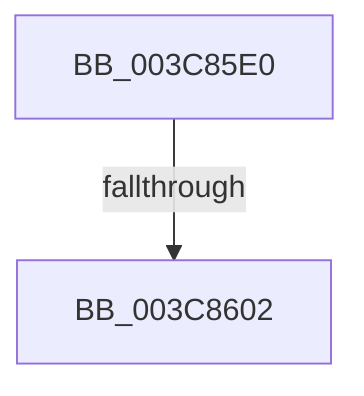

# SepSidInTokenSidHash

- RVA: `0x003C85E0`–`0x003C860A` (길이 `42` bytes)
- VA: `0x00000001403C85E0`
- 실행 섹션: `.text`
- PDB 이름 있음: `예`; PDB Function 태그: `아니요`
- unwind 정보 RVA: `0x0008E984`
- 디코드: `12`개 명령, `42/42` bytes 표시
- 미해석 바이트: `0` (있으면 어셈블리에 `.byte`로 보존)

> 이 문서는 커널 이미지의 기계어와 PDB 기호를 분석해 생성했습니다. 4번과 5번은 함수 원형과 자료형을 바이너리 사용 방식에서 추정한 C 해석이며 원본 소스 복구 결과는 아닙니다.

## 1. Dependencies

- 직접 호출 지점: **0**; 고유 호출 대상: **0**
- 직접 호출자로 확인된 함수: **9**
- RIP 상대 이미지 참조: **0**

### Outgoing calls
- 직접 디코드된 call 명령이 없습니다.

### Direct callers
- [AuthzBasepDeviceMemberOf](../4E/AuthzBasepDeviceMemberOf_function_004E3694.md) at `0x004E3775`
- [SepCreateAppContainerToken](../4F/SepCreateAppContainerToken_function_004F43AC.md) at `0x004F4B76`
- [SepCreateAppContainerToken](../4F/SepCreateAppContainerToken_function_004F43AC.md) at `0x004F4BC3`
- [SepApplyMandatoryAccess](../60/SepApplyMandatoryAccess_function_00607FF4.md) at `0x00608083`
- [SepApplyMandatoryAppAccess](../60/SepApplyMandatoryAppAccess_function_006080D4.md) at `0x00608144`
- [ObpCreateHandle](../../page/86/ObpCreateHandle_function_0086B950.md) at `0x0086CF40`
- [SeQueryInformationToken](../../page/8B/SeQueryInformationToken_function_008B5090.md) at `0x008B6330`
- [NtCreateLowBoxToken](../../page/AB/NtCreateLowBoxToken_function_00AB9880.md) at `0x00ABA207`
- [NtCreateLowBoxToken](../../page/AB/NtCreateLowBoxToken_function_00AB9880.md) at `0x00ABA254`
- [NtQueryInformationToken](../../page/AE/NtQueryInformationToken_function_00AECDD0.md) at `0x00AF048C`
- [sub_00B375D4](../../page/B3/Unknown_function_00B375D4.md) at `0x00B37726`

### Static image references
- 디코드된 RIP-relative 메모리 참조가 없습니다.

## 2. Other-region calls and transfers

- 다른 실행 섹션으로 향하는 call: **0**
- call이 아닌 외부 분기/꼬리 이동: **1**
  - `0x003C85FC` → [sub_003C87C8](Unknown_function_003C87C8.md) (`tail-transfer`)

## 3. Assembly (complete function range)

```asm
003C85E0  44 88 4C 24 20                  mov byte ptr [rsp + 0x20], r9b
003C85E5  53                              push rbx
003C85E6  41 54                           push r12
003C85E8  41 56                           push r14
003C85EA  41 57                           push r15
003C85EC  48 83 EC 38                     sub rsp, 0x38
003C85F0  4D 8B F8                        mov r15, r8
003C85F3  48 8B DA                        mov rbx, rdx
003C85F6  4C 8B F1                        mov r14, rcx
003C85F9  48 85 D2                        test rdx, rdx
003C85FC  0F 85 C6 01 00 00               jne 0x1403c87c8
003C8602  80 BC 24 88 00 00 00 00         cmp byte ptr [rsp + 0x88], 0
```

## 4. C-style interpretation (structured pseudocode)

```c
void __fastcall SepSidInTokenSidHash(__int64 a1, __int64 a2, __int64 a3, unsigned __int8 a4, __int64 a5, unsigned __int8 a6)
{
    __int64 v_rsp;
    unsigned __int8 v_stack_p20;

    v_stack_p20 = a4;
    v_rsp = (v_rsp) - (56);
    return;
}
```

## 5. (Beta) C Style

```c
void SepSidInTokenSidHash(int64_t Arg1, int64_t Arg2, int64_t Arg3, uint8_t Arg4, uint64_t Arg5, uint8_t Arg6)
{
    int64_t local_rsp;
    uint8_t v_stack_p20;

    v_stack_p20 = Arg4;
    local_rsp = (local_rsp) - (56);
    return;
}
```

## 6. Execution-region graph

[열기: 2D/3D 그래프와 함수 탐색 컨트롤 패널](../../../control-panel.html?section=text&rva=0x003C85E0&view=graph)

- 2D 그래프는 위에서 아래로 흐르고, 3D 그래프는 빈 공간을 드래그해 회전합니다. Shift+드래그는 이동, 휠은 확대·축소, 함수 노드 선택은 대상 보고서 이동입니다.

### Static fallback


