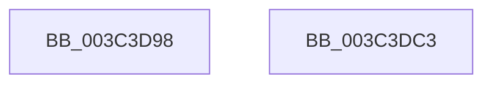

# SmKmFreeMdlForLock

- RVA: `0x003C3D98`–`0x003C3DC4` (길이 `44` bytes)
- VA: `0x00000001403C3D98`
- 실행 섹션: `.text`
- PDB 이름 있음: `예`; PDB Function 태그: `아니요`
- unwind 정보 RVA: `0x0005CF00`
- 디코드: `14`개 명령, `44/44` bytes 표시
- 미해석 바이트: `0` (있으면 어셈블리에 `.byte`로 보존)

> 이 문서는 커널 이미지의 기계어와 PDB 기호를 분석해 생성했습니다. 4번과 5번은 함수 원형과 자료형을 바이너리 사용 방식에서 추정한 C 해석이며 원본 소스 복구 결과는 아닙니다.

## 1. Dependencies

- 직접 호출 지점: **2**; 고유 호출 대상: **2**
- 직접 호출자로 확인된 함수: **2**
- RIP 상대 이미지 참조: **0**

### Outgoing calls
- `0x003C3DAE` → [SmAcquireReleaseCharges](../28/SmAcquireReleaseCharges_function_00285C40.md) (function, `0x00285C40`)
- `0x003C3DB8` → [ExFreePoolWithTag](../../poolcode/B8/ExFreePoolWithTag_function_00B82870.md) (function, `0x00B82870`)

### Direct callers
- [SmKmStoreHelperCommandProcess](SmKmStoreHelperCommandProcess_function_003C3AA4.md) at `0x003C3C07`
- [sub_006E7030](../6E/Unknown_function_006E7030.md) at `0x006E703D`

### Static image references
- 디코드된 RIP-relative 메모리 참조가 없습니다.

## 2. Other-region calls and transfers

- 다른 실행 섹션으로 향하는 call: **1**
  - `0x003C3DB8` → [ExFreePoolWithTag](../../poolcode/B8/ExFreePoolWithTag_function_00B82870.md) (`.text` → `POOLCODE`)
- 별도 외부 분기/꼬리 이동을 확인하지 못했습니다.

## 3. Assembly (complete function range)

```asm
003C3D98  40 53                           push rbx
003C3D9A  48 83 EC 20                     sub rsp, 0x20
003C3D9E  41 B9 01 00 00 00               mov r9d, 1
003C3DA4  48 8B DA                        mov rbx, rdx
003C3DA7  8B 52 28                        mov edx, dword ptr [rdx + 0x28]
003C3DAA  45 8D 41 02                     lea r8d, [r9 + 2]
003C3DAE  E8 8D 1E EC FF                  call 0x140285c40
003C3DB3  33 D2                           xor edx, edx
003C3DB5  48 8B CB                        mov rcx, rbx
003C3DB8  E8 B3 EA 7B 00                  call 0x140b82870
003C3DBD  48 83 C4 20                     add rsp, 0x20
003C3DC1  5B                              pop rbx
003C3DC2  C3                              ret
003C3DC3  CC                              int3
```

## 4. C-style interpretation (structured pseudocode)

```c
__int64 __fastcall SmKmFreeMdlForLock(__int64 a1, __int64 a2)
{
    __int64 result;
    __int64 v_rsp;

    v_rsp = (v_rsp) - (32);
    result = SmAcquireReleaseCharges(a1, (unsigned int)(*(unsigned int *)(a2 + 40)), 1 + 2, 1);
    a2 = 0;
    result = ExFreePoolWithTag(0, a2, 1 + 2, 1);
    v_rsp = (v_rsp) + (32);
    return result;
}
```

## 5. (Beta) C Style

```c
int64_t SmKmFreeMdlForLock(int64_t Arg1, void *Arg2)
{
    uint8_t *arg2 = (uint8_t *)Arg2;

    int64_t result;
    int64_t local_rsp;

    local_rsp = (local_rsp) - (32);
    result = SmAcquireReleaseCharges(Arg1, (uint32_t)(*(uint32_t *)(arg2 + 0x28)), 1 + 2, 1);
    Arg2 = 0;
    result = ExFreePoolWithTag(0, Arg2, 1 + 2, 1);
    local_rsp = (local_rsp) + (32);
    return result;
}
```

### 관측된 메모리 오프셋

구조체 형식이 확인되지 않은 접근은 인자 기준의 오프셋으로만 기록했습니다.

| 기준 인자 | 오프셋 표현 | 폭 (bit) | 접근 |
|---|---:|---:|---|
| `Arg2` | `+ 0x28` | `32` | `R` |

## 6. Execution-region graph

[열기: 2D/3D 그래프와 함수 탐색 컨트롤 패널](../../../control-panel.html?section=text&rva=0x003C3D98&view=graph)

- 2D 그래프는 위에서 아래로 흐르고, 3D 그래프는 빈 공간을 드래그해 회전합니다. Shift+드래그는 이동, 휠은 확대·축소, 함수 노드 선택은 대상 보고서 이동입니다.

### Static fallback


