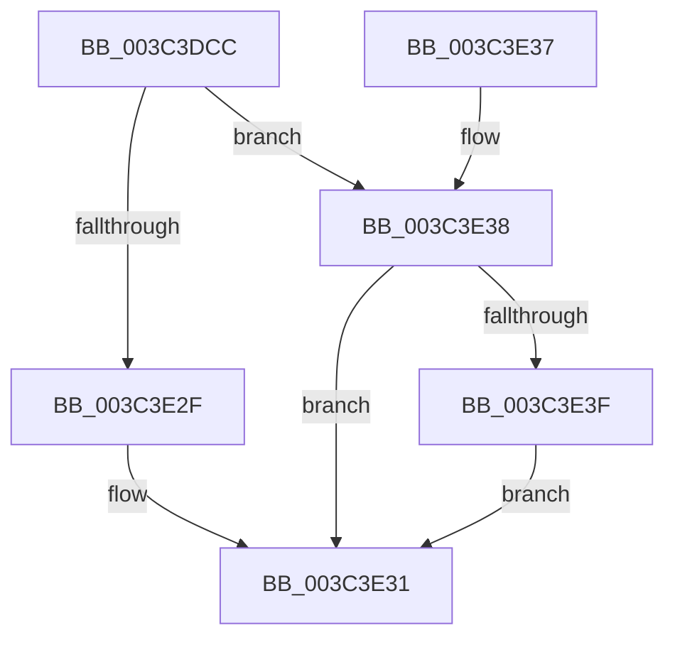

# SmKmProbeAndLockAddress

- RVA: `0x003C3DCC`–`0x003C3E46` (길이 `122` bytes)
- VA: `0x00000001403C3DCC`
- 실행 섹션: `.text`
- PDB 이름 있음: `예`; PDB Function 태그: `아니요`
- unwind 정보 RVA: `0x0008E35C`
- 디코드: `33`개 명령, `122/122` bytes 표시
- 미해석 바이트: `0` (있으면 어셈블리에 `.byte`로 보존)

> 이 문서는 커널 이미지의 기계어와 PDB 기호를 분석해 생성했습니다. 4번과 5번은 함수 원형과 자료형을 바이너리 사용 방식에서 추정한 C 해석이며 원본 소스 복구 결과는 아닙니다.

## 1. Dependencies

- 직접 호출 지점: **1**; 고유 호출 대상: **1**
- 직접 호출자로 확인된 함수: **2**
- RIP 상대 이미지 참조: **0**

### Outgoing calls
- `0x003C3E26` → [MmStoreProbeAndLockPages](../23/MmStoreProbeAndLockPages_function_0023E570.md) (function, `0x0023E570`)

### Direct callers
- [SmKmStoreHelperCommandProcess](SmKmStoreHelperCommandProcess_function_003C3AA4.md) at `0x003C3B7A`
- [sub_006E8004](../6E/Unknown_function_006E8004.md) at `0x006E805D`

### Static image references
- 디코드된 RIP-relative 메모리 참조가 없습니다.

## 2. Other-region calls and transfers

- 다른 실행 섹션으로 향하는 call: **0**
- 별도 외부 분기/꼬리 이동을 확인하지 못했습니다.

## 3. Assembly (complete function range)

```asm
003C3DCC  40 57                           push rdi
003C3DCE  48 83 EC 20                     sub rsp, 0x20
003C3DD2  44 8B D9                        mov r11d, ecx
003C3DD5  41 89 50 28                     mov dword ptr [r8 + 0x28], edx
003C3DD9  45 8B D3                        mov r10d, r11d
003C3DDC  48 81 E1 00 F0 FF FF            and rcx, 0xfffffffffffff000
003C3DE3  41 81 E2 FF 0F 00 00            and r10d, 0xfff
003C3DEA  49 89 48 20                     mov qword ptr [r8 + 0x20], rcx
003C3DEE  49 81 C2 FF 0F 00 00            add r10, 0xfff
003C3DF5  33 FF                           xor edi, edi
003C3DF7  4C 03 D2                        add r10, rdx
003C3DFA  49 89 38                        mov qword ptr [r8], rdi
003C3DFD  49 C1 EA 0C                     shr r10, 0xc
003C3E01  41 81 E3 FF 0F 00 00            and r11d, 0xfff
003C3E08  66 41 83 C2 06                  add r10w, 6
003C3E0D  66 41 89 78 0A                  mov word ptr [r8 + 0xa], di
003C3E12  66 41 C1 E2 03                  shl r10w, 3
003C3E17  41 8B D1                        mov edx, r9d
003C3E1A  49 8B C8                        mov rcx, r8
003C3E1D  66 45 89 50 08                  mov word ptr [r8 + 8], r10w
003C3E22  45 89 58 2C                     mov dword ptr [r8 + 0x2c], r11d
003C3E26  E8 45 A7 E7 FF                  call 0x14023e570
003C3E2B  85 C0                           test eax, eax
003C3E2D  78 09                           js 0x1403c3e38
003C3E2F  8B C7                           mov eax, edi
003C3E31  48 83 C4 20                     add rsp, 0x20
003C3E35  5F                              pop rdi
003C3E36  C3                              ret
003C3E37  CC                              int3
003C3E38  3D 17 00 00 C0                  cmp eax, 0xc0000017
003C3E3D  75 F2                           jne 0x1403c3e31
003C3E3F  B8 AD 01 00 C0                  mov eax, 0xc00001ad
003C3E44  EB EB                           jmp 0x1403c3e31
```

## 4. C-style interpretation (structured pseudocode)

```c
__int64 __fastcall SmKmProbeAndLockAddress(__int64 a1, __int64 a2, __int64 a3, int a4)
{
    __int64 result;
    __int64 v_r10;
    __int64 v_r11;
    __int64 v_rdi;
    __int64 v_rsp;

    v_rsp = (v_rsp) - (32);
    *(unsigned int *)(a3 + 40) = (unsigned int)(a2);
    a1 = (a1) & (0xFFFFFFFFFFFFF000ULL);
    v_r10 = (unsigned int)(((unsigned int)((unsigned int)((unsigned int)((unsigned int)(a1))))) & (0xFFFULL));
    *(unsigned __int64 *)(a3 + 32) = a1;
    v_r10 = (v_r10) + (0xFFFULL);
    v_rdi = 0;
    v_r10 = (v_r10) + (a2);
    *(unsigned __int64 *)(a3) = 0;
    v_r10 = (v_r10) >> (12);
    v_r11 = (unsigned int)(((unsigned int)((unsigned int)(a1))) & (0xFFFULL));
    v_r10 = (unsigned __int16)((v_r10) + (6));
    *(unsigned __int16 *)(a3 + 10) = 0;
    v_r10 = (unsigned __int16)((v_r10) << (3));
    *(unsigned __int16 *)(a3 + 8) = (unsigned __int16)(v_r10);
    *(unsigned int *)(a3 + 44) = (unsigned int)(v_r11);
    result = MmStoreProbeAndLockPages(a3, (unsigned int)(a4), a3, a4);
    if (sign_flag) goto loc_003C3E38;
loc_003C3E31:
    v_rsp = (v_rsp) + (32);
    return 0;
loc_003C3E38:
    if (0 != 0xC0000017ULL) goto loc_003C3E31;
    goto loc_003C3E31;
}
```

## 5. (Beta) C Style

```c
int64_t SmKmProbeAndLockAddress(int64_t Arg1, int64_t Arg2, void *Arg3, int32_t Arg4)
{
    uint8_t *arg3 = (uint8_t *)Arg3;

    int64_t result;
    int64_t local_r10;
    int64_t local_r11;
    int64_t local_rdi;
    int64_t local_rsp;

    local_rsp = (local_rsp) - (32);
    *(uint32_t *)(arg3 + 0x28) = (uint32_t)(Arg2);
    Arg1 = (Arg1) & (0xFFFFFFFFFFFFF000ULL);
    local_r10 = (uint32_t)(((uint32_t)((uint32_t)((uint32_t)((uint32_t)(Arg1))))) & (0xFFFULL));
    *(uint64_t *)(arg3 + 0x20) = Arg1;
    local_r10 = (local_r10) + (0xFFFULL);
    local_rdi = 0;
    local_r10 = (local_r10) + (Arg2);
    *(uint64_t *)(arg3) = 0;
    local_r10 = (local_r10) >> (12);
    local_r11 = (uint32_t)(((uint32_t)((uint32_t)(Arg1))) & (0xFFFULL));
    local_r10 = (uint16_t)((local_r10) + (6));
    *(uint16_t *)(arg3 + 0xA) = 0;
    local_r10 = (uint16_t)((local_r10) << (3));
    *(uint16_t *)(arg3 + 0x8) = (uint16_t)(local_r10);
    *(uint32_t *)(arg3 + 0x2C) = (uint32_t)(local_r11);
    result = MmStoreProbeAndLockPages(Arg3, (uint32_t)(Arg4), Arg3, Arg4);
    if (sign_flag) goto loc_003C3E38;
loc_003C3E31:
    local_rsp = (local_rsp) + (32);
    return 0;
loc_003C3E38:
    if (0 != 0xC0000017ULL) goto loc_003C3E31;
    goto loc_003C3E31;
}
```

### 관측된 메모리 오프셋

구조체 형식이 확인되지 않은 접근은 인자 기준의 오프셋으로만 기록했습니다.

| 기준 인자 | 오프셋 표현 | 폭 (bit) | 접근 |
|---|---:|---:|---|
| `Arg3` | `+ 0x0` | `64` | `W` |
| `Arg3` | `+ 0x8` | `16` | `W` |
| `Arg3` | `+ 0xA` | `16` | `W` |
| `Arg3` | `+ 0x20` | `64` | `W` |
| `Arg3` | `+ 0x28` | `32` | `W` |
| `Arg3` | `+ 0x2C` | `32` | `W` |

## 6. Execution-region graph

[열기: 2D/3D 그래프와 함수 탐색 컨트롤 패널](../../../control-panel.html?section=text&rva=0x003C3DCC&view=graph)

- 2D 그래프는 위에서 아래로 흐르고, 3D 그래프는 빈 공간을 드래그해 회전합니다. Shift+드래그는 이동, 휠은 확대·축소, 함수 노드 선택은 대상 보고서 이동입니다.

### Static fallback


