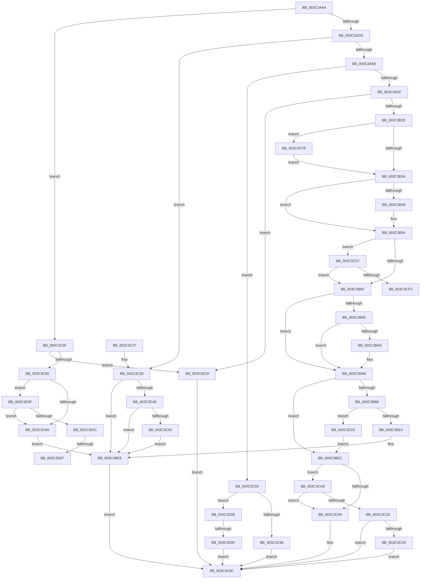

# SmKmStoreHelperCommandProcess

- RVA: `0x003C3AA4`–`0x003C3D91` (길이 `749` bytes)
- VA: `0x00000001403C3AA4`
- 실행 섹션: `.text`
- PDB 이름 있음: `예`; PDB Function 태그: `예`
- unwind 정보 RVA: `0x0008E330`
- 디코드: `192`개 명령, `749/749` bytes 표시
- 미해석 바이트: `0` (있으면 어셈블리에 `.byte`로 보존)

> 이 문서는 커널 이미지의 기계어와 PDB 기호를 분석해 생성했습니다. 4번과 5번은 함수 원형과 자료형을 바이너리 사용 방식에서 추정한 C 해석이며 원본 소스 복구 결과는 아닙니다.

## 1. Dependencies

- 직접 호출 지점: **16**; 고유 호출 대상: **13**
- 직접 호출자로 확인된 함수: **2**
- RIP 상대 이미지 참조: **0**

### Outgoing calls
- `0x003C3B1D` → [SmFpAllocate](../31/SmFpAllocate_function_00317D10.md) (function, `0x00317D10`)
- `0x003C3B3D` → [PsGetPagePriorityThread](PsGetPagePriorityThread_function_003C3E80.md) (function, `0x003C3E80`)
- `0x003C3B4C` → [PsSetPagePriorityThread](PsSetPagePriorityThread_function_003C4138.md) (function, `0x003C4138`)
- `0x003C3B7A` → [SmKmProbeAndLockAddress](SmKmProbeAndLockAddress_function_003C3DCC.md) (function, `0x003C3DCC`)
- `0x003C3B97` → [PsGetPagePriorityThread](PsGetPagePriorityThread_function_003C3E80.md) (function, `0x003C3E80`)
- `0x003C3BA3` → [PsSetPagePriorityThread](PsSetPagePriorityThread_function_003C4138.md) (function, `0x003C4138`)
- `0x003C3BD2` → [SmFpAllocate](../31/SmFpAllocate_function_00317D10.md) (function, `0x00317D10`)
- `0x003C3C07` → [SmKmFreeMdlForLock](SmKmFreeMdlForLock_function_003C3D98.md) (function, `0x003C3D98`)
- `0x003C3C46` → [MmStoreFreeVirtualMemory](../../page/A7/MmStoreFreeVirtualMemory_function_00A767A8.md) (function, `0x00A767A8`)
- `0x003C3C58` → [SmKmVirtualLockCtxMemoryUnlocked](../61/SmKmVirtualLockCtxMemoryUnlocked_function_0061015C.md) (function, `0x0061015C`)
- `0x003C3C6B` → [MmStoreAllocateVirtualMemory](../../page/A6/MmStoreAllocateVirtualMemory_function_00A68238.md) (function, `0x00A68238`)
- `0x003C3CA2` → [guard_dispatch_icall](../6B/guard_dispatch_icall_function_006BAAD0.md) (function, `0x006BAAD0`)
- `0x003C3CB9` → [SmpFpReleaseResource](../4F/SmpFpReleaseResource_function_004FAC90.md) (function, `0x004FAC90`)
- `0x003C3CDD` → [KeSetEvent](../33/KeSetEvent_function_0033F310.md) (function, `0x0033F310`)
- `0x003C3D35` → [SmKmUnlockMdl](../37/SmKmUnlockMdl_function_00372A44.md) (function, `0x00372A44`)
- `0x003C3D77` → [SmAcquireReleaseCharges](../28/SmAcquireReleaseCharges_function_00285C40.md) (function, `0x00285C40`)

### Direct callers
- [SmKmStoreHelperWorker](SmKmStoreHelperWorker_function_003C2BC0.md) at `0x003C2C23`
- [SmKmStoreHelperCommandCleanup](../4D/SmKmStoreHelperCommandCleanup_function_004D03FC.md) at `0x004D04D5`

### Static image references
- 디코드된 RIP-relative 메모리 참조가 없습니다.

## 2. Other-region calls and transfers

- 다른 실행 섹션으로 향하는 call: **2**
  - `0x003C3C46` → [MmStoreFreeVirtualMemory](../../page/A7/MmStoreFreeVirtualMemory_function_00A767A8.md) (`.text` → `PAGE`)
  - `0x003C3C6B` → [MmStoreAllocateVirtualMemory](../../page/A6/MmStoreAllocateVirtualMemory_function_00A68238.md) (`.text` → `PAGE`)
- call이 아닌 외부 분기/꼬리 이동: **4**
  - `0x003C3CF3` → [sub_006E8004 + 0x2C](../6E/Unknown_function_006E8004.md) (`tail-transfer`)
  - `0x003C3D09` → [sub_006E8004](../6E/Unknown_function_006E8004.md) (`tail-transfer`)
  - `0x003C3D81` → [sub_006E8004 + 0x8F](../6E/Unknown_function_006E8004.md) (`tail-transfer`)
  - `0x003C3D8C` → [sub_006E8004 + 0xCC](../6E/Unknown_function_006E8004.md) (`tail-transfer`)

## 3. Assembly (complete function range)

```asm
003C3AA4  48 89 5C 24 08                  mov qword ptr [rsp + 8], rbx
003C3AA9  55                              push rbp
003C3AAA  56                              push rsi
003C3AAB  57                              push rdi
003C3AAC  41 54                           push r12
003C3AAE  41 55                           push r13
003C3AB0  41 56                           push r14
003C3AB2  41 57                           push r15
003C3AB4  48 8B EC                        mov rbp, rsp
003C3AB7  48 83 EC 40                     sub rsp, 0x40
003C3ABB  33 F6                           xor esi, esi
003C3ABD  49 8B F8                        mov rdi, r8
003C3AC0  48 89 75 F0                     mov qword ptr [rbp - 0x10], rsi
003C3AC4  4C 8B F9                        mov r15, rcx
003C3AC7  48 89 75 58                     mov qword ptr [rbp + 0x58], rsi
003C3ACB  65 4C 8B 2C 25 88 01 00 00      mov r13, qword ptr gs:[0x188]
003C3AD4  83 EA 02                        sub edx, 2
003C3AD7  0F 84 82 01 00 00               je 0x1403c3c5f
003C3ADD  83 EA 01                        sub edx, 1
003C3AE0  0F 84 42 01 00 00               je 0x1403c3c28
003C3AE6  83 EA 01                        sub edx, 1
003C3AE9  0F 85 A4 01 00 00               jne 0x1403c3c93
003C3AEF  49 8B 00                        mov rax, qword ptr [r8]
003C3AF2  44 8D 76 01                     lea r14d, [rsi + 1]
003C3AF6  48 89 45 F0                     mov qword ptr [rbp - 0x10], rax
003C3AFA  8D 56 02                        lea edx, [rsi + 2]
003C3AFD  49 8B 40 08                     mov rax, qword ptr [r8 + 8]
003C3B01  45 33 C9                        xor r9d, r9d
003C3B04  48 89 45 58                     mov qword ptr [rbp + 0x58], rax
003C3B08  41 8B 40 14                     mov eax, dword ptr [r8 + 0x14]
003C3B0C  4C 8B C1                        mov r8, rcx
003C3B0F  48 8B 89 80 00 00 00            mov rcx, qword ptr [rcx + 0x80]
003C3B16  41 23 C6                        and eax, r14d
003C3B19  89 44 24 20                     mov dword ptr [rsp + 0x20], eax
003C3B1D  E8 EE 41 F5 FF                  call 0x140317d10
003C3B22  4C 8B E0                        mov r12, rax
003C3B25  48 85 C0                        test rax, rax
003C3B28  0F 84 EB 01 00 00               je 0x1403c3d19
003C3B2E  8B 57 10                        mov edx, dword ptr [rdi + 0x10]
003C3B31  4D 85 ED                        test r13, r13
003C3B34  0F 84 BE 01 00 00               je 0x1403c3cf8
003C3B3A  49 8B CD                        mov rcx, r13
003C3B3D  E8 3E 03 00 00                  call 0x1403c3e80
003C3B42  89 45 50                        mov dword ptr [rbp + 0x50], eax
003C3B45  3B C2                           cmp eax, edx
003C3B47  74 0B                           je 0x1403c3b54
003C3B49  49 8B CD                        mov rcx, r13
003C3B4C  E8 E7 05 00 00                  call 0x1403c4138
003C3B51  89 45 50                        mov dword ptr [rbp + 0x50], eax
003C3B54  41 8A 85 27 07 00 00            mov al, byte ptr [r13 + 0x727]
003C3B5B  45 33 C9                        xor r9d, r9d
003C3B5E  88 45 48                        mov byte ptr [rbp + 0x48], al
003C3B61  4D 8B C4                        mov r8, r12
003C3B64  41 8A 87 88 00 00 00            mov al, byte ptr [r15 + 0x88]
003C3B6B  41 88 85 27 07 00 00            mov byte ptr [r13 + 0x727], al
003C3B72  48 8B 55 58                     mov rdx, qword ptr [rbp + 0x58]
003C3B76  48 8B 4D F0                     mov rcx, qword ptr [rbp - 0x10]
003C3B7A  E8 4D 02 00 00                  call 0x1403c3dcc
003C3B7F  8B D8                           mov ebx, eax
003C3B81  3D AD 01 00 C0                  cmp eax, 0xc00001ad
003C3B86  0F 84 5B 01 00 00               je 0x1403c3ce7
003C3B8C  8B 55 50                        mov edx, dword ptr [rbp + 0x50]
003C3B8F  3B 57 10                        cmp edx, dword ptr [rdi + 0x10]
003C3B92  74 14                           je 0x1403c3ba8
003C3B94  49 8B CD                        mov rcx, r13
003C3B97  E8 E4 02 00 00                  call 0x1403c3e80
003C3B9C  3B C2                           cmp eax, edx
003C3B9E  74 08                           je 0x1403c3ba8
003C3BA0  49 8B CD                        mov rcx, r13
003C3BA3  E8 90 05 00 00                  call 0x1403c4138
003C3BA8  8A 45 48                        mov al, byte ptr [rbp + 0x48]
003C3BAB  41 88 85 27 07 00 00            mov byte ptr [r13 + 0x727], al
003C3BB2  85 DB                           test ebx, ebx
003C3BB4  78 36                           js 0x1403c3bec
003C3BB6  8B 47 14                        mov eax, dword ptr [rdi + 0x14]
003C3BB9  4D 8B CC                        mov r9, r12
003C3BBC  49 8B 8F 80 00 00 00            mov rcx, qword ptr [r15 + 0x80]
003C3BC3  41 23 C6                        and eax, r14d
003C3BC6  4D 8B C7                        mov r8, r15
003C3BC9  89 44 24 20                     mov dword ptr [rsp + 0x20], eax
003C3BCD  BA 05 00 00 00                  mov edx, 5
003C3BD2  E8 39 41 F5 FF                  call 0x140317d10
003C3BD7  48 89 45 F0                     mov qword ptr [rbp - 0x10], rax
003C3BDB  48 85 C0                        test rax, rax
003C3BDE  0F 84 3F 01 00 00               je 0x1403c3d23
003C3BE4  4C 89 67 20                     mov qword ptr [rdi + 0x20], r12
003C3BE8  8B DE                           mov ebx, esi
003C3BEA  EB 20                           jmp 0x1403c3c0c
003C3BEC  4D 8B B7 80 00 00 00            mov r14, qword ptr [r15 + 0x80]
003C3BF3  49 8B 46 70                     mov rax, qword ptr [r14 + 0x70]
003C3BF7  49 3B C7                        cmp rax, r15
003C3BFA  0F 84 AE 00 00 00               je 0x1403c3cae
003C3C00  49 8B 4E 20                     mov rcx, qword ptr [r14 + 0x20]
003C3C04  49 8B D4                        mov rdx, r12
003C3C07  E8 8C 01 00 00                  call 0x1403c3d98
003C3C0C  89 5F 30                        mov dword ptr [rdi + 0x30], ebx
003C3C0F  48 8B 9C 24 80 00 00 00         mov rbx, qword ptr [rsp + 0x80]
003C3C17  48 83 C4 40                     add rsp, 0x40
003C3C1B  41 5F                           pop r15
003C3C1D  41 5E                           pop r14
003C3C1F  41 5D                           pop r13
003C3C21  41 5C                           pop r12
003C3C23  5F                              pop rdi
003C3C24  5E                              pop rsi
003C3C25  5D                              pop rbp
003C3C26  C3                              ret
003C3C27  CC                              int3
003C3C28  49 8B 40 08                     mov rax, qword ptr [r8 + 8]
003C3C2C  41 BE 01 00 00 00               mov r14d, 1
003C3C32  49 8B 08                        mov rcx, qword ptr [r8]
003C3C35  48 89 45 58                     mov qword ptr [rbp + 0x58], rax
003C3C39  41 8B 40 10                     mov eax, dword ptr [r8 + 0x10]
003C3C3D  48 89 4D F0                     mov qword ptr [rbp - 0x10], rcx
003C3C41  41 84 C6                        test r14b, al
003C3C44  75 A2                           jne 0x1403c3be8
003C3C46  E8 5D 2B 6B 00                  call 0x140a767a8
003C3C4B  49 8B 4F 78                     mov rcx, qword ptr [r15 + 0x78]
003C3C4F  48 85 C9                        test rcx, rcx
003C3C52  74 94                           je 0x1403c3be8
003C3C54  48 8B 55 58                     mov rdx, qword ptr [rbp + 0x58]
003C3C58  E8 FF C4 24 00                  call 0x14061015c
003C3C5D  EB 89                           jmp 0x1403c3be8
003C3C5F  49 8B 48 08                     mov rcx, qword ptr [r8 + 8]
003C3C63  41 8B 50 18                     mov edx, dword ptr [r8 + 0x18]
003C3C67  48 89 4D 58                     mov qword ptr [rbp + 0x58], rcx
003C3C6B  E8 C8 45 6A 00                  call 0x140a68238
003C3C70  48 89 45 F0                     mov qword ptr [rbp - 0x10], rax
003C3C74  48 8B C8                        mov rcx, rax
003C3C77  48 85 C0                        test rax, rax
003C3C7A  0F 84 99 00 00 00               je 0x1403c3d19
003C3C80  49 39 77 78                     cmp qword ptr [r15 + 0x78], rsi
003C3C84  0F 85 B5 00 00 00               jne 0x1403c3d3f
003C3C8A  48 89 4F 20                     mov qword ptr [rdi + 0x20], rcx
003C3C8E  E9 55 FF FF FF                  jmp 0x1403c3be8
003C3C93  83 EA 01                        sub edx, 1
003C3C96  75 6E                           jne 0x1403c3d06
003C3C98  49 8B 00                        mov rax, qword ptr [r8]
003C3C9B  45 33 C0                        xor r8d, r8d
003C3C9E  48 8B 57 08                     mov rdx, qword ptr [rdi + 8]
003C3CA2  E8 29 6E 2F 00                  call 0x1406baad0
003C3CA7  8B D8                           mov ebx, eax
003C3CA9  E9 5E FF FF FF                  jmp 0x1403c3c0c
003C3CAE  4D 8B C4                        mov r8, r12
003C3CB1  BA 02 00 00 00                  mov edx, 2
003C3CB6  49 8B CE                        mov rcx, r14
003C3CB9  E8 D2 6F 13 00                  call 0x1404fac90
003C3CBE  85 C0                           test eax, eax
003C3CC0  0F 84 3A FF FF FF               je 0x1403c3c00
003C3CC6  41 38 76 5E                     cmp byte ptr [r14 + 0x5e], sil
003C3CCA  0F 85 3C FF FF FF               jne 0x1403c3c0c
003C3CD0  49 87 76 70                     xchg qword ptr [r14 + 0x70], rsi
003C3CD4  49 8D 4E 08                     lea rcx, [r14 + 8]
003C3CD8  45 33 C0                        xor r8d, r8d
003C3CDB  33 D2                           xor edx, edx
003C3CDD  E8 2E B6 F7 FF                  call 0x14033f310
003C3CE2  E9 25 FF FF FF                  jmp 0x1403c3c0c
003C3CE7  8B 47 14                        mov eax, dword ptr [rdi + 0x14]
003C3CEA  41 84 C6                        test r14b, al
003C3CED  0F 84 99 FE FF FF               je 0x1403c3b8c
003C3CF3  E9 38 43 32 00                  jmp 0x1406e8030
003C3CF8  65 4C 8B 2C 25 88 01 00 00      mov r13, qword ptr gs:[0x188]
003C3D01  E9 34 FE FF FF                  jmp 0x1403c3b3a
003C3D06  83 FA 01                        cmp edx, 1
003C3D09  0F 84 F5 42 32 00               je 0x1406e8004
003C3D0F  BB 0D 00 00 C0                  mov ebx, 0xc000000d
003C3D14  E9 F3 FE FF FF                  jmp 0x1403c3c0c
003C3D19  BB 9A 00 00 C0                  mov ebx, 0xc000009a
003C3D1E  E9 E9 FE FF FF                  jmp 0x1403c3c0c
003C3D23  49 8B 97 80 00 00 00            mov rdx, qword ptr [r15 + 0x80]
003C3D2A  4D 8B C7                        mov r8, r15
003C3D2D  49 8B CC                        mov rcx, r12
003C3D30  BB 9A 00 00 C0                  mov ebx, 0xc000009a
003C3D35  E8 0A ED FA FF                  call 0x140372a44
003C3D3A  E9 AD FE FF FF                  jmp 0x1403c3bec
003C3D3F  8B 47 28                        mov eax, dword ptr [rdi + 0x28]
003C3D42  41 BE 01 00 00 00               mov r14d, 1
003C3D48  41 84 C6                        test r14b, al
003C3D4B  0F 85 39 FF FF FF               jne 0x1403c3c8a
003C3D51  41 8A 85 27 07 00 00            mov al, byte ptr [r13 + 0x727]
003C3D58  45 33 C9                        xor r9d, r9d
003C3D5B  88 45 48                        mov byte ptr [rbp + 0x48], al
003C3D5E  45 8B C6                        mov r8d, r14d
003C3D61  41 8A 87 88 00 00 00            mov al, byte ptr [r15 + 0x88]
003C3D68  41 88 85 27 07 00 00            mov byte ptr [r13 + 0x727], al
003C3D6F  48 8B 55 58                     mov rdx, qword ptr [rbp + 0x58]
003C3D73  48 8B 4F 10                     mov rcx, qword ptr [rdi + 0x10]
003C3D77  E8 C4 1E EC FF                  call 0x140285c40
003C3D7C  44 8B E0                        mov r12d, eax
003C3D7F  85 C0                           test eax, eax
003C3D81  0F 85 0C 43 32 00               jne 0x1406e8093
003C3D87  BB 9A 00 00 C0                  mov ebx, 0xc000009a
003C3D8C  E9 3F 43 32 00                  jmp 0x1406e80d0
```

## 4. C-style interpretation (structured pseudocode)

```c
__int64 __fastcall SmKmStoreHelperCommandProcess(__int64 a1, int a2, __int64 a3, int a4)
{
    __int64 result;
    __int64 v_rsi;
    __int64 v_rsp;
    unsigned __int64 v_stack_m48;
    unsigned int v_stack_m58;
    unsigned __int8 v_stack_p10;
    unsigned int v_stack_p18;
    unsigned __int64 v_stack_p20;
    unsigned __int64 v_stack_p8;

    v_stack_p8 = v_rbx;
    v_rsp = (v_rsp) - (64);
    v_rsi = 0;
    v_stack_m48 = 0;
    v_stack_p20 = 0;
    a2 = (unsigned int)((a2) - (2));
    if (condition_is_equal) goto loc_003C3C5F;
    a2 = (unsigned int)((a2) - (1));
    if (condition_is_equal) goto loc_003C3C28;
    a2 = (unsigned int)((a2) - (1));
    if (condition_is_not_equal) goto loc_003C3C93;
    v_stack_m48 = *(unsigned __int64 *)(a3);
    a4 = 0;
    v_stack_p20 = *(unsigned __int64 *)(a3 + 8);
    result = (unsigned int)(((unsigned int)(*(unsigned int *)(a3 + 20))) & ((unsigned int)(v_rsi + 1)));
    v_stack_m58 = (unsigned int)(result);
    result = SmFpAllocate(*(unsigned __int64 *)(a1 + 128), v_rsi + 2, a1, a4);
    if (result == 0) goto loc_003C3D19;
    if (*(unsigned __int64 *)(gs_base + (0 + 392)) == 0) goto loc_003C3CF8;
loc_003C3B3A:
    result = PsGetPagePriorityThread(*(unsigned __int64 *)(gs_base + (0 + 392)), (unsigned int)(*(unsigned int *)(a3 + 16)), a1, a4);
    v_stack_p18 = (unsigned int)(result);
    if (((unsigned int)(result)) != ((unsigned int)((unsigned int)(*(unsigned int *)(a3 + 16))))) {
        a1 = *(unsigned __int64 *)(gs_base + (0 + 392));
        result = PsSetPagePriorityThread(a1, (unsigned int)(*(unsigned int *)(a3 + 16)), a1, a4);
        v_stack_p18 = (unsigned int)(result);
    }
    a4 = 0;
    v_stack_p10 = (unsigned __int8)(*(unsigned __int8 *)(*(unsigned __int64 *)(gs_base + (0 + 392)) + 1831));
    *(unsigned __int8 *)(*(unsigned __int64 *)(gs_base + (0 + 392)) + 1831) = (unsigned __int8)(*(unsigned __int8 *)(a1 + 136));
    result = SmKmProbeAndLockAddress(v_stack_m48, v_stack_p20, result, a4);
    if (((unsigned int)(result)) == 0xC00001ADULL) goto loc_003C3CE7;
loc_003C3B8C:
    if (((unsigned int)((unsigned int)(v_stack_p18))) == (*(unsigned int *)(a3 + 16))) goto loc_003C3BA8;
    result = PsGetPagePriorityThread(*(unsigned __int64 *)(gs_base + (0 + 392)), (unsigned int)(v_stack_p18), result, a4);
    if (((unsigned int)(result)) != ((unsigned int)((unsigned int)(v_stack_p18)))) {
        a1 = *(unsigned __int64 *)(gs_base + (0 + 392));
        result = PsSetPagePriorityThread(a1, (unsigned int)(v_stack_p18), result, a4);
    }
    *(unsigned __int8 *)(*(unsigned __int64 *)(gs_base + (0 + 392)) + 1831) = (unsigned __int8)(v_stack_p10);
    if (sign_flag) goto loc_003C3BEC;
    result = (unsigned int)(((unsigned int)(*(unsigned int *)(a3 + 20))) & ((unsigned int)(v_rsi + 1)));
    v_stack_m58 = (unsigned int)(result);
    result = SmFpAllocate(*(unsigned __int64 *)(a1 + 128), 5, a1, result);
    v_stack_m48 = result;
    if (result == 0) goto loc_003C3D23;
    *(unsigned __int64 *)(a3 + 32) = result;
loc_003C3BE8:
    goto loc_003C3C0C;
loc_003C3BEC:
    if ((*(unsigned __int64 *)(*(unsigned __int64 *)(a1 + 128) + 112)) == a1) goto loc_003C3CAE;
loc_003C3C00:
    result = SmKmFreeMdlForLock(*(unsigned __int64 *)(*(unsigned __int64 *)(a1 + 128) + 32), result, a1, result);
loc_003C3C0C:
    *(unsigned int *)(a3 + 48) = 0;
    v_rsp = (v_rsp) + (64);
    return result;
loc_003C3C28:
    v_stack_p20 = *(unsigned __int64 *)(a1 + 8);
    v_stack_m48 = *(unsigned __int64 *)(a1);
    if (((1) & ((unsigned __int8)((unsigned int)(*(unsigned int *)(a1 + 16))))) != 0) goto loc_003C3BE8;
    result = MmStoreFreeVirtualMemory(*(unsigned __int64 *)(a1), result, a1, result);
    if (*(unsigned __int64 *)(a1 + 120) == 0) goto loc_003C3BE8;
    result = SmKmVirtualLockCtxMemoryUnlocked(*(unsigned __int64 *)(a1 + 120), v_stack_p20, a1, result);
    goto loc_003C3BE8;
loc_003C3C5F:
    v_stack_p20 = *(unsigned __int64 *)(a1 + 8);
    result = MmStoreAllocateVirtualMemory(*(unsigned __int64 *)(a1 + 8), (unsigned int)(*(unsigned int *)(a1 + 24)), a1, result);
    v_stack_m48 = result;
    if (result == 0) goto loc_003C3D19;
    if ((*(unsigned __int64 *)(a1 + 120)) != 0) goto loc_003C3D3F;
loc_003C3C8A:
    *(unsigned __int64 *)(a3 + 32) = result;
    goto loc_003C3BE8;
loc_003C3C93:
    a2 = (unsigned int)(((unsigned int)(*(unsigned int *)(a1 + 24))) - (1));
    if (condition_is_not_equal) goto loc_003C3D06;
    a3 = 0;
    result = guard_dispatch_icall(result, *(unsigned __int64 *)(a3 + 8), a3, result);
    goto loc_003C3C0C;
loc_003C3CAE:
    result = SmpFpReleaseResource(1, 2, result, result);
    if ((unsigned int)(result) == 0) goto loc_003C3C00;
    if ((*(unsigned __int8 *)(1 + 94)) != 0) goto loc_003C3C0C;
    a3 = 0;
    a2 = 0;
    result = KeSetEvent(1 + 8, a2, a3, result);
    goto loc_003C3C0C;
loc_003C3CE7:
    if (((1) & ((unsigned __int8)((unsigned int)(*(unsigned int *)(a3 + 20))))) == 0) goto loc_003C3B8C;
loc_003C3CF8:
    goto loc_003C3B3A;
loc_003C3D06:
    goto loc_003C3C0C;
loc_003C3D19:
    goto loc_003C3C0C;
loc_003C3D23:
    result = SmKmUnlockMdl(result, *(unsigned __int64 *)(a1 + 128), a1, result);
    goto loc_003C3BEC;
loc_003C3D3F:
    if (((1) & ((unsigned __int8)((unsigned int)(*(unsigned int *)(a3 + 40))))) != 0) goto loc_003C3C8A;
    a4 = 0;
    v_stack_p10 = (unsigned __int8)(*(unsigned __int8 *)(*(unsigned __int64 *)(gs_base + (0 + 392)) + 1831));
    *(unsigned __int8 *)(*(unsigned __int64 *)(gs_base + (0 + 392)) + 1831) = (unsigned __int8)(*(unsigned __int8 *)(a1 + 136));
    result = SmAcquireReleaseCharges(*(unsigned __int64 *)(a3 + 16), v_stack_p20, 1, a4);
}
```

## 5. (Beta) C Style

```c
int64_t SmKmStoreHelperCommandProcess(void *Arg1, int32_t Arg2, void *Arg3, int32_t Arg4)
{
    uint8_t *arg1 = (uint8_t *)Arg1;
    uint8_t *arg3 = (uint8_t *)Arg3;

    int64_t result;
    int64_t local_rsi;
    int64_t local_rsp;
    uint64_t v_stack_m48;
    uint32_t v_stack_m58;
    uint8_t v_stack_p10;
    uint32_t v_stack_p18;
    uint64_t v_stack_p20;
    uint64_t v_stack_p8;

    v_stack_p8 = local_rbx;
    local_rsp = (local_rsp) - (64);
    local_rsi = 0;
    v_stack_m48 = 0;
    v_stack_p20 = 0;
    Arg2 = (uint32_t)((Arg2) - (2));
    if (condition_is_equal) goto loc_003C3C5F;
    Arg2 = (uint32_t)((Arg2) - (1));
    if (condition_is_equal) goto loc_003C3C28;
    Arg2 = (uint32_t)((Arg2) - (1));
    if (condition_is_not_equal) goto loc_003C3C93;
    v_stack_m48 = *(uint64_t *)(arg3);
    Arg4 = 0;
    v_stack_p20 = *(uint64_t *)(arg3 + 0x8);
    result = (uint32_t)(((uint32_t)(*(uint32_t *)(arg3 + 0x14))) & ((uint32_t)(local_rsi + 1)));
    v_stack_m58 = (uint32_t)(result);
    result = SmFpAllocate(*(uint64_t *)(arg1 + 0x80), local_rsi + 2, Arg1, Arg4);
    if (result == 0) goto loc_003C3D19;
    if (*(uint64_t *)(gs_base + (0 + 0x188)) == 0) goto loc_003C3CF8;
loc_003C3B3A:
    result = PsGetPagePriorityThread(*(uint64_t *)(gs_base + (0 + 0x188)), (uint32_t)(*(uint32_t *)(arg3 + 0x10)), Arg1, Arg4);
    v_stack_p18 = (uint32_t)(result);
    if (((uint32_t)(result)) != ((uint32_t)((uint32_t)(*(uint32_t *)(arg3 + 0x10))))) {
        Arg1 = *(uint64_t *)(gs_base + (0 + 0x188));
        result = PsSetPagePriorityThread(Arg1, (uint32_t)(*(uint32_t *)(arg3 + 0x10)), Arg1, Arg4);
        v_stack_p18 = (uint32_t)(result);
    }
    Arg4 = 0;
    v_stack_p10 = (uint8_t)(*(uint8_t *)(*(uint64_t *)(gs_base + (0 + 0x188)) + 0x727));
    *(uint8_t *)(*(uint64_t *)(gs_base + (0 + 0x188)) + 0x727) = (uint8_t)(*(uint8_t *)(arg1 + 0x88));
    result = SmKmProbeAndLockAddress(v_stack_m48, v_stack_p20, result, Arg4);
    if (((uint32_t)(result)) == 0xC00001ADULL) goto loc_003C3CE7;
loc_003C3B8C:
    if (((uint32_t)((uint32_t)(v_stack_p18))) == (*(uint32_t *)(arg3 + 0x10))) goto loc_003C3BA8;
    result = PsGetPagePriorityThread(*(uint64_t *)(gs_base + (0 + 0x188)), (uint32_t)(v_stack_p18), result, Arg4);
    if (((uint32_t)(result)) != ((uint32_t)((uint32_t)(v_stack_p18)))) {
        Arg1 = *(uint64_t *)(gs_base + (0 + 0x188));
        result = PsSetPagePriorityThread(Arg1, (uint32_t)(v_stack_p18), result, Arg4);
    }
    *(uint8_t *)(*(uint64_t *)(gs_base + (0 + 0x188)) + 0x727) = (uint8_t)(v_stack_p10);
    if (sign_flag) goto loc_003C3BEC;
    result = (uint32_t)(((uint32_t)(*(uint32_t *)(arg3 + 0x14))) & ((uint32_t)(local_rsi + 1)));
    v_stack_m58 = (uint32_t)(result);
    result = SmFpAllocate(*(uint64_t *)(arg1 + 0x80), 5, Arg1, result);
    v_stack_m48 = result;
    if (result == 0) goto loc_003C3D23;
    *(uint64_t *)(arg3 + 0x20) = result;
loc_003C3BE8:
    goto loc_003C3C0C;
loc_003C3BEC:
    if ((*(uint64_t *)(*(uint64_t *)(arg1 + 0x80) + 0x70)) == Arg1) goto loc_003C3CAE;
loc_003C3C00:
    result = SmKmFreeMdlForLock(*(uint64_t *)(*(uint64_t *)(arg1 + 0x80) + 0x20), result, Arg1, result);
loc_003C3C0C:
    *(uint32_t *)(arg3 + 0x30) = 0;
    local_rsp = (local_rsp) + (64);
    return result;
loc_003C3C28:
    v_stack_p20 = *(uint64_t *)(arg1 + 0x8);
    v_stack_m48 = *(uint64_t *)(arg1);
    if (((1) & ((uint8_t)((uint32_t)(*(uint32_t *)(arg1 + 0x10))))) != 0) goto loc_003C3BE8;
    result = MmStoreFreeVirtualMemory(*(uint64_t *)(arg1), result, Arg1, result);
    if (*(uint64_t *)(arg1 + 0x78) == 0) goto loc_003C3BE8;
    result = SmKmVirtualLockCtxMemoryUnlocked(*(uint64_t *)(arg1 + 0x78), v_stack_p20, Arg1, result);
    goto loc_003C3BE8;
loc_003C3C5F:
    v_stack_p20 = *(uint64_t *)(arg1 + 0x8);
    result = MmStoreAllocateVirtualMemory(*(uint64_t *)(arg1 + 0x8), (uint32_t)(*(uint32_t *)(arg1 + 0x18)), Arg1, result);
    v_stack_m48 = result;
    if (result == 0) goto loc_003C3D19;
    if ((*(uint64_t *)(arg1 + 0x78)) != 0) goto loc_003C3D3F;
loc_003C3C8A:
    *(uint64_t *)(arg3 + 0x20) = result;
    goto loc_003C3BE8;
loc_003C3C93:
    Arg2 = (uint32_t)(((uint32_t)(*(uint32_t *)(arg1 + 0x18))) - (1));
    if (condition_is_not_equal) goto loc_003C3D06;
    Arg3 = 0;
    result = guard_dispatch_icall(result, *(uint64_t *)(arg3 + 0x8), Arg3, result);
    goto loc_003C3C0C;
loc_003C3CAE:
    result = SmpFpReleaseResource(1, 2, result, result);
    if ((uint32_t)(result) == 0) goto loc_003C3C00;
    if ((*(uint8_t *)(1 + 0x5E)) != 0) goto loc_003C3C0C;
    Arg3 = 0;
    Arg2 = 0;
    result = KeSetEvent(1 + 8, Arg2, Arg3, result);
    goto loc_003C3C0C;
loc_003C3CE7:
    if (((1) & ((uint8_t)((uint32_t)(*(uint32_t *)(arg3 + 0x14))))) == 0) goto loc_003C3B8C;
loc_003C3CF8:
    goto loc_003C3B3A;
loc_003C3D06:
    goto loc_003C3C0C;
loc_003C3D19:
    goto loc_003C3C0C;
loc_003C3D23:
    result = SmKmUnlockMdl(result, *(uint64_t *)(arg1 + 0x80), Arg1, result);
    goto loc_003C3BEC;
loc_003C3D3F:
    if (((1) & ((uint8_t)((uint32_t)(*(uint32_t *)(arg3 + 0x28))))) != 0) goto loc_003C3C8A;
    Arg4 = 0;
    v_stack_p10 = (uint8_t)(*(uint8_t *)(*(uint64_t *)(gs_base + (0 + 0x188)) + 0x727));
    *(uint8_t *)(*(uint64_t *)(gs_base + (0 + 0x188)) + 0x727) = (uint8_t)(*(uint8_t *)(arg1 + 0x88));
    result = SmAcquireReleaseCharges(*(uint64_t *)(arg3 + 0x10), v_stack_p20, 1, Arg4);
}
```

### 관측된 메모리 오프셋

구조체 형식이 확인되지 않은 접근은 인자 기준의 오프셋으로만 기록했습니다.

| 기준 인자 | 오프셋 표현 | 폭 (bit) | 접근 |
|---|---:|---:|---|
| `Arg1` | `+ 0x78` | `64` | `R` |
| `Arg1` | `+ 0x80` | `64` | `R` |
| `Arg1` | `+ 0x88` | `8` | `R` |
| `Arg3` | `+ 0x0` | `64` | `R` |
| `Arg3` | `+ 0x8` | `64` | `R` |
| `Arg3` | `+ 0x10` | `32` | `R` |
| `Arg3` | `+ 0x10` | `64` | `R` |
| `Arg3` | `+ 0x14` | `32` | `R` |
| `Arg3` | `+ 0x18` | `32` | `R` |
| `Arg3` | `+ 0x20` | `64` | `W` |
| `Arg3` | `+ 0x28` | `32` | `R` |
| `Arg3` | `+ 0x30` | `32` | `W` |

## 6. Execution-region graph

[열기: 2D/3D 그래프와 함수 탐색 컨트롤 패널](../../../control-panel.html?section=text&rva=0x003C3AA4&view=graph)

- 2D 그래프는 위에서 아래로 흐르고, 3D 그래프는 빈 공간을 드래그해 회전합니다. Shift+드래그는 이동, 휠은 확대·축소, 함수 노드 선택은 대상 보고서 이동입니다.

### Static fallback


