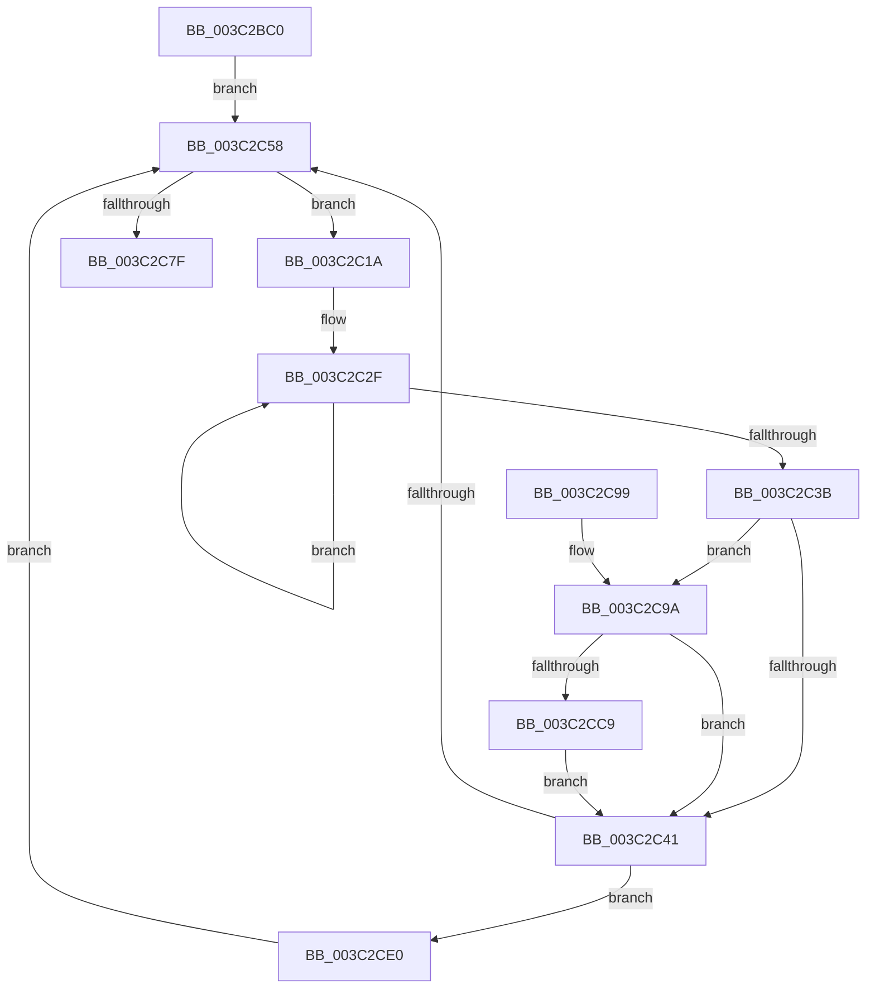

# SmKmStoreHelperWorker

- RVA: `0x003C2BC0`–`0x003C2CF4` (길이 `308` bytes)
- VA: `0x00000001403C2BC0`
- 실행 섹션: `.text`
- PDB 이름 있음: `예`; PDB Function 태그: `아니요`
- unwind 정보 RVA: `0x0008E250`
- 디코드: `83`개 명령, `308/308` bytes 표시
- 미해석 바이트: `0` (있으면 어셈블리에 `.byte`로 보존)

> 이 문서는 커널 이미지의 기계어와 PDB 기호를 분석해 생성했습니다. 4번과 5번은 함수 원형과 자료형을 바이너리 사용 방식에서 추정한 C 해석이며 원본 소스 복구 결과는 아닙니다.

## 1. Dependencies

- 직접 호출 지점: **7**; 고유 호출 대상: **6**
- 직접 호출자로 확인된 함수: **0**
- RIP 상대 이미지 참조: **0**

### Outgoing calls
- `0x003C2BFF` → [KeSetActualBasePriorityThread](KeSetActualBasePriorityThread_function_003C4370.md) (function, `0x003C4370`)
- `0x003C2C23` → [SmKmStoreHelperCommandProcess](SmKmStoreHelperCommandProcess_function_003C3AA4.md) (function, `0x003C3AA4`)
- `0x003C2C4A` → [KeSetEvent](../33/KeSetEvent_function_0033F310.md) (function, `0x0033F310`)
- `0x003C2C69` → [KeWaitForSingleObject](../20/KeWaitForSingleObject_function_0020E6B0.md) (function, `0x0020E6B0`)
- `0x003C2C71` → [KeResetEvent](../24/KeResetEvent_function_00248350.md) (function, `0x00248350`)
- `0x003C2CD3` → [SmKmStoreHelperCommandCleanup](../4D/SmKmStoreHelperCommandCleanup_function_004D03FC.md) (function, `0x004D03FC`)
- `0x003C2CEA` → [SmKmStoreHelperCommandCleanup](../4D/SmKmStoreHelperCommandCleanup_function_004D03FC.md) (function, `0x004D03FC`)

### Direct callers
- 이 함수 시작 RVA로 연결되는 직접 call은 확인되지 않았습니다. 간접 호출은 완전히 역산할 수 없습니다.

### Static image references
- 디코드된 RIP-relative 메모리 참조가 없습니다.

## 2. Other-region calls and transfers

- 다른 실행 섹션으로 향하는 call: **0**
- 별도 외부 분기/꼬리 이동을 확인하지 못했습니다.

## 3. Assembly (complete function range)

```asm
003C2BC0  4C 8B DC                        mov r11, rsp
003C2BC3  49 89 5B 08                     mov qword ptr [r11 + 8], rbx
003C2BC7  49 89 6B 10                     mov qword ptr [r11 + 0x10], rbp
003C2BCB  49 89 73 18                     mov qword ptr [r11 + 0x18], rsi
003C2BCF  57                              push rdi
003C2BD0  41 56                           push r14
003C2BD2  41 57                           push r15
003C2BD4  48 83 EC 70                     sub rsp, 0x70
003C2BD8  0F 57 C0                        xorps xmm0, xmm0
003C2BDB  33 C0                           xor eax, eax
003C2BDD  48 8B F9                        mov rdi, rcx
003C2BE0  65 48 8B 0C 25 88 01 00 00      mov rcx, qword ptr gs:[0x188]
003C2BE9  0F 11 44 24 30                  movups xmmword ptr [rsp + 0x30], xmm0
003C2BEE  0F 11 44 24 40                  movups xmmword ptr [rsp + 0x40], xmm0
003C2BF3  8D 50 19                        lea edx, [rax + 0x19]
003C2BF6  0F 11 44 24 50                  movups xmmword ptr [rsp + 0x50], xmm0
003C2BFB  49 89 43 D8                     mov qword ptr [r11 - 0x28], rax
003C2BFF  E8 6C 17 00 00                  call 0x1403c4370
003C2C04  65 48 8B 04 25 88 01 00 00      mov rax, qword ptr gs:[0x188]
003C2C0D  4C 8D 77 08                     lea r14, [rdi + 8]
003C2C11  83 88 A4 05 00 00 02            or dword ptr [rax + 0x5a4], 2
003C2C18  EB 3E                           jmp 0x1403c2c58
003C2C1A  4C 8D 47 40                     lea r8, [rdi + 0x40]
003C2C1E  8B D6                           mov edx, esi
003C2C20  48 8B CF                        mov rcx, rdi
003C2C23  E8 7C 0E 00 00                  call 0x1403c3aa4
003C2C28  0F 0D 4F 38                     prefetchw byte ptr [rdi + 0x38]
003C2C2C  8B 47 38                        mov eax, dword ptr [rdi + 0x38]
003C2C2F  8B C8                           mov ecx, eax
003C2C31  83 C9 01                        or ecx, 1
003C2C34  F0 0F B1 4F 38                  lock cmpxchg dword ptr [rdi + 0x38], ecx
003C2C39  75 F4                           jne 0x1403c2c2f
003C2C3B  8B D8                           mov ebx, eax
003C2C3D  A8 02                           test al, 2
003C2C3F  75 59                           jne 0x1403c2c9a
003C2C41  45 33 C0                        xor r8d, r8d
003C2C44  48 8D 4F 20                     lea rcx, [rdi + 0x20]
003C2C48  33 D2                           xor edx, edx
003C2C4A  E8 C1 C6 F7 FF                  call 0x14033f310
003C2C4F  F6 C3 02                        test bl, 2
003C2C52  0F 85 88 00 00 00               jne 0x1403c2ce0
003C2C58  48 83 64 24 20 00               and qword ptr [rsp + 0x20], 0
003C2C5E  45 33 C9                        xor r9d, r9d
003C2C61  45 33 C0                        xor r8d, r8d
003C2C64  33 D2                           xor edx, edx
003C2C66  49 8B CE                        mov rcx, r14
003C2C69  E8 42 BA E4 FF                  call 0x14020e6b0
003C2C6E  49 8B CE                        mov rcx, r14
003C2C71  E8 DA 56 E8 FF                  call 0x140248350
003C2C76  0F B7 77 3A                     movzx esi, word ptr [rdi + 0x3a]
003C2C7A  83 FE 01                        cmp esi, 1
003C2C7D  75 9B                           jne 0x1403c2c1a
003C2C7F  4C 8D 5C 24 70                  lea r11, [rsp + 0x70]
003C2C84  49 8B 5B 20                     mov rbx, qword ptr [r11 + 0x20]
003C2C88  49 8B 6B 28                     mov rbp, qword ptr [r11 + 0x28]
003C2C8C  49 8B 73 30                     mov rsi, qword ptr [r11 + 0x30]
003C2C90  49 8B E3                        mov rsp, r11
003C2C93  41 5F                           pop r15
003C2C95  41 5E                           pop r14
003C2C97  5F                              pop rdi
003C2C98  C3                              ret
003C2C99  CC                              int3
003C2C9A  0F 10 47 40                     movups xmm0, xmmword ptr [rdi + 0x40]
003C2C9E  0F 10 4F 50                     movups xmm1, xmmword ptr [rdi + 0x50]
003C2CA2  0F 11 44 24 30                  movups xmmword ptr [rsp + 0x30], xmm0
003C2CA7  0F 10 47 60                     movups xmm0, xmmword ptr [rdi + 0x60]
003C2CAB  0F 11 4C 24 40                  movups xmmword ptr [rsp + 0x40], xmm1
003C2CB0  F2 0F 10 4F 70                  movsd xmm1, qword ptr [rdi + 0x70]
003C2CB5  F2 0F 11 4C 24 60               movsd qword ptr [rsp + 0x60], xmm1
003C2CBB  0F 11 44 24 50                  movups xmmword ptr [rsp + 0x50], xmm0
003C2CC0  83 FE 04                        cmp esi, 4
003C2CC3  0F 85 78 FF FF FF               jne 0x1403c2c41
003C2CC9  4C 8D 44 24 30                  lea r8, [rsp + 0x30]
003C2CCE  8B D6                           mov edx, esi
003C2CD0  48 8B CF                        mov rcx, rdi
003C2CD3  E8 24 D7 10 00                  call 0x1404d03fc
003C2CD8  83 E3 FD                        and ebx, 0xfffffffd
003C2CDB  E9 61 FF FF FF                  jmp 0x1403c2c41
003C2CE0  4C 8D 44 24 30                  lea r8, [rsp + 0x30]
003C2CE5  8B D6                           mov edx, esi
003C2CE7  48 8B CF                        mov rcx, rdi
003C2CEA  E8 0D D7 10 00                  call 0x1404d03fc
003C2CEF  E9 64 FF FF FF                  jmp 0x1403c2c58
```

## 4. C-style interpretation (structured pseudocode)

```c
__int64 __fastcall SmKmStoreHelperWorker(__int64 a1, __int64 a2, __int64 a3, int a4)
{
    __int64 result;
    __int64 v_rbx;
    __int64 v_rsp;
    unsigned __int64 v_stack_m10;
    unsigned __int64 v_stack_m18;
    unsigned __int64 v_stack_m20;
    unsigned __int64 v_stack_m30;
    unsigned __int64 v_stack_m38;
    unsigned __int64 v_stack_m40;
    unsigned __int64 v_stack_m48;
    unsigned __int64 v_stack_m58;
    unsigned __int64 v_stack_m68;

    *(unsigned __int64 *)(v_rsp + 8) = v_rbx;
    *(unsigned __int64 *)(v_rsp + 16) = v_rbp;
    *(unsigned __int64 *)(v_rsp + 24) = v_rsi;
    v_rsp = (v_rsp) - (112);
    result = 0;
    v_stack_m58 = v_xmm0;
    v_stack_m48 = v_xmm0;
    v_stack_m38 = v_xmm0;
    *(unsigned __int64 *)(v_rsp - 40) = 0;
    result = KeSetActualBasePriorityThread(*(unsigned __int64 *)(gs_base + (0 + 392)), result + 25, a3, a4);
    goto loc_003C2C58;
loc_003C2C1A:
    result = SmKmStoreHelperCommandProcess(a1, (unsigned int)((unsigned int)(v_rsi)), a1 + 64, a4);
loc_003C2C2F:
    a1 = (unsigned int)(((unsigned int)((unsigned int)((unsigned int)(*(unsigned int *)(a1 + 56))))) | (1));
    if (condition_is_not_equal) goto loc_003C2C2F;
    if ((((unsigned __int8)((unsigned int)(*(unsigned int *)(a1 + 56)))) & (2)) != 0) goto loc_003C2C9A;
loc_003C2C41:
    a3 = 0;
    a2 = 0;
    result = KeSetEvent(a1 + 32, a2, a3, a4);
    if ((((unsigned __int8)((unsigned int)((unsigned int)((unsigned int)(*(unsigned int *)(a1 + 56)))))) & (2)) != 0) goto loc_003C2CE0;
loc_003C2C58:
    a4 = 0;
    a3 = 0;
    a2 = 0;
    result = KeWaitForSingleObject(a1 + 8, a2, a3, a4);
    result = KeResetEvent(a1 + 8, a2, a3, a4);
    if (((unsigned int)(*(unsigned __int16 *)(a1 + 58))) != 1) goto loc_003C2C1A;
    return result;
loc_003C2C9A:
    v_stack_m40 = v_xmm0;
    v_stack_m30 = v_xmm1;
    v_stack_m10 = v_xmm1;
    v_stack_m20 = v_xmm0;
    if (((unsigned int)(*(unsigned __int64 *)(v_stack_m18 + 48))) != 4) goto loc_003C2C41;
    result = SmKmStoreHelperCommandCleanup(a1, (unsigned int)((unsigned int)(*(unsigned __int64 *)(v_stack_m18 + 48))), v_stack_m40, a4);
    v_rbx = (unsigned int)((*(unsigned __int64 *)(v_stack_m18 + 32)) & (0xFFFFFFFDULL));
    goto loc_003C2C41;
loc_003C2CE0:
    result = SmKmStoreHelperCommandCleanup(a1, (unsigned int)((unsigned int)(*(unsigned __int64 *)(v_stack_m18 + 48))), v_stack_m40, a4);
    goto loc_003C2C58;
}
```

## 5. (Beta) C Style

```c
int64_t SmKmStoreHelperWorker(void *Arg1, int64_t Arg2, int64_t Arg3, int32_t Arg4)
{
    uint8_t *arg1 = (uint8_t *)Arg1;

    int64_t result;
    int64_t local_rbx;
    int64_t local_rsp;
    uint64_t v_stack_m10;
    uint64_t v_stack_m18;
    uint64_t v_stack_m20;
    uint64_t v_stack_m30;
    uint64_t v_stack_m38;
    uint64_t v_stack_m40;
    uint64_t v_stack_m48;
    uint64_t v_stack_m58;
    uint64_t v_stack_m68;

    *(uint64_t *)(local_rsp + 0x8) = local_rbx;
    *(uint64_t *)(local_rsp + 0x10) = local_rbp;
    *(uint64_t *)(local_rsp + 0x18) = local_rsi;
    local_rsp = (local_rsp) - (112);
    result = 0;
    v_stack_m58 = v_xmm0;
    v_stack_m48 = v_xmm0;
    v_stack_m38 = v_xmm0;
    *(uint64_t *)(local_rsp - 0x28) = 0;
    result = KeSetActualBasePriorityThread(*(uint64_t *)(gs_base + (0 + 0x188)), result + 25, Arg3, Arg4);
    goto loc_003C2C58;
loc_003C2C1A:
    result = SmKmStoreHelperCommandProcess(Arg1, (uint32_t)((uint32_t)(local_rsi)), Arg1 + 64, Arg4);
loc_003C2C2F:
    Arg1 = (uint32_t)(((uint32_t)((uint32_t)((uint32_t)(*(uint32_t *)(arg1 + 0x38))))) | (1));
    if (condition_is_not_equal) goto loc_003C2C2F;
    if ((((uint8_t)((uint32_t)(*(uint32_t *)(arg1 + 0x38)))) & (2)) != 0) goto loc_003C2C9A;
loc_003C2C41:
    Arg3 = 0;
    Arg2 = 0;
    result = KeSetEvent(Arg1 + 32, Arg2, Arg3, Arg4);
    if ((((uint8_t)((uint32_t)((uint32_t)((uint32_t)(*(uint32_t *)(arg1 + 0x38)))))) & (2)) != 0) goto loc_003C2CE0;
loc_003C2C58:
    Arg4 = 0;
    Arg3 = 0;
    Arg2 = 0;
    result = KeWaitForSingleObject(Arg1 + 8, Arg2, Arg3, Arg4);
    result = KeResetEvent(Arg1 + 8, Arg2, Arg3, Arg4);
    if (((uint32_t)(*(uint16_t *)(arg1 + 0x3A))) != 1) goto loc_003C2C1A;
    return result;
loc_003C2C9A:
    v_stack_m40 = v_xmm0;
    v_stack_m30 = v_xmm1;
    v_stack_m10 = v_xmm1;
    v_stack_m20 = v_xmm0;
    if (((uint32_t)(*(uint64_t *)(v_stack_m18 + 0x30))) != 4) goto loc_003C2C41;
    result = SmKmStoreHelperCommandCleanup(Arg1, (uint32_t)((uint32_t)(*(uint64_t *)(v_stack_m18 + 0x30))), v_stack_m40, Arg4);
    local_rbx = (uint32_t)((*(uint64_t *)(v_stack_m18 + 0x20)) & (0xFFFFFFFDULL));
    goto loc_003C2C41;
loc_003C2CE0:
    result = SmKmStoreHelperCommandCleanup(Arg1, (uint32_t)((uint32_t)(*(uint64_t *)(v_stack_m18 + 0x30))), v_stack_m40, Arg4);
    goto loc_003C2C58;
}
```

### 관측된 메모리 오프셋

구조체 형식이 확인되지 않은 접근은 인자 기준의 오프셋으로만 기록했습니다.

| 기준 인자 | 오프셋 표현 | 폭 (bit) | 접근 |
|---|---:|---:|---|
| `Arg1` | `+ 0x8` | `64` | `R` |
| `Arg1` | `+ 0x20` | `64` | `R` |
| `Arg1` | `+ 0x38` | `8` | `R` |
| `Arg1` | `+ 0x38` | `32` | `R` |
| `Arg1` | `+ 0x3A` | `16` | `R` |
| `Arg1` | `+ 0x40` | `64` | `R` |
| `Arg1` | `+ 0x40` | `128` | `R` |
| `Arg1` | `+ 0x50` | `128` | `R` |
| `Arg1` | `+ 0x60` | `128` | `R` |
| `Arg1` | `+ 0x70` | `64` | `R` |

## 6. Execution-region graph

[열기: 2D/3D 그래프와 함수 탐색 컨트롤 패널](../../../control-panel.html?section=text&rva=0x003C2BC0&view=graph)

- 2D 그래프는 위에서 아래로 흐르고, 3D 그래프는 빈 공간을 드래그해 회전합니다. Shift+드래그는 이동, 휠은 확대·축소, 함수 노드 선택은 대상 보고서 이동입니다.

### Static fallback


